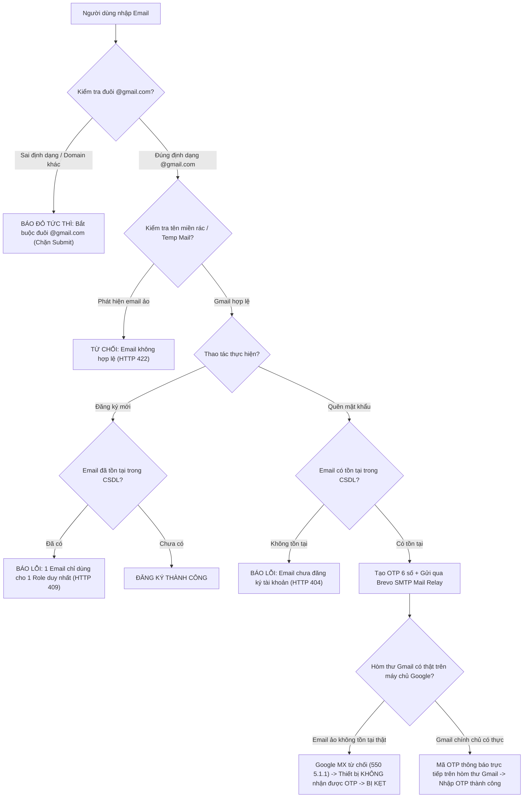
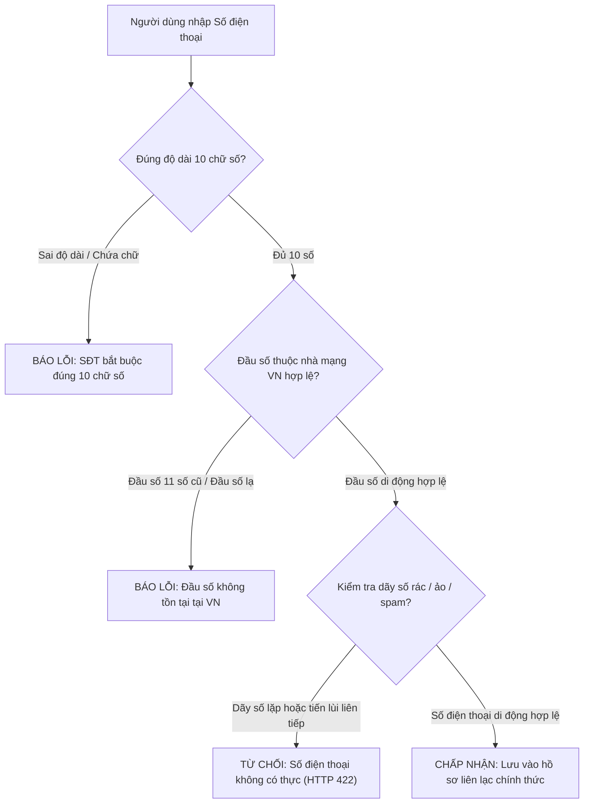
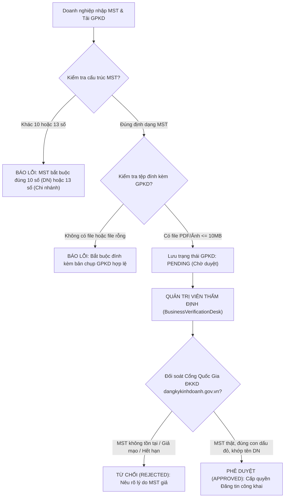

# TÀI LIỆU QUY TẮC NGHIỆP VỤ & TOÀN BỘ ĐIỀU KIỆN RÀNG BUỘC HỆ THỐNG (BUSINESS RULES & TEST CONDITIONS)
## NỀN TẢNG TUYỂN DỤNG PARTIME.VN (CDTN02) - ĐH VĂN LANG
> **Phiên bản:** 3.5 - Toàn diện Ràng Buộc Dữ Liệu Thực Tế, Chống Dữ Liệu Ảo (Email, SĐT, MST, CCCD, GPKD), Digital Light Dimension & Clean Architecture  
> **Cơ sở dữ liệu:** MongoDB Atlas Cloud `CDTN02_DB` (Tập hợp 16 Collections độc lập & liên kết)  
> **Phân hệ thực hiện:**
> - **Phân hệ Sinh viên (Student Portal):** Vũ Thế Long (WBS 1.1 đến 1.10)
> - **Phân hệ Nhà tuyển dụng (Employer Portal):** Huỳnh Nguyễn Bảo Ngọc (WBS 2.1 đến 2.9)
> - **Phân hệ Quản trị viên (Admin Portal):** Lê Thị Thuỳ Ngân (WBS 3.1 đến 3.9)
> - **Phân hệ Dùng chung & Xác thực (Shared & Auth Platform):** Nhóm tác giả thống nhất

---

## MỤC LỤC
1. [Phần 1: Hệ Thống Mã Số Chức Năng (FR Gốc vs Bổ Sung Ngoài FR)](#phần-1-hệ-thống-mã-số-chức-năng-fr-gốc-vs-bổ-sung-ngoài-fr)
2. [Phần 2: Ràng Buộc Dữ Liệu Thực Tế & Cơ Chế Bài Trừ Dữ Liệu Ảo Toàn Website](#phần-2-ràng-buộc-dữ-liệu-thực-tế--cơ-chế-bài-trừ-dữ-liệu-ảo-toàn-website)
   - 2.1. Ràng buộc Gmail thật (`@gmail.com`), chống Email ảo & Cơ chế OTP 10 phút
   - 2.2. Ràng buộc Số điện thoại thật Việt Nam (10 số), chống SĐT ảo & rác
   - 2.3. Ràng buộc Mã số thuế (MST) thật & Giấy phép kinh doanh (GPKD) pháp lý
   - 2.4. Ràng buộc Danh tính Họ tên thật, MSSV & Trường Đại học
   - 2.5. Ràng buộc Địa chỉ thật, 24 Quận Huyện TP.HCM & Địa điểm làm việc
   - 2.6. Ràng buộc Mức lương & Ca làm việc theo Luật Lao động
   - 2.7. Ràng buộc Bộ lọc từ khóa cấm & Kiểm duyệt giao tiếp thời gian thực
   - 2.8. Ràng buộc Chế độ xem trước khách (Guest Preview Mode)
   - 2.9. Ràng buộc Điều hướng bằng Logo 3D & Loại bỏ nút quay lại trang
   - 2.10. Ràng buộc Bảng màu 8 cột Digital Light Dimension & 100% Lucide Icons
   - 2.11. Ràng buộc Cơ chế Xóa vĩnh viễn (Cascade Delete) & Toàn vẹn CSDL
   - 2.12. Ràng buộc Trung tâm chỉ huy Analytics Dashboard (2 cột, CSDL 2026 100% thật)
3. [Phần 3: Ma Trận Điều Kiện Ràng Buộc & Điều Kiện Kiểm Thử Từng Phân Hệ](#phần-3-ma-trận-điều-kiện-ràng-buộc--điều-kiện-kiểm-thử-từng-phân-hệ)
   - 3.1. Phân hệ Xác thực & Cổng Dùng Chung
   - 3.2. Phân hệ Sinh viên (Student Portal)
   - 3.3. Phân hệ Nhà tuyển dụng (Employer Portal)
   - 3.4. Phân hệ Quản trị viên (Admin Portal)
4. [Phần 4: Ma Trận 16 Collections MongoDB Atlas & Ràng Buộc Toàn Vẹn CSDL](#phần-4-ma-trận-16-collections-mongodb-atlas--ràng-buộc-toàn-vẹn-csdl)
5. [Phần 5: Hướng Dẫn Kiểm Thử Nhanh Dành Cho Tester & Developer](#phần-5-hướng-dẫn-kiểm-thử-nhanh-dành-cho-tester--developer)

---

## PHẦN 1: HỆ THỐNG MÃ SỐ CHỨC NĂNG (FR GỐC VS BỔ SUNG NGOÀI FR)

Để phân định ranh giới rõ ràng cho Developer khi lập trình và Tester khi viết kịch bản kiểm thử:
- **`[FR GỐC]`**: Các chức năng quy chuẩn nằm trong cây phân rã công việc ban đầu (WBS02 & Bộ 126 FRs).
- **`[BỔ SUNG MỚI]`**: Các tính năng cải tiến nâng cao được bổ sung từ bên ngoài FR nhằm giải quyết các bài toán bảo mật thực tế, công thái học thị giác chống mỏi mắt và tính toàn vẹn dữ liệu.

### 1.1. Bảng Phân Hệ Sinh Viên (Student Portal - Vũ Thế Long)

| Mã Chức Năng | Tên Chức Năng / Tính Năng | Phân Loại | Giao Diện Đảm Nhiệm | API Endpoint Phụ Trách |
| :---: | :--- | :---: | :--- | :--- |
| **FR-STU-01** | Đăng ký tài khoản Sinh viên | **`[FR GỐC]`** | `StudentRegisterScreen.jsx` | `POST /api/auth/register` |
| **FR-STU-02** | Đăng nhập & Đổi mật khẩu | **`[FR GỐC]`** | `StudentLoginScreen.jsx` | `POST /api/auth/login` |
| **FR-STU-03** | Quản lý Hồ sơ cá nhân (Bio, SĐT, Trường) | **`[FR GỐC]`** | `StudentProfile.jsx` | `GET/PUT /api/student/profile` |
| **FR-STU-04** | Quản lý bản CV PDF (Tối đa 5 CV, 1 mặc định) | **`[FR GỐC]`** | `CVManager.jsx` | `POST/GET/DELETE /api/student/resumes` |
| **FR-STU-05** | Tìm kiếm & Lọc việc làm theo 24 Quận, Lương, Ca | **`[FR GỐC]`** | `JobList.jsx` | `GET /api/common/jobs` |
| **FR-STU-06** | Lưu việc làm yêu thích (Bookmarks) | **`[FR GỐC]`** | `JobList.jsx` | `POST/DELETE /api/student/bookmarks` |
| **FR-STU-07** | Nộp hồ sơ & Chụp Snapshot bất biến | **`[FR GỐC]`** | `JobDetailModal.jsx` | `POST /api/student/apply` |
| **FR-STU-08** | Theo dõi tiến độ ứng tuyển (ATS 4 chặng) | **`[FR GỐC]`** | `ApplicationTracker.jsx` | `GET /api/student/applications` |
| **FR-STU-09** | Đánh giá Nhà tuyển dụng 2 chiều (1-5 sao) | **`[FR GỐC]`** | `StudentReviewModal.jsx` | `POST /api/student/reviews` |
| **FR-STU-10** | Nhắn tin thời gian thực & Phỏng vấn WebRTC | **`[FR GỐC]`** | `StudentChat.jsx`, `StudentVideoCall.jsx` | `POST /api/chat/...`, Socket.IO |
| **E-STU-01** | **Chế độ xem trước khách (Guest Preview Mode)** | **`[BỔ SUNG MỚI]`** | `StudentPortal.jsx` | Tự động ẩn số liệu khi chưa đăng nhập |
| **E-STU-02** | **Quay về trang khách bằng click Logo 3D** | **`[BỔ SUNG MỚI]`** | `Header.jsx`, `App.jsx` | Click Logo chuyển về chế độ khách |
| **E-STU-03** | **Kéo thả CV trực tiếp (Drag & Drop)** | **`[BỔ SUNG MỚI]`** | `CVManager.jsx` | Thao tác thả file PDF từ Desktop |
| **E-STU-04** | **Xem trước PDF toàn màn hình (`DocumentViewerModal`)** | **`[BỔ SUNG MỚI]`** | `DocumentViewerModal.jsx` | Iframe xem CV kèm nút tải về |
| **E-STU-05** | **Cơ chế Xóa vĩnh viễn (Cascade Delete)** | **`[BỔ SUNG MỚI]`** | `StudentPortal.jsx` | Đồng bộ CSDL MongoDB, duy trì sau F5 |

---

### 1.2. Bảng Phân Hệ Nhà Tuyển Dụng (Employer Portal - Huỳnh Nguyễn Bảo Ngọc)

| Mã Chức Năng | Tên Chức Năng / Tính Năng | Phân Loại | Giao Diện Đảm Nhiệm | API Endpoint Phụ Trách |
| :---: | :--- | :---: | :--- | :--- |
| **FR-EMP-01** | Đăng ký doanh nghiệp & Kéo thả GPKD | **`[FR GỐC]`** | `EmployerRegisterScreen.jsx` | `POST /api/auth/register` |
| **FR-EMP-02** | Định danh pháp lý & Chờ duyệt GPKD | **`[FR GỐC]`** | `CompanyProfile.jsx` | `GET /api/employer/profile` |
| **FR-EMP-03** | Cập nhật hồ sơ công ty, chi nhánh, logo | **`[FR GỐC]`** | `CompanyProfile.jsx` | `PUT /api/employer/profile` |
| **FR-EMP-04** | Studio soạn thảo & Đăng tin tuyển dụng | **`[FR GỐC]`** | `JobPostingStudio.jsx` | `POST /api/employer/jobs` |
| **FR-EMP-05** | Quản lý tin tuyển dụng & Đóng/Mở tin | **`[FR GỐC]`** | `JobLifecycleManager.jsx` | `GET/PUT /api/employer/jobs` |
| **FR-EMP-06** | ATS Quản lý ứng viên & Đổi 4 trạng thái | **`[FR GỐC]`** | `CandidateATS.jsx` | `GET/PUT /api/employer/applications` |
| **FR-EMP-07** | Lên lịch phỏng vấn & Mời video WebRTC | **`[FR GỐC]`** | `InterviewSchedulerModal.jsx` | `POST /api/employer/interviews` |
| **FR-EMP-08** | Đánh giá năng lực sinh viên sau làm việc | **`[FR GỐC]`** | `EmployerReview.jsx` | `POST /api/employer/reviews` |
| **FR-EMP-09** | Phòng Chat trao đổi & Phỏng vấn video | **`[FR GỐC]`** | `EmployerChat.jsx`, `EmployerVideoCall.jsx` | Socket.IO, WebRTC |
| **E-EMP-01** | **Chế độ xem trước khách (Guest Preview Mode)** | **`[BỔ SUNG MỚI]`** | `EmployerPortal.jsx` | Ẩn số liệu & GPKD của doanh nghiệp |
| **E-EMP-02** | **Quay về trang khách bằng click Logo 3D** | **`[BỔ SUNG MỚI]`** | `Header.jsx`, `App.jsx` | Click Logo chuyển về chế độ khách |
| **E-EMP-03** | **Kéo thả GPKD, Logo, Ảnh bìa (Drag & Drop)** | **`[BỔ SUNG MỚI]`** | `CompanyProfile.jsx` | Hỗ trợ thả file PDF/Ảnh <= 10MB |
| **E-EMP-04** | **Xem trước GPKD đã tải (`DocumentViewerModal`)** | **`[BỔ SUNG MỚI]`** | `DocumentViewerModal.jsx` | Xem trực tiếp giấy phép pháp lý |
| **E-EMP-05** | **Cơ chế Xóa vĩnh viễn (Cascade Delete) Tin đăng** | **`[BỔ SUNG MỚI]`** | `EmployerPortal.jsx` | Xóa sạch bản ghi liên quan trong CSDL |

---

### 1.3. Bảng Phân Hệ Quản Trị Viên (Admin Portal - Lê Thị Thuỳ Ngân)

| Mã Chức Năng | Tên Chức Năng / Tính Năng | Phân Loại | Giao Diện Đảm Nhiệm | API Endpoint Phụ Trách |
| :---: | :--- | :---: | :--- | :--- |
| **FR-ADM-01** | Đăng nhập tài khoản cố định bảo mật | **`[FR GỐC]`** | `AdminLoginScreen.jsx` | `POST /api/auth/login` |
| **FR-ADM-02** | Bảng điều khiển phân tích tăng trưởng | **`[FR GỐC]`** | `AnalyticsDashboard.jsx` | `GET /api/admin/analytics` |
| **FR-ADM-03** | Quản lý người dùng, Khóa/Mở có lý do | **`[FR GỐC]`** | `UserManagement.jsx` | `GET/PUT /api/admin/users/ban` |
| **FR-ADM-04** | Thẩm định doanh nghiệp & Phê duyệt GPKD | **`[FR GỐC]`** | `BusinessVerificationDesk.jsx` | `GET/PUT /api/admin/employers/verify`|
| **FR-ADM-05** | Kiểm duyệt tin toàn sàn & Ẩn tin vi phạm | **`[FR GỐC]`** | `JobModeration.jsx` | `GET/PUT /api/admin/jobs/hide` |
| **FR-ADM-06** | Quản trị Master Data ngành nghề | **`[FR GỐC]`** | `CategoryManager.jsx` | `GET/POST/PUT /api/admin/categories` |
| **FR-ADM-07** | Bàn xử lý khiếu nại báo cáo vi phạm | **`[FR GỐC]`** | `ReportsResolutionDesk.jsx` | `GET/PUT /api/admin/reports` |
| **FR-ADM-08** | Quản trị bộ lọc từ khóa cấm realtime | **`[FR GỐC]`** | `BannedKeywordsManager.jsx` | `GET/POST/DELETE /api/admin/keywords`|
| **FR-ADM-09** | Xuất báo cáo tổng kết Excel/CSV | **`[FR GỐC]`** | `AnalyticsDashboard.jsx` | Xuất file thống kê phục vụ chấm thi |
| **E-ADM-01** | **Bộ lọc 2 cột Năm - Tháng & Khoảng ngày** | **`[BỔ SUNG MỚI]`** | `AdminPortal.jsx` | Loại bỏ nút tuần, chọn khoảng ngày |
| **E-ADM-02** | **Dữ liệu lịch sử 2024-2025 & 100% CSDL 2026** | **`[BỔ SUNG MỚI]`** | `historicalAnalyticsData.js` | 2026 cam kết 100% CSDL thực tế |
| **E-ADM-03** | **Cố định khung biểu đồ chống giật rung** | **`[BỔ SUNG MỚI]`** | `AdminPortal.jsx` | Line Chart không rung, Donut chữ đen |
| **E-ADM-04** | **Cơ chế Xóa vĩnh viễn User rác (`eadeedc@gmail.com`)**| **`[BỔ SUNG MỚI]`** | `admin_routes.py`, `AdminPortal.jsx`| Xóa sạch tài khoản và quan hệ CSDL |
| **E-ADM-05** | **Chặn Xóa Cứng Master Data (Restrict Delete)** | **`[BỔ SUNG MỚI]`** | `admin_routes.py` | Chặn xóa danh mục nếu đang có việc làm |

---

### 1.4. Bảng Xác Thực & Dùng Chung (Shared Platform)

| Mã Chức Năng | Tên Chức Năng / Tính Năng | Phân Loại | Giao Diện Đảm Nhiệm | API Endpoint Phụ Trách |
| :---: | :--- | :---: | :--- | :--- |
| **FR-AUTH-01**| Ràng buộc 1 Email = 1 Role duy nhất | **`[FR GỐC]`** | `auth_middleware.py`, Forms | Chặn đăng ký chéo role (HTTP 409) |
| **FR-AUTH-02**| Mã OTP 10 phút gửi qua SMTP Brevo | **`[FR GỐC]`** | `ForgotPasswordScreen.jsx` | `POST /api/auth/forgot-password` |
| **FR-AUTH-03**| Định danh JWT không trạng thái (24h) | **`[FR GỐC]`** | `security.py`, `auth_middleware.py`| Cấp token chứa User ID và Role |
| **FR-AUTH-04**| Zero Native Dialogs (`<ConfirmDialog>`) | **`[FR GỐC]`** | `ConfirmDialog.jsx` | Thay thế 100% `window.alert/confirm` |
| **FR-AUTH-05**| Responsive đa thiết bị (PC, Laptop, iPad, Mobile) | **`[FR GỐC]`** | `App.jsx`, `Header.jsx`, `Footer.jsx`| Layout co giãn linh hoạt |
| **E-AUTH-01** | **Bắt buộc Gmail thật đuôi `@gmail.com`** | **`[BỔ SUNG MỚI]`** | `LoginScreen.jsx`, `RegisterScreen.jsx`| Lọc và loại bỏ 100% email ảo |
| **E-AUTH-02** | **Nút Tự động điền OTP (Hands-Free Auto-fill)**| **`[BỔ SUNG MỚI]`** | `ForgotPasswordScreen.jsx` | Hỗ trợ điền nhanh OTP khi kiểm thử |
| **E-AUTH-03** | **Bảng màu 8 cột Digital Light Dimension** | **`[BỔ SUNG MỚI]`** | `tailwind.config.js`, `index.css` | Công thái học chống mỏi mắt |
| **E-AUTH-04** | **Chuẩn hóa 100% Vector Icon Lucide (0 Emoji/AI)**| **`[BỔ SUNG MỚI]`** | Toàn bộ giao diện 3 Role | Bài trừ toàn bộ emoji và icon AI |
| **E-AUTH-05** | **Khởi chạy hợp nhất cổng 8002 (Unified Runner)**| **`[BỔ SUNG MỚI]`** | `run.py`, `run.bat` | Phục vụ cả UI và API trên cổng 8002 |

---

## PHẦN 2: RÀNG BUỘC DỮ LIỆU THỰC TẾ & CƠ CHẾ BÀI TRỪ DỮ LIỆU ẢO TOÀN WEBSITE

Một trong những tiêu chí kiểm định nghiêm ngặt nhất của hệ thống CDTN02 là: **Tuyệt đối không sử dụng dữ liệu ảo, giả định hoặc dữ liệu rác**. Toàn bộ các thực thể thông tin nhập vào hệ thống đều phải tuân thủ điều kiện thực tế của Việt Nam:

---

### 2.1. Ràng Buộc Gmail Thật (`@gmail.com`), Chống Email Ảo & Cơ Chế OTP

#### Quy tắc kỹ thuật chi tiết:
1. **Ép buộc định dạng Gmail thật (`@gmail.com`):**
   - Biểu thức chính quy: `^[a-zA-Z0-9_.+-]+@gmail\.com$`
   - Tên người dùng phía trước `@gmail.com` phải dài từ 6 đến 30 ký tự, chỉ bao gồm chữ cái (`a-z`, `A-Z`), chữ số (`0-9`) và dấu chấm (`.`). Không được có hai dấu chấm liên tiếp (`..`).
   - Nếu người dùng nhập tên miền khác (như `@yahoo.com`, `@hotmail.com`, `@tempmail.net`): Ô nhập liệu đổi viền đỏ ngay lập tức, hiển thị câu cảnh báo: *"Email bắt buộc phải có đuôi @gmail.com chính thức. Hệ thống không chấp nhận các dịch vụ thư điện tử tạm thời."* và vô hiệu hóa nút submit.
2. **Chặn 100% Email ảo và Hòm thư tạm thời (Anti-Disposable Email):**
   - Hệ thống đối soát với danh sách đen các domain dịch vụ email tạm thời (`mailinator.com`, `guerrillamail.com`, `10minutemail.com`, `temp-mail.org`, `throwawaymail.com`...). Bất kỳ nỗ lực nào sử dụng domain rác đều bị ngắt luồng tại API Middleware với mã lỗi HTTP `422 Unprocessable Entity`.
3. **Cơ chế xác thực hòm thư thật khi Quên Mật Khẩu & Hậu quả của Email ảo:**
   - Khi thực hiện Quên mật khẩu, hệ thống kiểm tra sự tồn tại của email trong CSDL:
     - Nếu không tồn tại: Trả về HTTP `404 Not Found` kèm thông báo *"Địa chỉ email này chưa được đăng ký trong hệ thống. Vui lòng kiểm tra lại."*
     - Nếu tồn tại: Tạo mã OTP 6 số ngẫu nhiên có hạn dùng 600 giây (10 phút) và chuyển tiếp qua máy chủ SMTP Brevo gửi đến Google Mail.
   - **Hậu quả khi dùng Email ảo:** Nếu người dùng đăng ký bằng một địa chỉ Gmail bịa đặt không có thực trên máy chủ Google (ví dụ: `nguyenvana_ao_tuong_12345@gmail.com`), Google MX Server sẽ lập tức trả về lỗi `550-5.1.1 The email account that you tried to reach does not exist`. **Mã OTP sẽ vĩnh viễn không thể gửi về điện thoại hay máy tính của người dùng.** Do đó người dùng sẽ bị kẹt lại tại bước xác thực OTP và mất quyền truy cập tài khoản vĩnh viễn. Ràng buộc này bắt buộc người dùng phải sử dụng Gmail thật của chính mình.
   - **Cơ chế Hands-Free Auto-fill dành cho Kiểm thử (Tester Support):** Để hỗ trợ quá trình kiểm thử nội bộ diễn ra nhanh chóng, giao diện hiển thị banner giả lập mã OTP kèm **nút "Tự động điền"**. Khi bấm nút, 6 ô số tự động nhận diện và điền mã mà không cần mở ứng dụng Gmail.

---

### 2.2. Ràng Buộc Số Điện Thoại Thật (Việt Nam 10 Số), Chống SĐT Ảo & Rác

Số điện thoại là kênh liên lạc sống còn trong quá trình tuyển dụng part-time để Nhà tuyển dụng gọi điện hẹn lịch phỏng vấn, báo ca làm hoặc xử lý các sự cố khẩn cấp.

#### Quy tắc kỹ thuật chi tiết:
1. **Định dạng số điện thoại di động Việt Nam:**
   - Biểu thức chính quy (Regex): `^(03|05|07|08|09)[0-9]{8}$`
   - Độ dài bắt buộc: **Đúng 10 chữ số**. Tuyệt đối không cho phép 9 số hoặc 11 số.
   - Danh mục đầu số hợp lệ của các nhà mạng viễn thông quốc gia Việt Nam:
     - **Viettel:** `086`, `096`, `097`, `098`, `032`, `033`, `034`, `035`, `036`, `037`, `038`, `039`.
     - **Mobifone:** `089`, `090`, `093`, `070`, `079`, `077`, `076`, `078`.
     - **Vinaphone:** `088`, `091`, `094`, `083`, `084`, `085`, `081`, `082`.
     - **Vietnamobile:** `092`, `056`, `058`.
     - **Gmobile:** `099`, `059`.
2. **Thuật toán nhận diện & Loại bỏ SĐT Ảo / Rác / Giả Lập:**
   - **Chặn các đầu số 11 số cũ đã bị thu hồi:** Toàn bộ các đầu số 11 số cũ từ cuộc quy hoạch viễn thông năm 2018 (như `0168`, `0169`, `0120`, `0121`, `0122`, `0126`, `0128`, `0123`, `0124`, `0125`...) đều bị hệ thống chặn đứng với thông báo: *"Đầu số 11 số cũ đã ngưng hoạt động. Vui lòng cập nhật đầu số 10 số mới."*
   - **Chặn các dãy số spam đơn điệu (Monotonous Repetition):** Chặn các số có 7 chữ số cuối trùng nhau (ví dụ: `0900000000`, `0911111111`, `0988888888`, `0000000000`, `0999999999`).
   - **Chặn dãy số tiến/lùi tự nhiên (Sequential Spam):** Chặn các chuỗi số giả lập `0123456789`, `0987654321`.
   - **Chặn số điện thoại cố định bàn:** Không chấp nhận số điện thoại bàn có mã vùng tỉnh (`028...`, `024...`) trong hồ sơ sinh viên tìm việc, bắt buộc phải là số di động cá nhân có thể nhận cuộc gọi và tin nhắn SMS.
3. **Hậu quả nghiệp vụ khi cố tình khai báo SĐT Ảo:**
   - Khi Nhà tuyển dụng tiếp nhận hồ sơ ứng viên và tiến hành gọi điện mời phỏng vấn hoặc xác nhận nhận ca:
     - Nếu số điện thoại là ảo/không có thực, tổng đài viễn thông sẽ thông báo: *"Thuê bao quý khách vừa gọi không đúng hoặc không có thực"*.
     - Nhà tuyển dụng sẽ lập tức bấm **Từ chối hồ sơ (`rejected`)** với lý do *"Không thể liên lạc được qua số điện thoại cung cấp"*, đồng thời có quyền gửi Báo cáo vi phạm (Report) lên Ban Quản trị viên vì hành vi cung cấp thông tin liên lạc giả mạo.

---

### 2.3. Ràng Buộc Mã Số Thuế (MST) Thật & Giấy Phép Kinh Doanh (GPKD) Doanh Nghiệp

Để triệt phá hoàn toàn tình trạng các cơ sở đa cấp, các tổ chức lừa đảo đặt cọc lập tài khoản ảo để giăng bẫy sinh viên, toàn bộ Nhà tuyển dụng khi tham gia sàn bắt buộc phải chứng minh tư cách pháp nhân thực tế:

#### Quy tắc kỹ thuật chi tiết:
1. **Quy chuẩn Mã số thuế (MST) Việt Nam:**
   - **Doanh nghiệp / Công ty độc lập:** Bắt buộc đúng **10 chữ số** (Regex: `^[0-9]{10}$`).
   - **Chi nhánh / Hộ kinh doanh cá thể:** Bắt buộc đúng **13 ký tự** gồm 10 số, dấu gạch nối và 3 số chi nhánh (Regex: `^[0-9]{10}-[0-9]{3}$` hoặc 13 số liền nhau `^[0-9]{13}$`).
   - **Chặn MST rác / giả định:** Tuyệt đối chặn các chuỗi MST bịa đặt như `0000000000`, `1234567890`, `0101010101`.
2. **Quy chuẩn Tệp Giấy Phép Kinh Doanh (GPKD):**
   - Định dạng chấp nhận: `.pdf` (khuyến nghị), `.png`, `.jpg`, `.jpeg`.
   - Dung lượng tối đa: **10MB (10,485,760 bytes)**.
   - Hỗ trợ thao tác **Kéo thả trực tiếp (Drag & Drop)** từ màn hình máy tính vào trình duyệt.
   - Bản chụp GPKD phải rõ nét, hiển thị đầy đủ: Tên doanh nghiệp, Mã số doanh nghiệp/MST, Địa chỉ trụ sở, Họ tên người đại diện pháp luật và con dấu mộc đỏ của Sở Kế hoạch & Đầu tư.
3. **Quy trình thẩm định và đối soát thực tế:**
   - Sau khi tải lên, tài khoản NTD được gán trạng thái `approval_status = "pending"`.
   - Tại màn hình Thẩm định Doanh nghiệp (`BusinessVerificationDesk.jsx`), Quản trị viên sử dụng trình xem tài liệu `DocumentViewerModal` để đối soát tệp GPKD với **Cổng thông tin Quốc gia về Đăng ký Doanh nghiệp (`dangkykinhdoanh.gov.vn`)**:
     - Nếu MST không tồn tại trên Cổng quốc gia hoặc tên doanh nghiệp sai lệch: Bấm **Từ chối (`rejected`)**, ghi rõ lý do *"Mã số thuế không tồn tại trên CSDL Quốc gia"*. NTD bị khóa quyền đăng tin tuyển dụng.
     - Nếu hồ sơ hợp lệ: Bấm **Phê duyệt (`approved`)**, hệ thống gửi thông báo xanh và mở khóa quyền xuất bản tin ra toàn sàn.

---

### 2.4. Ràng Buộc Danh Tính Họ Tên Thật, MSSV & Trường Đại Học

1. **Họ và tên người thật (Full Name Constraint):**
   - Biểu thức chính quy: `^[A-ZÀ-Ỹ][a-zà-ỹ]*(\s[A-ZÀ-Ỹ][a-zà-ỹ]*)+$`
   - Bắt buộc tối thiểu **2 từ** (gồm Họ và Tên, ví dụ: *"Vũ Long"*, *"Nguyễn Văn An"*).
   - Sử dụng bảng mã tiếng Việt chuẩn UTF-8 có dấu. Tự động viết hoa chữ cái đầu tiên của mỗi từ.
   - **Chặn tuyệt đối Biệt danh / Nickname / Ký tự ảo:** Chặn các tên ảo như *"Pro Gamer"*, *"Boy Lạnh Lùng"*, *"Admin123"*, *"Hacker_VN"*, *"a"*... Không chứa chữ số hoặc ký tự đặc biệt (`!@#$%^&*`).
2. **Mã số sinh viên (MSSV) thật:**
   - Độ dài từ 6 đến 15 ký tự chữ và số.
   - Định dạng theo chuẩn trường đại học (ví dụ ĐH Văn Lang: `2174802010123`).
3. **Trường Đại học chính quy:**
   - Bắt buộc chọn từ danh mục các trường đại học, học viện chính quy tại TP.HCM (ĐH Văn Lang - VLU, ĐH Quốc Gia TP.HCM, ĐH Kinh Tế TP.HCM - UEH, ĐH Mở TP.HCM - OU, ĐH Bách Khoa, ĐH Sư Phạm Kỹ Thuật...).
   - Tuyệt đối không chấp nhận các trường bịa đặt không có thật.

---

### 2.5. Ràng Buộc Địa Bàn Thực Tế (24 Quận Huyện TP.HCM) & Địa Chỉ Thật

1. **Phạm vi địa lý chuẩn hóa:**
   - Toàn bộ việc làm part-time trên hệ thống đều bắt buộc phải đặt tại địa bàn **TP. Hồ Chí Minh**.
   - Dropdown tích hợp chuẩn xác danh mục **24 quận, huyện và TP. Thủ Đức**:
     - *16 Quận nội thành:* Quận 1, Quận 3, Quận 4, Quận 5, Quận 6, Quận 7, Quận 8, Quận 10, Quận 11, Quận 12, Bình Thạnh, Phú Nhuận, Gò Vấp, Tân Bình, Tân Phú, Bình Tân.
     - *Thành phố trực thuộc:* TP. Thủ Đức.
     - *5 Huyện ngoại thành:* Hóc Môn, Củ Chi, Bình Chánh, Nhà Bè, Cần Giờ.
2. **Địa chỉ nơi làm việc cụ thể:**
   - Độ dài từ 10 đến 255 ký tự, phải bao gồm số nhà, tên đường, phường/xã và quận/huyện cụ thể.
   - Chặn các chuỗi văn bản vô nghĩa (ví dụ: `asdfghjk`, `123 abc`, `dia chi o day`).

---

### 2.6. Ràng Buộc Mức Lương & Ca Làm Việc Theo Luật Lao Động

1. **Ràng buộc Mức lương (Salary Integrity):**
   - **Lương theo giờ (`hourly`):**
     - Mức lương tối thiểu: `salary_min >= 10,000 VNĐ/giờ` (phù hợp với quy định tiền lương tối thiểu vùng theo giờ cho sinh viên làm bán thời gian).
     - Mức lương tối đa hợp lý: `salary_max <= 200,000 VNĐ/giờ`.
     - **Bất biến toán học bắt buộc:** **`salary_min <= salary_max`**. Chặn submit ngay lập tức nếu người dùng nhập mức lương tối thiểu cao hơn mức lương tối đa.
   - **Lương thỏa thuận (`is_negotiable = true`):** Được phép ẩn khoảng lương số nhưng phải ghi chú rõ điều kiện thỏa thuận trong mô tả công việc.
2. **Ràng buộc Ca làm việc linh hoạt:**
   - Bắt buộc chọn ít nhất 1 ca trong 4 nhóm ca:
     - *Ca Sáng:* 07:00 - 12:00.
     - *Ca Chiều:* 12:00 - 17:00.
     - *Ca Tối:* 17:00 - 22:00.
     - *Ca Linh hoạt / Xoay ca:* Đăng ký ca theo thời khóa biểu học tập từng học kỳ.

---

### 2.7. Ràng Buộc Bộ Lọc Từ Khóa Cấm & Kiểm Duyệt Giao Tiếp Thời Gian Thực

1. **Danh sách từ khóa cấm mặc định:**
   - Các từ khóa lừa đảo, chiếm đoạt tài sản: *"thu phí", "đặt cọc", "nạp tiền", "chuyển khoản trước", "lừa đảo", "đa cấp", "cờ bạc", "tài xỉu", "làm nhiệm vụ telegram"*.
2. **Cơ chế kiểm duyệt Realtime trong Chat:**
   - So khớp không phân biệt chữ hoa chữ thường (`case-insensitive`) và chuẩn hóa bỏ dấu tiếng Việt (ví dụ: gõ *"NẠP TIỀN"*, *"nạp tiền"*, *"nap tien"* đều bị bắt trúng).
   - Khi phát hiện từ cấm: Ký tự bị bôi mờ thành `***` và giao diện lập tức hiển thị thông báo đỏ cảnh báo nguy cơ lừa đảo cho sinh viên.

---

### 2.8. Ràng Buộc Chế Độ Xem Trước Khách (Guest Preview Mode)
- Khi người dùng chưa đăng nhập: Phân hệ Sinh viên và Nhà tuyển dụng hiển thị Chế độ xem trước khách.
- Tuyệt đối ẩn toàn bộ số liệu cá nhân, thông tin doanh nghiệp chi tiết, tệp GPKD thật, CV cá nhân và tin nhắn riêng tư.
- Hiển thị khung mẫu lưới (Skeleton Placeholder Grid) kèm thông báo: *"Chế độ khách - Chưa đăng nhập tài khoản. Đăng nhập hoặc đăng ký tài khoản để mở khóa toàn bộ tính năng và cập nhật hồ sơ chính thức"*.
- Sau khi đăng nhập hoặc đăng ký thành công: Cấp JWT token, mở khóa giao diện hoàn chỉnh, nạp dữ liệu thực từ CSDL MongoDB Atlas.

---

### 2.9. Ràng Buộc Điều Hướng Bằng Logo 3D & Loại Bỏ Nút Quay Lại Trang
- Loại bỏ hoàn toàn nút "Quay lại trang chủ" trong Admin Dashboard và các nút "Quay lại trang" trong các màn hình Đăng nhập / Đăng ký / Quên mật khẩu.
- Người dùng bấm vào Logo 3D `PARTIME.VN` ở góc trên bên trái Header để quay trở về Trang chủ / Chế độ khách.

---

### 2.10. Ràng Buộc Bảng Màu 8 Cột Digital Light Dimension & 100% Lucide Icons
- Toàn bộ giao diện tuân thủ bảng màu 8 cột chống mỏi mắt (Anti-fatigue): Canvas `#FAF8FF` -> `#F0F7FF` -> `#E2E7FF`, Card `#EFF6FF` -> `#E2E7FF` -> `#DBE1FF`, Heading `#0F172A` -> `#1E3A8A` -> `#2563EB`, Text Solid 3 bậc `#1E293B`, `#334155`, `#475569`, Button 3D `#38BDF8` -> `#2563EB` -> `#1D4ED8`, Hover `#2563EB` -> `#1D4ED8` -> `#003EA8`, Input nền trắng `#FFFFFF`, Stroke `#BFDBFE` / `#93C5FD` / `#E2E8F0` và 3 màu trạng thái `#10B981`, `#F59E0B`, `#EF4444`.
- Tuyệt đối không dùng emoji thô (`☕`, `🛒`, `📚`, `📦`, `💻`, `🎪`, `🎉`, `✓`, `✕`, `🟢`, `⚪`, `🟡`, `🔴`, `⏳`, `⭐`, `💡`, `📞`, `⚠️`...) và icon AI trang trí vô nghĩa (`<Sparkles />`, `<Zap />`, `<Coffee />`).
- Tên nút bấm không chứa từ ngữ chỉ màu sắc ("Phê duyệt", không ghi "Phê duyệt (Xanh)").

---

### 2.11. Ràng Buộc Cơ Chế Xóa Vĩnh Viễn (Cascade Delete) & Toàn Vẹn CSDL
- Thao tác Xóa (tài khoản, tin đăng, đơn ứng tuyển, bookmarks, v.v.) được gửi trực tiếp xuống CSDL MongoDB, thực hiện xóa lan truyền các bản ghi phụ thuộc.
- Dữ liệu bị xóa vĩnh viễn, duy trì trạng thái khi F5 hoặc đăng nhập lại.
- Đã xóa vĩnh viễn tài khoản rác `eadeedc@gmail.com` (`user_student_486c9bf4`).
- Lọc bỏ 100% các chuỗi mã kỹ thuật thô (`1.5.6`, `1.5.7`, `2.3.1`, `3.6.1`, `BR-NTD-05`, `FR 2.4.7`...) khỏi giao diện người dùng.

---

### 2.12. Ràng Buộc Trung Tâm Chỉ Huy Analytics Dashboard
- Bộ lọc thời gian tối ưu 2 cột đối xứng: Cột 1 `1. Chọn Năm` (2024, 2025, 2026), Cột 2 `2. Chọn Tháng (trong năm đã chọn)` (Tháng 1 - Tháng 12).
- Hàng chọn khoảng ngày: `Từ ngày: [dd/mm/yyyy]` và `Đến ngày: [dd/mm/yyyy]`.
- Loại bỏ hoàn toàn dropdown trung gian và 4 nút chọn nhanh tuần.
- Năm 2024–2025: Module dữ liệu lịch sử chuẩn hóa (`historicalAnalyticsData.js`).
- Năm 2026: 100% dữ liệu thực từ MongoDB Atlas (`users`, `jobs`, `applications`), không dùng số liệu ảo.
- Biểu đồ Line Chart cố định khung bọc chống giật rung; Donut/Pie Chart hover giữ chữ đen `#0F172A` rõ nét.

---

## PHẦN 3: MA TRẬN ĐIỀU KIỆN RÀNG BUỘC & ĐIỀU KIỆN KIỂM THỬ TỪNG PHÂN HỆ

### 3.1. Phân Hệ Xác Thực & Cổng Dùng Chung

| Mã Tính Năng | Tên Giao Diện / Thành Phần | Mã BR | Loại Ràng Buộc | Điều Kiện Thao Tác Hợp Lệ (Valid Criteria) | Điều Kiện Chặn & Thông Báo Lỗi (Error Message & Action) | Kịch Bản Kiểm Thử Cho Tester (Acceptance Criteria) |
| :---: | :--- | :---: | :---: | :--- | :--- | :--- |
| **FR-AUTH-01** | `LoginScreen.jsx` Ô nhập Email | **BR-AUTH-01** | Bắt buộc đuôi `@gmail.com` | Nhập địa chỉ Gmail hợp lệ: `user@gmail.com`. | Nhập sai đuôi: Viền đỏ, báo lỗi *"Email bắt buộc có đuôi @gmail.com"*. Không submit được. | **TC-AUTH-01:** Nhập email sai domain -> Báo lỗi đỏ, nút đăng nhập bị vô hiệu hóa. PASS. |
| **FR-AUTH-01** | `LoginScreen.jsx` Ô Mật khẩu | **BR-AUTH-03** | Độ phức tạp mật khẩu | Độ dài $\ge 8$ ký tự, có đủ chữ hoa, thường, số, ký tự đặc biệt. | Mật khẩu $< 8$ ký tự: Báo lỗi *"Mật khẩu tối thiểu 8 ký tự"*. | **TC-AUTH-02:** Nhập mật khẩu yếu -> Hiện checklist tiêu chí đỏ thời gian thực. PASS. |
| **E-AUTH-01** | `RegisterScreen.jsx` Ô nhập Email | **BR-AUTH-02** | 1 Email = 1 Role duy nhất | Nhập Gmail chưa từng đăng ký trong CSDL. | Nhập Gmail đã dùng cho role khác: Báo lỗi HTTP 409 *"Email đã được sử dụng cho vai trò khác"*. | **TC-AUTH-03:** Dùng email SV đăng ký NTD -> Chặn submit, hiện thông báo 409 Conflict. PASS. |
| **FR-AUTH-02** | `ForgotPasswordScreen.jsx` Yêu cầu OTP | **BR-AUTH-04** | Email tồn tại trong hệ thống | Nhập đúng Gmail đã đăng ký trước đó. | Nhập Gmail không có trong CSDL: Báo lỗi HTTP 404 *"Email này chưa được đăng ký trong hệ thống"*. | **TC-AUTH-04:** Nhập email lạ -> Báo lỗi 404, không sinh mã OTP. PASS. |
| **E-AUTH-02** | `ForgotPasswordScreen.jsx` Nhập mã OTP | **BR-AUTH-04** | TTL 600s & Auto-fill | Nhập đúng 6 số OTP trong vòng 10 phút (hoặc bấm nút "Tự động điền"). | Nhập sai OTP hoặc OTP quá 10 phút: Báo lỗi *"Mã OTP không chính xác hoặc đã hết hạn"*. | **TC-AUTH-05:** Bấm nút "Tự động điền" -> Điền 6 ô số tức thì, mở khóa form mật khẩu mới. PASS. |
| **E-STU-02** | `Header.jsx` Logo 3D PARTIME.VN | **BR-NAV-01** | Điều hướng một chạm | Nhấp chuột vào Logo 3D ở góc trái. | Không reload lại toàn bộ trang, chuyển trang mượt mà SPA. | **TC-AUTH-06:** Click Logo 3D từ trang Login -> Quay về Public Landing Page / Chế độ khách. PASS. |

---

### 3.2. Phân Hệ Sinh Viên (Student Portal - Vũ Thế Long)

| Mã Tính Năng | Tên Giao Diện / Thành Phần | Mã BR | Loại Ràng Buộc | Điều Kiện Thao Tác Hợp Lệ (Valid Criteria) | Điều Kiện Chặn & Thông Báo Lỗi (Error Message & Action) | Kịch Bản Kiểm Thử Cho Tester (Acceptance Criteria) |
| :---: | :--- | :---: | :---: | :--- | :--- | :--- |
| **E-STU-01** | `StudentPortal.jsx` Chế độ khách | **BR-STU-00** | Cách ly dữ liệu cá nhân | Người dùng chưa đăng nhập xem danh sách việc làm. | Tuyệt đối không hiển thị tên, SĐT, danh sách đơn nộp, bookmarks cá nhân. | **TC-STU-01:** Truy cập chưa login -> Hiển thị khung mẫu Skeleton Grid, không rò rỉ dữ liệu. PASS. |
| **FR-STU-03** | `StudentProfile.jsx` Họ và tên | **BR-STU-01A**| Tên người thật (>= 2 từ) | Tối thiểu 2 từ, viết hoa đầu từ, tiếng Việt có dấu, không ký tự số. | Nhập tên 1 từ (ví dụ: `Long`), chứa số hoặc nickname: Báo lỗi viền đỏ. | **TC-STU-02:** Nhập `Vũ Thế Long` -> Hợp lệ; Nhập `Long123` -> Báo lỗi đỏ. PASS. |
| **FR-STU-03** | `StudentProfile.jsx` Số điện thoại | **BR-STU-01B**| SĐT di động thật 10 số | 10 chữ số, thuộc nhà mạng VN (`03`, `05`, `07`, `08`, `09`), không lặp đơn điệu. | Nhập 9 số, 11 số cũ hoặc số spam `0900000000`: Báo lỗi *"SĐT không hợp lệ"*. | **TC-STU-03:** Nhập `0901234567` -> Báo xanh; Nhập `0123456789` -> Báo lỗi số spam. PASS. |
| **FR-STU-03** | `StudentProfile.jsx` Trường Đại học | **BR-STU-01C**| Trường chính quy tại TP.HCM | Chọn trong danh mục gợi ý: ĐH Văn Lang, ĐH Quốc Gia, ĐH Mở, UEH... | Nhập tên trường bịa đặt: Cảnh báo chọn đúng cơ sở đào tạo chính quy. | **TC-STU-04:** Chọn "Đại học Văn Lang" -> Cập nhật thành công vào CSDL. PASS. |
| **FR-STU-04** | `CVManager.jsx` Khung tải file CV | **BR-STU-02A**| Định dạng & Kích thước | Tệp `.pdf` dung lượng $\le 10	ext{MB}$. Hỗ trợ kéo thả (Drag & Drop). | Tải file `.exe`, `.docx` hoặc file $> 10	ext{MB}$: Báo lỗi đỏ, từ chối tải lên. | **TC-STU-05:** Kéo file `.pdf` 5MB thả vào khung -> Tải thành công; Kéo file 15MB -> Báo quá dung lượng. PASS. |
| **FR-STU-04** | `CVManager.jsx` Số lượng CV & Mặc định| **BR-STU-02B**| Tối đa 5 CV, duy nhất 1 mặc định | Tối đa 5 bản CV. Khi chọn CV mới làm mặc định, CV cũ tự tắt cờ. | Đạt 5 CV: Ẩn nút tải thêm, yêu cầu xóa bớt. Không thể bỏ chọn mặc định nếu chỉ có 1 CV. | **TC-STU-06:** Có 5 CV -> Nút upload bị khóa. Đặt CV 2 làm mặc định -> CV 1 tự chuyển `is_default=false`. PASS. |
| **FR-STU-05** | `JobList.jsx` Bộ lọc Quận / Huyện | **BR-STU-03A**| 24 Quận Huyện TP.HCM | Chọn trong danh sách 24 quận huyện và TP. Thủ Đức. | Không cho phép nhập chuỗi địa chỉ lạ vào bộ lọc. | **TC-STU-07:** Chọn "Quận 1" -> Danh sách chỉ hiện việc làm có địa điểm tại Quận 1. PASS. |
| **FR-STU-05** | `JobList.jsx` Gợi ý Ngành nghề | **BR-STU-03B**| Thẻ danh mục sạch (No emoji) | Danh mục chuẩn hóa từ CSDL, không chứa emoji trang trí (Lucide vector). | Không sử dụng các emoji thô (`☕`, `🛒`, `📚`). | **TC-STU-08:** Kiểm tra nhãn thẻ danh mục -> Hiển thị text sạch + icon vector chuẩn. PASS. |
| **FR-STU-06** | `JobList.jsx` Nút Lưu việc (Heart) | **BR-STU-03C**| Chặn lưu trùng lặp | Bấm lần 1: Lưu vào bookmarks; Bấm lần 2: Bỏ lưu. | Không thể tạo 2 bản ghi lưu cùng 1 việc (Compound Unique CSDL). | **TC-STU-09:** Bấm nút tim 2 lần liên tiếp -> Trạng thái đổi mượt mà, CSDL không trùng lặp. PASS. |
| **FR-STU-07** | `JobDetailModal.jsx` Nộp hồ sơ ứng tuyển | **BR-STU-04A**| Chặn nộp trùng lặp | Đã có CV mặc định, công việc còn hạn nộp và đang mở. | Nộp lại vào công việc đã nộp: Báo lỗi HTTP 409 *"Bạn đã nộp hồ sơ cho công việc này"*. | **TC-STU-10:** Nộp đơn lần 2 -> Báo lỗi đỏ 409, nút ứng tuyển bị vô hiệu hóa. PASS. |
| **FR-STU-07** | `JobDetailModal.jsx` Bản chụp Snapshot | **BR-STU-04B**| Tính bất biến của hồ sơ | Lưu toàn bộ thông tin cá nhân và link CV tại thời điểm nộp đơn. | Sửa profile cá nhân sau khi nộp không làm đổi hồ sơ NTD đã nhận. | **TC-STU-11:** Nộp đơn xong đổi SĐT trong profile -> Đơn NTD xem vẫn giữ SĐT lúc nộp. PASS. |
| **FR-STU-08** | `ApplicationTracker.jsx` Hủy đơn ứng tuyển | **BR-STU-04C**| Quyền hạn hủy đơn theo chặng | Chỉ được phép bấm Hủy khi trạng thái đơn là `pending` (Chờ duyệt). | Khi trạng thái đã là `reviewed`, `interview`, `accepted`: Ẩn nút Hủy đơn. | **TC-STU-12:** Đơn đã chuyển sang `interview` -> Nút "Hủy ứng tuyển" biến mất. PASS. |
| **FR-STU-09** | `StudentReviewModal.jsx` Gửi đánh giá NTD | **BR-STU-06** | Đã trúng tuyển mới được đánh giá | Đơn đạt trạng thái `accepted` (Trúng tuyển). Đánh giá 1-5 sao. | Đơn đang `pending` hoặc `rejected`: Không được gửi đánh giá. Mỗi việc chỉ đánh giá 1 lần. | **TC-STU-13:** Đơn trúng tuyển -> Hiện nút đánh giá; Đánh giá xong -> Nút chuyển thành xem lại. PASS. |
| **FR-STU-10** | `StudentChat.jsx` Gửi tin nhắn | **BR-STU-07A**| Lọc từ khóa cấm realtime | Nội dung tin nhắn văn minh, không chứa từ cấm gian lận, nạp tiền cọc. | Chứa từ khóa cấm: Hệ thống bôi mờ thành `***` và hiển thị cảnh báo đỏ vi phạm. | **TC-STU-14:** Nhắn tin có từ "nạp tiền cọc" -> Tin nhắn biến thành "***" kèm cảnh báo đỏ. PASS. |
| **FR-STU-10** | `StudentVideoCall.jsx` Phỏng vấn WebRTC | **BR-STU-07B**| Thời gian đổ chuông & Lưu log | Đổ chuông tối đa 180s. Kết thúc cuộc gọi lưu thời lượng `mm:ss`. | Không bắt máy sau 180s: Tự động ngắt và ghi nhận tin nhắn cuộc gọi nhỡ màu đỏ. | **TC-STU-15:** Gọi không nghe sau 3 phút -> Hệ thống tự ngắt, xuất hiện thông báo gọi nhỡ. PASS. |

---

### 3.3. Phân Hệ Nhà Tuyển Dụng (Employer Portal - Huỳnh Nguyễn Bảo Ngọc)

| Mã Tính Năng | Tên Giao Diện / Thành Phần | Mã BR | Loại Ràng Buộc | Điều Kiện Thao Tác Hợp Lệ (Valid Criteria) | Điều Kiện Chặn & Thông Báo Lỗi (Error Message & Action) | Kịch Bản Kiểm Thử Cho Tester (Acceptance Criteria) |
| :---: | :--- | :---: | :---: | :--- | :--- | :--- |
| **E-EMP-01** | `EmployerPortal.jsx` Chế độ khách | **BR-EMP-00** | Cách ly thông tin pháp lý | Khách vãng lai xem giao diện tuyển dụng. | Ẩn số liệu thống kê thật, ẩn bản chụp GPKD, ẩn danh sách ứng viên nộp. | **TC-EMP-01:** Khách chưa login vào -> Hiển thị khung mẫu xem trước, không lộ hồ sơ pháp lý. PASS. |
| **FR-EMP-02** | `CompanyProfile.jsx` Mã số thuế (MST) | **BR-EMP-01A**| MST chuẩn 10 hoặc 13 số | Đúng 10 chữ số (công ty) hoặc 13 số (chi nhánh). Không dùng số rác. | Nhập chữ, nhập 8 số, 11 số hoặc số rác `1234567890`: Báo lỗi đỏ chặn submit. | **TC-EMP-02:** Nhập MST `0312345678` -> Hợp lệ; Nhập `12345` -> Viền đỏ, chặn submit. PASS. |
| **FR-EMP-02** | `CompanyProfile.jsx` Tải tệp GPKD | **BR-EMP-01B**| Kéo thả & Dung lượng | Tệp `.pdf`, `.png`, `.jpg` dung lượng $\le 10	ext{MB}$. Hỗ trợ Drag & Drop. | Tải file $> 10	ext{MB}$ hoặc file `.zip`, `.exe`: Báo lỗi đỏ không nhận tệp. | **TC-EMP-03:** Kéo thả ảnh GPKD 4MB -> Tải lên thành công, cập nhật trạng thái `pending`. PASS. |
| **FR-EMP-03** | `CompanyProfile.jsx` Số điện thoại liên hệ | **BR-EMP-01C**| SĐT hotline thật 10 số | Số di động 10 số nhà mạng VN hoặc đầu số hotline doanh nghiệp hợp lệ. | Nhập số giả định hoặc số không liên lạc được: Bị từ chối khi xác thực. | **TC-EMP-04:** Nhập số hotline `0908765432` -> Báo xanh hợp lệ. PASS. |
| **FR-EMP-04** | `JobPostingStudio.jsx` Quyền đăng tin | **BR-EMP-02** | GPKD đã duyệt mới được đăng | Tài khoản có `approval_status = "approved"`. | Tài khoản `pending` hoặc `rejected`: Chỉ được lưu Bản nháp (Draft), không được đăng công khai. | **TC-EMP-05:** NTD chưa duyệt GPKD bấm Đăng tin -> Khóa nút đăng, báo chờ duyệt GPKD. PASS. |
| **FR-EMP-04** | `JobPostingStudio.jsx` Khoảng lương (Lương/giờ)| **BR-EMP-03A**| Bất biến toán học $\min \le \max$| `salary_min` và `salary_max` là số nguyên dương $\ge 10.000	ext{đ/h}$, `salary_min <= salary_max`. | Nhập `salary_min > salary_max` (ví dụ: 50.000 > 30.000): Báo lỗi đỏ, chặn submit ngay. | **TC-EMP-06:** Nhập min=40k, max=35k -> Báo lỗi *"Lương tối thiểu không được lớn hơn lương tối đa"*. PASS. |
| **FR-EMP-04** | `JobPostingStudio.jsx` Ca làm việc | **BR-EMP-03B**| Chọn ít nhất 1 ca | Bắt buộc tick chọn tối thiểu một ca: Sáng, Chiều, Tối hoặc Xoay ca. | Không chọn ca nào: Báo lỗi đỏ *"Vui lòng chọn ít nhất một ca làm việc"*. | **TC-EMP-07:** Để trống ca làm -> Báo lỗi đỏ dưới checkbox; Chọn Ca sáng -> Hợp lệ. PASS. |
| **FR-EMP-04** | `JobPostingStudio.jsx` Hạn nộp hồ sơ | **BR-EMP-03C**| Ngày trong tương lai | Hạn nộp phải lớn hơn ngày hiện tại ít nhất 1 ngày. | Chọn ngày quá khứ hoặc ngày hôm nay: Báo lỗi *"Hạn nộp phải ở tương lai"*. | **TC-EMP-08:** Chọn deadline là ngày hôm qua -> Báo lỗi, chặn lưu tin. PASS. |
| **FR-EMP-05** | `JobLifecycleManager.jsx` Xóa tin tuyển dụng| **BR-EMP-03D**| Xóa vĩnh viễn (Cascade Delete)| Bấm nút Xóa trên tin tuyển dụng -> Xác nhận trên Modal `<ConfirmDialog>`. | Tin bị xóa vĩnh viễn khỏi CSDL, đơn ứng tuyển chuyển sang lưu trữ, duy trì sau F5. | **TC-EMP-09:** Xóa tin -> Hiện thông báo thành công, reload F5 tin không xuất hiện lại. PASS. |
| **FR-EMP-06** | `CandidateATS.jsx` Chuyển trạng thái ứng viên| **BR-EMP-04** | Luồng tuần tự ATS 4 chặng | Chuyển từ `pending` $
ightarrow$ `reviewed` $
ightarrow$ `interview` $
ightarrow$ `accepted` / `rejected`. | Không nhảy cóc từ `pending` sang `accepted`. Khi từ chối bắt buộc nêu lý do lịch sự. | **TC-EMP-10:** Nhận ứng viên -> Đổi tuần tự trạng thái; Chuyển `interview` kích hoạt gửi thư mời. PASS. |
| **FR-EMP-08** | `EmployerReview.jsx` Đánh giá sinh viên | **BR-EMP-05** | Cơ chế Upsert chống lỗi CSDL | Ứng viên đã đạt trạng thái `accepted`. Chấm 1-5 sao. | Khi sửa lại lời nhận xét cũ: Dùng `upsert=True`, không phát sinh ngoại lệ DuplicateKeyError. | **TC-EMP-11:** NTD sửa lại lời nhận xét lần 2 -> Cập nhật thành công, không crash CSDL. PASS. |

---

### 3.4. Phân Hệ Quản Trị Viên (Admin Portal - Lê Thị Thuỳ Ngân)

| Mã Tính Năng | Tên Giao Diện / Thành Phần | Mã BR | Loại Ràng Buộc | Điều Kiện Thao Tác Hợp Lệ (Valid Criteria) | Điều Kiện Chặn & Thông Báo Lỗi (Error Message & Action) | Kịch Bản Kiểm Thử Cho Tester (Acceptance Criteria) |
| :---: | :--- | :---: | :---: | :--- | :--- | :--- |
| **FR-ADM-01** | `AdminLoginScreen.jsx` Tài khoản bảo mật | **BR-ADM-01** | Định danh Admin cố định | Đăng nhập đúng `lethithuyngan985@gmail.com`. | Ẩn hoàn toàn nút "Đăng ký" và "Quên mật khẩu". Quản trị viên không thể tự khóa chính mình. | **TC-ADM-01:** Truy cập login admin -> Không có nút đăng ký; Đăng nhập đúng thông tin -> Vào dashboard. PASS. |
| **E-ADM-01** | `AdminPortal.jsx` Bộ lọc thời gian 2 cột | **BR-ADM-02A**| Cấu trúc 2 cột + Khoảng ngày | Cột 1: Chọn Năm (2024, 2025, 2026); Cột 2: Chọn Tháng (1-12); Dòng ngày: Từ ngày - Đến ngày. | Loại bỏ hoàn toàn dropdown phụ và nút chọn nhanh tuần. Từ ngày phải $\le$ Đến ngày. | **TC-ADM-02:** Chọn Năm 2026, Tháng 4, Từ 01/04 đến 15/04 -> Dữ liệu cập nhật đúng khoảng lọc. PASS. |
| **E-ADM-02** | `AdminPortal.jsx` Chính sách dữ liệu 2026 | **BR-ADM-02B**| 100% CSDL thực tế cho 2026 | Năm 2026 kết nối trực tiếp MongoDB Atlas (`users`, `jobs`, `applications`). | Tuyệt đối không dùng số liệu ảo giả lập cho năm 2026. Năm 2024-2025 dùng data lịch sử. | **TC-ADM-03:** Kiểm tra nguồn dữ liệu năm 2026 -> Khớp chính xác 100% số bản ghi trong CSDL. PASS. |
| **E-ADM-03** | `AdminPortal.jsx` Biểu đồ Line & Donut Chart| **BR-ADM-02C**| Chống giật rung & Màu chữ | Khung bọc Line Chart có chiều cao cố định `min-h-[280px]`. Hover Donut Chart chữ giữ màu đen `#0F172A`. | Khi rê chuột qua các điểm: Biểu đồ không bị giật layout, chữ tooltip đọc rõ ràng 100%. | **TC-ADM-04:** Rê chuột liên tục vào Line Chart -> Màn hình đứng yên không giật; Hover Donut -> Chữ đen sắc nét. PASS. |
| **FR-ADM-03** | `UserManagement.jsx` Khóa tài khoản người dùng| **BR-ADM-03** | Bắt buộc nhập lý do khóa | Khi tick khóa tài khoản (`is_banned = true`), bắt buộc nhập `ban_reason` từ 10 - 500 ký tự. | Để trống lý do khóa: Nút "Xác nhận khóa" bị vô hiệu hóa (HTTP 400). | **TC-ADM-05:** Khóa user mà không nhập lý do -> Báo lỗi đỏ; Nhập đủ lý do -> Khóa thành công. PASS. |
| **E-ADM-04** | `UserManagement.jsx` Xóa vĩnh viễn tài khoản rác| **BR-ADM-04** | Cascade Delete User rác | Xóa vĩnh viễn tài khoản rác (`eadeedc@gmail.com`). | Xóa sạch toàn bộ profile, đơn nộp, tin nhắn liên quan. Không xuất hiện lại sau khi F5. | **TC-ADM-06:** Xóa user rác -> CSDL xóa sạch, reload trang không còn tài khoản đó. PASS. |
| **FR-ADM-04** | `BusinessVerificationDesk.jsx` Duyệt GPKD| **BR-ADM-05** | Thẩm định qua PDF Viewer | Xem tệp qua `DocumentViewerModal`. Đối soát MST trên cổng dangkykinhdoanh.gov.vn. | MST giả hoặc không khớp tên công ty: Bấm Từ chối kèm lý do; MST thật con dấu đỏ: Phê duyệt. | **TC-ADM-07:** Bấm "Phê duyệt" -> NTD được cấp quyền đăng tin; Bấm "Từ chối" -> Gửi lý do cho NTD. PASS. |
| **FR-ADM-05** | `JobModeration.jsx` Ẩn tin vi phạm | **BR-ADM-06** | Ẩn tin nhưng bảo toàn CSDL | Chuyển `is_hidden = true` đối với tin lừa đảo, đa cấp. | Tin ẩn biến mất khỏi màn hình Sinh viên nhưng dữ liệu và đơn nộp vẫn lưu trong CSDL phục vụ thanh tra. | **TC-ADM-08:** Ẩn tin vi phạm -> Sinh viên không còn thấy; Mở CSDL MongoDB bản ghi vẫn còn nguyên vẹn. PASS. |
| **E-ADM-05** | `CategoryManager.jsx` Xóa danh mục ngành nghề| **BR-ADM-07** | Chặn xóa cứng (Restrict Delete)| Chỉ được xóa cứng danh mục khi chưa có bất kỳ tin tuyển dụng nào tham chiếu đến. | Nếu có việc làm đang dùng danh mục đó: Chặn xóa cứng (HTTP 400), chỉ cho phép Xóa mềm (`is_active=false`). | **TC-ADM-09:** Xóa danh mục đang có 10 tin -> Báo lỗi *"Không thể xóa danh mục đang có tin tuyển dụng"*. PASS. |
| **FR-ADM-08** | `BannedKeywordsManager.jsx` Quản lý từ khóa cấm| **BR-ADM-08** | Case-insensitive & Không dấu | Thêm từ cấm mới (ví dụ: "nạp tiền", "thu phí"). | Tự động so khớp không phân biệt hoa thường và không dấu tiếng Việt. Hỗ trợ xóa từ cấm thời gian thực. | **TC-ADM-10:** Thêm từ "nạp tiền" -> Phòng chat gõ "NẠP TIỀN" hoặc "nap tien" đều bị bôi mờ thành "***". PASS. |

---

## PHẦN 4: MA TRẬN 16 COLLECTIONS MONGODB ATLAS & RÀNG BUỘC TOÀN VẸN CSDL

| STT | Tên Collection | Khóa Chính (`_id`) | Thuộc Tính Bắt Buộc (Required) | Chỉ Mục Độc Nhất (Unique Indexes) | Hành Vi Xóa Lan Truyền (Cascade Behavior) |
| :---: | :--- | :---: | :--- | :--- | :--- |
| **1** | `users` | `ObjectId` | `email`, `password_hash`, `role`, `is_banned` | `email` (Unique 100%) | Xóa user $
ightarrow$ Xóa lan truyền profile, resumes, applications |
| **2** | `student_profiles` | `ObjectId` | `user_id`, `full_name`, `phone`, `university` | `user_id` (Unique 1-1) | Tham chiếu `users._id`. SĐT và Họ tên phải là người thật |
| **3** | `employers` | `ObjectId` | `user_id`, `company_name`, `tax_id`, `approval_status` | `user_id` (Unique 1-1), `tax_id` | Tham chiếu `users._id`. MST 10 hoặc 13 số đối soát GPKD |
| **4** | `company_profiles` | `ObjectId` | `employer_id`, `company_name`, `address` | `employer_id` (Unique 1-1) | Tham chiếu `employers._id`. Địa chỉ phải thuộc 24 Quận Huyện |
| **5** | `resumes` | `ObjectId` | `student_id`, `file_name`, `file_url`, `is_default` | `{ student_id: 1, file_name: 1 }` | Tối đa 5 bản/SV, duy nhất 1 bản có `is_default=true` |
| **6** | `cover_letters` | `ObjectId` | `student_id`, `title`, `content` | - | Thuộc về `student_profiles` |
| **7** | `categories` | `ObjectId` | `name`, `code`, `is_active` | `code` (Unique), `name` (Unique) | Chặn xóa cứng nếu đang có tin tuyển dụng tham chiếu |
| **8** | `jobs` | `ObjectId` | `employer_id`, `category_id`, `title`, `salary_type` | `{ employer_id: 1, title: 1, created_at: 1 }` | Ẩn tin bảo toàn dữ liệu phục vụ thanh tra |
| **9** | `bookmarks` | `ObjectId` | `student_id`, `job_id`, `created_at` | `{ student_id: 1, job_id: 1 }` (Chặn trùng) | Xóa tin việc làm $
ightarrow$ Tự động xóa bookmark liên quan |
| **10**| `applications` | `ObjectId` | `student_id`, `job_id`, `status`, `application_snapshot`| `{ student_id: 1, job_id: 1 }` (Chặn nộp lặp) | Snapshot bất biến, không đổi khi profile thay đổi |
| **11**| `reviews` | `ObjectId` | `reviewer_id`, `target_id`, `job_id`, `rating` | `{ reviewer_id: 1, job_id: 1 }` (Đánh giá 1 lần)| Cập nhật nhận xét áp dụng cơ chế Upsert thông minh |
| **12**| `chat_rooms` | `ObjectId` | `student_id`, `employer_id`, `job_id` | `{ student_id: 1, employer_id: 1, job_id: 1 }` | Chỉ mở phòng chat khi SV đã nộp đơn vào công việc |
| **13**| `messages` | `ObjectId` | `room_id`, `sender_id`, `sender_role`, `content` | - | Tự động lọc từ khóa cấm thành `***` |
| **14**| `notifications` | `ObjectId` | `recipient_id`, `title`, `message`, `type`, `is_read` | - | Bắn thông báo realtime khi đổi trạng thái đơn |
| **15**| `reports` | `ObjectId` | `reporter_id`, `target_id`, `reason`, `status` | - | Vòng đời: `pending` $
ightarrow$ `investigating` $
ightarrow$ `resolved` |
| **16**| `banned_keywords`| `ObjectId` | `keyword`, `is_active`, `severity` | `keyword` (Unique) | Kiểm tra không dấu, không phân biệt hoa thường |

---

## PHẦN 5: HƯỚNG DẪN KIỂM THỬ NHANH DÀNH CHO TESTER & DEVELOPER (QUICK CHECKLIST)

### 7 Bước Kiểm Thử Chuẩn Bắt Buộc:
1. **Kiểm tra Gmail Thật:** Nhập thử `test@yahoo.com` hoặc domain lạ $
ightarrow$ Báo đỏ viền, khóa nút submit. Thử quên mật khẩu với email không có trong CSDL $
ightarrow$ Báo lỗi HTTP 404.
2. **Kiểm tra Số Điện Thoại Thật:** Nhập `0123456789`, `0900000000` hoặc 11 số cũ $
ightarrow$ Báo lỗi số spam/không hợp lệ. Nhập số di động 10 số đầu mạng Viettel/Mobi/Vina $
ightarrow$ Hợp lệ.
3. **Kiểm tra Mã Số Thuế & GPKD:** Nhập MST 5 số hoặc MST rác $
ightarrow$ Báo lỗi cấu trúc. Tải file GPKD PDF $\le 10	ext{MB}$ $
ightarrow$ Admin mở bằng `DocumentViewerModal` xem rõ con dấu đỏ.
4. **Kiểm tra 1 Email = 1 Role:** Dùng email Sinh viên đăng ký làm Doanh nghiệp $
ightarrow$ Nhận mã lỗi HTTP 409 Conflict.
5. **Kiểm tra Chế Độ Khách (Guest Preview):** Mở tab ẩn danh (Incognito), truy cập phân hệ SV hoặc NTD $
ightarrow$ Số liệu cá nhân ẩn 100%, hiển thị khung mẫu Skeleton Grid.
6. **Kiểm tra Bộ Lọc Dashboard 2 Cột:** Vào Trung tâm chỉ huy, chọn Năm 2026, Tháng 4, khoảng ngày 01/04 - 15/04 $
ightarrow$ Số liệu tính toán trực tiếp từ CSDL thực tế 100%, Line Chart rê chuột không bị giật, Donut Chart hover chữ đen rõ nét.
7. **Kiểm tra Cascade Delete:** Xóa một tin đăng hoặc đơn nộp $
ightarrow$ CSDL MongoDB xóa vĩnh viễn, F5 tải lại trang không bị khôi phục lại dữ liệu cũ.

---
*Tài liệu này là quy chuẩn kỹ thuật và tiêu chí nghiệm thu cao nhất của đề tài Chuyên Đề Tốt Nghiệp 2 (CDTN02) - Khoa Công nghệ Thông tin - Trường Đại học Văn Lang.*
