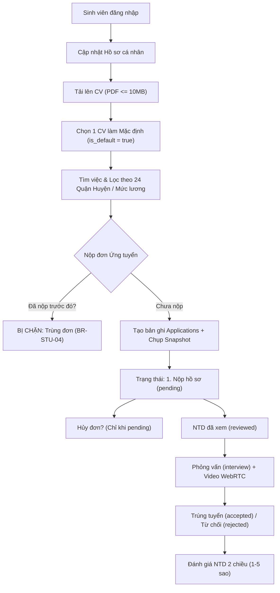
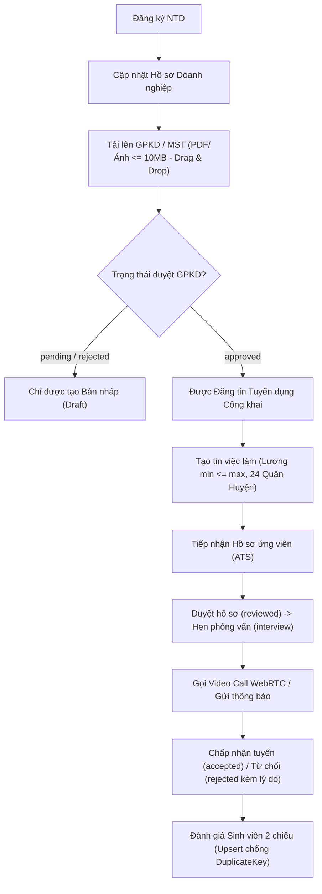
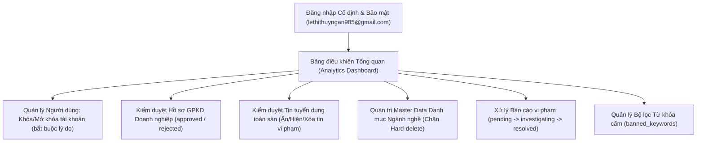

# TÀI LIỆU QUY TẮC NGHIỆP VỤ & TOÀN BỘ ĐIỀU KIỆN RÀNG BUỘC HỆ THỐNG
## NỀN TẢNG TUYỂN DỤNG PARTIME.VN (CDTN02) - ĐH VĂN LANG
> **Phiên bản:** 2.0 - Chuẩn hóa Layered Clean Architecture & MongoDB Atlas  
> **Cơ sở dữ liệu:** `CDTN02_DB` (Tập hợp 16 Collections độc lập & liên kết)  
> **Phân hệ phụ trách:**
> - 🎓 **Sinh viên (Student Portal):** Vũ Thế Long (WBS 1.1 đến 1.10)
> - 💼 **Nhà tuyển dụng (Employer Portal):** Huỳnh Nguyễn Bảo Ngọc (WBS 2.1 đến 2.9)
> - 🛡️ **Quản trị viên (Admin Portal):** Lê Thị Thuỳ Ngân (WBS 3.1 đến 3.9)

---

## PHẦN 1: CÁC NGUYÊN TẮC VÀ ĐIỀU KIỆN RÀNG BUỘC CỐT LÕI TOÀN HỆ THỐNG (SYSTEM-WIDE CONSTRAINTS)

### 1.1. Ràng Buộc Định Danh & Phân Quyền (Authentication & Authorization)

| Mã Ràng Buộc | Tên Quy Tắc | Diễn Giải & Điều Kiện Kỹ Thuật Chi Tiết | Cơ Chế Xử Lý Khi Vi Phạm |
| :--- | :--- | :--- | :--- |
| **BR-AUTH-01** | **Ràng buộc 1 Email = 1 Role duy nhất** | **Mỗi địa chỉ Email thực tế chỉ được liên kết với duy nhất một vai trò (Role: `student`, `employer` hoặc `admin`) trong toàn bộ CSDL.** Tuyệt đối không cho phép 1 email đăng ký chéo sang role thứ 2 hoặc thứ 3. Hệ thống kiểm soát tính toàn vẹn ở cả tầng Database (Unique Index trên field `email`) và Middleware (`src/middlewares/auth_middleware.py`). | Trả về HTTP `409 Conflict`: *"Email này đã được đăng ký với vai trò [Role_Name] trên hệ thống. Vui lòng sử dụng email khác."* Chặn form submit ngay tại Client. |
| **BR-AUTH-02** | **Định dạng Email thực tế** | Email nhập vào phải tuân theo chuẩn RFC 5322, kiểm tra regex chặt chẽ `^[a-zA-Z0-9_.+-]+@[a-zA-Z0-9-]+\.[a-zA-Z0-9-.]+$`, kiểm tra đuôi domain hợp lệ, loại trừ các email dùng tạm thời (temp-mail/disposable email). | Trả về HTTP `422 Unprocessable Entity`: *"Định dạng email không hợp lệ. Vui lòng nhập email thật."* |
| **BR-AUTH-03** | **Độ phức tạp Mật khẩu** | Mật khẩu tối thiểu **8 ký tự**, tối đa 72 bytes (giới hạn an toàn của thuật toán băm bcrypt). Mật khẩu bắt buộc bao gồm ít nhất: 1 chữ hoa `[A-Z]`, 1 chữ thường `[a-z]`, 1 chữ số `[0-9]` và 1 ký tự đặc biệt `[!@#$%^&*()_+\-=\[\]{};':"\\|,.<>\/?~]`. | Hiển thị bảng checklist 5 tiêu chí trực quan với icon đỏ/xanh thời gian thực; Chặn submit nếu chưa thỏa mãn toàn bộ tiêu chí (HTTP `400 Bad Request`). |
| **BR-AUTH-04** | **Mã OTP 10 Phút & Tự Động Điền (Hands-Free Auto-fill)** | Mã OTP gồm 6 chữ số ngẫu nhiên (`000000` - `999999`). Thời hạn hiệu lực (TTL) chuẩn là **600 giây (10 phút)**. Đồng hồ đếm ngược trực quan hiển thị `mm:ss` trên màn hình Quên mật khẩu. Hỗ trợ cơ chế mô phỏng hộp thư hoặc gửi SMTP Brevo và **nút "Tự động điền" (Auto-fill)** giúp người dùng điền ngay lập tức 6 ô số mà không cần nhập tay. | Sau 600 giây, mã OTP tự động bị hủy khỏi Redis/MongoDB (HTTP `410 Gone` hoặc `400 Bad Request`). Người dùng phải bấm "Gửi lại mã mới". |
| **BR-AUTH-05** | **Kiểm soát Phân quyền RBAC (Role-Based Access Control)** | Token JWT chứa Claims: `sub` (User ID), `role` (`student` \| `employer` \| `admin`), `email`, `exp` (thời hạn 24 giờ). Các route API được bảo vệ bằng Decorator: `@student_required`, `@employer_required`, `@admin_required`. | Nếu truy cập trái quyền: HTTP `403 Forbidden` *"Bạn không có quyền truy cập chức năng này."* Nếu Token hết hạn hoặc không hợp lệ: HTTP `401 Unauthorized` và điều hướng về trang Đăng nhập. |
| **BR-AUTH-06** | **Tài khoản bị Khóa (Account Banning Constraint)** | Khi tài khoản có trường `is_banned = true`, token JWT ngay lập tức bị vô hiệu hóa; mọi yêu cầu HTTP tiếp theo đều bị chặn lại. Đồng thời, toàn bộ tin tuyển dụng của NTD bị khóa hoặc toàn bộ đơn ứng tuyển chưa xử lý của SV bị khóa sẽ chuyển sang trạng thái tạm dừng. | Trả về HTTP `403 Forbidden`: *"Tài khoản của bạn đã bị khóa bởi Quản trị viên. Lý do: [ban_reason]. Liên hệ hỗ trợ: support@partime.vn."* |
| **BR-AUTH-07** | **Bảo vệ Chống Tấn Công Brute-Force** | Nếu người dùng nhập sai mật khẩu quá 5 lần liên tiếp trong vòng 15 phút, hệ thống tự động khóa tạm thời tính năng đăng nhập của địa chỉ IP và tài khoản đó trong 5 phút. | Trả về HTTP `429 Too Many Requests`: *"Bạn đã nhập sai quá số lần quy định. Vui lòng thử lại sau 5 phút."* |

---

### 1.2. Ràng Buộc Giao Diện, Trải Nghiệm & Đồ Họa 4D (UI/UX & Graphics Constraints)

- **BR-UI-01 (Loại bỏ 100% Native Browser Dialogs):** Tuyệt đối cấm sử dụng các hộp thoại mặc định của trình duyệt (`window.alert`, `window.confirm`, `window.prompt`) vì gây phản cảm và để lộ thông tin `localhost:8002 cho biết`. Toàn bộ hành vi cảnh báo, xác nhận xóa, duyệt hồ sơ phải sử dụng Modal nổi **`<ConfirmDialog>`** với lớp phủ `backdrop-blur-md bg-black/85` và **Thanh Banner Trạng Thái** gắn dưới Header (Xanh: Thành công; Vàng: Đang xử lý; Đỏ: Lỗi).
- **BR-UI-02 (Chuẩn Hóa 4 Màu Trạng Thái Nghiệp Vụ):**
  - 🟡 **Vàng (Amber `#F59E0B`):** Chờ đợi (`pending`, chờ duyệt hồ sơ, chờ duyệt GPKD, đang gửi OTP).
  - 🔴 **Đỏ (Red `#EF4444`):** Cảnh báo / Từ chối / Bị khóa (`banned`, `rejected`, `cancelled`, ẩn tin vi phạm, từ cấm).
  - 🟢 **Xanh lá (Emerald `#10B981`):** Hoạt động / Đã duyệt / Trúng tuyển (`active`, `approved`, `accepted`, thao tác thành công).
  - 🟠 **Cam đỏ (Orange `#F97316`):** Đang xử lý / Phỏng vấn (`interviewing`, `investigating`, đang điều tra báo cáo).
- **BR-UI-03 (Loại Bỏ Mã Kỹ Thuật):** Tuyệt đối không để lộ bất kỳ mã số WBS, FR, BR, UC, US nào trên giao diện người dùng. Tất cả nhãn, tiêu đề, nút bấm phải sử dụng tiếng Việt tự nhiên, trực quan, chuyên nghiệp.
- **BR-UI-04 (Độ Trong Suốt & Tương Phản Dropdown):** Toàn bộ Dropdown Menu tài khoản, chuông Thông báo và bảng dữ liệu phải có màu nền đặc hoàn toàn (`bg-[#090f20]` hoặc `bg-slate-900`, opacity = 1, `z-[9999]`), viền neon `border-blue-500/40`. Tuyệt đối không để xảy ra hiện tượng bảng hoặc dropdown bị trong suốt làm chìm nội dung text.
- **BR-UI-05 (Đồng Bộ Đa Thiết Bị - Responsive Across All Breakpoints):**
  - **Desktop / Màn hình lớn (>= 1280px):** Hiển thị Sidebar cố định, không gian vũ trụ 4D chuyển động theo chuột, bảng dữ liệu đầy đủ cột.
  - **Laptop (1024px - 1279px):** Tự động thu gọn khoảng đệm padding, các bảng tự co giãn có thanh cuộn ngang mượt mà.
  - **iPad / Tablet (768px - 1023px):** Sidebar chuyển đổi thành Ngăn kéo trượt (Drawer); bố cục 3 cột chuyển thành 2 cột; 3D Logo hỗ trợ cảm ứng chạm.
  - **Mobile Phone (< 768px):** Thanh điều hướng chuyển xuống đáy màn hình (**Mobile Bottom Navigation Dock**), chạm một chạm bằng ngón tay cái; bố cục chuyển về 1 cột dọc; form nhập liệu full-width.

---

## PHẦN 2: TOÀN BỘ ĐIỀU KIỆN RÀNG BUỘC THEO TỪNG PHÂN HỆ NGƯỜI DÙNG

---

### 2.1. ĐIỀU KIỆN RÀNG BUỘC PHÂN HỆ SINH VIÊN (VŨ THẾ LONG - WBS 1.1 ĐẾN 1.10)

#### Chi tiết các điều kiện ràng buộc phân hệ Sinh viên:

1. **BR-STU-01: Ràng buộc Hồ sơ cá nhân (Student Profile Constraints)**
   - **Họ và tên:** Độ dài từ 2 đến 100 ký tự. Không được chứa số hoặc ký tự đặc biệt nguy hiểm (`<`, `>`, `{`, `}`, `scripts`).
   - **Mã số sinh viên (MSSV):** Tùy chọn nhưng nếu nhập phải từ 6 đến 15 ký tự chữ/số (ví dụ: `2174802010123`).
   - **Trường Đại học:** Bắt buộc chọn hoặc nhập; ưu tiên danh sách gợi ý các trường đại học tại TP.HCM (ĐH Văn Lang, ĐH Bách Khoa, ĐH Kinh Tế, ĐH KHXH&NV...).
   - **Số điện thoại:** Bắt buộc 10 chữ số, định dạng nhà mạng Việt Nam (bắt đầu bằng `03`, `05`, `07`, `08`, `09`).
   - **Ngày sinh:** Tuổi của sinh viên phải từ đủ 16 tuổi trở lên và không quá 35 tuổi tính đến ngày đăng ký.
   - **Kỹ năng & Sở thích:** Mảng danh sách tối đa 15 kỹ năng; mỗi kỹ năng không quá 30 ký tự.

2. **BR-STU-02: Ràng buộc Quản lý CV & Thư giới thiệu (Resumes & Cover Letters)**
   - **Định dạng file:** Bắt buộc chỉ chấp nhận định dạng `.pdf` (khuyến nghị chuẩn kiểm định) và `.docx`. Tuyệt đối chặn các file thực thi `.exe`, `.bat`, `.sh`, `.php`, `.js`.
   - **Dung lượng tệp tối đa:** Dung lượng file không được vượt quá **10MB (10,485,760 bytes)**.
   - **Giới hạn số lượng:** Mỗi tài khoản sinh viên được phép lưu tối đa **5 bản CV** trên hệ thống. Khi đạt mốc 5 CV, hệ thống yêu cầu xóa bớt bản cũ trước khi tải bản mới.
   - **Quy tắc Duy nhất 1 CV Mặc định (`is_default = true`):**
     - Sinh viên bắt buộc có đúng 1 CV được đánh dấu là mặc định.
     - Khi sinh viên chọn một CV khác làm mặc định, hệ thống tự động cập nhật toàn bộ các CV còn lại của sinh viên đó về `is_default = false` (nguyên tắc chuyển trạng thái đơn vị).
   - **Xem & Tải CV:** Cho phép xem trực tiếp toàn màn hình qua Modal `DocumentViewerModal` và tải file gốc về máy tính.
   - **Thư giới thiệu (Cover Letter):** Tiêu đề từ 5 đến 100 ký tự; nội dung thư từ 20 đến 2.000 ký tự.

3. **BR-STU-03: Ràng buộc Tìm kiếm, Bộ lọc & Lưu việc làm (Job Search & Bookmarks)**
   - **Bộ lọc Địa điểm:** Tích hợp đầy đủ **24 quận, huyện và TP. Thủ Đức** tại TP.HCM. Không cho phép nhập địa điểm rác.
   - **Bộ lọc Ngành nghề:** Phải tham chiếu đến danh mục hợp lệ trong collection `categories` có `is_active = true`.
   - **Bộ lọc Lương:** Hỗ trợ lọc theo khoảng lương theo giờ: `< 25k/h`, `25k - 35k/h`, `35k - 50k/h`, `> 50k/h` hoặc Lương thỏa thuận.
   - **Ràng buộc Bookmark (Lưu việc):**
     - Thiết lập Unique Compound Index `{ student_id: 1, job_id: 1 }` trên collection `bookmarks`. Sinh viên chỉ được lưu 1 công việc đúng 1 lần.
     - Nhấn lần 1: Thêm vào danh sách đã lưu; Nhấn lần 2: Tự động xóa khỏi danh sách đã lưu (Toggle Bookmark).
     - Khi tin tuyển dụng bị xóa hoặc ẩn bởi Admin/NTD, bookmark tự động bị ẩn hoặc xóa cascade.

4. **BR-STU-04: Ràng buộc Ứng tuyển & Lưu trữ Hồ sơ bất biến (Job Application & Immutable Snapshot)**
   - **Chặn nộp trùng lặp (Anti-Duplicate Submission):** Một sinh viên chỉ được phép nộp 1 đơn ứng tuyển cho một công việc (`job_id`). Nếu đơn ứng tuyển cũ đang ở trạng thái `pending`, `reviewed` hoặc `interview`, hệ thống lập tức từ chối yêu cầu nộp mới với mã HTTP `409 Conflict`.
   - **Bản chụp hồ sơ bất biến (Application Snapshot):** Tại thời điểm sinh viên bấm "Xác nhận nộp đơn", hệ thống bắt buộc chụp lại nguyên trạng thông tin cá nhân (Họ tên, SĐT, Email, Trường), bản sao tệp CV và nội dung thư giới thiệu vào trường `application_snapshot`. Bất kỳ thay đổi nào trong Profile sinh viên sau thời điểm này đều **không làm thay đổi** hồ sơ mà Nhà tuyển dụng đã nhận.
   - **Điều kiện mở tin:** Sinh viên chỉ có thể ứng tuyển khi tin việc làm có `is_open = true` và `is_hidden = false` và hạn nộp hồ sơ (`deadline`) còn hiệu lực.
   - **Quy tắc Hủy đơn ứng tuyển:** Sinh viên **CHỈ ĐƯỢC PHÉP HỦY ĐƠN** khi trạng thái của đơn đang là `pending` (Chờ duyệt). Khi đơn đã được NTD chuyển sang `reviewed`, `interview`, hoặc `accepted`, sinh viên không thể tự ý bấm nút Hủy nhằm bảo đảm tính cam kết và tính chuyên nghiệp trong tuyển dụng.

5. **BR-STU-05: Ràng buộc Tiến độ 4 Chặng & Lịch sử Trạng thái (Application Tracker)**
   - Tiến độ ứng tuyển hiển thị trực quan theo 4 cột mốc chuẩn hóa:
     1. `[Chặng 1: Nộp hồ sơ]` (`pending`)
     2. `[Chặng 2: NTD đã xem]` (`reviewed`)
     3. `[Chặng 3: Phỏng vấn]` (`interview`)
     4. `[Chặng 4: Trúng tuyển / Từ chối]` (`accepted` hoặc `rejected`)
   - Mỗi lần trạng thái thay đổi, hệ thống bắt buộc append bản ghi vào mảng `status_history` gồm `{ status, updated_at, updated_by, note }`.

6. **BR-STU-06: Ràng buộc Đánh giá Nhà tuyển dụng (Review Constraints)**
   - Sinh viên chỉ được đánh giá Nhà tuyển dụng sau khi đơn ứng tuyển của công việc tương ứng đạt trạng thái `accepted` (Trúng tuyển / Đã làm việc).
   - Mỗi công việc sinh viên chỉ được gửi đánh giá đúng 1 lần duy nhất.
   - Điểm đánh giá: Số nguyên từ 1 đến 5 sao. Bình luận tối thiểu 10 ký tự, tối đa 1.000 ký tự.
   - Không được chứa từ ngữ thô tục, xúc phạm hoặc từ khóa cấm.

7. **BR-STU-07: Ràng buộc Nhắn tin & Cuộc gọi Video WebRTC (Realtime Communication)**
   - Sinh viên chỉ được mở phòng chat với Nhà tuyển dụng của công việc mà sinh viên đã nộp hồ sơ hoặc nhận được lời mời phỏng vấn.
   - Mọi tin nhắn gửi đi đều chạy qua bộ lọc từ khóa cấm (`banned_keywords`). Nếu phát hiện từ cấm, hệ thống tự động bôi mờ thành ký tự `***` và hiển thị cảnh báo đỏ.
   - Cuộc gọi Video WebRTC: Đổ chuông tối đa 180 giây (3 phút). Nếu sinh viên không bắt máy, hệ thống tự động ngắt và ghi nhận tin nhắn hệ thống màu đỏ: *"Cuộc gọi nhỡ lúc hh:mm"*. Khi kết thúc cuộc gọi thành công, tự động lưu thời lượng dạng `mm:ss` vào phòng chat.

---

### 2.2. ĐIỀU KIỆN RÀNG BUỘC PHÂN HỆ NHÀ TUYỂN DỤNG (HUỲNH NGUYỄN BẢO NGỌC - WBS 2.1 ĐẾN 2.9)

#### Chi tiết các điều kiện ràng buộc phân hệ Nhà tuyển dụng:

1. **BR-EMP-01: Ràng buộc Định danh Doanh nghiệp & Hồ sơ Pháp lý (Company Profile & GPKD)**
   - **Tên doanh nghiệp / Đơn vị kinh doanh:** Độ dài từ 3 đến 200 ký tự. Không được trùng lặp hoàn toàn với doanh nghiệp đã tồn tại.
   - **Mã số thuế (MST) / Giấy phép kinh doanh:** Độ dài chuẩn 10 số (doanh nghiệp) hoặc 13 số (chi nhánh).
   - **Tệp giấy phép kinh doanh (GPKD):**
     - Hỗ trợ cơ chế **Kéo thả tệp tin trực tiếp (Drag & Drop)** từ máy tính vào khung tải tệp trên giao diện.
     - Định dạng cho phép: `.pdf`, `.png`, `.jpg`, `.jpeg`.
     - Dung lượng tối đa: **10MB**.
   - **Quy trình Kiểm duyệt GPKD (`approval_status`):**
     - Khi mới đăng ký hoặc mới cập nhật GPKD, trạng thái là `"pending"` (Chờ quản trị viên phê duyệt).
     - Chỉ khi Quản trị viên duyệt thành `"approved"`, Nhà tuyển dụng mới có đầy đủ quyền đăng tin tuyển dụng công khai ra hệ thống.
     - Nếu bị `"rejected"`, Quản trị viên phải nêu rõ lý do (ví dụ: "Ảnh mờ không rõ con dấu", "Mã số thuế không tồn tại") để NTD cập nhật lại.

2. **BR-EMP-02: Quyền hạn Đăng tin Tuyển dụng theo Cấp bậc Phê duyệt (Posting Permissions)**
   - Nhà tuyển dụng có `approval_status = "pending"` hoặc `"rejected"`: **CHỈ ĐƯỢC LƯU TIN DẠNG BẢN NHÁP (Draft)**, không được phép công khai tin lên sàn việc làm.
   - Nhà tuyển dụng có `approval_status = "approved"`: Được phép xuất bản tin công khai (`is_open = true`, `is_hidden = false`).

3. **BR-EMP-03: Ràng buộc Dữ liệu Tin Tuyển dụng (Job Posting Data Constraints)**
   - **Tiêu đề tin tuyển dụng:** Tối thiểu 10 ký tự, tối đa 150 ký tự. Phải thể hiện rõ vị trí công việc (ví dụ: *"Nhân viên Phục vụ Part-time Ca Tối Quận 1"*).
   - **Ngành nghề (`category_id`):** Bắt buộc chọn từ danh mục đang hoạt động (`is_active = true`) trong bảng `categories`.
   - **Địa điểm làm việc:** Bắt buộc chọn thuộc **24 quận, huyện hoặc TP. Thủ Đức** tại TP.HCM. Địa chỉ chi tiết từ 10 đến 255 ký tự.
   - **Quy tắc Ràng buộc Mức lương (Salary Integrity Constraint):**
     - Nếu chọn "Lương thỏa thuận" (`is_negotiable = true`): Không bắt buộc nhập khoảng lương số.
     - Nếu chọn "Lương theo số tiền" (`is_negotiable = false`): Bắt buộc nhập `salary_min` và `salary_max`. Cả hai phải là số nguyên dương (`>= 10,000 VNĐ/giờ`).
     - **Điều kiện bất biến toán học:** **`salary_min <= salary_max`**. Hệ thống chặn ngay tại form nếu người dùng nhập mức lương tối thiểu lớn hơn mức lương tối đa.
   - **Hình thức ca làm việc:** Bắt buộc chọn ít nhất một ca: Ca sáng (07:00 - 12:00), Ca chiều (12:00 - 17:00), Ca tối (17:00 - 22:00), Ca linh hoạt / Xoay ca.
   - **Số lượng cần tuyển:** Phải là số nguyên dương từ 1 đến 500 người.
   - **Hạn nộp hồ sơ (`deadline`):** Phải là ngày trong tương lai (lớn hơn ngày hiện tại ít nhất 1 ngày).
   - **Mô tả công việc & Yêu cầu:** Mỗi trường tối thiểu 50 ký tự, tối đa 5.000 ký tự. Không được chứa từ khóa cấm lừa đảo, chuyển tiền cọc.

4. **BR-EMP-04: Ràng buộc Vòng đời Tuyển dụng & Quản lý Ứng viên (ATS Pipeline Constraints)**
   - **Luồng chuyển đổi trạng thái hợp lệ:**
     - Chuyển từ `pending` sang `reviewed` (Đã xem hồ sơ).
     - Chuyển từ `reviewed` sang `interview` (Mời phỏng vấn): Bắt buộc nhập thời gian phỏng vấn, địa điểm hoặc đường link phòng họp trực tuyến.
     - Chuyển sang `accepted` (Tuyển dụng thành công / Trúng tuyển).
     - Chuyển sang `rejected` (Từ chối hồ sơ): Khuyến khích hoặc bắt buộc chọn lý do từ chối (ví dụ: *"Chưa phù hợp với lịch làm việc của quán"*, *"Đã tuyển đủ số lượng"*) để gửi email thông báo văn minh cho sinh viên.
   - **Không cho phép nhảy cóc trái logic:** Không cho phép nhảy trực tiếp từ `pending` sang `accepted` mà chưa qua xem xét hồ sơ hoặc phỏng vấn.
   - **Thông báo thời gian thực:** Mỗi lần NTD chuyển trạng thái ứng viên, hệ thống tự động bắn Notification thời gian thực tới chuông thông báo của sinh viên.

5. **BR-EMP-05: Ràng buộc Đánh giá Sinh viên & Chống Xung đột Dữ liệu (Upsert Anti-Collision)**
   - Nhà tuyển dụng chỉ được gửi đánh giá đối với những ứng viên đã được nhận làm việc (`accepted`).
   - Thang điểm: Từ 1 đến 5 sao theo các tiêu chí: Đúng giờ, Thái độ làm việc, Kỹ năng nghiệp vụ.
   - **Cơ chế Upsert thông minh:** Nhằm loại bỏ hoàn toàn lỗi văng ngoại lệ `pymongo.errors.DuplicateKeyError` khi NTD muốn cập nhật lại lời nhận xét cũ, hệ thống áp dụng phương thức `update_one(filter, {'$set': data}, upsert=True)`.

6. **BR-EMP-06: Ràng buộc Tải Ảnh Bìa & Logo Doanh nghiệp**
   - Hỗ trợ kéo thả trực tiếp file Logo và Ảnh bìa.
   - Định dạng chấp nhận: `.png`, `.jpg`, `.jpeg`, `.webp`. Dung lượng tối đa: **10MB**.

---

### 2.3. ĐIỀU KIỆN RÀNG BUỘC PHÂN HỆ QUẢN TRỊ VIÊN (LÊ THỊ THUỲ NGÂN - WBS 3.1 ĐẾN 3.9)

#### Chi tiết các điều kiện ràng buộc phân hệ Quản trị viên:

1. **BR-ADM-01: Ràng buộc Bảo mật Tài khoản Quản trị Cố định (Fixed Admin Credentials)**
   - Tài khoản Quản trị viên tối cao được định danh cố định trong hệ thống: `lethithuyngan985@gmail.com` / Mật khẩu: `Le090805!`.
   - **Ẩn hoàn toàn tính năng công khai:** Tại giao diện Đăng nhập phân hệ Quản trị viên, hệ thống **ẩn hoàn toàn nút "Đăng ký tài khoản" và nút "Quên mật khẩu"** để loại bỏ nguy cơ bị kẻ gian chiếm quyền kiểm soát hệ thống.
   - **Bất khả xâm phạm (Admin Self-Preservation):** Quản trị viên không thể tự khóa tài khoản của chính mình (`is_banned` của Admin luôn luôn là `false`).

2. **BR-ADM-02: Ràng buộc Quản trị Người dùng & Xử lý Khóa Tài khoản (User Moderation)**
   - Quản trị viên có toàn quyền chuyển đổi cờ `is_banned` giữa `true` và `false` đối với bất kỳ tài khoản Sinh viên hoặc Nhà tuyển dụng nào vi phạm điều khoản dịch vụ.
   - **Bắt buộc nhập lý do khóa (`ban_reason`):** Khi chuyển `is_banned = true`, trường nhập lý do bắt buộc từ **10 đến 500 ký tự** (ví dụ: *"Đăng tin thu phí phỏng vấn trái phép", "Sinh viên có hành vi quấy rối trong chat"*). Tuyệt đối không cho phép khóa tài khoản mà để trống lý do.
   - **Hiệu ứng khóa tức thì (Immediate Revocation):**
     - Tài khoản bị khóa sẽ bị cưỡng chế đăng xuất (invalidate session) trong lần gọi API kế tiếp.
     - Toàn bộ tin tuyển dụng của NTD bị khóa tự động chuyển về `is_hidden = true`.

3. **BR-ADM-03: Ràng buộc Kiểm duyệt Doanh nghiệp & GPKD (Business Verification)**
   - Quản trị viên kiểm tra trực tiếp tệp GPKD thông qua trình xem PDF chuẩn kiểm định `DocumentViewerModal`.
   - Chuyển `approval_status`:
     - Nếu chọn `"approved"`: Nhà tuyển dụng lập tức nhận thông báo xanh và được cấp quyền đăng tin tuyển dụng ra công chúng.
     - Nếu chọn `"rejected"`: Bắt buộc điền ghi chú phản hồi để doanh nghiệp bổ sung giấy tờ hợp lệ.

4. **BR-ADM-04: Ràng buộc Kiểm duyệt Tin Tuyển Dụng (Job Moderation)**
   - Quản trị viên có quyền cập nhật cờ `is_hidden = true` (Ẩn tin) đối với bất kỳ tin đăng nào bị nghi ngờ lừa đảo, đa cấp, thông tin sai sự thật hoặc nhận nhiều báo cáo tiêu cực từ sinh viên.
   - **Quy tắc Toàn vẹn Dữ liệu Ẩn tin:** Khi tin bị ẩn (`is_hidden = true`), tin đó **ngay lập tức biến mất** khỏi danh sách tìm kiếm việc làm của sinh viên; tuy nhiên dữ liệu của tin và toàn bộ đơn ứng tuyển liên quan vẫn được **bảo toàn nguyên vẹn trong CSDL** phục vụ công tác thanh tra, điều tra của nhà trường hoặc cơ quan chức năng.

5. **BR-ADM-05: Ràng buộc Toàn vẹn Danh mục Master Data (Category Integrity - Restrict Delete)**
   - **Chặn Xóa Cứng (Hard-Delete Restriction):** Quản trị viên **TUYỆT ĐỐI KHÔNG ĐƯỢC XÓA CỨNG** một danh mục ngành nghề trong collection `categories` nếu đang có ít nhất **1 tin tuyển dụng** (dù đang mở hay đã đóng) tham chiếu đến `category_id` đó.
   - **Cơ chế Xóa mềm / Vô hiệu hóa (Soft-Delete):** Nếu không muốn sử dụng danh mục đó nữa, Admin chỉ được phép chuyển trạng thái `is_active = false`. Khi đó, danh mục sẽ không xuất hiện trong dropdown đăng tin mới của NTD, nhưng các tin cũ đã đăng vẫn hiển thị đúng tên ngành nghề.

6. **BR-ADM-06: Ràng buộc Xử lý Báo Cáo Vi Phạm (Violation Reports Lifecycle)**
   - Người dùng (Sinh viên/NTD) mỗi lần chỉ được báo cáo 1 đối tượng vi phạm 1 lần. Chặn spam flood report.
   - Vòng đời xử lý báo cáo:
     - `pending` (Báo cáo mới nhận).
     - `investigating` (Admin đang tiến hành kiểm tra, đối soát lịch sử chat/tin đăng).
     - `resolved` (Đã xử lý xong - kèm biện pháp: khóa tài khoản vi phạm hoặc ẩn tin).
     - `dismissed` (Bác bỏ báo cáo nếu xác định là báo cáo sai sự thật / vu khống).
   - Mọi thao tác xử lý báo cáo đều phải lưu log `{ handled_by: admin_id, handled_at: timestamp, resolution_note: text }`.

7. **BR-ADM-07: Ràng buộc Quản lý Bộ Lọc Từ Khóa Cấm (Banned Keywords Engine)**
   - Quản trị viên toàn quyền thêm mới, kích hoạt, vô hiệu hóa hoặc xóa bỏ các từ khóa cấm trong collection `banned_keywords`.
   - Danh sách từ khóa cấm mặc định bao gồm các từ nhạy cảm và gian lận: *"thu phí", "đặt cọc", "lừa đảo", "chuyển khoản trước", "cờ bạc", "nạp tiền telegram", "mô hình đa cấp"*.
   - Đảm bảo cơ chế đối soát không phân biệt chữ hoa chữ thường (`case-insensitive`) và loại bỏ dấu tiếng Việt khi so khớp để chống lách luật.

---

## PHẦN 3: BẢNG MA TRẬN RÀNG BUỘC CSDL MONGODB ATLAS (16 COLLECTIONS)

| STT | Tên Collection | Thuộc Tính Bắt Buộc (Required Fields) | Chỉ Mục Độc Nhất (Unique Indexes) | Ràng Buộc Khóa Ngoại Mô Phỏng |
| :---: | :--- | :--- | :--- | :--- |
| 1 | `users` | `email`, `password_hash`, `role`, `is_banned`, `created_at` | `email` (Unique 100%) | - |
| 2 | `student_profiles` | `user_id`, `full_name`, `phone`, `university` | `user_id` (Unique 1-1) | `user_id` -> `users._id` |
| 3 | `employers` | `user_id`, `company_name`, `tax_id`, `approval_status` | `user_id` (Unique 1-1), `tax_id` | `user_id` -> `users._id` |
| 4 | `company_profiles` | `employer_id`, `company_name`, `industry`, `address` | `employer_id` (Unique 1-1) | `employer_id` -> `employers._id` |
| 5 | `resumes` | `student_id`, `resume_url`, `file_name`, `is_default` | `{ student_id, file_name }` | `student_id` -> `student_profiles._id` |
| 6 | `cover_letters` | `student_id`, `title`, `content` | - | `student_id` -> `student_profiles._id` |
| 7 | `categories` | `name`, `code`, `is_active` | `code` (Unique), `name` (Unique) | - |
| 8 | `jobs` | `employer_id`, `category_id`, `title`, `salary_type`, `district`, `is_open`, `is_hidden` | `{ employer_id, title, created_at }` | `employer_id` -> `employers._id` `category_id` -> `categories._id` |
| 9 | `bookmarks` | `student_id`, `job_id`, `created_at` | `{ student_id: 1, job_id: 1 }` (Unique chặn trùng) | `student_id` -> `student_profiles._id` `job_id` -> `jobs._id` |
| 10 | `applications` | `student_id`, `job_id`, `status`, `application_snapshot` | `{ student_id: 1, job_id: 1 }` (Chặn nộp lặp lại) | `student_id` -> `student_profiles._id` `job_id` -> `jobs._id` |
| 11 | `reviews` | `reviewer_id`, `target_id`, `job_id`, `rating`, `comment` | `{ reviewer_id: 1, job_id: 1 }` (1 bên đánh giá 1 lần) | `job_id` -> `jobs._id` |
| 12 | `chat_rooms` | `student_id`, `employer_id`, `job_id`, `created_at` | `{ student_id: 1, employer_id: 1, job_id: 1 }` | Tham chiếu SV, NTD và Job tương ứng |
| 13 | `messages` | `room_id`, `sender_id`, `sender_role`, `content`, `created_at` | - | `room_id` -> `chat_rooms._id` |
| 14 | `notifications` | `recipient_id`, `title`, `message`, `type`, `is_read` | - | `recipient_id` -> `users._id` |
| 15 | `reports` | `reporter_id`, `target_id`, `target_type`, `reason`, `status` | - | `reporter_id` -> `users._id` |
| 16 | `banned_keywords`| `keyword`, `is_active`, `severity`, `created_by` | `keyword` (Unique) | `created_by` -> `users._id` (Admin) |

---

*Tài liệu này là quy chuẩn pháp lý và kỹ thuật cao nhất của hệ thống CDTN02. Mọi thành viên trong nhóm và các chức năng phần mềm bắt buộc phải tuân thủ 100% các điều kiện ràng buộc trên.*
