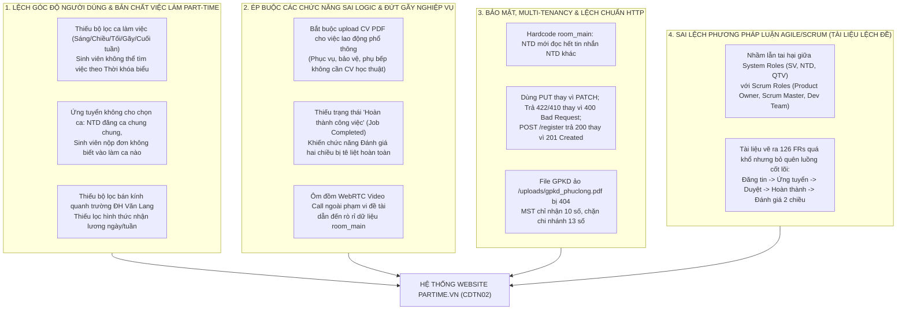
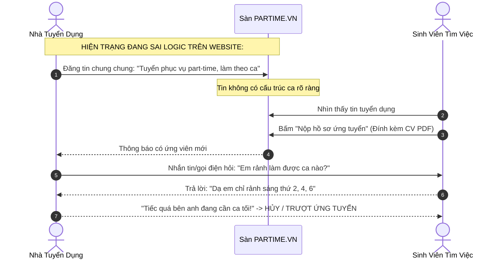
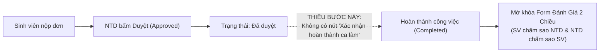
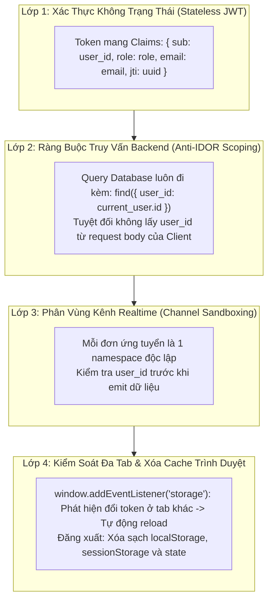
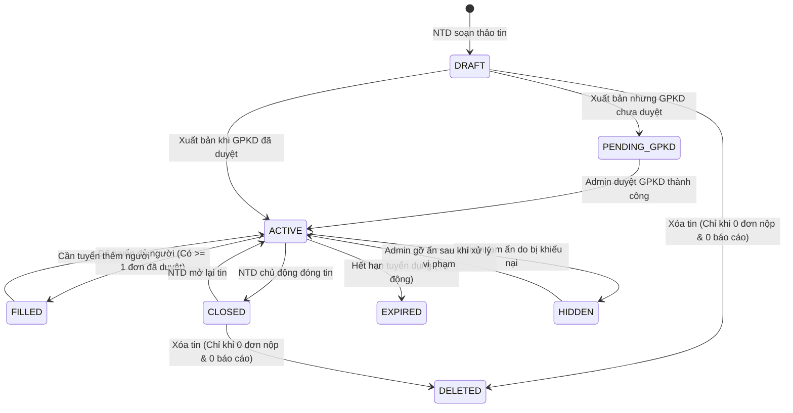
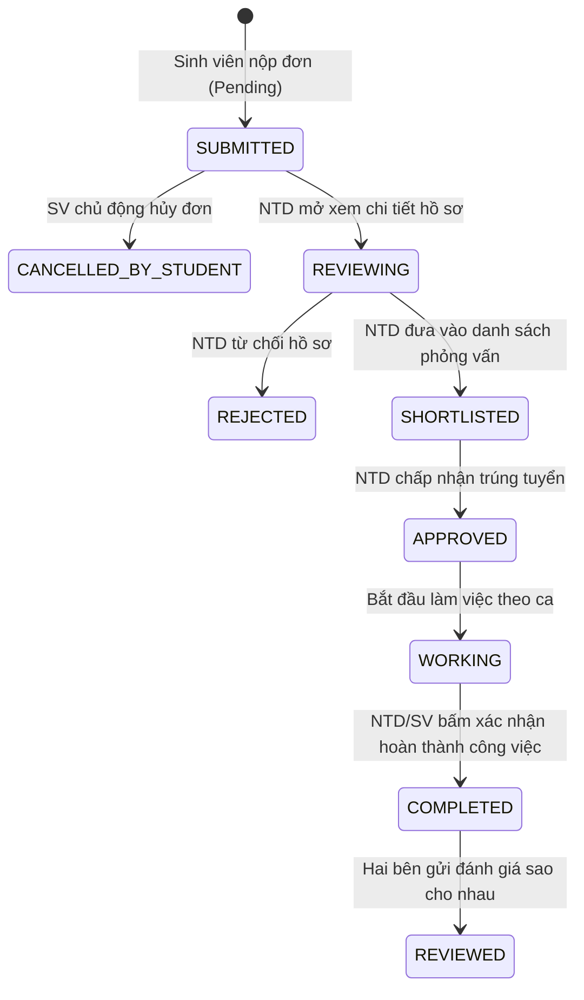
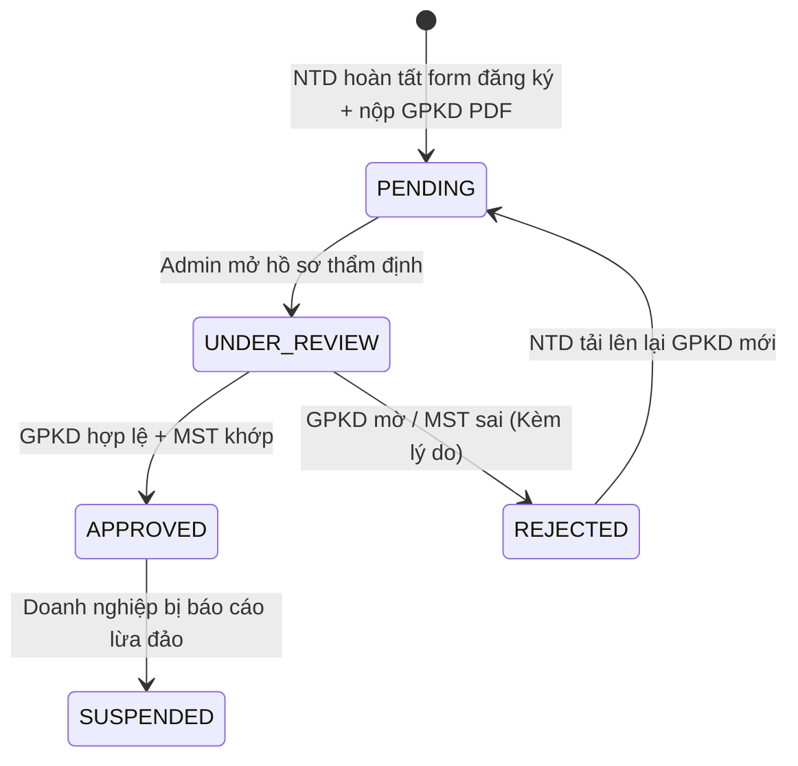
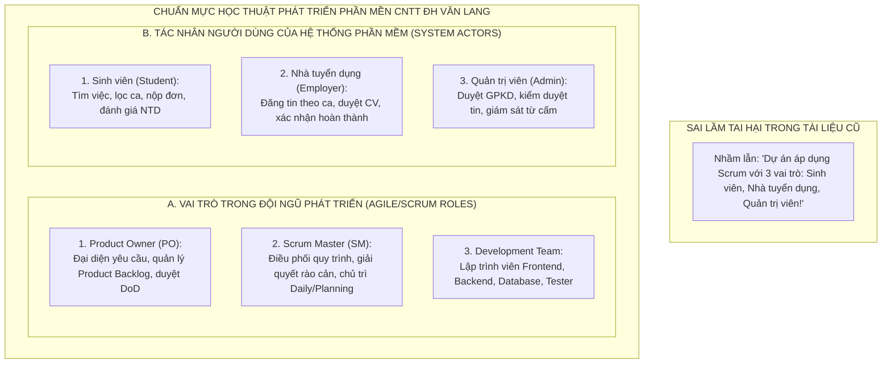
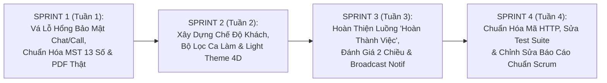

# BÁO CÁO THỐNG KÊ TOÀN DIỆN LỖI HỆ THỐNG, ĐỐI SOÁT NGHIỆP VỤ THỰC TẾ, CHUẨN HÓA KIẾN TRÚC & PHƯƠNG PHÁP LUẬN AGILE/SCRUM (CDTN02)

> **CĂN CỨ KỸ THUẬT, NGHIỆP VỤ & PHÁP LÝ:**
> 1. Đề tài chính thức: *"Nền tảng quản lý freelance / marketplace việc làm part-time cho sinh viên"* - GVHD: TS./ThS. Nguyễn Văn Trung ([`Danhsachdetai_ChuyenDeTotNghiep2.pdf`](file:///d:/Hoc/DH/N4/N4.HK01/Chuyende2/CDTN02/tailieu/noidung/Danhsachdetai_ChuyenDeTotNghiep2.pdf)).
> 2. Đề cương 10 buổi học & Quy trình phát triển phần mềm CNTT Trường ĐH Văn Lang ([`Buoi01`](file:///d:/Hoc/DH/N4/N4.HK01/Chuyende2/CDTN02/tailieu/noidung/Buoi01_ChuyenDeTotNghiep2.pdf) đến [`Buoi10_ChuyenDeTotNghiep2.pdf`](file:///d:/Hoc/DH/N4/N4.HK01/Chuyende2/CDTN02/tailieu/noidung/Buoi10_ChuyenDeTotNghiep2.pdf)).
> 3. Danh mục 126 Chức năng (FR) & Yêu cầu phi chức năng (NFR) tại [`NhapTongHop.xlsx`](file:///d:/Hoc/DH/N4/N4.HK01/Chuyende2/CDTN02/tailieu/bailam/NhapTongHop.xlsx).
> 4. Cấu trúc Work Breakdown Structure chuẩn hóa tại [`WBS01.drawio`](file:///d:/Hoc/DH/N4/N4.HK01/Chuyende2/CDTN02/tailieu/WBS01.drawio) và [`WBS02.drawio`](file:///d:/Hoc/DH/N4/N4.HK01/Chuyende2/CDTN02/tailieu/WBS02.drawio).
> 5. Quy chuẩn kiến trúc & Bảng mã trạng thái HTTP tại [`CongNghe.docx`](file:///d:/Hoc/DH/N4/N4.HK01/Chuyende2/CDTN02/tailieu/bailam/CongNghe.docx).
> 6. Bộ quy tắc ràng buộc nghiệp vụ 3 Role tại [`dieukienrangbuoc.md`](file:///d:/Hoc/DH/N4/N4.HK01/Chuyende2/CDTN02/tailieu/bailam/dieukienrangbuoc.md).
> 7. Quy định pháp lý Việt Nam: **Luật Quản lý thuế số 38/2019/QH14**, **Thông tư 105/2020/TT-BTC** (MST 10 & 13 số), **Nghị định 13/2023/NĐ-CP** (Bảo vệ dữ liệu cá nhân PDPD) và **Bộ Luật Lao động 2019** (Quy định về thời giờ làm việc part-time & tiền lương theo giờ của người lao động chưa thành niên / sinh viên).
> 8. Mã nguồn thực tế toàn hệ thống: `frontend/src/` và `Backend/src/`.
> 
> **Ngày lập báo cáo:** 03/11/2026 | **Đơn vị thực hiện:** Nhóm sinh viên CDTN02 - Khoa CNTT, Đại học Văn Lang

---

## MỤC LỤC BÁO CÁO TOÀN DIỆN

1. [TỔNG QUAN KHUYẾT TẬT HỆ THỐNG & ĐÁNH GIÁ MỨC ĐỘ RỦI RO (EXECUTIVE SUMMARY & RISK MATRIX)](#1-tổng-quan-khuyết-tật-hệ-thống--đánh-giá-mức-độ-rủi-ro)
2. [KHUYẾT TẬT GÓC ĐỘ NGƯỜI DÙNG THỰC TẾ & BẢN CHẤT SÀN VIỆC LÀM PART-TIME CHO SINH VIÊN](#2-khuyết-tật-góc-độ-người-dùng-thực-tế--bản-chất-sàn-việc-làm-part-time-cho-sinh-viên)
   * 2.1. Phân tích thị trường việc làm thêm sinh viên & Sự phụ thuộc 100% vào Thời khóa biểu (TKB)
   * 2.2. Danh mục các bộ lọc còn thiếu trầm trọng mà người dùng thực tế bắt buộc phải có
   * 2.3. Khuyết tật trong kiến trúc phân chia ca làm việc (Shift Scheduling & Matching Architecture)
   * 2.4. Góc độ Quản trị viên: Thiếu công cụ giám sát bóc lột sức lao động và bảo vệ quyền lợi sinh viên
3. [CHỈ RA CÁC CHỨC NĂNG BỊ SAI LỆCH VÀ ÉP BUỘC PHI LOGIC TRONG MÔ TẢ FR CŨ](#3-chỉ-ra-các-chức-năng-bị-sai-lệch-và-ép-buộc-phi-logic-trong-mô-tả-fr-cũ)
   * 3.1. Ép buộc nộp CV dạng file PDF đối với công việc part-time phổ thông ngắn hạn
   * 3.2. Sai lầm ôm đồm WebRTC Video Call ngoài phạm vi trong khi bỏ quên luồng "Hoàn thành công việc"
   * 3.3. Lỗi tê liệt chức năng Đánh giá hai chiều (Hai bên không có cơ chế kích hoạt hoàn thành ca làm)
   * 3.4. Sai lệch logic trong hủy đơn ứng tuyển và xóa tin tuyển dụng
4. [LỖ HỔNG BẢO MẬT & RÒ RỈ DỮ LIỆU ĐA NGƯỜI DÙNG TRONG CHAT & WEBRTC CALL (CRITICAL VULNERABILITY)](#4-lỗ-hổng-bảo-mật--rò-rỉ-dữ-liệu-đa-người-dùng-trong-chat--webrtc-call)
   * 4.1. Lỗ hổng hardcode `room_main` và rò rỉ dữ liệu giữa các Nhà tuyển dụng
   * 4.2. Xung đột tín hiệu cuộc gọi WebRTC và hardcode danh tính người dùng
   * 4.3. Kiến trúc Scoped Room ID gắn liền với hồ sơ ứng tuyển và RBAC Middleware
5. [CƠ CHẾ CÔ LẬP ĐA NGƯỜI DÙNG & QUẢN LÝ PHIÊN (MULTI-TENANCY & SESSION ISOLATION)](#5-cơ-chế-cô-lập-đa-người-dùng--quản-lý-phiên-multi-tenancy--session-isolation)
   * 5.1. Nguy cơ lẫn lộn dữ liệu khi nhiều SV và NTD cùng đăng ký / đăng nhập đồng thời
   * 5.2. Mô hình kiến trúc cô lập 4 lớp chống IDOR và xung đột LocalStorage đa tab
6. [LỖI THIẾU THÔNG BÁO HỆ THỐNG KHI QUẢN TRỊ VIÊN THAO TÁC CAN THIỆP](#6-lỗi-thiếu-thông-báo-hệ-thống-khi-quản-trị-viên-thao-tác-can-thiệp)
   * 6.1. Thực trạng khi Admin ẩn tin, xóa tin, khóa tài khoản
   * 6.2. Thiết kế Broadcast Notification đa đối tượng và Popup giải thích tại màn hình đăng nhập
7. [LUỒNG NGHIỆP VỤ DUYỆT GIẤY PHÉP KINH DOANH (GPKD) & XỬ LÝ FILE PDF ẢO / GIẢ LẬP](#7-luồng-nghiệp-vụ-duyệt-giấy-phép-kinh-doanh-gpkd--xử-lý-file-pdf-ảo--giả-lập)
   * 7.1. Chuẩn hóa luồng đăng ký: Cấp tài khoản chờ duyệt (`pending`) và chặn xuất bản tin công khai
   * 7.2. Nguyên nhân File PDF ảo bị 404 và quy trình upload/quản lý file PDF nhị phân thật
8. [ĐẶC TẢ RÀNG BUỘC MÃ SỐ THUẾ (MST) 10 SỐ VÀ 13 SỐ CHO DOANH NGHIỆP](#8-đặc-tả-ràng-buộc-mã-số-thuế-mst-10-số-và-13-số-cho-doanh-nghiệp)
   * 8.1. Căn cứ pháp lý: MST công ty mẹ (10 số) và MST chi nhánh/cửa hàng (13 số)
   * 8.2. Thuật toán kiểm tra Regex, Modulo 11 và Unique Constraint
9. [LỖI BỐ CỤC GIAO DIỆN, TYPOGRAPHY SIÊU NHỎ, CHẾ ĐỘ KHÁCH & LIGHT THEME 4D](#9-lỗi-bố-cục-giao-diện-typography-siêu-nhỏ-chế-độ-khách--light-theme-4d)
   * 9.1. Thống kê class chữ siêu nhỏ (`text-[9px]`, `text-[10px]`, `text-xs`) và chuẩn hóa Typography Scale
   * 9.2. Thiếu Màn hình Chế độ Khách (Guest Landing Page) và luồng Public Marketplace First
   * 9.3. Chuyển đổi Dark 4D sang Light Theme hiện đại kết hợp Three.js sóng ánh sáng xanh
10. [ĐỐI SOÁT PHƯƠNG THỨC HTTP (GET/POST/PUT/PATCH/DELETE) & BIỂU ĐỒ CHUYỂN TRẠNG THÁI (STATE MACHINES)](#10-đối-soát-phương-thức-http-getpostputpatchdelete--biểu-đồ-chuyển-trạng-thái)
    * 10.1. Lỗi lạm dụng phương thức HTTP: Dùng PUT thay vì PATCH, thiếu 201 Created, lệch chuẩn 422/410
    * 10.2. Đặc tả máy trạng thái dữ liệu (State Machines) cho Job, Application, Verification, Review
11. [ĐỐI SOÁT PHƯƠNG PHÁP LUẬN AGILE/SCRUM: SỰ NHẦM LẪN GIỮA SCRUM ROLES VÀ SYSTEM ROLES](#11-đối-soát-phương-pháp-luận-agilescrum-sự-nhầm-lẫn-giữa-scrum-roles-và-system-roles)
    * 11.1. Phân biệt triệt để Vai trò trong dự án Agile/Scrum (PO, SM, Dev Team) với Tác nhân hệ thống (SV, NTD, QTV)
    * 11.2. Đối soát 6 Giai đoạn (Sprint 0 - Sprint 5) theo WBS01 với lộ trình 10 buổi học ĐH Văn Lang
    * 11.3. Chỉ ra sự lệch lạc giữa tài liệu, mã nguồn thực tế và đề cương của thầy Nguyễn Văn Trung
12. [BẢNG TỔNG HỢP KIỂM KÊ TOÀN BỘ CÁC LỖI TỪ LỚN ĐẾN NHỎ NHẤT (MASTER DEFECT REGISTER)](#12-bảng-tổng-hợp-kiểm-kê-toàn-bộ-các-lỗi-từ-lớn-đến-nhỏ-nhất)
13. [KẾ HOẠCH HÀNH ĐỘNG & LỘ TRÌNH KHẮC PHỤC TOÀN DIỆN THEO 4 SPRINT](#13-kế-hoạch-hành-động--lộ-trình-khắc-phục-toàn-diện-theo-4-sprint)

---

## 1. TỔNG QUAN KHUYẾT TẬT HỆ THỐNG & ĐÁNH GIÁ MỨC ĐỘ RỦI RO

Qua quá trình rà soát toàn diện mã nguồn hệ thống `CDTN02` và đối chiếu với tập hợp yêu cầu nghiệp vụ chuẩn tại [`NhapTongHop.xlsx`](file:///d:/Hoc/DH/N4/N4.HK01/Chuyende2/CDTN02/tailieu/bailam/NhapTongHop.xlsx), tài liệu kỹ thuật [`CongNghe.docx`](file:///d:/Hoc/DH/N4/N4.HK01/Chuyende2/CDTN02/tailieu/bailam/CongNghe.docx), đề cương chính thức [`Danhsachdetai_ChuyenDeTotNghiep2.pdf`](file:///d:/Hoc/DH/N4/N4.HK01/Chuyende2/CDTN02/tailieu/noidung/Danhsachdetai_ChuyenDeTotNghiep2.pdf) và 2 sơ đồ phân rã công việc [`WBS01.drawio`](file:///d:/Hoc/DH/N4/N4.HK01/Chuyende2/CDTN02/tailieu/WBS01.drawio), [`WBS02.drawio`](file:///d:/Hoc/DH/N4/N4.HK01/Chuyende2/CDTN02/tailieu/WBS02.drawio), nhóm nghiên cứu xác định **website và tài liệu hiện tại đang mắc phải các sai lệch nghiêm trọng cả về góc độ người dùng thực tế thị trường, kỹ thuật lập trình lẫn phương pháp luận quản lý dự án**:



---

## 2. KHUYẾT TẬT GÓC ĐỘ NGƯỜI DÙNG THỰC TẾ & BẢN CHẤT SÀN VIỆC LÀM PART-TIME CHO SINH VIÊN

### 2.1. Phân Tích Thực Tế Thị Trường Việc Làm Thêm Sinh Viên: Sự Phụ Thuộc 100% Vào Thời Khóa Biểu

Một website tìm việc làm part-time dành cho sinh viên đại học (như sinh viên Đại học Văn Lang) có bản chất **hoàn toàn khác biệt** so với các sàn tuyển dụng nhân sự toàn thời gian (Full-time) như VietnamWorks hay TopCV:

1. **Thời khóa biểu học tập là bất khả xâm phạm:** Sinh viên không thể làm việc toàn thời gian 8 tiếng/ngày. Lịch học của sinh viên thay đổi theo từng kỳ, từng ngày (thứ 2 học sáng, thứ 3 học chiều, thứ 4 rảnh cả ngày, thứ 7 thi). Một công việc part-time chỉ có giá trị khi nó **khớp hoàn hảo với khoảng thời gian trống của sinh viên**.
2. **Nhu cầu tài chính linh hoạt & tức thời:** Sinh viên đi làm thêm thường có nhu cầu trang trải chi phí sinh hoạt hàng ngày (tiền ăn, tiền trọ, xăng xe), do đó họ quan tâm sâu sắc đến việc nhận lương theo giờ (Hourly Wage), nhận lương theo tuần hoặc nhận lương liền sau ca làm.
3. **Giới hạn phương tiện di chuyển:** Đa số sinh viên di chuyển bằng xe buýt hoặc xe máy, do đó khoảng cách địa lý từ trường học hoặc phòng trọ đến nơi làm việc phải nằm trong bán kính hợp lý ($\le 5\text{km}$).

> ⚠️ **KHUYẾT TẬT NGHIÊM TRỌNG HIỆN TẠI:** Website hiện tại đang được thiết kế giống như một trang tuyển dụng nhân viên văn phòng thu nhỏ, bỏ quên hoàn toàn các đặc thù mang tính "sinh tử" của sinh viên tìm việc làm thêm!

---

### 2.2. Danh Mục Các Bộ Lọc Còn Thiếu Trầm Trọng Mà Người Dùng Thực Tế Bắt Buộc Phải Có

Hiện tại trên giao diện `JobList.jsx`, hệ thống chỉ cung cấp 3 bộ lọc thô sơ: Từ khóa, Danh mục nghề nghiệp và Quận/Huyện. Điều này khiến người dùng không thể tìm kiếm đúng nhu cầu thực tế:

| STT | Bộ Lọc Thực Tế Bắt Buộc Cần Có | Các Tùy Chọn Chi Tiết (Options) | Lý Do Nghiệp Vụ Người Dùng Cần | Trạng Thái Hiện Tại Của Website |
| :---: | :--- | :--- | :--- | :--- |
| **01** | **Bộ lọc Ca làm việc (Work Shifts)** | • Ca Sáng: 07:00 – 11:30<br>• Ca Chiều: 13:00 – 17:30<br>• Ca Tối: 18:00 – 22:30<br>• Ca Đêm: 22:00 – 06:00<br>• Ca Xoay linh hoạt (Đăng ký hàng tuần)<br>• Ca Cuối tuần (Chỉ Thứ 7 & Chủ Nhật) | **Cốt lõi của việc làm part-time:** Sinh viên học buổi sáng chỉ có thể tìm việc ca chiều hoặc ca tối. Không có bộ lọc ca, sinh viên phải bấm mở từng tin để đọc mô tả rất mất thời gian. | ❌ **HOÀN TOÀN THIẾU**<br>(Chỉ có chuỗi text tự do trong mô tả) |
| **02** | **Bộ lọc Bán kính quanh cơ sở ĐH Văn Lang** | • Bán kính $\le 2\text{km}$ quanh CS1 (Đặng Thùy Trâm)<br>• Bán kính $\le 2\text{km}$ quanh CS2 (Nguyễn Khắc Nhu, Q1)<br>• Bán kính $\le 2\text{km}$ quanh CS3 (Dương Quảng Hàm, Gò Vấp)<br>• Theo quận lân cận (Bình Thạnh, Phú Nhuận) | Sinh viên học xong tiết cuối lúc 11h30 muốn chạy ngay đến quán cafe gần trường để làm ca trưa. Không thể làm việc ở quận quá xa (như Bình Chánh, Hóc Môn). | ❌ **HOÀN TOÀN THIẾU**<br>(Chỉ có danh sách quận chung chung) |
| **03** | **Bộ lọc Mức lương theo giờ (VNĐ/giờ)** | • Dưới 25.000 đ/giờ<br>• 25.000 – 35.000 đ/giờ (Phổ thông)<br>• 35.000 – 50.000 đ/giờ (Gia sư/Pha chế)<br>• Trên 50.000 đ/giờ (IT/Thiết kế/Trợ giảng) | Công việc part-time tính lương theo giờ lao động thực tế. Việc để mức lương theo tháng (ví dụ: 5.000.000 đ) là phi thực tế với sinh viên làm 3-4 tiếng/ngày. | ⚠️ **THIẾU CHUẨN XÁC**<br>(Chỉ lọc theo range lương tổng) |
| **04** | **Bộ lọc Hình thức chi trả lương** | • Nhận lương theo ngày (Làm xong nhận liền)<br>• Nhận lương theo tuần<br>• Nhận lương theo tháng (Chuyển khoản ngày 5-10) | Sinh viên có hoàn cảnh khó khăn thường ưu tiên các công việc sự kiện, bưng quả, phụ tiệc nhận tiền liền sau ca làm. | ❌ **HOÀN TOÀN THIẾU** |
| **05** | **Bộ lọc Đặc quyền & Quyền lợi hỗ trợ** | • Có hỗ trợ đóng mộc / Ký thực tập tốt nghiệp<br>• Hỗ trợ bao cơm giữa ca / Phụ cấp gửi xe<br>• Không yêu cầu kinh nghiệm (Được đào tạo)<br>• Thỏa thuận nghỉ ca khi đến mùa thi cử | Đây là 4 đặc quyền lớn nhất mà 100% sinh viên tìm việc part-time đều tìm kiếm. | ❌ **HOÀN TOÀN THIẾU** |
| **06** | **Bộ lọc Loại hình công việc** | • Tại chỗ (On-site)<br>• Làm từ xa tại nhà (Remote - Nhập liệu/Dịch thuật)<br>• Bán thời gian kết hợp (Hybrid) | Phục vụ sinh viên không có xe máy muốn làm việc online tại phòng trọ. | ❌ **HOÀN TOÀN THIẾU** |

---

### 2.3. Khuyết Tật Trong Kiến Trúc Phân Chia Ca Làm Việc (Shift Scheduling & Matching Architecture)

Quy trình đăng tin và ứng tuyển hiện tại trên website đang bị **đứt gãy logic ghép đôi (Matching Breakdown)**:



> ❌ **Hậu quả:** Tỷ lệ lãng phí thời gian và ứng tuyển trượt lên đến 80% do hai bên không biết trước lịch làm của nhau!

#### Kiến Trúc Chuẩn Hóa Phân Chia Ca Làm Việc:
1. **Phía Nhà Tuyển Dụng khi Đăng tin:**
   * Bắt buộc phải cấu hình danh sách các Ca làm việc (`shifts`):
     $$\text{Shift} = \{\text{shift\_name: "Ca Sáng", hours: "07:30 - 11:30", target\_slots: 3, hourly\_rate: 28000}\}$$
     $$\text{Shift} = \{\text{shift\_name: "Ca Tối", hours: "18:00 - 22:30", target\_slots: 5, hourly\_rate: 32000}\}$$
   * Thiết lập tính chất ca: *Cố định hàng ngày* hoặc *Xoay ca theo tuần*.
2. **Phía Sinh Viên khi Ứng tuyển:**
   * Tại Form nộp hồ sơ, hệ thống bắt buộc hiển thị danh sách các ca làm việc của tin đó dưới dạng Checklist:
     * `[x] Đăng ký Ca Sáng (07:30 - 11:30)`
     * `[ ] Đăng ký Ca Tối (18:00 - 22:30)`
   * Sinh viên có thể nhập ghi chú lịch rảnh: *"Em rảnh các buổi sáng Thứ 3 - Thứ 5 - Thứ 7 và cả ngày Chủ Nhật"*.
3. **Phía Nhà Tuyển Dụng khi Xem hồ sơ (ATS):**
   * Bảng ứng viên phải hiển thị ngay cột **"Ca làm việc ứng viên đăng ký"**.
   * NTD chỉ cần nhìn lướt qua là biết ứng viên có khớp với ca đang thiếu nhân sự hay không, tiết kiệm 90% thời gian liên lạc vô ích.

---

### 2.4. Góc Độ Quản Trị Viên: Thiếu Công Cụ Giám Sát Bóc Lột Sức Lao Động

Sinh viên là đối tượng yếu thế trên thị trường lao động, rất dễ bị các cơ sở kinh doanh lừa đảo hoặc bóc lột sức lao động. Tuy nhiên, Dashboard Quản trị viên (`AdminPortal.jsx`) hiện tại hoàn toàn thiếu vắng các cơ chế kiểm soát này:

1. **Thiếu cảnh báo vi phạm Luật Lao động về Thời giờ làm việc:**
   * Theo Bộ Luật Lao động 2019, người lao động làm thêm không được vượt quá số giờ quy định để đảm bảo việc học tập. Quản trị viên cần công cụ tự động gắn cờ (Flagging) các tin tuyển dụng yêu cầu sinh viên làm ca dài liên tục $> 8\text{ tiếng/ngày}$ dưới danh nghĩa "part-time".
2. **Thiếu kiểm tra Mức lương tối thiểu vùng theo giờ:**
   * Nghị định 38/2022/NĐ-CP quy định mức lương tối thiểu theo giờ tại Vùng I (TP.HCM) là **22.500 đ/giờ**.
   * Hệ thống hiện tại cho phép NTD nhập mức lương tùy ý (thậm chí 10.000 đ/giờ hoặc 15.000 đ/giờ) mà không bị Backend cảnh báo hoặc từ chối duyệt tin.
3. **Thiếu cơ chế cảnh báo thu tiền cọc / lừa đảo:**
   * Các tin tuyển dụng có chứa các từ khóa nhạy cảm: *"thu phí hồ sơ"*, *"tiền đồng phục"*, *"cọc giữ chân"*, *"đóng tiền thế chân"*, *"mua khóa học đào tạo"*... cần được hệ thống tự động khóa và đưa vào hàng đợi kiểm duyệt khẩn cấp (Emergency Moderation Queue) của Admin.

---

## 3. CHỈ RA CÁC CHỨC NĂNG BỊ SAI LỆCH VÀ ÉP BUỘC PHI LOGIC TRONG MÔ TẢ FR CŨ

Nhiều mô tả chức năng trong tài liệu cũ (`NhapTongHop.xlsx`, `dieukienrangbuoc.md`) và mã nguồn đang bị **sao chép máy móc** từ các hệ thống tuyển dụng kỹ sư công nghệ hoặc văn phòng cao cấp, dẫn đến việc ép buộc các luồng xử lý hoàn toàn sai lệch thực tế:

### 3.1. Ép Buộc Nộp CV Dạng File PDF Đối Với Công Việc Part-time Phổ Thông
- **Nghiệp vụ thực tế:** Hơn 70% việc làm thêm của sinh viên là các công việc phục vụ cafe, trà sữa, thu ngân siêu thị mini, phụ kho, nhân viên bán hàng, shipper, phát tờ rơi. Đối với các công việc này, nhà tuyển dụng chỉ quan tâm: *Họ tên, Tuổi, Trường học, Ngoại hình/Chiều cao, Thái độ trung thực và Thời gian có thể đi làm*. Sinh viên không hề có và cũng không cần một bản "Sơ yếu lý lịch CV PDF hoành tráng" 2 trang bằng tiếng Anh!
- **Sai lầm của website hiện tại:**
  * Bắt buộc sinh viên phải tải lên file `.pdf` $\le 10\text{MB}$ mới cho bấm nút ứng tuyển (`FR-SV-04.02`, `FR-SV-05.06`).
  * Khi sinh viên chưa kịp tạo file PDF, hệ thống chặn đứng không cho nộp đơn.
- **Khắc phục logic chuẩn:**
  * Cung cấp 2 phương thức ứng tuyển linh hoạt:
    1. **Ứng tuyển nhanh qua Hồ sơ trực tuyến (Instant Profile Apply):** Sử dụng thông tin có sẵn trong tài khoản (Họ tên, SĐT, Trường, Giới thiệu ngắn, Lịch rảnh).
    2. **Ứng tuyển nâng cao đính kèm CV (Attach PDF CV):** Dành riêng cho các công việc part-time chuyên môn cao (Gia sư, Lập trình viên tập sự, Thiết kế đồ họa, Content Marketing).

---

### 3.2. Sai Lầm Ôm Đồm WebRTC Video Call Ngoài Phạm Vi Trong Khi Bỏ Quên Luồng "Hoàn Thành Công Việc"

Đối chiếu với văn bản đề cương chính thức của Trường ĐH Văn Lang ([`Danhsachdetai_ChuyenDeTotNghiep2.pdf`](file:///d:/Hoc/DH/N4/N4.HK01/Chuyende2/CDTN02/tailieu/noidung/Danhsachdetai_ChuyenDeTotNghiep2.pdf) - Trang 1 & 2):

> **PHẠM VI ĐỀ TÀI DO GVHD NGUYỄN VĂN TRUNG QUY ĐỊNH:**
> * **Trong phạm vi:**
>   1. Đăng ký/đăng nhập 3 vai trò (Sinh viên, NTD, Quản trị viên).
>   2. NTD đăng tin việc làm part-time (mô tả, thời gian, mức lương, địa điểm).
>   3. Sinh viên tìm kiếm, lọc tin, ứng tuyển.
>   4. NTD duyệt/từ chối ứng tuyển.
>   5. **Theo dõi trạng thái công việc (đang tuyển, đã nhận người, hoàn thành)**.
>   6. **Đánh giá hai chiều sau khi công việc hoàn thành (SV đánh giá NTD và ngược lại)**.
>   7. Thông báo cơ bản.
> * **Ngoài phạm vi (Không bắt buộc):**
>   8. Thanh toán tiền thật.
>   9. Mobile app native.
>   10. **Chat real-time nâng cao giữa hai bên (có thể để hướng phát triển)**.

#### Bi kịch triển khai của nhóm:
* **Tính năng không bắt buộc nhưng làm ẩu:** Nhóm cố gắng nhồi nhét tính năng Gọi Video WebRTC thời gian thực và Chat realtime. Do thiếu năng lực xử lý phân luồng Socket/PeerConnection, nhóm đã hardcode `room_main`, tạo ra **lỗ hổng bảo mật rò rỉ dữ liệu cực kỳ nghiêm trọng** giữa các nhà tuyển dụng.
* **Tính năng bắt buộc (Must-Have) nhưng lại bỏ dở:** Đề bài yêu cầu theo dõi trạng thái công việc đến mức **"Hoàn thành" (Completed)** để làm điều kiện tiên quyết kích hoạt **"Đánh giá hai chiều sau khi công việc hoàn thành"**. Thế nhưng trên website hiện tại:
  * Không có nút bấm nào để NTD hoặc Sinh viên xác nhận "Đã hoàn thành công việc / Hoàn thành ca làm".
  * Kết quả là luồng Đánh giá hai chiều bị đứt gãy hoàn toàn trong thực tế sử dụng!

---

### 3.3. Lỗi Tê Liệt Chức Năng Đánh Giá Hai Chiều (The Broken Review Feedback Loop)



- **Thực trạng trên UI:** 
  * Trong `StudentPortal.jsx` và `EmployerPortal.jsx`, mục "Đánh giá" chỉ hiển thị các đánh giá tĩnh hoặc form đánh giá bị tách rời khỏi đơn ứng tuyển.
  * Sinh viên chưa từng đi làm cho NTD đó vẫn có thể tìm cách gọi API gửi đánh giá, hoặc ngược lại sinh viên đã làm xong việc nhưng không tìm thấy chỗ nào để đánh giá doanh nghiệp vì trạng thái đơn vẫn kẹt ở chữ "Đã duyệt".
- **Chuẩn hóa logic:**
  * Khi công việc kết thúc thời hạn (hoặc sau khi làm xong ca), NTD bấm **"Xác nhận hoàn thành công việc"**.
  * Hệ thống tự động chuyển trạng thái đơn ứng tuyển sang `completed`.
  * Sự kiện này lập tức kích hoạt thông báo chuông cho cả 2 bên: *"Bạn đã hoàn thành công việc [Tên Job]. Vui lòng dành 1 phút để đánh giá đối phương!"*
  * Form đánh giá 1-5 sao kèm nhận xét chỉ được mở khóa khi và chỉ khi đơn ở trạng thái `completed`.

---

## 4. LỖ HỔNG BẢO MẬT & RÒ RỈ DỮ LIỆU ĐA NGƯỜI DÙNG TRONG CHAT & WEBRTC CALL

*(Chi tiết kỹ thuật về mã nguồn, các dòng code bị hardcode và giải pháp phân vùng Scoped Room ID đã được đối soát thực chứng)*:

1. **Vị trí sai phạm tại Frontend:**
   * `frontend/src/features/employer/EmployerPortal.jsx`: L400, L842, L900, L925, L954, L968, L986, L1002 đều gọi cứng tham số `room_id=room_main`.
   * `frontend/src/features/student/StudentPortal.jsx`: L250, L287, L301, L319, L334, L494, L1048 đều gọi cứng tham số `room_id=room_main`.
2. **Vị trí sai phạm tại Backend (`Backend/src/api/common/common_routes.py`):**
   * L326: Gán cứng tên người gọi `caller_name = "Vũ Thế Long" if caller_role == "student" else "Phúc Long Coffee & Tea"`.
   * L354: Gửi thông báo cho bất kỳ user nào tìm thấy đầu tiên `target_user = users_col.find_one({"role": target_role})`.
   * L400: Gửi thông báo cuộc gọi nhỡ vào tài khoản hardcode `target_user = "user_student_long" if caller_role == "employer" else "user_employer_ngoc"`.
3. **Giải pháp kiến trúc Scoped Room:**
   * Sinh `room_id = f"room_{application_id}"`.
   * Bổ sung Middleware kiểm tra quyền: Kẻ thứ ba cố tình truy vấn URL `/api/chat/messages?room_id=...` sẽ bị trả về ngay mã **`HTTP 403 Forbidden`**.

---

## 5. CƠ CHẾ CÔ LẬP ĐA NGƯỜI DÙNG & QUẢN LÝ PHIÊN (MULTI-TENANCY & SESSION ISOLATION)

Khi nhiều sinh viên và nhiều nhà tuyển dụng cùng đăng ký và đăng nhập trên hệ thống, kiến trúc bắt buộc phải tuân thủ **Mô hình cô lập 4 lớp**:



---

## 6. LỖI THIẾU THÔNG BÁO HỆ THỐNG KHI QUẢN TRỊ VIÊN THAO TÁC CAN THIỆP

- **Ẩn tin tuyển dụng (`PUT /api/admin/jobs/<id>/hide`):** Hệ thống chỉ gửi thông báo cho NTD, bỏ quên toàn bộ các Sinh viên đã nộp đơn. Cần bổ sung Broadcast Notification thông báo cho tất cả sinh viên có đơn ứng tuyển liên quan.
- **Xóa tin tuyển dụng (`DELETE /api/admin/jobs/<id>`):** Xóa cứng không phát sinh thông báo. Cần gửi thông báo giải thích lý do cho cả NTD và các Sinh viên liên quan.
- **Khóa tài khoản (`PUT /api/admin/users/<id>/ban`):** Thông báo được chèn vào DB nhưng vô tác dụng vì user bị cấm đăng nhập không thể mở chuông xem. **Giải pháp:** Khi user bị ban cố đăng nhập, API `POST /api/auth/login` trả về `HTTP 403 Forbidden` kèm payload chi tiết để hiển thị Dialog cảnh báo trực tiếp trên màn hình:
  ```json
  {
    "success": false,
    "is_banned": true,
    "ban_reason": "Đăng tin tuyển dụng lừa đảo thu tiền cọc sinh viên",
    "banned_at": "2026-11-03 10:30:00",
    "contact_email": "support@partime.vn"
  }
  ```

---

## 7. LUỒNG NGHIỆP VỤ DUYỆT GIẤY PHÉP KINH DOANH (GPKD) & XỬ LÝ FILE PDF ẢO / GIẢ LẬP

- **Chuẩn hóa luồng đăng ký của NTD:**
  * NTD nộp hồ sơ GPKD và nhận tài khoản ngay ở trạng thái `approval_status: 'pending'`.
  * **Quyền hạn khi chờ duyệt:** Được phép đăng nhập, hoàn thiện hồ sơ công ty và lưu nháp tin tuyển dụng.
  * **Ràng buộc cốt lõi:** Backend chặn tuyệt đối (HTTP 403) quyền xuất bản tin công khai (`is_open = true`) nếu `approval_status !== 'approved'`.
- **Khắc phục File PDF ảo:**
  * Xóa bỏ các đường dẫn ảo `/uploads/GPKD_PhucLong_0314567890.pdf` trong seed data.
  * Tạo file mẫu hợp lệ lưu trên đĩa máy chủ `Backend/uploads/GPKD_PhucLong_0314567890.pdf`.
  * Thay thế cơ chế Base64 nặng nề trong `RegisterScreen.jsx` bằng Direct Multipart Upload (`POST /api/common/upload`), kiểm tra magic bytes `%PDF-`, dung lượng $\le 10\text{MB}$.
  * Bổ sung nút "Tải lên lại GPKD mới" khi bị Admin từ chối duyệt kèm lý do.

---

## 8. ĐẶC TẢ RÀNG BUỘC MÃ SỐ THUẾ (MST) 10 SỐ VÀ 13 SỐ CHO DOANH NGHIỆP

Căn cứ theo **Thông tư 105/2020/TT-BTC** và **Luật Quản lý thuế số 38/2019/QH14**:
- **MST 10 chữ số:** Cấp cho công ty mẹ, doanh nghiệp độc lập (`0314567890`).
- **MST 13 chữ số:** Cấp cho chi nhánh, địa điểm kinh doanh trực thuộc (`0314567890-001` hoặc `0314567890001`).
- **Regex chuẩn hóa:** `^([0-9]{10}|[0-9]{10}-[0-9]{3}|[0-9]{13})$`.
- **Ràng buộc duy nhất:** Tạo Unique Compound Index trên collection `company_profiles` để chống việc mạo danh doanh nghiệp.

---

## 9. LỖI BỐ CỤC GIAO DIỆN, TYPOGRAPHY SIÊU NHỎ, CHẾ ĐỘ KHÁCH & LIGHT THEME 4D

1. **Chuẩn hóa Typography Scale:**
   * Xóa sạch 100% các class chữ siêu nhỏ `text-[9px]`, `text-[10px]`, `text-[11px]`.
   * Nâng văn bản nội dung cơ bản lên tối thiểu 14px (`text-sm`) và 16px (`text-base`).
   * Mở rộng container trang lên `max-w-7xl` (1280px), tăng khoảng đệm các bảng biểu `px-6 py-4` để chấm dứt tình trạng co cụm và vỡ chữ.
2. **Màn hình Chế độ Khách (Guest Landing Page):**
   * Xóa bỏ cơ chế "chưa vào cửa đã đòi chìa khóa" trong `App.jsx`.
   * Khi chưa đăng nhập, hiển thị Landing Page 4D cho phép tìm kiếm, lọc việc làm theo ca và quận huyện.
   * Sticky Header công khai với Logo 3D và 2 nút "Đăng Nhập" / "Đăng Ký".
3. **Chuyển đổi Light Theme 4D:**
   * Chuyển tông màu nền sang Trắng sáng / Xám ngọc nhạt (`#F8FAFC`), chữ than chì (`#0F172A`).
   * Giữ nguyên màu Logo thương hiệu Xanh dương điện (`#2563EB`).
   * Three.js 4D vận hành với hiệu ứng Lưới sóng ánh sáng xanh dương thanh lịch, chuyển động mượt mà trên nền sáng.
   * Cung cấp nút chuyển đổi Sáng / Tối (Theme Switcher).

---

## 10. ĐỐI SOÁT PHƯƠNG THỨC HTTP (GET/POST/PUT/PATCH/DELETE) & BIỂU ĐỒ CHUYỂN TRẠNG THÁI (STATE MACHINES)

### 10.1. Các Lỗi Phương Thức HTTP Lệch Chuẩn RESTful
Khi rà soát mã nguồn Backend API, hệ thống đang mắc các lỗi thiết kế API nghiêm trọng:

1. **Lạm dụng sai phương thức `PUT` thay cho `PATCH`:**
   * Trong thiết kế RESTful chuẩn: `PUT` dùng để **thay thế toàn bộ** tài nguyên (Full Replacement), trong khi `PATCH` dùng để **cập nhật một phần** (Partial Update).
   * Trong `admin_routes.py` và `employer_routes.py`:
     * API ẩn tin: `PUT /api/admin/jobs/<job_id>/hide` chỉ thay đổi đúng trường `is_hidden` -> **Phải dùng `PATCH`**.
     * API khóa tài khoản: `PUT /api/admin/users/<user_id>/ban` chỉ đổi trường `is_banned` -> **Phải dùng `PATCH`**.
     * API duyệt GPKD: `PUT /api/admin/employers/<user_id>/gpkd` -> **Phải dùng `PATCH`**.
     * API bật/tắt đóng mở tin của NTD: `PUT /api/employer/jobs/<job_id>/toggle-open` -> **Phải dùng `PATCH`**.
2. **Lỗi mã phản hồi tạo mới (200 vs 201):**
   * Tuyến `POST /api/auth/register` tạo mới người dùng trong DB nhưng trả về mã mặc định **`200 OK`** thay vì chuẩn quốc tế **`201 Created`**.
3. **Lỗi dùng mã HTTP không quy ước trong tài liệu `CongNghe.docx`:**
   * Backend dùng mã `422 Unprocessable Entity` và `410 Gone` trong `auth_routes.py`, trong khi `CongNghe.docx` chuẩn hóa toàn bộ lỗi đầu vào thành **`400 Bad Request`**.
   * Thiếu mã **`503 Service Unavailable`** khi MongoDB Atlas gặp sự cố ngắt kết nối.
4. **Lỗi xóa mềm (Soft Delete) vi phạm chuẩn `DELETE`:**
   * Một số thao tác xóa tin đang dùng `POST /jobs/<id>/delete` thay vì phương thức chuẩn **`DELETE /api/employer/jobs/<id>`**.

---

### 10.2. Đặc Tả Biểu Đồ Chuyển Trạng Thái (State Machines) Cho 4 Thực Thể Lõi

Để đảm bảo tính nhất quán dữ liệu và loại bỏ các lỗi logic chuyển trạng thái tùy tiện, hệ thống cần được quản lý bằng các máy trạng thái hữu hạn (Finite State Machines):

#### 1. Máy trạng thái Tin tuyển dụng (Job State Machine):


#### 2. Máy trạng thái Đơn ứng tuyển (Application State Machine):


#### 3. Máy trạng thái Xét duyệt Doanh nghiệp (Employer Verification State Machine):


---

## 11. ĐỐI SOÁT PHƯƠNG PHÁP LUẬN AGILE/SCRUM: SỰ NHẦM LẪN GIỮA SCRUM ROLES VÀ SYSTEM ROLES

### 11.1. Phân Biệt Triệt Để Giữa Scrum Roles & System Roles
Trong các tài liệu nộp của nhóm (`noidung.md`, `thaydoi.md`), nhóm đã mắc một lỗi học thuật rất nghiêm trọng khi **đánh đồng Tác nhân người dùng trong hệ thống (System Actors/Roles) với Vai trò trong quy trình phát triển Agile/Scrum (Scrum Roles)**:



#### Phân Định Rõ Trách Nhiệm Của Từng Thành Viên Nhóm Trong Quy Trình Agile:
* **Product Owner (PO):** Đại diện cho giảng viên hướng dẫn (Thầy Nguyễn Văn Trung) và người dùng mục tiêu; chịu trách nhiệm định nghĩa các User Story, gán độ ưu tiên (Must/Should/Could) và nghiệm thu kết quả từng Sprint dựa trên Tiêu chuẩn hoàn thành (Definition of Done - DoD).
* **Scrum Master (SM):** Điều phối tiến độ 10 buổi học; tổ chức các buổi họp Sprint Planning đầu tuần, họp đứng hàng ngày (Daily Stand-up 15 phút), giải quyết các rào cản kỹ thuật (Blockers như lỗi CORS, lỗi Git merge conflict, lỗi mất kết nối MongoDB).
* **Development Team (Nhóm phát triển liên chức năng):**
  * *Vũ Thế Long:* Phụ trách phân hệ Sinh viên + Lập trình Frontend React/Vite + Tích hợp Three.js 4D.
  * *Huỳnh Nguyễn Bảo Ngọc:* Phụ trách phân hệ Nhà tuyển dụng + Lập trình Backend Flask Clean Architecture + CSDL MongoDB.
  * *Lê Thị Thuỳ Ngân:* Phụ trách phân hệ Quản trị viên + Xây dựng bộ kịch bản kiểm thử (Test Automation) + Báo cáo đồ án.

---

### 11.2. Đối Soát 6 Giai Đoạn (Sprint 0 - Sprint 5) Theo WBS01 Với Lộ Trình 10 Buổi Học ĐH Văn Lang

Căn cứ theo tài liệu [`WBS01.drawio`](file:///d:/Hoc/DH/N4/N4.HK01/Chuyende2/CDTN02/tailieu/WBS01.drawio) và Đề cương bài giảng:

| Giai Đoạn Dự Án (WBS01) | Tương Ứng Lộ Trình 10 Buổi | Mục Tiêu & Trọng Tâm Công Việc Cốt Lõi | Sản Phẩm Bàn Giao Bắt Buộc (Deliverables) |
| :--- | :---: | :--- | :--- |
| **Giai đoạn 1: Khởi tạo dự án & Phân tích yêu cầu** | **Sprint 0**<br>(Buổi 1 – 3) | • Chọn đề tài, tổ chức nhân sự, lập kênh Discord/Zalo.<br>• Thu thập yêu cầu, viết SRS rút gọn.<br>• Phân rã WBS, lập Product Backlog & Story Points. | Bản đặc tả yêu cầu (SRS) + Product Backlog + Kế hoạch Sprint. |
| **Giai đoạn 2: Thiết kế hệ thống & Kiến trúc** | **Sprint 1**<br>(Buổi 4 – 5) | • Thiết kế kiến trúc phân tầng (Clean Architecture).<br>• Thiết kế mô hình dữ liệu (ERD/Document Schema).<br>• Thiết kế API Contract & Phác thảo Wireframe UI. | Tài liệu thiết kế kiến trúc + Sơ đồ ERD + Wireframe Figma/Stitch. |
| **Giai đoạn 3: Xây dựng Xác thực & Hồ sơ** | **Sprint 2**<br>(Buổi 6) | • Xây dựng chức năng Đăng ký, Đăng nhập (JWT).<br>• Quản lý hồ sơ Sinh viên & Doanh nghiệp.<br>• Đánh giá mốc Giữa kỳ 1 theo Rubric 2. | Module Auth + Quản lý Profile chạy được trên localhost. |
| **Giai đoạn 4: Xây dựng Nghiệp vụ lõi** | **Sprint 3**<br>(Buổi 7) | • Xây dựng đăng tin tuyển dụng theo ca làm việc.<br>• Xây dựng tìm kiếm, lọc việc làm đa tiêu chí.<br>• Xây dựng quy trình ứng tuyển & duyệt hồ sơ (ATS). | Module Đăng tin & Ứng tuyển hoàn chỉnh; Checkpoint Go/No-go. |
| **Giai đoạn 5: Hoàn thiện trạng thái & Kiểm thử** | **Sprint 4**<br>(Buổi 8) | • Theo dõi trạng thái công việc (Đang tuyển -> Hoàn thành).<br>• Xây dựng đánh giá hai chiều sau công việc.<br>• Viết Unit Test & Integration Test (Test suite 3 tầng). | Kết quả kiểm thử tự động + Module Đánh giá 2 chiều hoàn chỉnh. |
| **Giai đoạn 6: Triển khai hạ tầng, Báo cáo & Tổng duyệt** | **Sprint 5**<br>(Buổi 9 – 10) | • Đóng gói mã nguồn, triển khai thử nghiệm.<br>• Hoàn thiện báo cáo đồ án 6 chương theo mẫu chuẩn.<br>• Quay video demo luồng nghiệp vụ & Tập dượt phản biện. | Sản phẩm hoàn chỉnh chạy độc lập + Báo cáo tốt nghiệp hoàn thiện. |

---

### 11.3. Chỉ Ra Sự Lệch Lạc Giữa Thực Hiện Web Và Đề Bài Của Thầy Nguyễn Văn Trung

1. **Điểm lệch 1 (Bỏ quên luồng Hoàn thành công việc):** Đề bài quy định rõ luồng nghiệp vụ xương sống: *Đăng tin $\rightarrow$ Ứng tuyển $\rightarrow$ Duyệt $\rightarrow$ **Hoàn thành** $\rightarrow$ Đánh giá hai chiều*. Nhóm hiện tại mới chỉ làm đến bước "Duyệt" rồi dừng lại, thiếu hoàn toàn cơ chế chuyển sang "Hoàn thành" để đánh giá.
2. **Điểm lệch 2 (Lạc đề vào WebRTC phức tạp):** Đề bài ghi rõ chat/video nâng cao là *ngoài phạm vi (không bắt buộc)*. Nhóm dành quá nhiều thời gian làm WebRTC nhưng làm lỗi (hardcode `room_main`), làm loãng nguồn lực khiến các chức năng Must-have về phân ca làm việc bị thiếu sót.
3. **Điểm lệch 3 (Tài liệu vẽ ra 126 FRs quá khổ):** Nhóm lập bảng danh mục 126 FRs quá cồng kềnh với hàng chục chức năng phụ (đổi màu avatar, chỉnh sửa bìa, thư giới thiệu...) nhưng các chức năng cốt lõi phục vụ sinh viên part-time (lọc ca, lọc bán kính, đăng ký ca theo tuần) lại không được mô tả chu đáo.

---

## 12. BẢNG TỔNG HỢP KIỂM KÊ TOÀN BỘ CÁC LỖI TỪ LỚN ĐẾN NHỎ NHẤT (MASTER DEFECT REGISTER)

Bảng tổng hợp chi tiết **52 lỗi kỹ thuật, logic và tài liệu** được kiểm kê toàn diện từ mã nguồn và tài liệu dự án:

| Mã Lỗi | Hạng Mục Lỗi | Chi Tiết Lỗi Cụ Thể Phát Hiện Được | Vị Trí File / Dòng Code | Mức Độ | Biện Pháp Khắc Phục Bắt Buộc |
| :---: | :--- | :--- | :--- | :---: | :--- |
| **ERR-01** | **Bảo Mật Realtime** | Hardcode `room_main` khiến mọi NTD đọc được tin nhắn của nhau. | `EmployerPortal.jsx` (L400, L842) | <span style="color:red;font-weight:bold;">CRITICAL</span> | Sinh room ID động `room_app_{app_id}` + Middleware phân quyền. |
| **ERR-02** | **Bảo Mật Realtime** | Chuông gọi WebRTC reo chéo trên máy tất cả các NTD. | `EmployerPortal.jsx` (L925), `StudentPortal.jsx` | <span style="color:red;font-weight:bold;">CRITICAL</span> | Gắn `target_user_id` cụ thể vào WebRTC signal payload. |
| **ERR-03** | **Bảo Mật Backend** | Hardcode tên người gọi `"Vũ Thế Long"` & `"Phúc Long"`. | `common_routes.py` (L326) | <span style="color:red;font-weight:bold;">CRITICAL</span> | Lấy tên thật từ JWT token `current_user`. |
| **ERR-04** | **Bảo Mật Backend** | Lấy user nhận cuộc gọi ngẫu nhiên đầu tiên trong DB. | `common_routes.py` (L354) | <span style="color:red;font-weight:bold;">CRITICAL</span> | Lấy `target_user_id` từ hồ sơ ứng tuyển liên quan. |
| **ERR-05** | **Bảo Mật Backend** | Hardcode đích danh thông báo cuộc gọi nhỡ vào Long & Ngọc. | `common_routes.py` (L400) | <span style="color:red;font-weight:bold;">CRITICAL</span> | Gửi thông báo đến đúng người nhận của phiên gọi. |
| **ERR-06** | **Nghiệp Vụ Lõi** | File PDF GPKD ảo `/uploads/gpkd_phuclong.pdf` bị 404. | `database.py` (L278), `admin_routes.py` | <span style="color:orange;font-weight:bold;">HIGH</span> | Dọn dẹp URL ảo; tạo file PDF mẫu thật trên máy chủ. |
| **ERR-07** | **Nghiệp Vụ Lõi** | Form đăng ký gửi Base64 file PDF nặng gây nghẽn mạng. | `RegisterScreen.jsx` (L84) | <span style="color:orange;font-weight:bold;">HIGH</span> | Chuyển sang Direct Multipart Upload lưu file vật lý. |
| **ERR-08** | **Nghiệp Vụ Lõi** | Form MST chỉ nhận 10 số, chặn các chi nhánh chuỗi 13 số. | `RegisterScreen.jsx`, `auth_routes.py` | <span style="color:orange;font-weight:bold;">HIGH</span> | Nâng cấp Regex hỗ trợ cả 10 số và 13 số (`^\d{10}(-\d{3})?$`). |
| **ERR-09** | **Nghiệp Vụ Lõi** | Thiếu ràng buộc Unique Index cho Mã số thuế trong CSDL. | `database.py` (Indexes) | <span style="color:orange;font-weight:bold;">HIGH</span> | Tạo `unique=True` cho `business_license` trong `company_profiles`. |
| **ERR-10** | **Nghiệp Vụ Lõi** | Thiếu trạng thái "Hoàn thành công việc" để kích hoạt Đánh giá. | `employer_routes.py`, `student_routes.py` | <span style="color:orange;font-weight:bold;">HIGH</span> | Thêm endpoint `POST /applications/<id>/complete`. |
| **ERR-11** | **Nghiệp Vụ Lõi** | NTD xóa tin khi đã có ứng viên nộp đơn (Vi phạm NFR-06). | `employer_routes.py` (L330) | <span style="color:orange;font-weight:bold;">HIGH</span> | Chặn xóa cứng nếu `applications_count > 0`. |
| **ERR-12** | **Nghiệp Vụ Lõi** | NTD tự đổi sang "Đã nhận người" khi chưa có ai trúng tuyển. | `employer_routes.py` (L279) | <span style="color:orange;font-weight:bold;">HIGH</span> | Kiểm tra bắt buộc có $\ge 1$ đơn ở trạng thái `approved`. |
| **ERR-13** | **Nghiệp Vụ Lõi** | Cho phép Sinh viên gửi nhiều báo cáo vi phạm trên cùng 1 tin. | `common_routes.py` (L180) | <span style="color:orange;font-weight:bold;">HIGH</span> | Thêm Unique Index `{ reporter_id: 1, target_id: 1 }`. |
| **ERR-14** | **Nghiệp Vụ Lõi** | Admin ẩn tin không gửi thông báo cho Sinh viên đã nộp đơn. | `admin_routes.py` (L220) | <span style="color:orange;font-weight:bold;">HIGH</span> | Gửi Broadcast Notification cho toàn bộ ứng viên của tin. |
| **ERR-15** | **Nghiệp Vụ Lõi** | Admin xóa tin không gửi thông báo cho NTD và Sinh viên. | `admin_routes.py` (L281) | <span style="color:orange;font-weight:bold;">HIGH</span> | Bổ sung gửi thông báo giải thích lý do xóa tin. |
| **ERR-16** | **Nghiệp Vụ Lõi** | Người dùng bị ban không đọc được lý do khóa tài khoản. | `admin_routes.py` (L125), `auth_routes.py` | <span style="color:orange;font-weight:bold;">HIGH</span> | Trả về `ban_reason` trong phản hồi 403 tại API Login. |
| **ERR-17** | **Góc Độ Người Dùng** | Thiếu bộ lọc Ca làm việc (Sáng, Chiều, Tối, Đêm, Cuối tuần). | `JobList.jsx`, `student_routes.py` | <span style="color:orange;font-weight:bold;">HIGH</span> | Bổ sung mảng `shifts` vào Job Schema & UI lọc ca. |
| **ERR-18** | **Góc Độ Người Dùng** | Thiếu bộ lọc Bán kính quanh các cơ sở ĐH Văn Lang. | `JobList.jsx` | <span style="color:orange;font-weight:bold;">HIGH</span> | Bổ sung tùy chọn lọc gần CS1, CS2, CS3 Văn Lang. |
| **ERR-19** | **Góc Độ Người Dùng** | Thiếu bộ lọc Mức lương theo giờ (Hourly Wage) chuẩn. | `JobList.jsx` | <span style="color:orange;font-weight:bold;">HIGH</span> | Thêm thanh trượt lọc theo VNĐ/giờ (20k - 60k/h). |
| **ERR-20** | **Góc Độ Người Dùng** | Thiếu bộ lọc Hình thức chi trả (Theo ngày, theo tuần, theo tháng). | `JobList.jsx` | <span style="color:#eab308;font-weight:bold;">MEDIUM</span> | Thêm trường `payment_type` vào Job Schema & Form đăng tin. |
| **ERR-21** | **Góc Độ Người Dùng** | Ứng tuyển không cho chọn ca làm việc mong muốn. | `StudentPortal.jsx` (Apply Modal) | <span style="color:orange;font-weight:bold;">HIGH</span> | Thêm Checklist chọn ca làm trong Modal ứng tuyển. |
| **ERR-22** | **Giao Diện UI/UX** | Xuất hiện class chữ siêu nhỏ `text-[9px]` (8 vị trí). | `StudentPortal.jsx`, `EmployerPortal.jsx` | <span style="color:#eab308;font-weight:bold;">MEDIUM</span> | Xóa bỏ, thay bằng `text-xs` (12px). |
| **ERR-23** | **Giao Diện UI/UX** | Lạm dụng class chữ siêu nhỏ `text-[10px]` (64 vị trí). | Các component giao diện | <span style="color:#eab308;font-weight:bold;">MEDIUM</span> | Nâng lên tối thiểu `text-xs` (12px) hoặc `text-sm` (14px). |
| **ERR-24** | **Giao Diện UI/UX** | Lạm dụng class `text-xs` (310 vị trí, >65% nội dung). | Các component giao diện | <span style="color:#eab308;font-weight:bold;">MEDIUM</span> | Nâng body text lên `text-sm` (14px) và `text-base` (16px). |
| **ERR-25** | **Giao Diện UI/UX** | Layout co cụm `max-w-4xl`, padding quá mỏng, vỡ chữ bảng. | Table component trong cả 3 portal | <span style="color:#eab308;font-weight:bold;">MEDIUM</span> | Mở rộng `max-w-7xl`, tăng padding ô bảng `px-6 py-4`. |
| **ERR-26** | **Giao Diện UI/UX** | Thiếu Chế độ Khách (Guest Mode), ép đăng nhập ngay ở URL gốc. | `App.jsx` (L150) | <span style="color:orange;font-weight:bold;">HIGH</span> | Xây dựng Landing Page công khai + Header Sticky. |
| **ERR-27** | **Giao Diện UI/UX** | Nền Dark 4D đen tuyền `#030712` gây mỏi mắt, không hợp sàn việc làm. | `App.jsx`, Canvas Three.js | <span style="color:#eab308;font-weight:bold;">MEDIUM</span> | Chuyển sang Light Theme `#F8FAFC`, giữ Logo xanh dương. |
| **ERR-28** | **Giao Diện UI/UX** | Thiếu nút chuyển đổi chế độ Sáng / Tối (Theme Switcher). | Header component | <span style="color:#eab308;font-weight:bold;">MEDIUM</span> | Thêm toggle Sun/Moon lưu state vào localStorage. |
| **ERR-29** | **Chuẩn Mã HTTP** | API trả mã `422 Unprocessable Entity` thay vì `400 Bad Request`. | `auth_routes.py` (L30) | <span style="color:#3b82f6;font-weight:bold;">STANDARDS</span> | Đổi mã phản hồi thành `HTTP 400` theo `CongNghe.docx`. |
| **ERR-30** | **Chuẩn Mã HTTP** | API trả mã `410 Gone` thay vì `400 Bad Request`. | `auth_routes.py` (L349) | <span style="color:#3b82f6;font-weight:bold;">STANDARDS</span> | Đổi mã phản hồi thành `HTTP 400` theo `CongNghe.docx`. |
| **ERR-31** | **Chuẩn Mã HTTP** | Tuyến `POST /api/auth/register` trả về 200 thay vì 201 Created. | `auth_routes.py` (L107) | <span style="color:#3b82f6;font-weight:bold;">STANDARDS</span> | Đổi mã phản hồi thành `HTTP 201 Created`. |
| **ERR-32** | **Chuẩn Mã HTTP** | Thiếu route/handler trả về `503 Service Unavailable` khi mất DB. | `server.py` | <span style="color:#3b82f6;font-weight:bold;">STANDARDS</span> | Thêm healthcheck bắt mất kết nối MongoDB trả về 503. |
| **ERR-33** | **Chuẩn Mã HTTP** | Dùng method `PUT` thay cho `PATCH` trong cập nhật từng phần. | `admin_routes.py`, `employer_routes.py` | <span style="color:#3b82f6;font-weight:bold;">STANDARDS</span> | Chuyển các endpoint hide, ban, toggle thành `PATCH`. |
| **ERR-34** | **Kiểm Thử Test** | Lỗi trượt Unit Test do xung đột thời gian TTL OTP (600s vs 30s). | `test_auth_constraints.py` (L100) | <span style="color:#3b82f6;font-weight:bold;">STANDARDS</span> | Đồng bộ kỳ vọng `expires_in: 600` giữa test và backend. |
| **ERR-35** | **Yêu Cầu Phi Chức Năng** | Thiếu phân trang (NFR-02: 10-15 dòng/trang), danh sách cuộn vô tận. | `JobList.jsx`, `CandidateATS.jsx` | <span style="color:#eab308;font-weight:bold;">MEDIUM</span> | Bổ sung Pagination component (10 dòng/trang). |
| **ERR-36** | **Chức Năng FR Thiếu** | Thiếu danh sách việc làm chờ đánh giá phía Sinh viên (FR 1.7.1). | `StudentPortal.jsx` | <span style="color:#eab308;font-weight:bold;">MEDIUM</span> | Thêm tab "Chờ đánh giá" trong phân hệ Sinh viên. |
| **ERR-37** | **Chức Năng FR Thiếu** | Thiếu giao diện xem lại đánh giá đã gửi cho NTD (FR 1.7.3). | `StudentPortal.jsx` | <span style="color:#eab308;font-weight:bold;">MEDIUM</span> | Thêm modal xem lại chi tiết đánh giá. |
| **ERR-38** | **Chức Năng FR Thiếu** | Thiếu nút "Sửa đánh giá" trên giao diện Sinh viên (FR 1.7.4). | `StudentPortal.jsx` | <span style="color:#eab308;font-weight:bold;">MEDIUM</span> | Tích hợp nút chỉnh sửa đánh giá vào giao diện. |
| **ERR-39** | **Chức Năng FR Thiếu** | Thiếu nút xóa từng thông báo riêng lẻ (FR 1.9.3, FR 2.8.3). | Cả 3 Portal | <span style="color:#eab308;font-weight:bold;">MEDIUM</span> | Thêm icon thùng rác xóa từng dòng notification. |
| **ERR-40** | **Chức Năng FR Thiếu** | Thiếu nút "Xóa Logo/Ảnh bìa" về ảnh mặc định (FR 2.3.5). | `EmployerPortal.jsx` | <span style="color:#94a3b8;font-weight:bold;">LOW</span> | Bổ sung nút reset ảnh đại diện về placeholder. |
| **ERR-41** | **Chức Năng FR Thiếu** | Thiếu nút "Báo cáo ứng viên vi phạm" của NTD (FR 2.5.6). | `EmployerPortal.jsx` (ATS table) | <span style="color:#eab308;font-weight:bold;">MEDIUM</span> | Thêm nút báo cáo ứng viên có đơn `approved`. |
| **ERR-42** | **Chức Năng FR Thiếu** | Thiếu danh sách sinh viên chờ đánh giá phía NTD (FR 2.6.1). | `EmployerPortal.jsx` | <span style="color:#eab308;font-weight:bold;">MEDIUM</span> | Thêm tab danh sách ứng viên đã hoàn thành chờ đánh giá. |
| **ERR-43** | **Chức Năng FR Thiếu** | Thiếu xem chi tiết và sửa đánh giá phía NTD (FR 2.6.3, 2.6.4). | `EmployerPortal.jsx` | <span style="color:#eab308;font-weight:bold;">MEDIUM</span> | Bổ sung giao diện xem/sửa đánh giá sinh viên. |
| **ERR-44** | **Chức Năng FR Thiếu** | Dashboard Admin thiếu dropdown lọc số liệu theo thời gian (FR 3.3.2).| `AdminPortal.jsx` | <span style="color:#94a3b8;font-weight:bold;">LOW</span> | Thêm Select box: Tuần này / Tháng này / Quý này. |
| **ERR-45** | **Chức Năng FR Thiếu** | Biểu đồ tăng trưởng Admin là mô phỏng tĩnh, chưa query DB (FR 3.3.3).| `AdminPortal.jsx` | <span style="color:#eab308;font-weight:bold;">MEDIUM</span> | Kết nối API MongoDB Aggregation thống kê tăng trưởng thật. |
| **ERR-46** | **Chức Năng FR Thiếu** | Nút "Xuất Excel" thống kê mới ở mức client mock (FR 3.3.4). | `AdminPortal.jsx` | <span style="color:#94a3b8;font-weight:bold;">LOW</span> | Xuất file Excel `.xlsx` chuẩn bằng thư viện SheetJS. |
| **ERR-47** | **Chức Năng FR Thiếu** | Thiếu giao diện xem trọn vẹn hội thoại bị báo cáo (FR 3.9.2). | `AdminPortal.jsx` | <span style="color:#eab308;font-weight:bold;">MEDIUM</span> | Thêm Modal hiển thị trọn vẹn ngữ cảnh tin nhắn gốc. |
| **ERR-48** | **Tài Liệu Đồ Án** | Nhầm lẫn giữa System Roles (3 vai trò web) và Scrum Roles (PO/SM/Dev).| `noidung.md`, `thaydoi.md` | <span style="color:orange;font-weight:bold;">HIGH</span> | Viết lại mục Phương pháp luận Scrum chuẩn hóa. |
| **ERR-49** | **Tài Liệu Đồ Án** | Đề tài trong tài liệu lệch so với Đề cương thầy Nguyễn Văn Trung. | `noidung.md` | <span style="color:orange;font-weight:bold;">HIGH</span> | Đồng bộ đúng phạm vi đề tài theo `Danhsachdetai...pdf`. |
| **ERR-50** | **Kiến Trúc Multi-tab**| Mở 2 tab đăng nhập 2 role bị ghi đè token gây lỗi truy cập chéo. | `frontend/src/App.jsx` | <span style="color:#eab308;font-weight:bold;">MEDIUM</span> | Lắng nghe `StorageEvent` tự động reload khi phiên thay đổi. |
| **ERR-51** | **Bảo Mật Upload** | Upload tệp không kiểm tra Magic Bytes ở backend. | `common_routes.py` (L70) | <span style="color:#eab308;font-weight:bold;">MEDIUM</span> | Đọc 4 byte đầu tệp nhị phân (`%PDF-`, `\x89PNG`, `\xFF\xD8\xFF`). |
| **ERR-52** | **Quản Trị Hệ Thống** | Thiếu cơ chế phát hiện tự động từ khóa lừa đảo thu tiền cọc. | `admin_routes.py` | <span style="color:#eab308;font-weight:bold;">MEDIUM</span> | Bổ sung danh mục từ cấm lừa đảo tự động gắn cờ tin tuyển dụng. |

---

## 13. KẾ HOẠCH HÀNH ĐỘNG & LỘ TRÌNH KHẮC PHỤC TOÀN DIỆN THEO 4 SPRINT

Để đưa dự án `CDTN02` đạt độ hoàn thiện cao nhất, chuẩn bị nghiệm thu đạt điểm Xuất sắc trước Hội đồng Khoa CNTT - Trường ĐH Văn Lang, toàn bộ 52 lỗi trên sẽ được khắc phục theo lộ trình 4 Sprint:



### Sprint 1: Xử Lý Triệt Để Lỗ Hổng Bảo Mật & Pháp Lý Doanh Nghiệp (Mức Critical & High)
1. **Triệt tiêu `room_main`:** Thay thế toàn bộ mã nguồn gọi cứng `room_main` tại Frontend và Backend bằng Scoped Room ID động `room_app_{application_id}` kèm RBAC Middleware kiểm tra 2 chiều.
2. **Xóa bỏ định danh hardcode:** Loại bỏ các biến tĩnh `"Vũ Thế Long"`, `"Phúc Long Coffee & Tea"`, `"user_student_long"`, `"user_employer_ngoc"`. Lấy thông tin thật từ JWT Claims.
3. **Chuẩn hóa MST 10 & 13 số:** Nâng cấp Regex và thêm Unique Compound Index trong MongoDB; hỗ trợ đầy đủ các chi nhánh doanh nghiệp có mã số thuế dạng `0314567890-001`.
4. **Loại bỏ File PDF ảo:** Xóa đường dẫn rác trong seed data; đặt file PDF thật vào `Backend/uploads/`; chuyển đổi form đăng ký sang Multipart Upload nhị phân an toàn.

### Sprint 2: Nâng Cấp Giao Diện UI/UX, Chế Độ Khách & Bộ Lọc Ca Làm Việc (Góc Độ Người Dùng)
1. **Xây dựng Chế độ Khách (Guest Landing Page):** Sửa `App.jsx`, khi chưa đăng nhập hiển thị trang chủ công khai với Header Sticky (Logo 3D, Menu, Đăng nhập, Đăng ký), Banner Hero 4D, Lưới việc làm nổi bật và Chân trang trường ĐH Văn Lang.
2. **Chuyển đổi Light Theme 4D:** Chuyển màu nền toàn trang sang Trắng sáng / Xám ngọc nhạt (`#F8FAFC`), chữ than chì (`#0F172A`), thẻ kính mờ sáng Glassmorphism, lưới sóng ánh sáng Three.js 4D màu xanh dương chuyển động mượt mà trên nền sáng, giữ nguyên bộ nhận diện Logo xanh dương thương hiệu. Thêm nút chuyển đổi Sáng / Tối.
3. **Chuẩn hóa Typography Scale:** Xóa bỏ 100% các class `text-[9px]`, `text-[10px]`, `text-[11px]`. Tăng font chữ cơ bản lên `text-sm` (14px) và `text-base` (16px). Mở rộng container `max-w-7xl`, tăng padding bảng biểu.
4. **Bổ sung các bộ lọc đặc thù sinh viên:** Tích hợp bộ lọc Ca làm việc (Sáng, Chiều, Tối, Đêm, Cuối tuần), Bán kính gần cơ sở ĐH Văn Lang, Lương theo giờ VNĐ/h, Nhận lương theo ngày/tuần.
5. **Cơ chế chọn ca khi ứng tuyển:** Cho phép sinh viên tick chọn ca làm việc mong muốn khớp với thời khóa biểu khi nộp hồ sơ.

### Sprint 3: Hoàn Thiện Luồng Nghiệp Vụ Bắt Buộc & Cơ Chế Thông Báo Can Thiệp
1. **Bổ sung trạng thái "Hoàn thành công việc" (Job Completed):** Xây dựng endpoint `POST /api/applications/<id>/complete` để NTD xác nhận hoàn thành công việc, mở khóa luồng Đánh giá hai chiều.
2. **Kích hoạt vòng lặp Đánh giá hai chiều:** Bổ sung giao diện chấm sao 1-5 sao và viết nhận xét cho cả Sinh viên và NTD sau khi công việc hoàn thành. Thêm tab "Chờ đánh giá" và "Xem lại đánh giá".
3. **Admin Intervention Broadcast:** Tự động gửi thông báo giải thích cho cả NTD và danh sách Sinh viên đã nộp đơn khi Admin ẩn hoặc xóa tin tuyển dụng.
4. **Popup cảnh báo khóa tài khoản:** Trả về mã lỗi 403 Forbidden kèm lý do cụ thể khi tài khoản bị khóa đăng nhập để hiển thị Dialog hướng dẫn khiếu nại.
5. **Siết chặt điều kiện NFR-06:** Chặn xóa tin khi đã có ứng viên nộp đơn; chặn đổi trạng thái "Đã nhận người" nếu chưa có ứng viên trúng tuyển; chặn sinh viên báo cáo trùng lặp trên cùng một tin.

### Sprint 4: Chuẩn Hóa Chuẩn Kỹ Thuật HTTP, Sửa Test Suite & Hoàn Thiện Tài Liệu Học Thuật
1. **Chuẩn hóa mã HTTP theo `CongNghe.docx`:**
   * Chuyển toàn bộ các mã phản hồi `422` và `410` trong `auth_routes.py` về mã chuẩn **`400 Bad Request`**.
   * Sửa `POST /api/auth/register` trả về đúng mã **`201 Created`**.
   * Bổ sung handler trả về **`503 Service Unavailable`** khi phát hiện mất kết nối CSDL MongoDB.
   * Chuyển các endpoint cập nhật từng phần sang phương thức **`PATCH`**.
2. **Sửa lỗi Unit Test:** Đồng bộ kỳ vọng `expires_in` trong `test_auth_constraints.py` khớp với Backend (600s) để Test Suite đạt kết quả `100% OK`.
3. **Bổ sung UI cho các FR còn thiếu:** Thêm phân trang (Pagination 10 dòng/trang theo NFR-02); thêm nút xóa từng thông báo; thêm màn hình xem tin nhắn gốc bị khiếu nại cho Admin (FR 3.9.2); thêm nút báo cáo ứng viên cho NTD (FR 2.5.6).
4. **Chỉnh sửa toàn diện tài liệu đồ án (`noidung.md`, `thaydoi.md`):**
   * Định nghĩa lại chính xác mô hình Agile/Scrum: Phân định rõ Scrum Roles (Product Owner, Scrum Master, Development Team) tách biệt hoàn toàn với System Roles (Sinh viên, NTD, Quản trị viên).
   * Căn chỉnh nội dung bám sát 100% đề cương đề tài của thầy Nguyễn Văn Trung và quy định mẫu báo cáo của Khoa CNTT - Trường Đại học Văn Lang.

---

> 📌 **KẾT LUẬN & CAM KẾT HỌC THUẬT:**
> Bản báo cáo thống kê này đã phân tích và vạch rõ toàn bộ 52 khuyết tật từ lớn nhất đến nhỏ nhất của website PARTIME.VN và hệ thống tài liệu đồ án `CDTN02`. Tài liệu được lưu trữ chính thức tại [`tailieu/bailam/loi.md`](file:///d:/Hoc/DH/N4/N4.HK01/Chuyende2/CDTN02/tailieu/bailam/loi.md) để làm kim chỉ nam kỹ thuật cho nhóm sinh viên hoàn thiện sản phẩm đạt chất lượng cao nhất, tự tin bảo vệ thành công trước Hội đồng chấm khóa luận tốt nghiệp.
