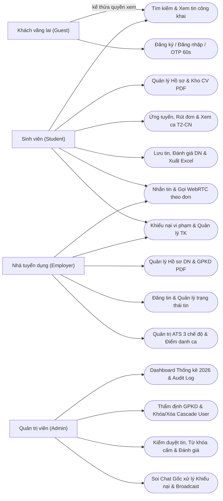
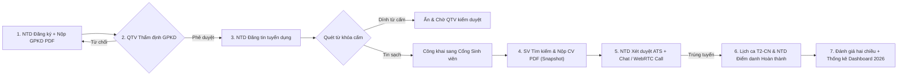
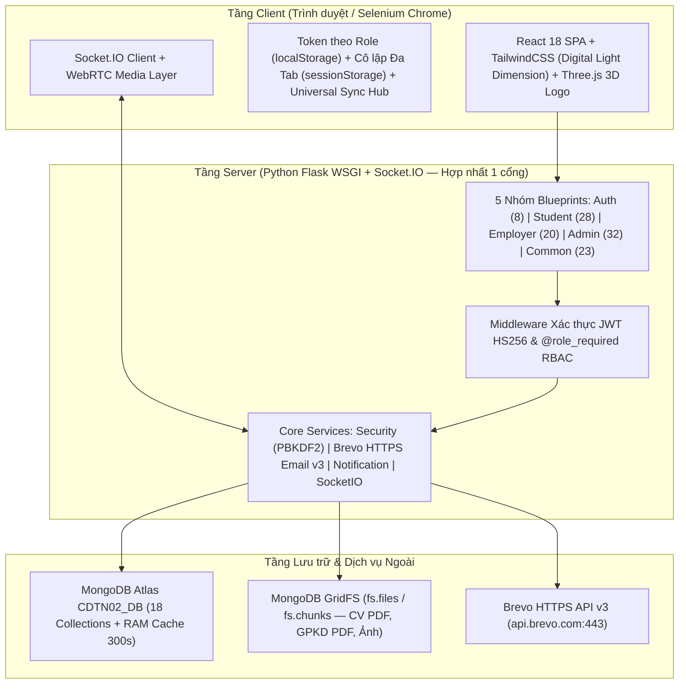
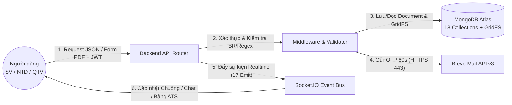
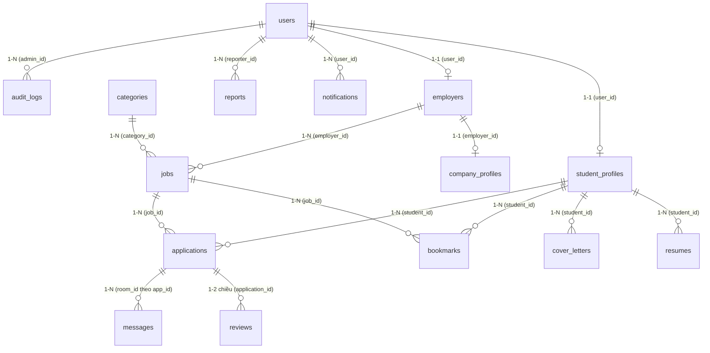

# BÁO CÁO ĐỒ ÁN CHUYÊN ĐỀ TỐT NGHIỆP 2 (CDTN02)

<div align="center">

**TRƯỜNG ĐẠI HỌC VĂN LANG**  
**TRƯỜNG CÔNG NGHỆ VĂN LANG — KHOA CÔNG NGHỆ THÔNG TIN**  

---

### ĐỀ TÀI:
# NGHIÊN CỨU, PHÂN TÍCH VÀ XÂY DỰNG NỀN TẢNG TUYỂN DỤNG VIỆC LÀM PART-TIME THEO CA CHO SINH VIÊN (PARTIME.VN)

* **Ngành đào tạo:** Công nghệ Thông tin (Mã ngành: `7480201`)
* **Học phần:** Chuyên đề Tốt nghiệp 2 (Mã học phần: `CDTN02`)
* **Giảng viên hướng dẫn:** Quý Thầy/Cô Giảng viên hướng dẫn học phần Chuyên đề Tốt nghiệp 2
* **Nhóm sinh viên thực hiện:**
  1. **Vũ Thế Long** — MSSV: `2374802010286` *(Trưởng nhóm — Phụ trách Phân hệ Sinh viên & Hạ tầng Kiểm thử)*
  2. **Huỳnh Nguyễn Bảo Ngọc** — MSSV: `2374802010339` *(Phụ trách Phân hệ Nhà tuyển dụng & Kiểm soát Nghiệp vụ)*
  3. **Lê Thị Thuỳ Ngân** — MSSV: `2374802010328` *(Phụ trách Phân hệ Quản trị viên & Điều phối Dữ liệu)*
* **Sản phẩm triển khai thực tế (Production Render):** `https://parttime-css0.onrender.com/` (Cổng Sinh viên) · `/employer` (Cổng Nhà tuyển dụng) · `/admin` (Cổng Quản trị viên) · Môi trường cục bộ hợp nhất cổng `8002`

*TP. Hồ Chí Minh, tháng 11 năm 2026*

</div>

---

> **Hướng dẫn đọc tài liệu này cho mọi đối tượng:**  
> Tài liệu được trình bày theo chuẩn báo cáo học thuật của Khoa Công nghệ Thông tin – Trường Đại học Văn Lang, nhưng mỗi khái niệm chuyên ngành đều kèm giải thích dễ hiểu ngay bên cạnh.  
> Để đi sâu vào từng khía cạnh kỹ thuật khi bảo vệ đồ án hoặc bàn giao dự án, người đọc có thể mở kèm 5 tài liệu đồng bộ trong cùng thư mục `tailieu/bailam/` và `README.md` gốc:  
> 1. [dieukienrangbuoc.md](file:///d:/Hoc/DH/N4/N4.HK01/Chuyende2/CDTN02/tailieu/bailam/dieukienrangbuoc.md) — Đặc tả chi tiết 18 collections MongoDB, 41 quy tắc nghiệp vụ (`BR`), 13 yêu cầu phi chức năng (`NFR`) và bản đồ API/Socket thực tế.  
> 2. [thietke.md](file:///d:/Hoc/DH/N4/N4.HK01/Chuyende2/CDTN02/tailieu/bailam/thietke.md) — Hệ thống thiết kế *Digital Light Dimension* và 42 prompt Google Stitch đồng bộ 1-1 với màn hình giao diện thực tế.  
> 3. [kichban.md](file:///d:/Hoc/DH/N4/N4.HK01/Chuyende2/CDTN02/tailieu/bailam/kichban.md) — Kiến trúc kiểm thử song hành Manual + Selenium WebDriver Java POM cho 255 Test Cases Selenium (tổng 319 TCs gồm 64 Python TCs) và bảng ánh xạ đủ 57 lệnh từ tài liệu *PLT Solutions PDF*.  
> 4. [congnghe.md](file:///d:/Hoc/DH/N4/N4.HK01/Chuyende2/CDTN02/tailieu/bailam/congnghe.md) — Đối chiếu `congnghe.md` với công nghệ thực tế (`React 18`, `pymongo`, `GridFS`, `PBKDF2`) và từ điển giải thích từng hàm/biến.  
> 5. [thaydoi.md](file:///d:/Hoc/DH/N4/N4.HK01/Chuyende2/CDTN02/tailieu/bailam/thaydoi.md) — Nhật ký tiến hóa 38 giai đoạn từ Sprint 0 đến phiên bản Production Render hiện tại.

---

## MỤC LỤC

- [LỜI CẢM ƠN](#lời-cảm-ơn)
- [LỜI CAM ĐOAN](#lời-cam-đoan)
- [TÓM TẮT](#tóm-tắt)
- [DANH MỤC HÌNH VẼ](#danh-muc-hình-vẽ)
- [DANH MỤC BẢNG BIỂU](#danh-muc-bảng-biểu)
- [DANH MỤC CÁC CHỮ VIẾT TẮT](#danh-muc-các-chữ-viết-tắt)
- [CHƯƠNG 1. MỞ ĐẦU](#chương-1-mở-đầu)
  - [1.1. Lý do chọn đề tài](#11-lý-do-chọn-đề-tài)
    - [1.1.1. Thực trạng nhu cầu tìm việc làm part-time của sinh viên](#111-thực-trạng-nhu-cầu-tìm-việc-làm-part-time-của-sinh-viên)
    - [1.1.2. Khó khăn của nhà tuyển dụng khi tiếp cận ứng viên sinh viên đáng tin cậy](#112-khó-khăn-của-nhà-tuyển-dụng-khi-tiếp-cận-ứng-viên-sinh-viên-đáng-tin-cậy)
    - [1.1.3. Tính cấp thiết của đề tài](#113-tính-cấp-thiết-của-đề-tài)
  - [1.2. Mục tiêu của đề tài](#12-mục-tiêu-của-đề-tài)
    - [1.2.1. Mục tiêu tổng quát](#121-mục-tiêu-tổng-quát)
    - [1.2.2. Mục tiêu cụ thể](#122-mục-tiêu-cụ-thể)
  - [1.3. Đối tượng, phạm vi và nội dung nghiên cứu](#13-đối-tượng-phạm-vi-và-nội-dung-nghiên-cứu)
    - [1.3.1. Đối tượng nghiên cứu](#131-đối-tượng-nghiên-cứu)
    - [1.3.2. Phạm vi nghiên cứu](#132-phạm-vi-nghiên-cứu)
    - [1.3.3. Nội dung nghiên cứu](#133-nội-dung-nghiên-cứu)
  - [1.4. Phương pháp nghiên cứu](#14-phương-pháp-nghiên-cứu)
    - [1.4.1. Phương pháp nghiên cứu lý thuyết](#141-phương-pháp-nghiên-cứu-lý-thuyết)
    - [1.4.2. Phương pháp nghiên cứu thực tiễn](#142-phương-pháp-nghiên-cứu-thực-tiễn)
  - [1.5. Cơ sở khoa học và thực tiễn của đề tài](#15-cơ-sở-khoa-học-và-thực-tiễn-của-đề-tài)
  - [1.6. Thời gian thực hiện](#16-thời-gian-thực-hiện)
  - [1.7. Sản phẩm của đề tài](#17-sản-phẩm-của-đề-tài)
  - [1.8. Bố cục của báo cáo](#18-bố-cục-của-báo-cáo)
- [CHƯƠNG 2. CƠ SỞ LÝ THUYẾT](#chương-2-cơ-sở-lý-thuyết)
  - [2.1. Giới thiệu lĩnh vực nghiên cứu](#21-giới-thiệu-lĩnh-vực-nghiên-cứu)
    - [2.1.1. Mô hình nền tảng hai chiều (Two-sided Marketplace)](#211-mô-hình-nền-tảng-hai-chiều-two-sided-marketplace)
    - [2.1.2. Khảo sát một số nền tảng tuyển dụng / freelance hiện có](#212-khảo-sát-một-số-nền-tảng-tuyển-dụng--freelance-hiện-có)
    - [2.1.3. Định vị giải pháp của nhóm so với các nền tảng hiện có](#213-định-vị-giải-pháp-của-nhóm-so-với-các-nền-tảng-hiện-có)
  - [2.2. Phương pháp tiếp cận](#22-phương-pháp-tiếp-cận)
    - [2.2.1. Quy trình phát triển sản phẩm CNTT](#221-quy-trình-phát-triển-sản-phẩm-cntt)
    - [2.2.2. Mô hình Agile/Scrum rút gọn](#222-mô-hình-agilescrum-rút-gọn)
    - [2.2.3. Phân tích yêu cầu và mô hình hóa UML](#223-phân-tích-yêu-cầu-và-mô-hình-hóa-uml)
  - [2.3. Kiến trúc và công nghệ áp dụng](#23-kiến-trúc-và-công-nghệ-áp-dụng)
    - [2.3.1. Kiến trúc Client – Server, kiến trúc phân lớp và RESTful API](#231-kiến-trúc-client--server-kiến-trúc-phân-lớp-và-restful-api)
    - [2.3.2. Thư viện ReactJS](#232-thư-viện-reactjs)
    - [2.3.3. Nền tảng Node.js và framework Express](#233-nền-tảng-nodejs-và-framework-express)
    - [2.3.4. Hệ quản trị cơ sở dữ liệu MySQL](#234-hệ-quản-trị-cơ-sở-dữ-liệu-mysql)
    - [2.3.5. Xác thực JWT, phân quyền RBAC và băm mật khẩu Bcrypt](#235-xác-thực-jwt-phân-quyền-rbac-và-băm-mật-khẩu-bcrypt)
    - [2.3.6. Giao tiếp thời gian thực: WebSocket và WebRTC](#236-giao-tiếp-thời-gian-thực-websocket-và-webrtc)
    - [2.3.7. Công cụ hỗ trợ: Git/GitHub, Postman](#237-công-cụ-hỗ-trợ-gitgithub-postman)
  - [2.4. Kiểm thử phần mềm](#24-kiểm-thử-phần-mềm)
    - [2.4.1. Kiểm thử đơn vị (Unit Test)](#241-kiểm-thử-đơn-vị-unit-test)
    - [2.4.2. Kiểm thử tích hợp (Integration Test)](#242-kiểm-thử-tích-hợp-integration-test)
    - [2.4.3. Thiết kế test case và quản lý lỗi](#243-thiết-kế-test-case-và-quản-lý-lỗi)
  - [2.5. Phân tích, đánh giá chủ đề nghiên cứu](#25-phân-tích-đánh-giá-chủ-đề-nghiên-cứu)
- [CHƯƠNG 3. THỰC TRẠNG, PHÂN TÍCH VÀ THIẾT KẾ HỆ THỐNG (SPRINT 0 – SPRINT 1)](#chương-3-thực-trạng-phân-tích-và-thiết-kế-hệ-thống-sprint-0--sprint-1)
  - [3.1. Khảo sát hiện trạng và xác định bài toán](#31-khảo-sát-hiện-trạng-và-xác-định-bài-toán)
    - [3.1.1. Hiện trạng tìm việc part-time của sinh viên và tuyển dụng ngắn hạn](#311-hiện-trạng-tìm-việc-part-time-của-sinh-viên-và-tuyển-dụng-ngắn-hạn)
    - [3.1.2. Phân tích bài toán theo mô hình 5W1H](#312-phân-tích-bài-toán-theo-mô-hình-5w1h)
  - [3.2. Phạm vi dự án](#32-phạm-vi-dự-án)
    - [3.2.1. Các chức năng trong và ngoài phạm vi](#321-các-chức-năng-trong-và-ngoài-phạm-vi)
    - [3.2.2. Quản lý thay đổi phạm vi (Change Request)](#322-quản-lý-thay-đổi-phạm-vi-change-request)
      - [3.2.2.1. CR-01: Loại bỏ thanh toán trực tuyến qua cổng thanh toán](#3221-cr-01-loại-bỏ-thanh-toán-trực-tuyến-qua-cổng-thanh-toán)
      - [3.2.2.2. CR-02: Ưu tiên web responsive thay cho ứng dụng di động native](#3222-cr-02-ưu-tiên-web-responsive-thay-cho-ứng-dụng-di-động-native)
      - [3.2.2.3. CR-03: Bổ sung phân hệ hội thoại thời gian thực](#3223-cr-03-bổ-sung-phân-hệ-hội-thoại-thời-gian-thực)
  - [3.3. Tác nhân và mô hình Use Case](#33-tác-nhân-và-mô-hình-use-case)
    - [3.3.1. Danh mục tác nhân và ma trận chức năng theo vai trò](#331-danh-mục-tác-nhân-và-ma-trận-chức-năng-theo-vai-trò)
    - [3.3.2. Sơ đồ Use Case](#332-sơ-đồ-use-case)
      - [3.3.2.1. Sơ đồ Use Case tổng quát](#3321-sơ-đồ-use-case-tổng-quát)
      - [3.3.2.2. Sơ đồ Use Case theo phân hệ (Sinh viên, Nhà tuyển dụng, Quản trị viên)](#3322-sơ-đồ-use-case-theo-phân-hệ-sinh-viên-nhà-tuyển-dụng-quản-trị-viên)
    - [3.3.3. Danh sách Use Case và quan hệ «include» / «extend»](#333-danh-sách-use-case-và-quan-hệ-include--extend)
    - [3.3.4. Đặc tả các Use Case chính](#334-đặc-tả-các-use-case-chính)
      - [3.3.4.1. Tạo tin tuyển dụng mới](#3341-tạo-tin-tuyển-dụng-mới)
      - [3.3.4.2. Tạo yêu cầu ứng tuyển](#3342-tạo-yêu-cầu-ứng-tuyển)
      - [3.3.4.3. Cập nhật trạng thái ứng viên (Duyệt / Từ chối)](#3343-cập-nhật-trạng-thái-ứng-viên-duyệt--từ-chối)
      - [3.3.4.4. Đánh giá hai chiều sau khi hoàn thành công việc](#3344-đánh-giá-hai-chiều-sau-khi-hoàn-thành-công-việc)
  - [3.4. Luồng nghiệp vụ (Business Flow)](#34-luồng-nghiệp-vụ-business-flow)
    - [3.4.1. Luồng nghiệp vụ đầu – cuối](#341-luồng-nghiệp-vụ-đầu--cuối)
    - [3.4.2. Luồng nghiệp vụ phân hệ Sinh viên](#342-luồng-nghiệp-vụ-phân-hệ-sinh-viên)
    - [3.4.3. Luồng nghiệp vụ phân hệ Nhà tuyển dụng](#343-luồng-nghiệp-vụ-phân-hệ-nhà-tuyển-dụng)
    - [3.4.4. Luồng nghiệp vụ phân hệ Quản trị viên](#344-luồng-nghiệp-vụ-phân-hệ-quản-trị-viên)
  - [3.5. Đặc tả yêu cầu phần mềm (SRS)](#35-đặc-tả-yêu-cầu-phần-mềm-srs)
    - [3.5.1. Yêu cầu chức năng](#351-yêu-cầu-chức-năng)
    - [3.5.2. Phân hệ](#352-phân-hệ)
      - [3.5.2.1. Phân hệ Sinh viên](#3521-phân-hệ-sinh-viên)
      - [3.5.2.2. Phân hệ Nhà tuyển dụng](#3522-phân-hệ-nhà-tuyển-dụng)
      - [3.5.2.3. Phân hệ Quản trị viên](#3523-phân-hệ-quản-trị-viên)
    - [3.5.3. Yêu cầu phi chức năng](#353-yêu-cầu-phi-chức-năng)
  - [3.6. Lập kế hoạch dự án theo Agile/Scrum](#36-lập-kế-hoạch-dự-án-theo-agilescrum)
    - [3.6.1. Tổ chức nhóm, công cụ và quy trình làm việc](#361-tổ-chức-nhóm-công-cụ-và-quy-trình-làm-việc)
    - [3.6.2. Cấu trúc phân rã công việc (WBS)](#362-cấu-trúc-phân-rã-công-việc-wbs)
    - [3.6.3. Product Backlog và phân loại ưu tiên MoSCoW](#363-product-backlog-và-phân-loại-ưu-tiên-moscow)
    - [3.6.4. Kế hoạch Sprint ánh xạ theo 10 buổi](#364-kế-hoạch-sprint-ánh-xạ-theo-10-buổi)
  - [3.7. Thiết kế kiến trúc hệ thống](#37-thiết-kế-kiến-trúc-hệ-thống)
    - [3.7.1. Sơ đồ kiến trúc tổng thể (Client – Server, phân lớp)](#371-sơ-đồ-kiến-trúc-tổng-thể-client--server-phân-lớp)
    - [3.7.2. Sơ đồ luồng dữ liệu](#372-sơ-đồ-luồng-dữ-liệu)
    - [3.7.3. Bảng lựa chọn công nghệ và lý do lựa chọn](#373-bảng-lựa-chọn-công-nghệ-và-lý-do-lựa-chọn)
  - [3.8. Thiết kế cơ sở dữ liệu](#38-thiết-kế-cơ-sở-dữ-liệu)
    - [3.8.1. Sơ đồ thực thể – quan hệ (ERD)](#381-sơ-đồ-thực-thể--quan-hệ-erd)
    - [3.8.2. Mô hình dữ liệu quan hệ và ràng buộc](#382-mô-hình-dữ-liệu-quan-hệ-và-ràng-buộc)
    - [3.8.3. Từ điển dữ liệu](#383-từ-điển-dữ-liệu)
  - [3.9. Thiết kế API](#39-thiết-kế-api)
    - [3.9.1. Danh mục endpoint theo phân hệ](#391-danh-mục-endpoint-theo-phân-hệ)
    - [3.9.2. Chuẩn Request / Response JSON và mã lỗi](#392-chuẩn-request--response-json-và-mã-lỗi)
    - [3.9.3. Đặc tả sự kiện thời gian thực (chat, trạng thái online, thông báo)](#393-đặc-tả-sự-kiện-thời-gian-thực-chat-trạng-thái-online-thông-báo)
  - [3.10. Thiết kế giao diện](#310-thiết-kế-giao-diện)
    - [3.10.1. Luồng người dùng (User Flow)](#3101-luồng-người-dùng-user-flow)
    - [3.10.2. Hệ thống thiết kế (Design System)](#3102-hệ-thống-thiết-kế-design-system)
    - [3.10.3. Wireframe và UI Mockup](#3103-wireframe-và-ui-mockup)
- [CHƯƠNG 4. KẾT QUẢ ĐẠT ĐƯỢC (SPRINT 0 – SPRINT 5)](#chương-4-kết-quả-đạt-được-sprint-0--sprint-5)
  - [4.1. Môi trường và quy trình phát triển](#41-môi-trường-và-quy-trình-phát-triển)
    - [4.1.1. Cấu trúc mã nguồn Frontend và Backend](#411-cấu-trúc-mã-nguồn-frontend-và-backend)
    - [4.1.2. Quản lý mã nguồn với Git/GitHub](#412-quản-lý-mã-nguồn-với-gitgithub)
  - [4.2. Kết quả thực hiện theo Sprint (Sprint 0 → Sprint 5)](#42-kết-quả-thực-hiện-theo-sprint-sprint-0--sprint-5)
    - [4.2.1. Sprint 0 (Buổi 1–3): Khởi tạo dự án, phân tích yêu cầu và lập kế hoạch](#421-sprint-0-buổi-13-khởi-tạo-dự-án-phân-tích-yêu-cầu-và-lập-kế-hoạch)
    - [4.2.2. Sprint 1 (Buổi 4–5): Thiết kế hệ thống – Mốc đánh giá giữa kỳ 1](#422-sprint-1-buổi-45-thiết-kế-hệ-thống--mốc-đánh-giá-giữa-kỳ-1)
    - [4.2.3. Sprint 2 (Buổi 6): Phân hệ xác thực, phân quyền và hồ sơ](#423-sprint-2-buổi-6-phân-hệ-xác-thực-phân-quyền-và-hồ-sơ)
    - [4.2.4. Sprint 3 (Buổi 7): Phân hệ nghiệp vụ lõi và tích hợp – Mốc đánh giá giữa kỳ 2](#424-sprint-3-buổi-7-phân-hệ-nghiệp-vụ-lõi-và-tích-hợp--mốc-đánh-giá-giữa-kỳ-2)
    - [4.2.5. Sprint 4 (Buổi 8): Hoàn thiện trạng thái, đánh giá, thông báo, hội thoại và kiểm thử](#425-sprint-4-buổi-8-hoàn-thiện-trạng-thái-đánh-giá-thông-báo-hội-thoại-và-kiểm-thử)
    - [4.2.6. Sprint 5 (Buổi 9–10): Triển khai, hoàn thiện báo cáo và tổng duyệt](#426-sprint-5-buổi-910-triển-khai-hoàn-thiện-báo-cáo-và-tổng-duyệt)
  - [4.3. Các chức năng đã xây dựng](#43-các-chức-năng-đã-xây-dựng)
    - [4.3.1. Phân hệ Sinh viên](#431-phân-hệ-sinh-viên)
      - [4.3.1.1. Đăng ký, đăng nhập và quản lý hồ sơ, CV](#4311-đăng-ký-đăng-nhập-và-quản-lý-hồ-sơ-cv)
      - [4.3.1.2. Tìm kiếm, lọc và ứng tuyển việc làm](#4312-tìm-kiếm-lọc-và-ứng-tuyển-việc-làm)
      - [4.3.1.3. Theo dõi tiến độ ứng tuyển và đánh giá nhà tuyển dụng](#4313-theo-dõi-tiến-độ-ứng-tuyển-và-đánh-giá-nhà-tuyển-dụng)
      - [4.3.1.4. Tin nhắn và thông báo](#4314-tin-nhắn-và-thông-báo)
    - [4.3.2. Phân hệ Nhà tuyển dụng](#432-phân-hệ-nhà-tuyển-dụng)
      - [4.3.2.1. Đăng ký và quản lý hồ sơ doanh nghiệp](#4321-đăng-ký-và-quản-lý-hồ-sơ-doanh-nghiệp)
      - [4.3.2.2. Quản lý tin tuyển dụng](#4322-quản-lý-tin-tuyển-dụng)
      - [4.3.2.3. Quản lý ứng viên và đánh giá sinh viên](#4323-quản-lý-ứng-viên-và-đánh-giá-sinh-viên)
      - [4.3.2.4. Tin nhắn và thông báo](#4324-tin-nhắn-và-thông-báo)
    - [4.3.3. Phân hệ Quản trị viên](#433-phân-hệ-quản-trị-viên)
      - [4.3.3.1. Thống kê và bảng điều khiển](#4331-thống-kê-và-bảng-điều-khiển)
      - [4.3.3.2. Quản lý người dùng và phê duyệt nhà tuyển dụng](#4332-quản-lý-người-dùng-và-phê-duyệt-nhà-tuyển-dụng)
      - [4.3.3.3. Kiểm duyệt tin tuyển dụng, đánh giá và hội thoại](#4333-kiểm-duyệt-tin-tuyển-dụng-đánh-giá-và-hội-thoại)
      - [4.3.3.4. Quản lý danh mục và xử lý báo cáo vi phạm](#4334-quản-lý-danh-mục-và-xử-lý-báo-cáo-vi-phạm)
  - [4.4. Đối chiếu chức năng dự kiến và kết quả thực hiện](#44-đối-chiếu-chức-năng-dự-kiến-và-kết-quả-thực-hiện)
    - [4.4.1. Bảng đối chiếu chức năng theo Product Backlog](#441-bảng-đối-chiếu-chức-năng-theo-product-backlog)
    - [4.4.2. Các chức năng chưa xây dựng được và lý do](#442-các-chức-năng-chưa-xây-dựng-được-và-lý-do)
  - [4.5. Kiểm thử sản phẩm](#45-kiểm-thử-sản-phẩm)
    - [4.5.1. Kế hoạch và môi trường kiểm thử](#451-kế-hoạch-và-môi-trường-kiểm-thử)
    - [4.5.2. Kiểm thử đơn vị (Unit Test)](#452-kiểm-thử-đơn-vị-unit-test)
    - [4.5.3. Kiểm thử tích hợp và kiểm thử API](#453-kiểm-thử-tích-hợp-và-kiểm-thử-api)
    - [4.5.4. Kiểm thử chức năng theo luồng nghiệp vụ chính](#454-kiểm-thử-chức-năng-theo-luồng-nghiệp-vụ-chính)
    - [4.5.5. Kiểm thử yêu cầu phi chức năng](#455-kiểm-thử-yêu-cầu-phi-chức-năng)
    - [4.5.6. Tổng hợp kết quả kiểm thử và danh sách lỗi đã sửa](#456-tổng-hợp-kết-quả-kiểm-thử-và-danh-sách-lỗi-đã-sửa)
  - [4.6. Triển khai sản phẩm](#46-triển-khai-sản-phẩm)
    - [4.6.1. Mô hình và môi trường triển khai](#461-mô-hình-và-môi-trường-triển-khai)
    - [4.6.2. Quy trình triển khai Frontend, Backend và cơ sở dữ liệu](#462-quy-trình-triển-khai-frontend-backend-và-cơ-sở-dữ-liệu)
    - [4.6.3. Tài khoản, dữ liệu demo và phương án dự phòng](#463-tài-khoản-dữ-liệu-demo-và-phương-án-dự-phòng)
  - [4.7. Kết quả phân công công việc](#47-kết-quả-phân-công-công-việc)
    - [4.7.1. Bảng phân vai trò và nhiệm vụ của từng thành viên](#471-bảng-phân-vai-trò-và-nhiệm-vụ-của-từng-thành-viên)
    - [4.7.2. Mức độ hoàn thành và đóng góp của từng thành viên](#472-mức-độ-hoàn-thành-và-đóng-góp-của-từng-thành-viên)
  - [4.8. Nhận xét, đánh giá](#48-nhận-xét-đánh-giá)
    - [4.8.1. Đối chiếu với tiêu chí nghiệm thu của đề tài](#481-đối-chiếu-với-tiêu-chí-nghiệm-thu-của-đề-tài)
    - [4.8.2. So sánh kế hoạch và thực tế triển khai](#482-so-sánh-kế-hoạch-và-thực-tế-triển-khai)
  - [4.9. Những khó khăn trong quá trình thực hiện và cách khắc phục](#49-những-khó-khăn-trong-quá-trình-thực-hiện-và-cách-khắc-phục)
- [CHƯƠNG 5. KẾT LUẬN VÀ HƯỚNG PHÁT TRIỂN](#chương-5-kết-luận-và-hướng-phát-triển)
  - [5.1. Tóm tắt kết quả đạt được](#51-tóm-tắt-kết-quả-đạt-được)
  - [5.2. Hạn chế của đề tài](#52-hạn-chế-của-đề-tài)
  - [5.3. Hướng phát triển và kiến nghị](#53-hướng-phát-triển-và-kiến-nghị)
- [TÀI LIỆU THAM KHẢO](#tài-liệu-tham-khảo)
- [PHỤ LỤC](#phụ-lục)

---

## LỜI CẢM ƠN

Nhóm sinh viên thực hiện đề tài xin trân trọng gửi lời cảm ơn chân thành đến Ban Giám hiệu Trường Đại học Văn Lang, Ban Chủ nhiệm Khoa Công nghệ Thông tin – Trường Công nghệ Văn Lang, cùng toàn thể quý Thầy/Cô giảng viên đã trang bị nền tảng kiến thức vững chắc về phân tích thiết kế hệ thống, công nghệ phần mềm, cơ sở dữ liệu và kiểm thử chất lượng trong suốt quá trình học tập.

Đặc biệt, nhóm xin gửi lời tri ân sâu sắc đến Quý Thầy/Cô Giảng viên hướng dẫn học phần Chuyên đề Tốt nghiệp 2 (`CDTN02`). Nhờ sự theo dõi sát sao qua từng mốc Sprint, những góp ý thẳng thắn về tính khả thi của phạm vi đề tài (Change Request), sự chuẩn mực của đặc tả nghiệp vụ và tư duy kiểm thử tự động song hành, nhóm đã hoàn thiện hệ thống **PARTIME.VN** phiên bản Production ổn định, đồng bộ trọn vẹn giữa mã nguồn, cơ sở dữ liệu đám mây và bộ tài liệu kiểm chứng.

*TP. Hồ Chí Minh, tháng 11 năm 2026*  
**Nhóm sinh viên thực hiện**  
**Vũ Thế Long — Huỳnh Nguyễn Bảo Ngọc — Lê Thị Thuỳ Ngân**

---

## LỜI CAM ĐOAN

Nhóm tác giả xin cam đoan rằng báo cáo và sản phẩm phần mềm **"Nền tảng tuyển dụng việc làm part-time theo ca cho sinh viên (PARTIME.VN)"** là thành quả lao động nghiêm túc, trung thực của cả nhóm trong học phần Chuyên đề Tốt nghiệp 2.

Mọi số liệu thống kê, kết quả chạy kiểm thử tự động trên môi trường triển khai thực tế Render (`255` Test Cases Selenium (tổng `319` TCs gồm `64` Python TCs) trong Excel và Selenium WebDriver Java), cấu trúc dữ liệu (`18` collections + GridFS), mã nguồn Backend/Frontend và các biểu đồ phân tích đều được ghi nhận trung thực từ quá trình xây dựng và vận hành thực tế của nhóm. Những tài liệu tham khảo và thư viện mã nguồn mở được sử dụng đều có trích dẫn rõ ràng.

---

## TÓM TẮT

Tìm kiếm việc làm bán thời gian (*part-time*) giúp sinh viên trang trải chi phí và tích lũy kinh nghiệm sớm, nhưng thị trường tuyển dụng tự phát trên mạng xã hội hiện nay tồn tại nhiều rủi ro như lừa đảo thu phí đặt cọc, tin tuyển dụng thiếu minh bạch về lương và lịch làm việc không tương thích với lịch học. Ở chiều ngược lại, các doanh nghiệp nhỏ, quán cà phê, cửa hàng bán lẻ hay đơn vị sự kiện thường gặp khó khăn trong việc sàng lọc ứng viên sinh viên theo đúng khung giờ rảnh và kiểm soát tỷ lệ bỏ ca.

Đề tài xây dựng nền tảng tuyển dụng hai chiều **PARTIME.VN** nhằm giải quyết trực tiếp bài toán kết nối **Sinh viên — Nhà tuyển dụng — Quản trị viên** xoay quanh **ca làm việc linh hoạt theo thứ trong tuần (T2–CN)** và **cơ chế kiểm soát an toàn nhiều lớp**. Hệ thống hỗ trợ:
1. **Sinh viên:** Trải nghiệm Chế độ Khách (*Guest Mode*) không cần đăng nhập để tìm việc theo từ khóa tiếng Việt không dấu, 63 tỉnh/thành, mức lương, ca làm và khoảng cách gần trường/nơi ở; lưu trữ nhiều bản CV định dạng `.pdf` (`<= 10MB`), ứng tuyển nhanh 1 chạm với ảnh chụp hồ sơ bất biến (*snapshot*), quản lý tiến độ 6 trạng thái, theo dõi lịch ca làm T2–CN, đánh giá doanh nghiệp và trò chuyện trực tiếp.
2. **Nhà tuyển dụng:** Đăng ký doanh nghiệp kèm kiểm định Mã số thuế (10/13 số) và Giấy phép kinh doanh (`.pdf`); đăng tin chuẩn khung lương `15.000 – 200.000 VNĐ/giờ` qua bộ lọc kiểm duyệt từ khóa nhạy cảm 2 luồng; quản trị ứng viên chuẩn ATS (*Applicant Tracking System*) theo 3 chế độ hiển thị (**Kanban**, **Lưới**, **Danh sách**); chấm công ca làm, xuất bảng tính `.xls` và phỏng vấn trực tuyến **WebRTC Video Call** tích hợp ngay trong phòng chat cô lập theo từng đơn ứng tuyển.
3. **Quản trị viên:** Kiểm soát tập trung qua **Trung tâm chỉ huy 2026** (số liệu thực `@gmail.com`), bàn thẩm định GPKD, xử lý tin bị gắn cờ từ khóa cấm, quản trị danh mục Master Data, đối chiếu **Chat gốc chưa che `***`** khi phân xử báo cáo vi phạm, phát Broadcast thông báo thu hồi được và giám sát 16 loại sự kiện nhật ký (*Audit Log*).

Về kỹ thuật, hệ thống sử dụng **React 18 + Vite + TailwindCSS** theo ngôn ngữ thiết kế *Digital Light Dimension* (8 cột màu sáng dịu mắt, phông *Be Vietnam Pro*, biểu tượng *Lucide*, logo 3D WebGL GLTF, không dùng hộp thoại trình duyệt thô `alert`/`confirm`), Backend **Python Flask + Flask-SocketIO**, CSDL đám mây **MongoDB Atlas (`CDTN02_DB` — 18 collections + GridFS)**, băm mật khẩu **PBKDF2-HMAC-SHA256 (`100.000` vòng)**, xác thực **JWT `HS256`**, gửi mã **OTP 60 giây qua Brevo HTTPS API v3**, và triển khai thống nhất trên **Render Docker**. Toàn bộ `161` yêu cầu chức năng (`FR`), `41` quy tắc nghiệp vụ (`BR`) và `13` yêu cầu phi chức năng (`NFR`) được kiểm chứng bằng bộ **255 Test Cases Selenium (tổng 319 TCs gồm 64 Python TCs) song hành Manual + Selenium WebDriver Java POM** tích hợp **đủ 57 lệnh chuẩn *PLT Solutions PDF***, đạt **`178/178 PASS (100%)` trên tập chạy tự động và `0 FAIL`**.

---

## DANH MỤC HÌNH VẼ

| Ký hiệu | Tên sơ đồ / hình minh họa | Vị trí mục | Ý nghĩa giúp người đọc nắm bắt |
|---|---|---|---|
| **Hình 3.1** | Sơ đồ Use Case tổng quát hệ thống PARTIME.VN | Mục 3.3.2.1 | Toàn cảnh quyền hạn của 4 tác nhân (*Khách, Sinh viên, Nhà tuyển dụng, Quản trị viên*). |
| **Hình 3.2** | Sơ đồ Use Case 3 phân hệ chi tiết | Mục 3.3.2.2 | Nhóm chức năng lõi riêng của SV, NTD và QTV. |
| **Hình 3.3** | Sơ đồ Luồng nghiệp vụ Đầu – Cuối (End-to-End Flow) | Mục 3.4.1 | Chuỗi tương tác liên thông từ đăng tin -> ứng tuyển -> phỏng vấn -> ca làm -> đánh giá. |
| **Hình 3.4** | Sơ đồ Kiến trúc tổng thể Client – Server & Phân lớp | Mục 3.7.1 | Cách Frontend React giao tiếp REST/Socket.IO với Backend Flask & MongoDB Atlas. |
| **Hình 3.5** | Sơ đồ Luồng dữ liệu (DFD Mức 0 & Mức 1) | Mục 3.7.2 | Đường đi của dữ liệu đăng ký, tệp PDF và đơn ứng tuyển trong hệ thống. |
| **Hình 3.6** | Sơ đồ Thực thể – Quan hệ (ERD 18 Collections + GridFS) | Mục 3.8.1 | Mối liên kết khóa logic giữa người dùng, tin tuyển dụng, đơn và hội thoại. |
| **Hình 3.7** | Sơ đồ Luồng người dùng (User Flow 3 vai trò) | Mục 3.10.1 | Hành trình di chuyển giữa các màn hình theo từng vai trò. |
| **Hình 4.1** | Kiến trúc triển khai Production trên Render Cloud & Atlas | Mục 4.6.1 | Mô hình Docker hợp nhất Static Frontend + Flask WSGI + Socket.IO + Brevo API v3. |

---

## DANH MỤC BẢNG BIỂU

| Ký hiệu | Tên bảng biểu | Vị trí mục | Nội dung chính |
|---|---|---|---|
| **Bảng 2.1** | So sánh PARTIME.VN với các nền tảng tuyển dụng hiện có | Mục 2.1.2 | Điểm khác biệt về lọc ca học, GPKD và phòng chống lừa đảo. |
| **Bảng 3.1** | Phân tích bài toán theo mô hình 5W1H | Mục 3.1.2 | Làm rõ đối tượng, bối cảnh, mục tiêu và phương thức giải quyết. |
| **Bảng 3.2** | Ma trận chức năng theo vai trò tác nhân | Mục 3.3.1 | Bảng phân quyền tổng quát giữa 4 nhóm người dùng. |
| **Bảng 3.3** | Danh sách Use Case và quan hệ `«include»`/`«extend»` | Mục 3.3.3 | Ánh xạ cấu trúc phụ thuộc giữa các ca sử dụng. |
| **Bảng 3.4** | Thống kê `161` Yêu cầu Chức năng (`Tonghop.xlsx`) | Mục 3.5.1 | Tổng hợp `56` FR SV + `59` FR NTD + `46` FR QTV (`70` Cơ bản, `12` Mục 10, `79` Nâng cao). |
| **Bảng 3.5** | Bảng tổng hợp `13` Yêu cầu Phi chức năng (`NFR-01..13`) | Mục 3.5.3 | Các ngưỡng đo về hiệu năng, bảo mật, đa thiết bị và kiểm toán. |
| **Bảng 3.6** | Kế hoạch phát triển theo 10 buổi học phần & 6 Sprint | Mục 3.6.4 | Mốc thời gian, đầu ra và nghiệm thu từng Sprint. |
| **Bảng 3.7** | Bảng lựa chọn công nghệ thực tế và lý do lựa chọn | Mục 3.7.3 | Lý giải chuyển đổi lý thuyết -> giải pháp tối ưu trong sản phẩm thật. |
| **Bảng 3.8** | Từ điển dữ liệu 18 Collections + GridFS | Mục 3.8.3 | Tên collection, tiền tố `_id` và vai trò lưu trữ thực tế. |
| **Bảng 3.9** | Danh mục API Endpoints thực tế theo 5 phân hệ | Mục 3.9.1 | `109+` đường dẫn HTTP và vai trò bảo vệ tương ứng. |
| **Bảng 3.10** | Bảng màu 8 cột *Digital Light Dimension* | Mục 3.10.2 | Mã màu hex, vùng áp dụng và lý do công thái học nền sáng. |
| **Bảng 4.1** | Bảng đối chiếu Product Backlog (`161` FR, `41` BR, `13` NFR) | Mục 4.4.1 | Tỷ lệ hoàn thành 100% phạm vi đã thống nhất. |
| **Bảng 4.2** | Phân bổ `255` Test Cases Selenium (tổng `319` TCs gồm `64` Python TCs) theo Role × Cấp độ × Loại kịch bản | Mục 4.5.1 | Kết quả chạy trực tiếp trên Render: `178 PASS / 0 FAIL / 77 Chờ Cookie/Not Run`. |
| **Bảng 4.3** | Bảng đối chiếu phân công và kết quả đóng góp 3 thành viên | Mục 4.7.1 | Phân tách rõ phạm vi code/tài liệu của từng thành viên. |

---

## DANH MỤC CÁC CHỮ VIẾT TẮT

| Từ viết tắt | Nguyên văn tiếng Anh / thuật ngữ | Nghĩa dễ hiểu trong tài liệu |
|---|---|---|
| **API** | *Application Programming Interface* | Giao diện kết nối cho phép trình duyệt (Frontend) gửi yêu cầu và nhận dữ liệu JSON từ máy chủ (Backend). |
| **ATS** | *Applicant Tracking System* | Hệ thống theo dõi hồ sơ ứng viên của Nhà tuyển dụng theo các trạng thái *Chờ duyệt -> Đã tiếp nhận -> Phỏng vấn -> Trúng tuyển*. |
| **BR / FR / NFR** | *Business Rule / Functional / Non-functional Requirement* | Quy tắc nghiệp vụ (`41`), Yêu cầu chức năng (`161`) và Yêu cầu phi chức năng (`13`). |
| **CR** | *Change Request* | Yêu cầu thay đổi phạm vi dự án có kiểm soát trong quá trình làm phần mềm. |
| **CRUD** | *Create, Read, Update, Delete* | 4 thao tác cơ bản với dữ liệu: Tạo mới, Đọc danh sách/chi tiết, Cập nhật, Xóa. |
| **CV / GPKD** | *Curriculum Vitae / Giấy phép kinh doanh* | Hồ sơ xin việc của Sinh viên và tài liệu pháp lý bắt buộc định dạng PDF của Doanh nghiệp. |
| **E2E** | *End-to-End Testing* | Kiểm thử luồng xuyên suốt nhiều vai trò liên thông (VD: NTD đăng tin -> SV ứng tuyển -> QTV kiểm duyệt). |
| **ERD** | *Entity-Relationship Diagram* | Sơ đồ biểu diễn các đối tượng dữ liệu (như Người dùng, Việc làm, Đơn ứng tuyển) và mối liên kết giữa chúng. |
| **GridFS** | *Grid File System (MongoDB)* | Cơ chế chia nhỏ và lưu trữ tệp nhị phân lớn (CV PDF, GPKD PDF, ảnh đại diện) an toàn ngay trong MongoDB. |
| **JWT** | *JSON Web Token* | Chuỗi mã hóa ký số có thời hạn (`24 giờ`) đóng vai trò "thẻ thông hành" chứng minh danh tính người dùng sau khi đăng nhập. |
| **OTP** | *One-Time Password* | Mã xác thực 6 chữ số dùng một lần gửi qua email, hết hạn sau **60 giây**. |
| **PBKDF2** | *Password-Based Key Derivation Function 2* | Thuật toán băm một chiều kèm lặp `100.000` lần giúp bảo vệ mật khẩu ngay cả khi dữ liệu bị lộ. |
| **POM** | *Page Object Model* | Mẫu thiết kế kiểm thử tự động tách riêng phần thao tác giao diện từng trang khỏi kịch bản kiểm thử. |
| **RBAC** | *Role-Based Access Control* | Kiểm soát quyền truy cập dựa theo vai trò (*Sinh viên* không gọi được chức năng *Quản trị viên*). |
| **RESTful** | *Representational State Transfer* | Chuẩn thiết kế API dùng đúng động từ HTTP (`GET`, `POST`, `PUT`, `DELETE`) và mã trạng thái chuẩn (`200`, `400`, `401`, `403`, `409`). |
| **WebRTC** | *Web Real-Time Communication* | Công nghệ gọi thoại và gọi video trực tiếp trên trình duyệt mà không cần cài ứng dụng ngoài. |

---

# CHƯƠNG 1. MỞ ĐẦU

## 1.1. Lý do chọn đề tài

### 1.1.1. Thực trạng nhu cầu tìm việc làm part-time của sinh viên
Hiện nay, tại các đô thị lớn tập trung đông đảo trường đại học như Thành phố Hồ Chí Minh, nhu cầu làm thêm (*part-time*) của sinh viên ngày càng cao. Sinh viên tìm việc không chỉ để trang trải sinh hoạt phí, tiền trọ mà còn để rèn luyện kỹ năng giao tiếp, quản lý thời gian và tích lũy kinh nghiệm thực tiễn trước khi tốt nghiệp. Đặc thù lớn nhất của sinh viên là lịch học thay đổi theo từng học kỳ và từng buổi trong tuần: một sinh viên có thể rảnh sáng thứ Hai, tối thứ Tư và cả ngày cuối tuần, nhưng bận lịch thực hành vào các khung giờ khác.

Tuy vậy, phần lớn sinh viên vẫn phải tìm việc thông qua các hội nhóm Facebook, Zalo tự phát hoặc qua người quen giới thiệu. Trên các kênh này, tin đăng thiếu cấu trúc rõ ràng: mức lương thường ghi mơ hồ kiểu "thu nhập hấp dẫn", không ghi rõ ca làm việc, địa điểm làm việc thực tế, và đặc biệt thiếu cơ chế kiểm chứng doanh nghiệp. Kết quả là nhiều sinh viên mất thời gian di chuyển phỏng vấn, thậm chí đối mặt với rủi ro tin lừa đảo yêu cầu đóng tiền đồng phục, tiền thế chân hoặc làm nhiệm vụ trực tuyến.

### 1.1.2. Khó khăn của nhà tuyển dụng khi tiếp cận ứng viên sinh viên đáng tin cậy
Ở phía ngược lại, các cửa hàng dịch vụ ăn uống (F&B), siêu thị tiện lợi, trung tâm gia sư, đơn vị tổ chức sự kiện và doanh nghiệp vừa và nhỏ luôn thiếu nhân sự theo ca ngắn hạn. Khi đăng tin trên mạng xã hội, nhà tuyển dụng thường nhận được hàng loạt tin nhắn rời rạc, không có hồ sơ chuẩn (CV), khó kiểm chứng ứng viên học trường nào, ở khu vực nào để thuận tiện đi làm, và mất rất nhiều công sức ghi chép tay ai đậu phỏng vấn, ai nhận ca ngày nào trong tuần.

Bên cạnh đó, các cổng tuyển dụng lớn tại Việt Nam (TopCV, VietnamWorks, CareerBuilder...) vốn được thiết kế tối ưu cho nhân sự toàn thời gian (*full-time*) có kinh nghiệm nhiều năm. Khi một quán cà phê chỉ cần tuyển sinh viên làm ca tối thứ Sáu – Chủ Nhật, quy trình tiếp nhận và sàng lọc của các trang tuyển dụng truyền thống trở nên cồng kềnh, thiếu tính năng chấm công ca làm, thiếu kênh trao đổi nhanh kèm phỏng vấn video ngay trong hồ sơ ứng tuyển.

### 1.1.3. Tính cấp thiết của đề tài
Từ khoảng trống thực tế hai chiều nêu trên, việc xây dựng một nền tảng web chuyên biệt dành riêng cho **việc làm part-time theo ca của sinh viên** — có cơ chế **thẩm định Giấy phép kinh doanh**, **bộ lọc tự động từ khóa lừa đảo/đặt cọc**, **quản lý ca làm T2–CN**, **trao đổi và phỏng vấn video theo từng đơn ứng tuyển**, cùng **hệ thống kiểm thử tự động đảm bảo độ tin cậy** — là hết sức cấp thiết cả về mặt thực tiễn xã hội lẫn giá trị học thuật kỹ thuật phần mềm.

---

## 1.2. Mục tiêu của đề tài

### 1.2.1. Mục tiêu tổng quát
Xây dựng và triển khai hoàn chỉnh nền tảng tuyển dụng việc làm part-time theo ca cho sinh viên (**PARTIME.VN**) vận hành thực tế trên Internet (Render Cloud + MongoDB Atlas), phục vụ đồng thời ba nhóm người dùng (**Sinh viên**, **Nhà tuyển dụng**, **Quản trị viên**) trên giao diện hiện đại, an toàn, cô lập dữ liệu nghiêm ngặt và có bộ kiểm thử tự động song hành đảm bảo chất lượng phát hành.

### 1.2.2. Mục tiêu cụ thể
Để đạt mục tiêu tổng quát, đề tài đặt ra 5 mục tiêu cụ thể đo lường được:
1. **Về nghiệp vụ:** Hoàn thiện đầy đủ `161` yêu cầu chức năng (`FR`) và `41` quy tắc nghiệp vụ (`BR`) trên `3` phân hệ chính, bảo đảm luồng khép kín: Thẩm định doanh nghiệp -> Đăng tin kiểm duyệt 2 luồng -> Tìm việc & Ứng tuyển -> Tuyển chọn ATS -> Quản lý ca làm T2–CN -> Đánh giá hai chiều & Xử lý báo cáo.
2. **Về bảo mật & toàn vẹn:** Thực thi nguyên tắc **`1 Email = 1 Role`**, mật khẩu băm một chiều **PBKDF2-HMAC-SHA256 (`100.000` vòng)**, token phiên **JWT (`24 giờ`)** cô lập đa tab, OTP **60 giây** qua **Brevo HTTPS API v3**, chặn tệp ngoài `.pdf` với kiểm tra chữ ký nhị phân `%PDF` (`<= 10MB`), và giữ **Chat gốc chưa che** làm bằng chứng quản trị.
3. **Về trải nghiệm người dùng:** Áp dụng phong cách *Digital Light Dimension* dịu mắt, tương thích **4 kích thước thiết bị** (`Mobile 430px`, `iPad 820px`, `Laptop 1366px`, `PC 1920px`), hỗ trợ **Chế độ Khách (*Guest Mode*)**, giao tiếp thời gian thực Socket.IO, gọi video **WebRTC**, và xuất **6 loại báo cáo Excel `.xls`**.
4. **Về kiểm thử:** Xây dựng bộ kịch bản kiểm thử song hành **Thủ công (Manual) + Tự động (Selenium WebDriver Java POM)** gồm **`255` Test Cases Selenium (tổng `319` TCs gồm `64` Python TCs)** trong Excel đồng bộ, phủ đủ 4 cấp độ kiểm thử và 57 lệnh chuẩn của tài liệu *PLT Solutions*.
5. **Về triển khai:** Đóng gói Docker, triển khai hoạt động ổn định tại `https://parttime-css0.onrender.com/` cùng hệ thống tài liệu kỹ thuật đồng bộ (`dieukienrangbuoc.md`, `thietke.md`, `kichban.md`, `thaydoi.md`, `noidung.md`).

---

## 1.3. Đối tượng, phạm vi và nội dung nghiên cứu

### 1.3.1. Đối tượng nghiên cứu
* **Đối tượng nghiệp vụ:** Quy trình tìm việc làm part-time của sinh viên, quy trình tuyển dụng theo ca ngắn hạn và công tác kiểm duyệt an toàn trên sàn tuyển dụng tại Việt Nam.
* **Đối tượng kỹ thuật:** Kiến trúc ứng dụng web hiện đại Client–Server, lập trình giao diện React 18, xây dựng RESTful API & Socket.IO với Python Flask, lưu trữ tài liệu & nhị phân trên MongoDB Atlas + GridFS, xác thực email qua HTTPS API, và tự động hóa kiểm thử bằng Selenium WebDriver Java POM.

### 1.3.2. Phạm vi nghiên cứu
* **Phạm vi người dùng:** Khách vãng lai (*Guest*), Sinh viên đang tìm việc, Nhà tuyển dụng đại diện doanh nghiệp/cơ sở kinh doanh, và Quản trị viên vận hành sàn.
* **Phạm vi không gian & địa lý trong dữ liệu:** Hỗ trợ dữ liệu lọc **63 Tỉnh/Thành phố** Việt Nam (có danh mục quận/huyện chi tiết cho 10 tỉnh/thành trọng điểm và 24 quận/huyện tại TP. Hồ Chí Minh), khung lương chuẩn `15.000 – 200.000 VNĐ/giờ`.
* **Phạm vi chức năng:** Thực hiện đầy đủ Mục 1–7 và Mục 10 theo đặc tả `Tonghop.xlsx` (`161` FR); theo **Change Request (`CR-01`, `CR-02`)**, dự án **không** tích hợp cổng thanh toán trực tuyến tiền thật (Mục 8) và **không** xây dựng app di động cài đặt riêng iOS/Android native (Mục 9) mà tối ưu Web Responsive chạy mượt trên trình duyệt di động.

### 1.3.3. Nội dung nghiên cứu
1. Khảo sát thực trạng thị trường tuyển dụng part-time và phân tích bài toán theo 5W1H.
2. Phân tích yêu cầu phần mềm: Use Case, Business Flow, SRS (`FR`, `BR`, `NFR`) và quản lý dự án theo Agile/Scrum.
3. Thiết kế kiến trúc phân lớp, thiết kế CSDL MongoDB 18 collections + GridFS, thiết kế REST API + Socket.IO + WebRTC, và chuẩn hóa Design System cho 42 màn hình/thành phần UI.
4. Lập trình hoàn thiện Backend (`Backend/`), Frontend (`frontend/`) và triển khai Docker trên Render Cloud.
5. Thiết kế và chạy kiểm thử đa tầng bằng Excel + Selenium Java POM (`test/`), đánh giá và tổng kết đề tài.

---

## 1.4. Phương pháp nghiên cứu

### 1.4.1. Phương pháp nghiên cứu lý thuyết
Nhóm nghiên cứu hệ thống hóa tài liệu chuẩn về kỹ nghệ phần mềm hiện đại: mô hình phát triển lặp tăng trưởng **Agile/Scrum**, chuẩn mô hình hóa **UML**, nguyên lý kiến trúc phân lớp **Clean/Layered Architecture**, thiết kế API **RESTful**, giao thức truyền thông thời gian thực **WebSocket/WebRTC**, kỹ thuật băm mật khẩu kháng dò vét (**PBKDF2**) và chuẩn mực thiết kế kiểm thử tự động **Page Object Model (POM)**.

### 1.4.2. Phương pháp nghiên cứu thực tiễn
* **Phân tích đối chiếu thực nghiệm:** Khảo sát giao diện và quy trình của các sàn tuyển dụng lớn để rút ra những điểm gây vướng cho sinh viên làm bán thời gian, từ đó thiết kế bộ lọc ca làm T2–CN và bộ lọc kiểm duyệt từ khóa cấm.
* **Phát triển lặp và phản hồi trực tiếp:** Chia quá trình lập trình thành 6 Sprint (gắn 10 buổi học phần), mỗi tuần đối chiếu trực tiếp sản phẩm chạy thật trên trình duyệt để sửa lỗi hiển thị và logic nghiệp vụ (ghi nhận xuyên suốt 38 giai đoạn trong `thaydoi.md`).
* **Kiểm thử tự động hóa hộp đen & hộp xám:** Viết bộ test Java vừa thao tác trực quan như người dùng thật qua ChromeDriver, vừa gửi HTTP request trực tiếp để xác minh phản hồi máy chủ Render, sau đó ghi ngược kết quả về file Excel.

---

## 1.5. Cơ sở khoa học và thực tiễn của đề tài
Đề tài đứng trên nền tảng khoa học vững chắc của các tiêu chuẩn công nghiệp: giao thức xác thực không trạng thái JWT (*RFC 7519*), chuẩn trao đổi email qua REST API cổng `443` (*RFC 5322* cho địa chỉ hiển thị khi fallback SMTP), chuẩn bảo vệ thông tin đăng nhập bằng hàm dẫn xuất khóa PBKDF2 (*NIST SP 800-132*), và đặc tả **W3C WebDriver** giúp kịch bản Selenium tương tác chính xác với DOM thật. Về mặt thực tiễn, hệ thống bám sát ngữ cảnh Việt Nam: kiểm tra đầu số điện thoại di động `0xxxxxxxxx`, kiểm tra Mã số thuế 10/13 chữ số, nhận dạng từ khóa tiếng Việt không dấu và chặn các hành vi tuyển dụng vi phạm quy định lao động (thu phí đặt cọc, ca làm bất thường, lương dưới mức sàn).

---

## 1.6. Thời gian thực hiện
Dự án được tổ chức thực hiện xuyên suốt học phần Chuyên đề Tốt nghiệp 2 trong **10 buổi chính khóa** (tương ứng **Sprint 0 đến Sprint 5** từ tháng 10/2026 đến tháng 11/2026), tiếp nối bằng chuỗi giai đoạn tinh chỉnh UI, đóng gói Docker/Render, nâng cấp OTP Brevo HTTPS API v3 và hoàn thiện bộ kiểm thử tự động **255 Test Cases Selenium (tổng 319 TCs gồm 64 Python TCs)** vào ngày **19–20/11/2026**. Hai mốc tổng kết quan trọng cuối học phần bao gồm:
* **Buổi 10 (23/11/2026):** Hoàn thiện đóng băng mã nguồn sản phẩm, in ấn và nộp **Poster nghiên cứu khổ A0** (60cm × 90cm) tổng kết kiến trúc, giao diện và kết quả kiểm thử.
* **Buổi 11 (30/11/2026):** Báo cáo nghiệm thu và bảo vệ đề tài chính thức trước Hội đồng chấm Chuyên đề Tốt nghiệp 2 Trường Đại học Văn Lang.

---

## 1.7. Sản phẩm của đề tài
Sản phẩm bàn giao hoàn chỉnh trong kho lưu trữ `CDTN02/` gồm 4 cấu phần đồng nhất:
1. **Mã nguồn Backend (`Backend/`):** Dịch vụ Flask RESTful + Socket.IO + Email Service + GridFS (`server.py` và `Backend/src/**`).
2. **Mã nguồn Frontend (`frontend/`):** Ứng dụng SPA React 18 + Vite + TailwindCSS + WebGL 3D Logo (`frontend/src/**`).
3. **Bộ kiểm thử song hành (`test/`):** Dự án Maven Java 17 (`pom.xml`), 9 tệp nguồn POM + `HttpClient`, tệp cấu hình tài nguyên mẫu và sổ kiểm thử Excel `TestCases_Selenium_PARTIME_VN.xlsx` (`255` Test Cases Selenium (tổng `319` TCs gồm `64` Python TCs)).
4. **Hệ thống tài liệu kỹ thuật & triển khai:** Bộ đặc tả `Tonghop.xlsx`, 5 tài liệu `.md` (`noidung.md`, `dieukienrangbuoc.md`, `thietke.md`, `kichban.md`, `thaydoi.md`) cùng `Dockerfile`, `docker-compose.yml` và `render.yaml`.

---

## 1.8. Bố cục của báo cáo
Ngoài các trang mở đầu và phụ lục, nội dung chính của báo cáo gồm 5 chương:
* **Chương 1 – Mở đầu:** Trình bày lý do, mục tiêu, đối tượng, phạm vi, phương pháp và sản phẩm đề tài.
* **Chương 2 – Cơ sở lý thuyết:** Hệ thống hóa lý thuyết về sàn tuyển dụng hai chiều, quy trình Agile/Scrum, kiến trúc và các công nghệ Web, cơ sở dữ liệu, bảo mật, thời gian thực và kiểm thử phần mềm (kèm đối chiếu minh bạch với lựa chọn thực tế của dự án).
* **Chương 3 – Thực trạng, Phân tích và Thiết kế hệ thống:** Toàn bộ đặc tả phân tích từ hiện trạng, Use Case, Business Flow, SRS (`161` FR / `41` BR / `13` NFR), kế hoạch Sprint đến thiết kế kiến trúc, CSDL (`18` collections + GridFS), API (`109+` endpoints) và thiết kế giao diện.
* **Chương 4 – Kết quả đạt được:** Trình bày chi tiết sản phẩm hoàn thiện từ Sprint 0 đến Sprint 5, tính năng từng role, kết quả chạy kiểm thử thực tế trên Render (`178 PASS / 0 FAIL / 77 Chờ Cookie/Not Run`), triển khai Docker/Render, phân công nhóm và bài học kinh nghiệm.
* **Chương 5 – Kết luận và Hướng phát triển:** Đánh giá tổng kết những điều làm được, những giới hạn trung thực hiện tại và định hướng nâng cấp tiếp theo.

---

# CHƯƠNG 2. CƠ SỞ LÝ THUYẾT

## 2.1. Giới thiệu lĩnh vực nghiên cứu

### 2.1.1. Mô hình nền tảng hai chiều (Two-sided Marketplace)
Trong kinh tế số, **nền tảng hai chiều (*Two-sided Marketplace*)** là hệ thống trung gian kết nối hai nhóm người dùng có nhu cầu bổ trợ lẫn nhau: bên **Cung nhân lực** (*Sinh viên*) và bên **Cầu nhân lực** (*Nhà tuyển dụng*). Giá trị của nền tảng tăng lên theo *hiệu ứng mạng* (càng nhiều doanh nghiệp uy tín đăng tin thì càng thu hút nhiều sinh viên ứng tuyển, và ngược lại). Tuy nhiên, để sàn không biến thành "chợ tin rác", vai trò điều tiết của bên thứ ba — **Quản trị viên (Admin)** — là bắt buộc để kiểm duyệt pháp lý người bán/tuyển dụng, xử lý gian lận và bảo vệ niềm tin chung.

### 2.1.2. Khảo sát một số nền tảng tuyển dụng / freelance hiện có
Bảng dưới đây giúp người đọc hình dung rõ sự khác biệt giữa các kênh tìm việc phổ biến hiện nay với bài toán việc làm theo ca của sinh viên:

| Tiêu chí | Mạng xã hội (Facebook/Zalo) | Cổng việc làm truyền thống (TopCV, VietnamWorks) | Nền tảng Freelance (Vlance, Fiverr) | **PARTIME.VN (Đề tài)** |
|---|---|---|---|---|
| **Đối tượng trọng tâm** | Tự phát, đủ mọi thành phần | Nhân sự Full-time, có kinh nghiệm | Làm dự án theo đầu việc (*output*) | **Sinh viên tìm việc theo ca học** |
| **Lọc theo ca T2–CN** | Không (đọc văn bản thủ công) | Hạn chế (chủ yếu Full-time/Remote) | Không áp dụng theo ca cửa hàng | **Chuyên sâu (Sáng/Chiều/Tối, 7 ngày)** |
| **Thẩm định doanh nghiệp** | Gần như bằng 0 (dễ lừa cọc) | Có kiểm duyệt ở mức doanh nghiệp lớn | Đánh giá qua lịch sử giao dịch | **Thẩm định MST 10/13 số & GPKD PDF** |
| **Quản lý ca & Chấm công** | Ghi chép tay / Zalo cá nhân | Chỉ dừng ở bước hẹn phỏng vấn | Bàn giao file dự án | **Bảng ca làm T2–CN & Điểm danh xác nhận** |
| **Bảo mật hội thoại & Gọi** | Lộ SĐT / Facebook cá nhân | Nhắn tin cơ bản hoặc qua email | Chat trên sàn, không có video call sẵn | **Chat cô lập từng đơn + WebRTC Call + Lọc từ cấm** |

### 2.1.3. Định vị giải pháp của nhóm so với các nền tảng hiện có
Nhóm không sao chép một trang tuyển dụng đa ngành quy mô lớn, mà định vị **PARTIME.VN** là **hệ sinh thái vi mô an toàn chuyên biệt cho sinh viên**:
* **Lấy lịch rảnh và an toàn làm trung tâm:** Tin đăng bắt buộc khai báo khung lương giờ minh bạch (`15.000 – 200.000 VNĐ/giờ`) và tự động đi qua bộ quét từ khóa nhạy cảm (`đặt cọc`, `nạp tiền`, `đa cấp`...).
* **Cô lập rủi ro theo từng đơn ứng tuyển:** Phòng chat và cuộc gọi video chỉ mở gắn với từng hồ sơ hợp lệ; ngay khi đơn bị từ chối hoặc rút, phòng chat tự động khóa **CHỈ ĐỌC**, bảo vệ sinh viên khỏi bị làm phiền.

---

## 2.2. Phương pháp tiếp cận

### 2.2.1. Quy trình phát triển sản phẩm CNTT
Thay vì làm tuần tự cứng nhắc (*Waterfall* — viết xong hết tài liệu mới code, xong hết code mới kiểm thử), dự án áp dụng vòng đời phát triển hiện đại gồm 5 pha lặp: *Phân tích nghiệp vụ -> Thiết kế kiến trúc & UI -> Lập trình gia tăng -> Kiểm thử liên tục (thủ công & tự động) -> Triển khai & Thu thập phản hồi sửa đổi*. Cách làm này giúp nhóm phát hiện sớm sai sót giao diện hoặc bất hợp lý nghiệp vụ ngay từ các buổi giữa kỳ thay vì chờ đến cuối môn học.

### 2.2.2. Mô hình Agile/Scrum rút gọn
**Agile/Scrum** là phương pháp quản lý dự án chia công việc lớn thành các chặng ngắn cố định gọi là **Sprint** (trong khuôn khổ 10 buổi của CDTN02, nhóm chia thành **6 Sprint: Sprint 0 đến Sprint 5**). Nhóm vận dụng 3 thành phần cốt lõi của Scrum theo dạng rút gọn phù hợp quy mô 3 thành viên:
* **Product Backlog:** Danh sách toàn bộ tính năng ưu tiên theo mô hình **MoSCoW** (*Must have, Should have, Could have, Won't have*).
* **Sprint Planning & Review:** Đầu mỗi buổi thống nhất đầu việc rõ cho từng thành viên theo 3 phân hệ (*SV / NTD / QTV*); cuối chặng nghiệm thu trực tiếp trên phiên bản chạy thật.
* **Daily/Session Sync & Change Log:** Mọi điều chỉnh phát sinh đều được ghi vết rõ ràng vào `thaydoi.md` để cả nhóm không bị lệch đặc tả.

### 2.2.3. Phân tích yêu cầu và mô hình hóa UML
**UML (*Unified Modeling Language*)** là "ngôn ngữ bản vẽ chung" giúp người phân tích nghiệp vụ, lập trình viên và người kiểm thử nhìn cùng một góc độ trước khi viết code. Dự án sử dụng ba loại sơ đồ chính:
* **Use Case Diagram:** Xác định ai được làm gì trên hệ thống (*Guest, Sinh viên, Nhà tuyển dụng, Quản trị viên*).
* **Activity / Business Flow Diagram:** Mô tả từng bước xử lý rẽ nhánh (như khi tin tuyển dụng dính từ khóa cấm thì đi nhánh *Chờ duyệt*, ngược lại đi nhánh *Công khai*).
* **Entity-Relationship Diagram (ERD):** Mô hình hóa cấu trúc các tập dữ liệu và quan hệ khóa liên kết giữa chúng.

---

## 2.3. Kiến trúc và công nghệ áp dụng

> **Ghi chú minh bạch cho người đọc:** Các tiểu mục `2.3.1` đến `2.3.7` dưới đây tuân thủ đúng khung công nghệ chuẩn trong đề cương học phần để trình bày nền tảng lý thuyết. Ở các công nghệ có sự nâng cấp/thay thế so với đề xuất ban đầu (**`2.3.3` Node.js/Express -> Python Flask**, **`2.3.4` MySQL -> MongoDB Atlas + GridFS**, **`2.3.5` Bcrypt -> PBKDF2-HMAC-SHA256**), báo cáo trình bày song song **cơ sở lý thuyết gốc** và **giải pháp thực tế đang chạy trên hệ thống**.

### 2.3.1. Kiến trúc Client – Server, kiến trúc phân lớp và RESTful API
* **Client – Server:** Chia phần mềm thành hai nửa rõ ràng. **Client (Frontend)** chạy trên trình duyệt người dùng, lo hiển thị đẹp mắt và kiểm tra sơ bộ nhập liệu; **Server (Backend)** chạy trên máy chủ đám mây, nắm toàn bộ logic nghiệp vụ, quyền truy cập và cơ sở dữ liệu.
* **Kiến trúc phân lớp (*Layered Architecture*):** Trong thư mục `Backend/src/`, mã nguồn được tách thành 3 tầng dễ hiểu: (1) Tầng *API Routes* nhận yêu cầu HTTP theo phân hệ (`auth`, `student`, `employer`, `admin`, `common`); (2) Tầng *Middlewares* gác cổng kiểm tra Token & phân quyền (`auth_middleware.py`); (3) Tầng *Core Infrastructure* lo bảo mật, kết nối CSDL, gửi email và Socket (`core/*`).
* **RESTful API:** Là cách thiết kế đường dẫn URL nhất quán theo tài nguyên (VD: `GET /api/student/applications` để đọc, `POST` để tạo mới, `PUT` để cập nhật, `DELETE` để xóa) và trả về dữ liệu JSON kèm mã HTTP trung thực (`200`, `201`, `400`, `401`, `403`, `404`, `409`).

### 2.3.2. Thư viện ReactJS
**ReactJS** (trong dự án sử dụng phiên bản **React 18 (`^18.2.0`)** kết hợp công cụ đóng gói tốc độ cao **Vite (`^5.1.6`)** và **TailwindCSS (`^3.4.1`)**) là thư viện xây dựng giao diện dựa trên **Component** (các khối ghép tái sử dụng như nút bấm, thẻ việc làm, hộp thoại xác nhận `<ConfirmDialog />`). Điểm mạnh giúp trải nghiệm người dùng mượt mà là cơ chế *Virtual DOM*: khi người dùng bấm lọc "Quận 1" hoặc đổi tab ATS từ *Kanban* sang *Danh sách*, chỉ phần danh sách kết quả được vẽ lại tức thì mà không phải tải lại toàn bộ trang web.

### 2.3.3. Nền tảng Node.js và framework Express *(Lý thuyết tham chiếu vs Lựa chọn thực tế: Python Flask)*
* **Nền tảng lý thuyết (Node.js & Express):** Trong hệ sinh thái phát triển Web, **Node.js** cho phép chạy JavaScript phía máy chủ với mô hình xử lý bất đồng bộ đơn luồng (*Event Loop*), còn **Express.js** là framework gọn nhẹ phổ biến để định tuyến RESTful API.
* **Áp dụng thực tế trong PARTIME.VN:** Nhóm vẫn dùng **Node.js (kèm Vite CLI)** cho toàn bộ quy trình phát triển và đóng gói (*build*) Frontend thành tệp tĩnh `frontend/dist/`. Tuy nhiên, ở tầng máy chủ Backend (`Backend/server.py`), sau khi đánh giá bài toán xử lý tệp PDF nhị phân (`%PDF` magic bytes), chuẩn hóa tiếng Việt Unicode (NFD/regex), tích hợp Flask-SocketIO gọn nhẹ và đồng bộ cấu trúc thư mục Python trên Render Docker, nhóm đã quyết định lựa chọn **Python 3 + Flask + Flask-SocketIO**. Quyết định này giúp toàn bộ `109+` API endpoint và hệ thống phục vụ tệp tĩnh Frontend nằm chung một tiến trình thống nhất, không phát sinh lỗi CORS chéo tên miền khi deploy.

### 2.3.4. Hệ quản trị cơ sở dữ liệu MySQL *(Lý thuyết tham chiếu vs Lựa chọn thực tế: MongoDB Atlas + GridFS)*
* **Nền tảng lý thuyết (MySQL):** **MySQL** là hệ quản trị cơ sở dữ liệu quan hệ (*RDBMS*) lưu dữ liệu dạng bảng hàng–cột nghiêm ngặt và dùng ngôn ngữ SQL để nối bảng (`JOIN`). Điểm mạnh của MySQL là tính chuẩn hóa cao và khóa ngoại cứng.
* **Áp dụng thực tế trong PARTIME.VN:** Thực tế nghiệp vụ sàn tuyển dụng có nhiều cấu trúc lồng nhau linh hoạt như: danh sách *ca làm rảnh theo ngày*, bản chụp bất biến của đơn ứng tuyển (`application_snapshot`), danh sách từ khóa khớp trên từng tin, và đặc biệt nhu cầu lưu trữ trực tiếp tệp **PDF CV / GPKD / Ảnh đại diện** mà không bị mất file khi máy chủ đám mây (Render container) khởi động lại. Vì vậy, nhóm chọn **MongoDB Atlas (`CDTN02_DB`)** với **`18` Collections + MongoDB GridFS**, kết hợp lớp đệm **`AtlasCollectionAdapter`** tự động cache RAM 300 giây và fallback về tệp `local_db_store.json` khi mất mạng. Toàn bộ tư duy khóa liên kết và ràng buộc toàn vẹn từ mô hình quan hệ vẫn được nhóm áp dụng chặt chẽ tại tầng ứng dụng Python (chi tiết tại Mục `3.8`).

### 2.3.5. Xác thực JWT, phân quyền RBAC và băm mật khẩu Bcrypt *(Lý thuyết tham chiếu vs Thực tế PBKDF2)*
* **JWT (*JSON Web Token*):** Sau khi đăng nhập đúng email/mật khẩu, máy chủ ký số một chuỗi token theo thuật toán **`HS256`**, có thời hạn **`86.400` giây (24 giờ)**. Mỗi yêu cầu tiếp theo gửi lên máy chủ đều đính kèm token này tại header `Authorization: Bearer <token>`.
* **Phân quyền RBAC (*Role-Based Access Control*):** Trên từng API, hệ thống gắn bộ lọc `@token_required` và `@role_required(...)` để chắc chắn tài khoản Sinh viên không bao giờ có thể gọi nhầm API phê duyệt GPKD của Quản trị viên (máy chủ chủ động từ chối bằng mã **HTTP 403**).
* **Băm mật khẩu (*Bcrypt* lý thuyết vs *PBKDF2-HMAC-SHA256* thực tế):** Trong lý thuyết bảo mật web phổ thông, *Bcrypt* thường được dùng để băm một chiều mật khẩu chống lộ dữ liệu gốc. Trên **PARTIME.VN** (`Backend/src/core/security.py`), nhằm không phụ thuộc thư viện biên dịch C bên ngoài khi triển khai đa nền tảng, nhóm sử dụng hàm tiêu chuẩn mật mã tích hợp sẵn của Python là **`hashlib.pbkdf2_hmac('sha256', ..., iterations=100000)`** (**100.000 vòng lặp** kết hợp salt bảo mật). Điều này đảm bảo cùng mức an toàn băm một chiều kháng tấn công dò mật khẩu mà vẫn đạt độ ổn định cao trên mọi hệ điều hành.

### 2.3.6. Giao tiếp thời gian thực: WebSocket và WebRTC
* **WebSocket (`Flask-SocketIO` + `socket.io-client`):** Khác với HTTP truyền thống (trình duyệt hỏi thì máy chủ mới trả lời), WebSocket giữ một kết nối hai chiều mở liên tục. Nhờ đó, khi Nhà tuyển dụng duyệt một ứng viên hoặc gửi tin nhắn mới, chuông thông báo và khung chat của Sinh viên cập nhật ngay lập tức không cần tải lại trang (`F5`).
* **WebRTC (*Web Real-Time Communication*):** Cho phép truyền luồng âm thanh và hình ảnh trực tiếp ngang hàng (*Peer-to-Peer*) giữa trình duyệt Nhà tuyển dụng và Sinh viên khi phỏng vấn. **Socket.IO** đóng vai trò "trạm điều phối tín hiệu" (*Signaling Server*) trao đổi `offer`, `answer` và `ICE candidate` qua các sự kiện `call-user`, `make-answer`, `send-candidate`, `reject-call`, `end-call`.

### 2.3.7. Công cụ hỗ trợ: Git/GitHub, Postman *(và Bộ công cụ Kiểm thử – Triển khai hiện đại)*
* **Git & GitHub:** Quản lý lịch sử phiên bản mã nguồn, rẽ nhánh và gộp code an toàn giữa 3 thành viên.
* **Postman & `java.net.http.HttpClient`:** Dùng để thử nghiệm độc lập từng API JSON (kiểm tra status code `200`, `400`, `401`, `403`, `409`) trước và sau khi nối giao diện.
* **Selenium WebDriver (Java) + TestNG + Maven + Apache POI:** Hệ sinh thái tự động hóa trình duyệt Chrome giúp vừa chạy kiểm thử chức năng trực quan vừa đọc/ghi kết quả vào Excel.
* **Docker & Render Cloud:** Đóng gói ứng dụng đồng nhất môi trường phát triển với môi trường chạy thật, tích hợp **Brevo HTTPS API v3** qua cổng `443` để gửi email OTP tin cậy.

---

## 2.4. Kiểm thử phần mềm

### 2.4.1. Kiểm thử đơn vị (Unit Test)
**Unit Test** là kiểm tra từng hàm hoặc quy tắc xử lý nhỏ nhất một cách cô lập mà không cần bật cả trình duyệt web. Trong dự án này, Unit Test giúp khẳng định ngay lập tức độ chính xác của các quy tắc như: mật khẩu phải đủ 5 điều kiện, số điện thoại di động bắt đầu bằng `0` và đủ 10 số, tìm kiếm `Quận 1` không được dính `Quận 10`, hoặc công thức tính điểm sao trung bình phải bỏ qua đánh giá đang bị Admin ẩn.

### 2.4.2. Kiểm thử tích hợp (Integration Test)
**Integration Test** kiểm tra sự phối hợp trơn tru giữa các thành phần với nhau: từ thao tác nhập form ở Frontend -> gửi API qua Backend -> lưu vào MongoDB/GridFS -> đẩy sự kiện qua Socket.IO -> đồng bộ sang màn hình của vai trò khác (như giữa Tab Nhà tuyển dụng và Tab Sinh viên).

### 2.4.3. Thiết kế test case và quản lý lỗi
Một **Test Case (Kịch bản kiểm thử)** tốt cần cấu trúc rõ: *Điều kiện tiên quyết -> Các bước thực hiện -> Dữ liệu đầu vào -> Kết quả mong đợi*. Dự án áp dụng **mẫu kịch bản dùng chung hai mục đích (*Dual-Use*)**: một bảng Excel duy nhất (`TestCases_Selenium_PARTIME_VN.xlsx`) cho phép người kiểm thử bằng tay đọc hiểu bước làm, đồng thời làm đầu vào cấu hình để Selenium Java chạy tự động và chụp ảnh màn hình lỗi (`<TC_ID>_FAIL.png`) nếu phát hiện sai lệch.

---

## 2.5. Phân tích, đánh giá chủ đề nghiên cứu
Qua tổng hợp cơ sở lý thuyết, có thể khẳng định hướng đi của nhóm có độ phù hợp cao:
1. Giải quyết **đúng điểm đau thực tiễn** (việc làm theo ca cho sinh viên và chống lừa đảo), không bị dàn trải sang phân khúc tuyển dụng full-time đang bão hòa.
2. Sự kết hợp **React 18 + Python Flask + MongoDB Atlas GridFS + Brevo HTTPS API v3** tối ưu hiệu năng triển khai thực tế trên hạ tầng miễn phí/tiết kiệm tài nguyên như Render Docker mà vẫn đáp ứng đầy đủ giao tiếp thời gian thực WebSocket/WebRTC.
3. Tư duy **kiểm thử tự động song hành ngay từ đồ án môn học** giúp nâng tầm chất lượng sản phẩm từ mức "chạy thử nghiệm" lên mức "vận hành kiểm chứng liên tục".

---

# CHƯƠNG 3. THỰC TRẠNG, PHÂN TÍCH VÀ THIẾT KẾ HỆ THỐNG (SPRINT 0 – SPRINT 1)

## 3.1. Khảo sát hiện trạng và xác định bài toán

### 3.1.1. Hiện trạng tìm việc part-time của sinh viên và tuyển dụng ngắn hạn
Qua khảo sát nhu cầu sinh viên Trường Đại học Văn Lang và các mô hình tuyển dụng phổ biến tại TP. Hồ Chí Minh, nhóm ghi nhận 4 điểm nghẽn cốt lõi:
* **Lệch nhịp thời gian:** Tin tuyển dụng chung chung khó đối chiếu với lịch học ca sáng/chiều/tối của sinh viên.
* **Thiếu hàng rào lọc tin xấu:** Sinh viên năm 1–2 rất dễ bị dụ bởi các từ khóa nhạy cảm như *"đặt cọc giữ chỗ"*, *"đóng phí đồng phục trước"*, *"nạp tiền làm nhiệm vụ"* hoặc mức lương phi thực tế.
* **Thất lạc hồ sơ & trạng thái:** Nộp CV qua tin nhắn rời rạc khiến sinh viên không biết đơn đã được xem chưa, còn nhà tuyển dụng khó quản lý khi có hàng chục ứng viên cho nhiều chi nhánh.
* **Khó khăn khi phân xử tranh chấp:** Khi hai bên mâu thuẫn trên mạng xã hội, bên vi phạm dễ thu hồi/xóa tin nhắn khiến người quản lý cộng đồng không có bằng chứng gốc để xử lý.

### 3.1.2. Phân tích bài toán theo mô hình 5W1H

| Thành phần 5W1H | Câu hỏi đặt ra | Câu trả lời định hình hệ thống PARTIME.VN |
|---|---|---|
| **Who (Ai dùng?)** | Hệ thống phục vụ ai? | 4 nhóm: *Khách vãng lai (Guest)*, *Sinh viên tìm việc*, *Nhà tuyển dụng (DN/cơ sở)*, *Quản trị viên sàn*. |
| **What (Làm gì?)** | Giải quyết công việc gì? | Đăng & kiểm duyệt tin theo ca, quản lý nhiều CV PDF, ứng tuyển 1 chạm, ATS 3 chế độ, chấm công ca T2–CN, đánh giá 2 chiều, Chat + WebRTC Video Call + Xử lý khiếu nại. |
| **When (Khi nào?)** | Vận hành lúc nào? | Hoạt động 24/7 trên cloud; thông báo & tin nhắn cập nhật tức thời (*realtime*); OTP giới hạn 60s. |
| **Where (Ở đâu?)** | Phạm vi tiếp cận ở đâu? | Website đa thiết bị hỗ trợ **63 Tỉnh/Thành phố** Việt Nam (từ máy tính PC/Laptop đến trình duyệt iPad và điện thoại). |
| **Why (Tại sao?)** | Vì sao cần hệ thống này? | Thay thế kênh tuyển dụng tự phát thiếu an toàn bằng môi trường minh bạch GPKD, bảo mật dữ liệu và lọc sẵn rủi ro lừa đảo. |
| **How (Như thế nào?)** | Vận hành bằng cách nào? | Kiến trúc Client–Server REST + Socket.IO, lưu trữ tập trung MongoDB Atlas + GridFS, kiểm chứng tự động qua 255 Test Cases Selenium (tổng 319 TCs gồm 64 Python TCs) Selenium. |

---

## 3.2. Phạm vi dự án

### 3.2.1. Các chức năng trong và ngoài phạm vi
* **Trong phạm vi xây dựng (In-Scope — Mục 1–7 & Mục 10 của `Tonghop.xlsx`):** Toàn bộ `161` yêu cầu chức năng trải rộng trên `3` phân hệ chính: Xác thực & Phân quyền đa tab (`@gmail.com`, OTP 60s), Trang Khách xem trước, Quản lý CV PDF & Tìm kiếm nâng cao cho Sinh viên, Quản lý GPKD PDF & Tuyển dụng ATS + Ca làm cho Nhà tuyển dụng, Phân hệ Hội thoại Chat + WebRTC Call + Cảnh báo từ cấm, và Bảng điều khiển Quản trị viên + Nhật ký kiểm toán + Broadcast.
* **Ngoài phạm vi (Out-of-Scope):** Không xây dựng ví điện tử/thanh toán tiền lương qua ngân hàng trong hệ thống; không xuất bản ứng dụng cài đặt riêng cho kho App Store/CH Play.

### 3.2.2. Quản lý thay đổi phạm vi (Change Request)

#### 3.2.2.1. CR-01: Loại bỏ thanh toán trực tuyến qua cổng thanh toán
* **Nội dung thay đổi:** Hủy bỏ hạng mục *Mục 8 (Tích hợp thanh toán trực tuyến VNPay/MoMo trả phí gói tin hoặc chuyển khoản lương)*.
* **Lý do & Ảnh hưởng:** Sinh viên đi làm part-time cần nền tảng **miễn phí hoàn toàn**, còn doanh nghiệp trả lương trực tiếp cho sinh viên ngoài đời thực theo ca đã điểm danh; việc nhúng cổng thanh toán giả dễ gây hiểu nhầm pháp lý trung gian thanh toán trong phạm vi đồ án. Thời lượng tiết kiệm được chuyển sang hoàn thiện cơ chế tính thu nhập ước tính và đối soát ca làm.

#### 3.2.2.2. CR-02: Ưu tiên web responsive thay cho ứng dụng di động native
* **Nội dung thay đổi:** Loại bỏ *Mục 9 (Xây dựng app Android/iOS riêng bằng Flutter/React Native)*.
* **Lý do & Ảnh hưởng:** Thay vì phân tán công sức duy trì 2 bộ mã nguồn giao diện, nhóm đầu tư chuẩn hóa giao diện Web đáp ứng mượt **4 kích thước màn hình (`Mobile 430x932`, `iPad 820x1180`, `Laptop 1366x768`, `PC 1920x1080`)**, có ngăn kéo Sidebar di động và cỡ chữ input `>= 16px` để sinh viên dùng trực tiếp trên trình duyệt điện thoại.

#### 3.2.2.3. CR-03: Bổ sung phân hệ hội thoại thời gian thực
* **Nội dung thay đổi:** Đưa *Mục 10 (`12` FR cốt lõi về Nhắn tin thời gian thực, Đính kèm tệp và Gọi video WebRTC)* vào phạm vi bắt buộc.
* **Lý do & Ảnh hưởng:** Nhà tuyển dụng part-time cần trao đổi nhanh về giờ nhận ca và phỏng vấn ngắn qua video mà không phải xin Zalo cá nhân của ứng viên. Tính năng này đồng thời giải bài toán bảo chứng tranh chấp khi lưu lại `original_content` phục vụ Admin.

---

## 3.3. Tác nhân và mô hình Use Case

### 3.3.1. Danh mục tác nhân và ma trận chức năng theo vai trò

| Tác nhân | Định danh hệ thống | Nhóm quyền & Chức năng chính |
|---|---|---|
| **Khách vãng lai (Guest)** | Chưa có JWT trên tab | Xem Trang chủ SV/NTD ở chế độ xem trước (`Guest Mode`), tìm kiếm/lọc việc làm công khai, xem chi tiết JD, xem Cẩm nang an toàn; bị chặn và điều hướng sang Login khi bấm *Lưu*, *Ứng tuyển*, *Chat* hoặc vào `/admin`. |
| **Sinh viên** | `role = "student"` | Đăng ký/Quên MK qua OTP 60s; cập nhật Hồ sơ cá nhân & Kho nhiều CV `.pdf`; Lưu việc làm; Nộp đơn 1 chạm & Rút đơn; Quản lý lịch ca tuần T2–CN; Đánh giá doanh nghiệp; Chat + Nhận/Gọi WebRTC; Gửi báo cáo vi phạm; Xuất 3 loại Excel; Tự hủy tài khoản. |
| **Nhà tuyển dụng** | `role = "employer"` | Đăng ký kèm MST (10/13 số) & GPKD `.pdf`; quản lý Hồ sơ công ty/Logo/Ảnh bìa; Đăng tin & theo dõi kiểm duyệt 2 luồng; Quản trị ứng viên ATS (Kanban/Lưới/Danh sách); Điểm danh ca làm & Đánh giá sinh viên; Chat + Gọi video WebRTC; Xuất 2 loại Excel; Tự hủy tài khoản. |
| **Quản trị viên** | `role = "admin"` | Đăng nhập riêng tại `/admin` (chặn tự đăng ký, chặn quên MK, chặn tự xóa); Xem Analytics Dashboard 2026; Quản lý/Khóa/Xóa cascade User; Phê duyệt/Từ chối GPKD PDF; Kiểm duyệt/Ẩn/Xóa tin tuyển dụng; Quản trị Từ khóa cấm & Master Data; Ẩn/Xóa Đánh giá; Phân xử Khiếu nại bằng Chat Gốc chưa che; Gửi/Thu hồi Broadcast; Theo dõi 16 Audit Log. |

### 3.3.2. Sơ đồ Use Case

> [!NOTE]
> Toàn bộ 5 sơ đồ Use Case chi tiết của hệ thống (gồm: *01_PhanCap_TacNhan*, *02_UseCase_TongQuat*, *03_UseCase_SinhVien*, *04_UseCase_NhaTuyenDung*, *05_UseCase_QuanTriVien*) được lưu trữ trực quan tại tệp [`tailieu/Actor_UseCase.drawio`](file:///d:/Hoc/DH/N4/N4.HK01/Chuyende2/CDTN02/tailieu/Actor_UseCase.drawio). Đồng thời, danh mục chi tiết 7 Tác nhân, Ma trận phân quyền RBAC 10 phân hệ và bảng đặc tả 40 Use Cases có quan hệ `«include»` / `«extend»` ánh xạ sang 161 FRs được chuẩn hóa đầy đủ tại sheet `Actor_UseCase` trong tệp [`tailieu/bailam/Tonghop.xlsx`](file:///d:/Hoc/DH/N4/N4.HK01/Chuyende2/CDTN02/tailieu/bailam/Tonghop.xlsx).

#### 3.3.2.1. Sơ đồ Use Case tổng quát



#### 3.3.2.2. Sơ đồ Use Case theo phân hệ (Sinh viên, Nhà tuyển dụng, Quản trị viên)
* **Phân hệ Sinh viên (9 nhóm Use Case — 56 FR):** (1) Xem trước & Xác thực; (2) Tài khoản, Chuông & Thông báo; (3) Trang chủ 3D & Gợi ý ngành; (4) Tìm kiếm & Lọc đa tiêu chí; (5) Chi tiết JD & Hồ sơ công ty; (6) Việc làm đã lưu; (7) Nộp đơn & Tiến độ ứng tuyển; (8) Lịch ca làm tuần & Đánh giá; (9) Kho CV PDF, Hồ sơ cá nhân & Chat/WebRTC.
* **Phân hệ Nhà tuyển dụng (9 nhóm Use Case — 59 FR):** (1) Xác thực MST/GPKD; (2) Header & Tài khoản; (3) Tổng quan KPI 3 chỉ số & Phễu; (4) Hồ sơ doanh nghiệp & Tải lại GPKD; (5) Đăng tin & Chỉnh sửa kiểm duyệt 2 luồng; (6) Bảng Quản lý tin; (7) Phễu ATS (Kanban/Lưới/Danh sách) & Lịch phỏng vấn; (8) Điểm danh ca làm & Đánh giá 2 chiều; (9) Chat/WebRTC & Khiếu nại.
* **Phân hệ Quản trị viên (10 nhóm Use Case — 46 FR):** (1) Bảo mật cổng `/admin`; (2) Điều hướng & Nhật ký; (3) Trung tâm chỉ huy Analytics 2026; (4) Quản lý User & Xóa Cascade; (5) Thẩm định GPKD PDF; (6) Kiểm duyệt tin & Từ khóa cấm; (7) Quản lý Đánh giá; (8) Master Data; (9) Khiếu nại & Chat Gốc; (10) Thông báo hệ thống Broadcast.

### 3.3.3. Danh sách Use Case và quan hệ `«include»` / `«extend»`

| Mã UC | Tên Use Case chính | Tác nhân | Quan hệ `«include»` (Bắt buộc) | Quan hệ `«extend»` (Mở rộng theo điều kiện) |
|---|---|---|---|---|
| **UC-01** | Đăng ký tài khoản mới | Khách -> SV/NTD | Kiểm tra `1 Email = 1 Role`, Xác thực **OTP 60s** | Tải tệp GPKD `.pdf` & kiểm tra MST *(nếu role là Nhà tuyển dụng)* |
| **UC-02** | Đăng tin tuyển dụng | Nhà tuyển dụng | Xác thực quyền `approval_status == approved`, Kiểm tra lương `15k–200k` | Gắn cờ *Chờ kiểm duyệt ẩn* *(nếu khớp từ khóa cấm)* |
| **UC-03** | Nộp hồ sơ ứng tuyển | Sinh viên | Kiểm tra tin `open`, chống nộp trùng, đính kèm CV `.pdf` | Tạo bản chụp bất biến `application_snapshot` và gửi Socket `new-application` |
| **UC-04** | Chuyển trạng thái ATS | Nhà tuyển dụng | Kiểm tra quyền sở hữu tin, cập nhật trạng thái | Mở phòng Chat mới *(khi Duyệt/Phỏng vấn)* hoặc Khóa Chat CHỈ ĐỌC *(khi Từ chối)* |
| **UC-05** | Nghiệm thu & Đánh giá chéo | NTD <-> Sinh viên | Điểm danh ca hoàn thành (`employer_confirmed = true`) | Tính lại điểm sao trung bình công khai & phát Socket `review-updated` |
| **UC-06** | Phân xử báo cáo vi phạm | Quản trị viên | Truy xuất phiếu `reports`, ghi nhận `audit_logs` | Đọc `original_content` chưa che `***` qua API `/chat-history`, Khóa User hoặc Ẩn tin |

### 3.3.4. Đặc tả các Use Case chính

#### 3.3.4.1. Tạo tin tuyển dụng mới
* **Tác nhân:** Nhà tuyển dụng đã được duyệt GPKD (`approval_status == 'approved'`).
* **Tiền điều kiện:** Không bị khóa tài khoản (`is_banned = false`).
* **Luồng chính:** (1) NTD mở form đăng tin -> (2) Nhập Tiêu đề, Ngành nghề, Tỉnh/Quận, Ca làm, Lương tối thiểu/tối đa (`15.000–200.000`) hoặc tick Thỏa thuận, Mô tả, Yêu cầu, Quyền lợi -> (3) Hệ thống tự quét từ khóa cấm trực tiếp trên 7 trường văn bản -> (4) Nếu sạch (`0` từ khóa khớp), tin lưu với `is_admin_reviewed = true, is_hidden = false` và hiển thị ngay trên cổng Sinh viên qua Socket `'new-job'`.
* **Luồng ngoại lệ:** Nếu GPKD chưa duyệt/bị từ chối -> Backend trả `403`; nếu lương sai ngưỡng -> `400`; nếu dính từ khóa nhạy cảm và NTD vẫn bấm lưu -> lưu ở trạng thái `is_hidden = true, is_admin_reviewed = false` và báo QTV kiểm tra.

#### 3.3.4.2. Tạo yêu cầu ứng tuyển
* **Tác nhân:** Sinh viên đã đăng nhập.
* **Tiền điều kiện:** Tin đang ở trạng thái `open`, không bị ẩn, Sinh viên có tối thiểu `1` CV PDF trong kho và chưa có đơn đang mở cho cùng `job_id`.
* **Luồng chính:** (1) SV bấm *Ứng tuyển ngay* -> (2) Modal chọn CV PDF mặc định hoặc CV khác trong kho -> (3) Bấm *Gửi hồ sơ* -> (4) Backend khóa bản chụp `application_snapshot` của CV tại thời điểm nộp -> (5) Tạo bản ghi `applications` (`pending`), thông báo cho NTD qua chuông và Socket.
* **Luồng ngoại lệ:** Chưa có CV hoặc tin đã đóng -> chặn và báo lỗi; nộp lại vào tin đang chờ duyệt -> `409 Conflict`.

#### 3.3.4.3. Cập nhật trạng thái ứng viên (Duyệt / Từ chối)
* **Tác nhân:** Nhà tuyển dụng sở hữu tin tuyển dụng.
* **Luồng chính:** (1) NTD mở ATS (Kanban / Lưới / Danh sách) -> (2) Bấm *Xem CV* (nếu đơn đang `pending` tự động chuyển sang `reviewed`) hoặc chọn chuyển `interview` / `accepted` (`Trúng tuyển`) / `rejected` (`Chưa phù hợp`) -> (3) Nếu từ chối, NTD nhập lý do từ chối -> (4) Hệ thống cập nhật DB, mở/khóa phòng Chat tương ứng và bắn thông báo tức thì cho Sinh viên.

#### 3.3.4.4. Đánh giá hai chiều sau khi hoàn thành công việc
* **Tác nhân:** Nhà tuyển dụng và Sinh viên thuộc cùng một `application_id`.
* **Luồng chính:** (1) NTD nghiệm thu ca hoàn thành (`PUT .../attendance` với `shift_status = 'completed'`) -> (2) Cả hai bên được mở nút viết đánh giá (chọn 1–5 sao, nhập nhận xét khác rỗng `< 1.000` ký tự) -> (3) Backend lưu vào `reviews` (chặn SV gửi trùng lần 2 bằng `409`; NTD gửi lại sẽ cập nhật bản ghi cũ) và tính lại điểm trung bình công khai (loại trừ review đang bị Admin ẩn).

---

## 3.4. Luồng nghiệp vụ (Business Flow)

### 3.4.1. Luồng nghiệp vụ đầu – cuối



### 3.4.2. Luồng nghiệp vụ phân hệ Sinh viên
Khách vào `/` được mở ngay Chế độ Khách để khám phá việc làm -> Muốn lưu tin hay nộp đơn phải đăng nhập (`@gmail.com`) -> Chuẩn bị hồ sơ & tải ít nhất 1 CV `.pdf` -> Tìm việc không dấu hoặc lọc theo Quận/Ca/Lương -> Xem chi tiết JD & Hồ sơ doanh nghiệp -> Nộp CV qua Modal -> Theo dõi 6 trạng thái đơn -> Nhắn tin & tham gia Video Call nếu được hẹn phỏng vấn -> Làm việc theo lịch tuần T2–CN -> Sau khi NTD chấm công hoàn thành, mở khóa đánh giá doanh nghiệp -> Xuất Excel hoặc báo cáo nếu gặp vi phạm.

### 3.4.3. Luồng nghiệp vụ phân hệ Nhà tuyển dụng
Mở `/employer` ở Chế độ Khách để xem giới thiệu cổng tuyển dụng -> Đăng ký nhập MST 10/13 số & tải GPKD `.pdf` -> Chờ QTV phê duyệt (nếu tải lại GPKD mới sau khi bị từ chối thì trạng thái quay lại *Chờ duyệt*, tạm khóa đăng tin) -> Đăng tin mới / Bật tắt / Sửa / Chốt đủ người -> Điều phối ứng viên qua 3 chế độ ATS -> Hẹn phỏng vấn hoặc Gọi video -> Chấm công ca làm (*Sắp tới, Đang làm, Hoàn thành, Vắng mặt*) -> Đánh giá thái độ sinh viên -> Theo dõi thống kê phễu & xuất báo cáo `.xls`.

### 3.4.4. Luồng nghiệp vụ phân hệ Quản trị viên
Truy cập `/admin` (luôn yêu cầu đăng nhập, không có chế độ khách) -> Theo dõi Dashboard 2026 (số liệu thực `@gmail.com`) -> Xử lý hàng đợi GPKD Doanh nghiệp -> Rà soát tin nhạy cảm dính từ khóa cấm (Duyệt mở công khai hoặc Ẩn/Xóa) -> Cập nhật Từ khóa cấm & Master Data -> Xem danh sách & Ẩn/Xóa đánh giá lệch chuẩn -> Tiếp nhận Báo cáo vi phạm, đối chiếu **Chat Gốc chưa che `***`** để ra quyết định Khóa/Xóa cascade -> Gửi Broadcast thông báo toàn sàn và kiểm tra Audit Log 16 sự kiện.

---

## 3.5. Đặc tả yêu cầu phần mềm (SRS)

### 3.5.1. Yêu cầu chức năng
Tổng cộng hệ thống đặc tả chính xác **`161` Yêu cầu Chức năng (`FR`)** trong tài liệu `tailieu/bailam/Tonghop.xlsx` (sau khi tinh gọn `4` FR trùng lặp với `NFR-11` và hợp nhất ở commit `fa08c4d`), bổ sung kèm **`41` Business Rules (`BR`)**, **`24` Business Flows (`BF`)**, **`33` User Flows (`UF`)**, **`29` Rules & Workflows (`RW`)**, **`24` Location/City rules (`LC`)** và **`41` Tiêu chuẩn nội dung (`TCND`)**.

**Bảng 3.4. Thống kê số lượng 161 Yêu cầu Chức năng theo Vai trò và Mức độ:**

| Phân hệ (Vai trò) | Cơ bản (Core) | Mục 10 (Chat / WebRTC) | Nâng cao (Advanced) | **Tổng cộng FR** |
|---|---:|---:|---:|---:|
| **Sinh viên (`FR-SV`)** | 24 | 4 | 28 | **56** |
| **Nhà tuyển dụng (`FR-NTD`)** | 25 | 4 | 30 | **59** |
| **Quản trị viên (`FR-QTV`)** | 21 | 4 | 21 | **46** |
| **TỔNG HỆ THỐNG** | **70** | **12** | **79** | **161** |

### 3.5.2. Phân hệ

#### 3.5.2.1. Phân hệ Sinh viên
Bao gồm **56 FR** thuộc 9 nhóm chức năng (`1.1` Xem trước & Xác thực, `1.2` Tài khoản & Thông báo, `1.3` Trang chủ & 6 ngành phổ biến, `1.4` Tìm kiếm không dấu & Bộ lọc, `1.5` Chi tiết việc làm & Công ty, `1.6` Việc làm đã lưu, `1.7` Ứng tuyển & Tiến độ 6 chặng, `1.8` Lịch ca làm T2–CN & Đánh giá NTD, `1.9` Quản lý nhiều CV PDF & Hồ sơ & Nhắn tin/Video). Ràng buộc đặc trưng gồm `BR-SV-01`..`BR-SV-08`.

#### 3.5.2.2. Phân hệ Nhà tuyển dụng
Bao gồm **59 FR** thuộc 9 nhóm chức năng (`2.1` Xác thực DN & MST/GPKD, `2.2` Header & Tài khoản DN, `2.3` Tổng quan KPI 3 chỉ số & Phễu, `2.4` Hồ sơ công ty & Tải lại GPKD, `2.5` Đăng & Kiểm duyệt tin 2 luồng, `2.6` Quản lý danh sách tin, `2.7` ATS 3 chế độ + Lịch PV 2 chế độ, `2.8` Điểm danh ca & Đánh giá SV, `2.9` Nhắn tin/Video & Khiếu nại). Ràng buộc đặc trưng gồm `BR-NTD-01`..`BR-NTD-10`.

#### 3.5.2.3. Phân hệ Quản trị viên
Bao gồm **46 FR** thuộc 10 nhóm chức năng (`3.1` Bảo mật `/admin`, `3.2` Điều hướng & Tài khoản chỉ đọc, `3.3` Trung tâm chỉ huy Analytics 2026, `3.4` Quản lý Người dùng & Xóa Cascade, `3.5` Thẩm định GPKD, `3.6` Kiểm duyệt tin & Từ khóa cấm, `3.7` Đánh giá 2 chiều, `3.8` Danh mục Master Data, `3.9` Khiếu nại & Chat Gốc, `3.10` Thông báo hệ thống Broadcast). Ràng buộc đặc trưng gồm `BR-QTV-01`..`BR-QTV-09`.

### 3.5.3. Yêu cầu phi chức năng

**Bảng 3.5. Tổng hợp 13 Yêu cầu Phi chức năng (`NFR-01`..`NFR-13`):**

| Mã NFR | Tên tiêu chí | Ngưỡng / Cơ chế đảm bảo thực tế trên hệ thống |
|---|---|---|
| **NFR-01** | Hiệu năng truy vấn | Lớp `AtlasCollectionAdapter` giữ RAM Cache `300s` + tự tách chuỗi blob `> 2KB` giúp truy vấn lặp dưới `1ms`. |
| **NFR-02** | Phân trang & Tải mượt | `<PaginationBar />` hỗ trợ `10 / 20 / 50 / Tất cả`; bảng ATS Kanban tải phân lô `12 thẻ/lượt` + *Xem thêm / Thu gọn*. |
| **NFR-03** | Bảo mật tài khoản | Băm mật khẩu **PBKDF2-HMAC-SHA256 (`100.000` vòng)**, JWT `HS256` 24 giờ, decorator RBAC và chặn `is_banned`. |
| **NFR-04** | Xác minh Gmail & OTP | Ràng buộc `@gmail.com`, mật khẩu 5 điều kiện, `1 Email = 1 Role`, OTP 6 số gửi qua **Brevo API v3** hết hạn sau **60 giây**. |
| **NFR-05** | Bảo mật tệp tải lên | Giới hạn `<= 10MB`, kiểm tra chữ ký nhị phân `%PDF` cho CV/GPKD lưu GridFS, chặn tuyệt đối `.exe, .bat, .zip, .rar`. |
| **NFR-06** | Cô lập phiên đa thẻ | Tách riêng key `localStorage` theo vai trò và dùng `sessionStorage` kiểm soát mở 3 tab/3 role song song không ghi đè. |
| **NFR-07** | Toàn vẹn dữ liệu | `<ErrorBoundary />` chống sập trang trắng; `application_snapshot` bất biến khi SV xóa CV; Admin xóa user cascade dọn sạch. |
| **NFR-08** | Truy vết kiểm toán | Ghi đủ **16 mã hành động** vào `audit_logs` (lọc 13 nhóm trên UI); giữ `original_content` chưa che `***` để QTV đối chứng. |
| **NFR-09** | Đồng bộ Realtime | Socket.IO 2 chiều không cần F5 kết hợp làm mới nền dự phòng 15 giây & cơ chế `syncEventHub`. |
| **NFR-10** | WebRTC P2P Video Call | Gọi thoại/video trong đúng phòng đơn, thanh nổi `<CallMediaLayer />` giữ kết nối khi đổi tab, tự chốt gọi nhỡ sau `180s`. |
| **NFR-11** | Responsive 4 thiết bị | Tương thích Mobile `430px`, iPad `820px`, Laptop `1366px`, PC `1920px`; font gốc `16px`, nhãn tối thiểu `14px`, chống vỡ chữ. |
| **NFR-12** | Tìm kiếm & Xuất Excel | Tìm kiếm không dấu chuẩn ranh giới *Quận 1 vs Quận 10/11/12*; xuất **6 mẫu `.xls`** chuẩn UTF-8 BOM mở ngay trên Excel. |
| **NFR-13** | Bảo trì & Triển khai | Backend tách 5 phân hệ rõ ràng, Docker hóa đóng gói gọn chạy một cổng duy nhất trên Render Cloud và `localhost:8002`. |

---

## 3.6. Lập kế hoạch dự án theo Agile/Scrum

### 3.6.1. Tổ chức nhóm, công cụ và quy trình làm việc
* **Thành viên & Chuyên trách:** Vũ Thế Long (Trưởng nhóm, Phân hệ Sinh viên + Selenium Automation), Huỳnh Nguyễn Bảo Ngọc (Phân hệ Nhà tuyển dụng + Đặc tả BR/ATS), Lê Thị Thuỳ Ngân (Phân hệ Quản trị viên + Kiểm duyệt/Master Data/Audit).
* **Công cụ phối hợp:** VS Code, Git/GitHub (branch/commit có quy tắc), MongoDB Atlas Cloud chung, Google Stitch thiết kế wireframe từ prompt chuẩn, Postman/JDK `HttpClient`, Maven + TestNG + Excel đồng bộ tiến độ kiểm thử.

### 3.6.2. Cấu trúc phân rã công việc (WBS)
Cấu trúc WBS bám sát trục phân hệ:
* **WBS 1.x (Sinh viên):** `1.1` Auth/Guest -> `1.2` Header/Account -> `1.3` Home 3D -> `1.4` Tìm kiếm/Lọc -> `1.5` JD/Công ty -> `1.6` Đã lưu -> `1.7` Ứng tuyển/Tiến độ -> `1.8` Ca làm/Đánh giá -> `1.9` CV/Hồ sơ/Chat & WebRTC.
* **WBS 2.x (Nhà tuyển dụng):** `2.1` Auth/GPKD -> `2.2` Header -> `2.3` Tổng quan KPI -> `2.4` Hồ sơ DN -> `2.5` Đăng tin -> `2.6` Quản lý tin -> `2.7` ATS & Lịch PV -> `2.8` Ca làm/Đánh giá -> `2.9` Chat/WebRTC & Khiếu nại.
* **WBS 3.x (Quản trị viên):** `3.1` Bảo mật `/admin` -> `3.2` Điều hướng/Audit -> `3.3` Dashboard 2026 -> `3.4` Users -> `3.5` Thẩm định GPKD -> `3.6` Kiểm duyệt tin/Từ cấm -> `3.7` Đánh giá -> `3.8` Master Data -> `3.9` Khiếu nại/Chat Gốc -> `3.10` Broadcast.
* **WBS 4.x (Hạ tầng, Kiểm thử & Tài liệu):** Triển khai Render/Docker, Brevo API v3, 255 Test Cases Selenium (tổng 319 TCs gồm 64 Python TCs) Selenium + Excel, và đồng bộ 5 tài liệu báo cáo.

### 3.6.3. Product Backlog và phân loại ưu tiên MoSCoW
* **Must have (`70` FR Cơ bản + `12` FR Mục 10):** Đăng ký/OTP/RBAC, 1 Email = 1 Role, Đăng & Xem tin sạch, GPKD PDF, Kho CV PDF, Nộp đơn & Duyệt ATS, Chấm công ca, Chat & WebRTC P2P, Thẩm định & Khóa user.
* **Should have (`79` FR Nâng cao):** Lọc 5 chiều, Đa ngôn ngữ không dấu Quận 1, 3 chế độ ATS + kéo/chuyển cột Kanban, Tìm kiếm địa danh 63 tỉnh, Analytics 2026 3 biểu đồ SVG, Xuất 6 loại Excel, Audit Log 13 nhóm.
* **Could have:** Logo 3D WebGL GLTF (`MeshyLogo3D.jsx`), Chế độ xem trước 2 portal SV & NTD song song đa tab.
* **Won't have (`CR-01`, `CR-02`):** Thanh toán tiền thật trực tuyến; App Native Android/iOS độc lập.

### 3.6.4. Kế hoạch Sprint ánh xạ theo 10 buổi

**Bảng 3.6. Lộ trình 6 Sprint gắn với 10 buổi thực hiện học phần:**

| Sprint | Buổi | Mục tiêu & Sản phẩm đầu ra chính | Mốc đánh giá |
|---|---|---|---|
| **Sprint 0** | Buổi 1–3 | Khảo sát thị trường, phân tích 5W1H, thống nhất `CR-01..03`, chốt SRS (`161` FR / `41` BR / `13` NFR) và tổ chức repo. | Chốt đặc tả đề tài |
| **Sprint 1** | Buổi 4–5 | Thiết kế kiến trúc phân lớp, ERD 18 collections, API Blueprints, Design System *Digital Light Dimension* & Wireframe Stitch. | **Giữa kỳ 1** |
| **Sprint 2** | Buổi 6 | Hoàn thiện phân hệ Xác thực, OTP, JWT/RBAC, `1 Email = 1 Role`, Hồ sơ cá nhân, CV/GPKD PDF qua GridFS. | Nghiệm thu Core Auth |
| **Sprint 3** | Buổi 7 | Xây dựng luồng nghiệp vụ lõi: Đăng tin 2 luồng kiểm duyệt, Tìm kiếm không dấu, Ứng tuyển ATS 3 chế độ & Trang Khách. | **Giữa kỳ 2** |
| **Sprint 4** | Buổi 8 | Hoàn thiện Lịch ca làm, Đánh giá 2 chiều, Chuông thông báo, Chat + Lọc từ cấm + WebRTC Call, Audit Log & Broadcast. | Đóng băng tính năng |
| **Sprint 5** | Buổi 9–10+ | Chuẩn hóa UI Responsive 4 màn hình, Brevo API v3 OTP, Render Docker Deploy, 255 TC Selenium Java POM & đồng bộ báo cáo. | **Tổng duyệt & Bảo vệ** |

---

## 3.7. Thiết kế kiến trúc hệ thống

### 3.7.1. Sơ đồ kiến trúc tổng thể (Client – Server, phân lớp)



### 3.7.2. Sơ đồ luồng dữ liệu



### 3.7.3. Bảng lựa chọn công nghệ và lý do lựa chọn

**Bảng 3.7. Tổng hợp công nghệ thực tế và lý giải kỹ thuật:**

| Thành phần | Công nghệ đã triển khai | Lý do lựa chọn thực tế |
|---|---|---|
| **Frontend UI** | **React 18 (`^18.2.0`) + Vite (`^5.1.6`) + TailwindCSS (`^3.4.1`) + Lucide React + `three` (`^0.162.0`)** | Dựng giao diện component tốc độ cao, loại bỏ 100% emoji bằng Lucide vector, dựng logo 3D WebGL nhẹ nhàng. |
| **Backend API** | **Python 3 + Flask + Flask-SocketIO (`simple-websocket`)** | Nhẹ, ổn định khi xử lý PDF nhị phân `%PDF`, chuẩn hóa Unicode tiếng Việt, tích hợp REST và WebSocket trên cùng cổng Render. |
| **CSDL & Tệp** | **MongoDB Atlas (`CDTN02_DB`) + GridFS + RAM Cache 300s** | Lưu linh hoạt cấu trúc JSON ca làm & `application_snapshot`; GridFS giúp tệp PDF/Ảnh không bị mất khi container Render restart. |
| **Mật mã & Xác thực** | **PBKDF2-HMAC-SHA256 (`100.000` vòng) + JWT `HS256` (`86.400s`)** | Dùng thư viện chuẩn Python an toàn, không kén môi trường build C/Docker; token mang vai trò giúp kiểm tra RBAC tức thì. |
| **Gửi Email OTP** | **Brevo HTTPS API v3 (`api.brevo.com:443`) + SMTP RFC fallback** | Khắc phục triệt để việc nền tảng đám mây Render chặn cổng SMTP truyền thống (25/465/587), đảm bảo gửi OTP 60s thật thành công. |
| **Kiểm thử tự động** | **Java 17 + Selenium `4.25.0` + TestNG + Apache POI + `HttpClient`** | Điều khiển trình duyệt trình chiếu trực quan + gọi API độc lập + tự đọc/ghi Excel 5 sheet kèm biểu đồ không làm vỡ định dạng. |
| **Đóng gói Deploy** | **Docker + Render (`render.yaml`)** | Build sẵn `frontend/dist` rồi serve tĩnh cùng Backend tại 1 URL duy nhất, tránh lỗi CORS và tối ưu chi phí vận hành. |

---

## 3.8. Thiết kế cơ sở dữ liệu

### 3.8.1. Sơ đồ thực thể – quan hệ (ERD)



### 3.8.2. Mô hình dữ liệu quan hệ và ràng buộc
Dù lưu trên cơ sở dữ liệu tài liệu MongoDB (`CDTN02_DB`), mô hình dữ liệu được thiết kế chặt chẽ theo chuẩn liên kết thực thể:
* **Khóa toàn vẹn tại tầng ứng dụng (Application-Level Integrity):** Trong `Backend/src/core/database.py`, hệ thống chưa dùng `.create_index(...)` ở tầng MongoDB driver; mọi quy tắc duy nhất (`1 Email = 1 Role`, không nộp đơn trùng trạng thái mở, từ khóa cấm không trùng, không đánh giá lặp phía Sinh viên) được kiểm tra nguyên tử ngay tại Python routes trước khi ghi.
* **Cơ chế đóng băng Snapshot (`application_snapshot`):** Khi Sinh viên ứng tuyển, dữ liệu CV tại thời điểm nộp (`cv_id`, `cv_name`, `cv_url`) được sao chép vào đơn. Nếu sau này Sinh viên xóa CV khỏi kho cá nhân, đơn đã nộp cho Nhà tuyển dụng vẫn giữ nguyên hồ sơ để xem xét; file GridFS gốc chỉ bị xóa khi không còn đơn nào tham chiếu.
* **Cơ chế Xóa dây chuyền (Cascade Delete):** Hàm `cascade_delete_user` xử lý dọn sạch đồng bộ các collection con và thu hồi file GridFS mồ côi khi Admin xóa tài khoản, đồng thời ẩn danh các đơn đã trúng tuyển khi người dùng tự hủy tài khoản.

### 3.8.3. Từ điển dữ liệu

**Bảng 3.8. Danh mục đầy đủ `18` Collections và GridFS trong `CDTN02_DB` (`Backend/src/core/database.py`):**

| STT | Collection | Tiền tố `_id` | Vai trò nghiệp vụ & Ghi chú kiểm chứng |
|---:|---|---|---|
| 1 | `users` | `user_<role>_<hex>` | Tài khoản xác thực 3 role (`student`, `employer`, `admin`), băm PBKDF2, cờ `is_banned`, `status`. |
| 2 | `student_profiles` | `stu_<hex>` | Hồ sơ Sinh viên (`full_name`, `phone`, `university`, `residence_address`, `avatar_url`, `cover_image_url`). |
| 3 | `employers` | `emp_<hex>` | Hồ sơ pháp lý Doanh nghiệp (`business_license` MST, `license_url` GPKD, `approval_status`, `reject_reason`). |
| 4 | `company_profiles` | `comp_<hex>` | Thương hiệu doanh nghiệp (`company_name`, `branch_name`, `address`, `scale`, `logo_url`, `cover_image_url`, `rating`). |
| 5 | `resumes` | `cv_<hex>` | Kho CV PDF của Sinh viên (`file_name`, `file_url`, `file_size`, `is_default`). |
| 6 | `cover_letters` | `cl_<hex>` | Kho mẫu thư giới thiệu đã lưu của Sinh viên (`title`, `content <= 5.000` ký tự). |
| 7 | `jobs` | `job_<hex>` | Tin tuyển dụng (`category_id`, `salary_min`, `salary_max`, `is_negotiable`, `status`, `is_hidden`, `is_admin_reviewed`, `matched_banned_keywords`). |
| 8 | `categories` | `cat_<hex>` / `cat_1..6` | Danh mục Master Data dùng chung toàn sàn (Backend seed sẵn **6 ngành nghề**; khi xóa sẽ gỡ liên kết job an toàn). |
| 9 | `bookmarks` | `bm_<hex>` | Danh sách việc làm Sinh viên đã bấm lưu tim. |
| 10 | `applications` | `app_<hex>` | Đơn ứng tuyển & Ca làm (`application_status`, `shift_status`, `employer_confirmed`, `application_snapshot`). |
| 11 | `reviews` | `rev_<hex>` | Đánh giá chéo 2 chiều (1–5 sao, `direction`, `comment`, `is_hidden`). |
| 12 | `chat_rooms` | *(chưa ghi)* | Khai báo dự phòng trong `COLLECTIONS`; thực tế định tuyến phòng chat trực tiếp theo `room_id` trong `messages`. |
| 13 | `messages` | `msg_<hex>` | Tin nhắn đã che `***`, bản gốc `original_content` phục vụ Admin đối chứng, tệp đính kèm và log cuộc gọi WebRTC. |
| 14 | `notifications` | `notif_<hex>` | Thông báo Chuông realtime (`user_id`, `user_aliases`, `notif_type`, `link`, `is_read`, `announcement_id`). |
| 15 | `reports` | `rep_<hex>` | Phiếu khiếu nại & báo cáo vi phạm (`reporter_id`, `target_id`, `room_id`, `status` 4 nấc, `admin_note`). |
| 16 | `banned_keywords` | `bkw_<hex>` | Danh sách từ khóa cấm toàn sàn (Backend seed sẵn **7 từ khóa**). |
| 17 | `audit_logs` | `log_<hex>` | Nhật ký quản trị ghi nhận đủ **16 mã hành động** (`BAN_USER`, `APPROVE_GPKD`, `HIDE_JOB`...). |
| 18 | `announcements` | `ann_<hex>` | Thông báo hệ thống Broadcast có hỗ trợ Xóa & Thu hồi đồng bộ. |
| **+** | `fs.files`, `fs.chunks` | `ObjectId` | Kho **MongoDB GridFS** lưu vĩnh viễn tệp PDF CV, PDF GPKD, ảnh đại diện/logo và tệp đính kèm chat. |

---

## 3.9. Thiết kế API

### 3.9.1. Danh mục endpoint theo phân hệ

**Bảng 3.9. Bản đồ Endpoint API thực tế đang phục vụ trong `Backend/src/api/`:**

| Nhóm Blueprint | Tiền tố URL | Số Endpoint | Các API trọng yếu |
|---|---|---:|---|
| **Auth** (`auth_routes.py`) | `/api/auth` | **8** | `POST /register`, `POST /login`, `GET /me`, `POST /send-otp` (alias `/forgot-password`), `POST /verify-otp`, `POST /reset-password-otp`, `PUT /change-password`, `DELETE /delete-account`. |
| **Student** (`student_routes.py`) | `/api/student` | **28** | `/profile` (`GET/PUT`), `/resumes` (`GET/POST/PUT/DELETE` + `/<id>/default`), `/bookmarks` (`GET` + `<job_id>` `POST/DELETE`), `/applications` (`POST/GET/DELETE` + `/cancel` `PUT` + `/shift-status` `PUT`), `/reviews` & `/received-reviews`, `/cover-letters`, `/notifications`. |
| **Employer** (`employer_routes.py`) | `/api/employer` | **20** | `/company` (`GET/PUT`), `/jobs` (`GET/POST/PUT/DELETE` + `/status` `PATCH,PUT`), `/applicants` (`GET/DELETE` + `/status` `PUT` + `/attendance` `PUT`), `/reviews` & `/received-reviews`, `/notifications`. |
| **Admin** (`admin_routes.py`) | `/api/admin` | **32** | `/dashboard`, `/users` (`GET`, `/ban`, `/unban`, `DELETE`, `/<id>/resumes`), `/employers` (`GET`, `/<id>/gpkd`), `/jobs` (`GET`, `/approve-moderation`, `/hide`, `/unhide`, `DELETE`), `/categories`, `/banned-keywords`, `/reports` (`GET/PUT/DELETE` + `/<id>/chat-history`), `/reviews`, `/audit-logs`, `/announcements`. |
| **Common & Static** (`common_routes.py`, `server.py`) | `/api`, `/uploads` | **21 + 2** | `POST /api/upload`, `GET /api/files/<id>`, `/api/health`, `/api/categories`, `/api/jobs`, `/api/jobs/<id>`, `/api/companies/<ref>`, `/api/banned-keywords`, `/api/chat/messages`, `/api/chat/call/*`, `/api/notifications/*`, `/api/reports`, `/api/announcements`, catch-all SPA `/`. |

### 3.9.2. Chuẩn Request / Response JSON và mã lỗi
* **Request:** Giao tiếp chuẩn JSON (`Content-Type: application/json`) kèm header `Authorization: Bearer <JWT>`, ngoại trừ luồng tải tệp `/api/upload` dùng `multipart/form-data`.
* **Response & HTTP Status Code chuẩn hóa:**
  * `200 OK` / `201 Created`: Thành công, trả về JSON chứa trường `data` / `message` rõ ràng.
  * `400 Bad Request`: Dữ liệu thiếu/sai quy tắc (lương ngoài khoảng `15k–200k`, mật khẩu thiếu ký tự đặc biệt, cố tự khóa Admin, xóa tin đang có đơn mở).
  * `401 Unauthorized`: Thiếu token hoặc token hết hạn quá `86.400` giây.
  * `403 Forbidden`: Vi phạm phân quyền RBAC (SV gọi API Admin), tài khoản bị `is_banned`, NTD chưa duyệt GPKD cố đăng tin, hoặc gửi tin nhắn vào phòng Chat đã khóa `CHỈ ĐỌC`.
  * `404 Not Found`: Không tìm thấy bản ghi theo ID.
  * `409 Conflict`: Vi phạm duy nhất (`1 Email = 1 Role`, nộp đơn trùng, thêm từ khóa cấm trùng, SV đánh giá lại cùng 1 đơn).
  * `410 Gone` / `422 Unprocessable Entity`: Mã OTP quá **60 giây** hoặc sai cú pháp email RFC.

### 3.9.3. Đặc tả sự kiện thời gian thực (chat, trạng thái online, thông báo)
Hệ thống định nghĩa **`10` listener phía client (`on`)** và **`17` kênh phát sự kiện (`emit`)** trong `Backend/src/core/socket_service.py`:
* **Điều phối phòng & cuộc gọi WebRTC:** `register-user`, `join-room`, `leave-room`, `call-user`, `make-answer`, `send-candidate`, `reject-call`, `end-call`.
* **Đẩy thay đổi tức thì đa vai trò:** `new-notification`, `new-chat-message`, `user-registered`, `user-status-updated`, `gpkd-reupload`, `gpkd-status-updated`, `new-job`, `job-updated`, `new-application`, `applicant-withdrawn`, `application-status-updated`, `shift-status-updated`, `new-review`, `review-updated`, `categories-updated`, `banned-keywords-updated`, `new-report`, `report-updated`, `audit-log-added`, `system-announcement`, `announcement-deleted`.

---

## 3.10. Thiết kế giao diện

### 3.10.1. Luồng người dùng (User Flow)
Mỗi vai trò có điểm vào phân tách rõ ràng ngay tại `App.jsx`:
* **`/` hoặc `/student`:** Mở thẳng giao diện Khám phá ở *Chế độ Khách* (`isGuestMode = true`) -> Đăng nhập/Đăng ký -> Không gian làm việc 10 mục Sidebar của Sinh viên.
* **`/employer` hoặc `/recruiter`:** Mở Trang giới thiệu & xem trước của Cổng Nhà tuyển dụng ở *Chế độ Khách* -> Đăng nhập/Đăng ký kèm MST & GPKD -> Không gian 10 mục Sidebar của Nhà tuyển dụng.
* **`/admin`:** Yêu cầu xác thực trực tiếp qua `AdminLoginScreen.jsx` -> Trung tâm chỉ huy 10 mục Sidebar của Quản trị viên.

### 3.10.2. Hệ thống thiết kế (Design System)
Thay thế hoàn toàn giao diện tối nặng mắt ở các bản phác thảo sơ khai, sản phẩm hiện hành chuẩn hóa theo ngôn ngữ **Digital Light Dimension** (chi tiết trong [thietke.md](file:///d:/Hoc/DH/N4/N4.HK01/Chuyende2/CDTN02/tailieu/bailam/thietke.md)):

**Bảng 3.10. Hệ thống màu sắc 8 cột Digital Light Dimension & Quy chuẩn hiển thị:**

| Cột | Vai trò trong UI | Mã màu thực tế (`index.css`) | Ghi chú công thái học |
|---:|---|---|---|
| **Cột 1** | Nền trang (*Canvas*) | `#FAF8FF → #F0F7FF → #E2E7FF` (Auth) · `#F8FAFC` (Portal) | Nền sáng nhẹ giảm mỏi mắt khi dùng lâu. |
| **Cột 2** | Form & Thẻ phụ | `#EFF6FF → #E2E7FF → #DBE1FF` (`.form-card-col2`) | Phân tách khu vực lọc/đăng tin rõ ràng. |
| **Cột 3** | Tiêu đề chính | `#0F172A`, `#1E3A8A`, `#2563EB` | Độ tương phản đậm nét trên nền sáng. |
| **Cột 4** | Nội dung chữ | `#1E293B`, `#334155`, `#475569` | Chuẩn hóa kích thước đọc tối thiểu `14px`, gốc `16px`. |
| **Cột 5** | Nút CTA chính | `#38BDF8 → #2563EB → #1D4ED8` | Chữ trắng đậm in nổi trực quan. |
| **Cột 6** | Hiệu ứng Hover CTA | `#2563EB → #1D4ED8 → #003EA8` | Đổ bóng xanh dịu phản hồi tức thì. |
| **Cột 7** | Nền Input & Viền | `#FFFFFF`, `#FAF8FF`, viền `#E2E8F0` | Ô nhập liệu sạch sẽ, đồng nhất chiều cao. |
| **Cột 8** | Accent & Trạng thái | `#10B981` (Đạt), `#F59E0B` (Chờ), `#DC2626` (Lỗi/Xóa) | Giữ tối màu có chủ đích đúng 4 vị trí: `ConfirmDialog`, Hộp thoại gọi đến, khung `MeshyLogo3D`, vùng video `CallMediaLayer`. |

* **Chuẩn phông chữ & Icon:** Chỉ sử dụng **Be Vietnam Pro (`300–800`)**, **Lucide React Icons** và logo 3D GLTF (`/meshy-3d-logo.glb`). Tuyệt đối **0 emoji** và **0 hộp thoại trình duyệt thô** (`window.alert/confirm/prompt`).
* **Quy ước thứ tự nút:** Nút tích cực (*Lưu / Phê duyệt / Xác nhận*) luôn đặt **bên trái**, nút hủy/xóa đặt **bên phải** trên cùng một hàng.

### 3.10.3. Wireframe và UI Mockup
Toàn bộ giao diện đã được đồng bộ 1-1 thành **`42` Prompt chi tiết dùng cho Google Stitch** trong tài liệu [thietke.md](file:///d:/Hoc/DH/N4/N4.HK01/Chuyende2/CDTN02/tailieu/bailam/thietke.md), phân theo:
* **6 màn hình dùng chung (`S-01..S-06`):** Header 3 vai trò, Popover Chuông & Tài khoản, `AccountModal`, Footer 3 cột + Cẩm nang an toàn, `ConfirmDialog` & `DocumentViewerModal` đọc PDF `<iframe>`, `Chat & CallMediaLayer`.
* **5 màn hình Xác thực (`A-01..A-05`):** Login, Register 2 chế độ SV/NTD, Màn nhập 6 ô OTP 60s, Quên mật khẩu, `AdminLoginScreen`.
* **11 màn hình Sinh viên (`SV-01..SV-11`), 10 màn hình Nhà tuyển dụng (`NTD-01..NTD-10`), 9 màn hình Quản trị viên (`QTV-01..QTV-09`)** và **1 ma trận kiểm chuẩn Responsive (`R-01`)**.
* *Ghi chú mã nguồn trung thực:* Các file giao diện thử nghiệm cũ `PublicLandingPage.jsx`, `HeroLanding.jsx`, `AuthModal.jsx`, `Web3DBackground.jsx` vẫn giữ dự phòng trong thư mục `frontend/src/` nhưng **không được import** vào `App.jsx` của phiên bản Production.

---

# CHƯƠNG 4. KẾT QUẢ ĐẠT ĐƯỢC (SPRINT 0 – SPRINT 5)

## 4.1. Môi trường và quy trình phát triển

### 4.1.1. Cấu trúc mã nguồn Frontend và Backend
Toàn bộ kho mã nguồn `CDTN02/` được tổ chức theo cấu trúc monorepo rõ ràng giúp 3 thành viên làm việc song song ít xung đột:

```text
CDTN02/
├── Backend/
│   ├── server.py                        # Điểm khởi chạy Flask WSGI + Socket.IO + Serve SPA dist/
│   ├── requirements.txt                 # Flask, flask-cors, pymongo, python-dotenv, flask-socketio, simple-websocket
│   └── src/
│       ├── core/                        # config.py, database.py (18 collections + GridFS + Cache 300s),
│       │                                # security.py (PBKDF2 + JWT), email_service.py (Brevo API v3 + SMTP),
│       │                                # notification_service.py, socket_service.py (10 on / 17 emit)
│       ├── middlewares/                 # auth_middleware.py (@token_required, @role_required, 1 Email = 1 Role)
│       └── api/
│           ├── auth/auth_routes.py      # 8 endpoint xác thực & tài khoản
│           ├── student/student_routes.py# 28 endpoint Sinh viên
│           ├── employer/employer_routes.py # 20 endpoint Nhà tuyển dụng
│           ├── admin/admin_routes.py    # 32 endpoint Quản trị viên
│           └── common/common_routes.py  # 21 endpoint chung, Chat, WebRTC signaling, GridFS /api/files
├── frontend/
│   ├── index.html, tailwind.config.js
│   └── src/
│       ├── App.jsx, main.jsx, index.css # Định tuyến 3 cổng + Digital Light Dimension CSS
│       ├── canvas3d/                    # MeshyLogo3D.jsx, HeroLogo3D.jsx (+ Web3DBackground.jsx dự phòng)
│       ├── features/
│       │   ├── auth/                    # LoginScreen.jsx, RegisterScreen.jsx, ForgotPasswordScreen.jsx, AdminLoginScreen.jsx
│       │   ├── student/StudentPortal.jsx
│       │   ├── employer/EmployerPortal.jsx
│       │   └── admin/                   # AdminPortal.jsx, historicalAnalyticsData.js (= [])
│       └── shared/                      # Header, Footer, AccountModal, ConfirmDialog, DocumentViewerModal,
│                                        # CallMediaLayer, BannedKeywordWarning, PaginationBar, BrandLogo,
│                                        # SearchableDropdownInput, MediaAvatar + 6 file helper .js
├── test/                                # Bộ kiểm thử Selenium Java POM + Excel (gộp trong cùng repo)
│   ├── pom.xml                          # Java 17, TestNG 7.10.2, Selenium 4.25.0, Apache POI 5.3.0, Jackson
│   ├── TestCases_Selenium_PARTIME_VN.xlsx # 5 Sheets, 255 Test Cases Selenium (tổng 319 TCs gồm 64 Python TCs) song hành Manual + Automation
│   ├── cookies/                         # Lưu phiên student_session.json, employer_session.json, admin_session.json
│   └── src/test/java/com/partime/       # BasePage, StudentPage, EmployerPage, AdminPage, CrossRoleAndApiHelper,
│                                        # PartimeAutomationRunnerTest, CookieSessionManager, ExcelTestManager, ScenarioResult
└── tailieu/bailam/                      # Tonghop.xlsx, Chamcong.xlsx + 5 tài liệu báo cáo đồng bộ (.md)
```

### 4.1.2. Quản lý mã nguồn với Git/GitHub
Mã nguồn được quản lý liên tục trên GitHub. Các thay đổi quan trọng gần đây thể hiện rõ lộ trình hoàn thiện thực tế:
* `c1d7325` *(2026-11-17)*: Bổ sung Universal Sync Event Hub (`syncEventHub.js`), sửa lọc chính xác ranh giới *Quận 1*.
* `cd3417b` *(2026-11-17)*: Đồng bộ Responsive 4 thiết bị, loại bỏ chế độ thẻ dư thừa, khôi phục tìm kiếm Trang chủ SV.
* `f7f34bd` *(2026-11-17)*: Chuẩn hóa thông tin Quản trị viên trong `AccountModal`.
* `2c9c907` *(2026-11-18)*: Thêm `Dockerfile`, `docker-compose.yml`, `render.yaml` và định tuyến 3 role hợp nhất.
* `fa08c4d` *(2026-11-18)*: Tinh gọn `4` FR trùng lặp và đồng bộ 9 sheet `FR.xlsx` (`161` FR).
* `0683a80` *(2026-11-18)* & `c90f10f` *(2026-11-19)*: Xây dựng bộ Selenium Java POM + Excel song hành, Cookie Auto-Refresh và sửa lỗi UI Mobile Drawer / `AccountModal`.
* `abbc5bf` *(2026-11-19)*: Nâng cấp gửi OTP qua **Brevo HTTPS API v3** chuẩn RFC + mở rộng lên **255 Test Cases Selenium (tổng 319 TCs gồm 64 Python TCs)**.

---

## 4.2. Kết quả thực hiện theo Sprint (Sprint 0 → Sprint 5)

### 4.2.1. Sprint 0 (Buổi 1–3): Khởi tạo dự án, phân tích yêu cầu và lập kế hoạch
Hoàn thành khảo sát, xác định bài toán 5W1H, quản lý thay đổi `CR-01`–`CR-03`, lập danh mục tác nhân, ma trận Use Case, bảng Product Backlog MoSCoW và chốt tệp đặc tả nguồn `Tonghop.xlsx` gồm `161` FR, `41` BR và `13` NFR.

### 4.2.2. Sprint 1 (Buổi 4–5): Thiết kế hệ thống – Mốc đánh giá giữa kỳ 1
Hoàn thành thiết kế kiến trúc Client–Server phân lớp, từ điển dữ liệu MongoDB Atlas 18 collections + GridFS, đặc tả API RESTful + Socket.IO, chuyển đổi giao diện sang phong cách *Digital Light Dimension* 8 cột sáng, loại bỏ hoàn toàn emoji và dựng prototype Wireframe 3 role.

### 4.2.3. Sprint 2 (Buổi 6): Phân hệ xác thực, phân quyền và hồ sơ
Xây dựng hoàn chỉnh luồng đăng nhập/đăng ký 3 cổng, tách phiên đa tab bằng `sessionStorage`, cơ chế `1 Email = 1 Role`, băm mật khẩu PBKDF2, kiểm định MST/GPKD `.pdf` (`%PDF` magic bytes) và kho quản lý nhiều CV `.pdf` trên MongoDB GridFS.

### 4.2.4. Sprint 3 (Buổi 7): Phân hệ nghiệp vụ lõi và tích hợp – Mốc đánh giá giữa kỳ 2
Hoàn thiện luồng đăng tin kèm bộ quét tự động từ khóa cấm 2 luồng, tìm kiếm đa từ không dấu hỗ trợ 63 tỉnh/thành, Modal ứng tuyển chọn CV với bản chụp `application_snapshot`, ATS 3 chế độ (*Kanban / Lưới / Danh sách*) và Trang xem trước Chế độ Khách.

### 4.2.5. Sprint 4 (Buổi 8): Hoàn thiện trạng thái, đánh giá, thông báo, hội thoại và kiểm thử
Hoàn tất bảng lịch ca làm tuần T2–CN và điểm danh xác nhận, hệ thống đánh giá 2 chiều, Chuông thông báo hover-to-read, Phòng Chat cô lập từng `application_id` kèm che từ khóa `***` / giữ `original_content`, gọi Video WebRTC kèm thanh nổi, Trung tâm chỉ huy Admin 2026, xuất 6 loại Excel và Nhật ký 16 sự kiện.

### 4.2.6. Sprint 5 (Buổi 9–10): Triển khai, hoàn thiện báo cáo và tổng duyệt
Hoàn tất đóng gói Docker triển khai thực tế lên **Render Cloud** (`https://parttime-css0.onrender.com`), xử lý triệt để lỗi chặn cổng SMTP bằng **Brevo HTTPS API v3**, nâng cấp bộ kiểm thử lên **`255` Test Cases Selenium (tổng `319` TCs gồm `64` Python TCs) Selenium WebDriver Java POM** phủ đủ **57 lệnh *PLT Solutions PDF***, kiểm chứng đạt **`178 PASS / 0 FAIL`** trên hệ thống thật và đồng bộ trọn bộ 5 tài liệu `.md`. Đồng thời hoàn thiện hai mốc nghiệm thu chốt môn:
* **Mốc Buổi 10 (23/11/2026):** Đóng gói trọn vẹn mã nguồn Production, nộp **Poster khổ A0** tổng quan sản phẩm và nghiệm thu kỹ thuật.
* **Mốc Buổi 11 (30/11/2026):** Báo cáo và bảo vệ sản phẩm trước Hội đồng Chuyên đề Tốt nghiệp.

---

## 4.3. Các chức năng đã xây dựng

### 4.3.1. Phân hệ Sinh viên

#### 4.3.1.1. Đăng ký, đăng nhập và quản lý hồ sơ, CV
* **Chế độ Khách & Xác thực:** Tab mới mở `/` tự vào *Chế độ Khách*; bấm nút tương tác dữ liệu cá nhân sẽ chuyển sang màn Đăng nhập/Đăng ký có checkbox *Ghi nhớ đăng nhập* (`rememberMe`) và con mắt ẩn/hiện mật khẩu duy nhất. Luồng đăng ký kiểm tra email `@gmail.com`, SĐT 10 số, mật khẩu đủ 5 điều kiện (*trên giao diện `RegisterScreen` hiện 4 dòng checklist tóm tắt, hàm kiểm tra vẫn ép đủ 5 điều kiện*), OTP **60 giây** (*không nút Auto-fill*).
* **Hồ sơ & Kho CV PDF:** Cập nhật thông tin đồng bộ giữa `AccountModal` và Hồ sơ cá nhân (ràng buộc SĐT `^0\d{9}$`), chọn trường học và địa chỉ bằng `SearchableDropdownInput` để gắn nhãn **`Gần bạn`**. Kho CV không giới hạn 5 file cứng, kiểm tra `.pdf` & `<= 10MB`, cho phép đặt mặc định, thay thế tệp, tải về và xem trước A4 qua `DocumentViewerModal` (`<iframe>`).

#### 4.3.1.2. Tìm kiếm, lọc và ứng tuyển việc làm
* Tìm kiếm từ khóa tiếng Việt **không dấu đa từ** (chuẩn hóa NFD + xử lý chữ `đ`), lọc theo 6 ngành Master Data, 63 tỉnh/thành + chọn nhiều Quận/Huyện (phân biệt chính xác `Quận 1` với `Quận 10/11/12`), 5 khung ca làm, 6 mức lương.
* Trang chi tiết tin dạng ngăn kéo trượt (*Slide-over*) + Xem hồ sơ Doanh nghiệp; lưu việc làm yêu thích (`Bookmarks`) không cho trùng; nộp hồ sơ chọn trực tiếp CV PDF từ kho (không có ô Cover Letter hay checkbox phụ trong Modal ứng tuyển) và tự tạo `application_snapshot`.

#### 4.3.1.3. Theo dõi tiến độ ứng tuyển và đánh giá nhà tuyển dụng
* Bảng tiến độ 7 bộ lọc trạng thái (`Chờ duyệt`, `Đã tiếp nhận`, `Phỏng vấn`, `Trúng tuyển`, `Chưa phù hợp`, `Đã hủy`), hỗ trợ Rút đơn hoặc Xóa đơn đã hủy/từ chối và xuất bảng tính `.xls`.
* Màn hình **Lịch ca làm tuần T2–CN** cập nhật từ đơn trúng tuyển; nút **Viết đánh giá** mở khóa sau khi NTD xác nhận hoàn thành ca, cho phép chấm 1–5 sao, nhận xét (`< 1.000` ký tự) và không cho gửi trùng lặp trên cùng 1 đơn.

#### 4.3.1.4. Tin nhắn và thông báo
* Chuông thông báo ở Header tự đánh dấu đã đọc khi rê chuột (`hover`) và xóa từng dòng bằng nút `X`.
* Phòng Chat cô lập theo `application_id`: hỗ trợ đính kèm tệp an toàn (`.pdf, .png, .jpg, .jpeg <= 10MB`), hiển thị tin bị che `***` nếu vi phạm bộ từ khóa cấm, tự khóa **`CHỈ ĐỌC`** nếu đơn bị từ chối/rút/khóa tài khoản, và nhận/tham gia cuộc gọi **WebRTC Video Call** có thanh nổi giữ kết nối xuyên tab.

### 4.3.2. Phân hệ Nhà tuyển dụng

#### 4.3.2.1. Đăng ký và quản lý hồ sơ doanh nghiệp
* Bắt buộc nhập MST **10 hoặc 13 chữ số** và tải GPKD **định dạng `.pdf` (`<= 10MB`)**. Banner mỏng phía trên Header cảnh báo trực tiếp trạng thái GPKD (*Chờ duyệt / Từ chối kèm lý do*).
* Trong tab Hồ sơ doanh nghiệp, NTD xem lại GPKD PDF trong `<iframe>`, tải lên GPKD mới (hệ thống tự reset trạng thái về `pending`, tạm khóa đăng tin và bắn Socket `'gpkd-reupload'` về Admin). Sửa tên công ty/chi nhánh trong `AccountModal` tự đồng bộ tức thì sang Hồ sơ công ty.

#### 4.3.2.2. Quản lý tin tuyển dụng
* Biểu mẫu đăng tin kiểm tra lương giờ `15.000–200.000 VNĐ/giờ` hoặc chế độ *Thỏa thuận*. Khi gõ từ khóa nhạy cảm trên 7 trường văn bản, hộp cảnh báo đỏ `<BannedKeywordWarning />` bật lên ngay; nếu cố lưu, tin tự đưa vào trạng thái ẩn chờ Admin kiểm duyệt.
* Bảng quản lý tin cho phép Bật/Tắt tuyển (`open`/`closed`), Sửa tin (sạch trở lại sẽ tự mở công khai), Chốt đủ người (`filled` — bắt buộc có ít nhất 1 ứng viên `accepted`), hoặc Xóa tin an toàn (chặn xóa khi còn đơn đang xử lý).

#### 4.3.2.3. Quản lý ứng viên và đánh giá sinh viên
* **ATS 3 chế độ hiển thị đồng bộ dữ liệu:** *Bảng Kanban* (4 cột theo trạng thái, phân lô `12 thẻ/lượt` + Xem thêm/Thu gọn), *Lưới thẻ* (5 tab), và *Danh sách bảng* (cụm nút thao tác căn thẳng 1 hàng ngang). Mở xem CV đơn `pending` tự động chuyển thành `reviewed`.
* Có màn hình **Lịch phỏng vấn** (2 chế độ xem), màn hình **Điểm danh ca làm** (`upcoming`, `in_progress`, `completed`, `absent` — trả `400` nếu điểm danh đơn chưa trúng tuyển), **Đánh giá sinh viên** (hỗ trợ cập nhật đè) và xuất 2 mẫu `.xls`.

#### 4.3.2.4. Tin nhắn và thông báo
Nhắn tin 1-1 theo từng đơn ứng viên, khởi tạo cuộc gọi thoại hoặc gọi video **WebRTC**, phát hiện & gửi phiếu báo cáo khiếu nại lên Admin và nhận thông báo realtime khi có sinh viên nộp/rút đơn.

### 4.3.3. Phân hệ Quản trị viên

#### 4.3.3.1. Thống kê và bảng điều khiển
Trang chủ `/admin` hiển thị **Trung tâm chỉ huy Analytics 2026** với bộ lọc 2 hàng chuẩn (`Năm` — gồm *Tất cả* và *Năm 2026*; `Tháng 1–12`; `Từ ngày -> Đến ngày`), truy vấn 100% dữ liệu thật từ tài khoản `@gmail.com` (`historicalAnalyticsData.js = []`), 3 biểu đồ SVG giữ cố định khung chú thích `h-12` chống giật layout và nút xuất báo cáo Excel tổng hợp.

#### 4.3.3.2. Quản lý người dùng và phê duyệt nhà tuyển dụng
* Quản lý danh sách SV & NTD có phân trang, soi chi tiết hồ sơ + danh sách CV PDF của SV, thực hiện **Khóa / Mở khóa** hoặc **Xóa vĩnh viễn Cascade** (hệ thống chặn mọi thao tác tự khóa hoặc xóa tài khoản Admin).
* Bàn thẩm định GPKD mở trực tiếp PDF trong `DocumentViewerModal`, cho phép **Phê duyệt** hoặc **Từ chối kèm lý do** và thông báo ngay tới NTD qua Socket.IO.

#### 4.3.3.3. Kiểm duyệt tin tuyển dụng, đánh giá và hội thoại
* Tab **Kiểm duyệt tin tuyển dụng** lọc theo trạng thái vi phạm từ khóa cấm, cho phép *Duyệt mở công khai*, *Ẩn tin* hoặc *Xóa tin sạch*.
* Tab **Từ khóa cấm** hỗ trợ CRUD và cảnh báo trùng `409`; bộ quét biến thể xử lý chuỗi viết liền không dấu `>= 4` ký tự (VD: `datcocngay`). Tab **Quản lý Đánh giá** cho phép *Ẩn/Hiện* (lập tức loại điểm sao đó khỏi trung bình công khai và khóa chỉnh sửa của tác giả bằng `403`).

#### 4.3.3.4. Quản lý danh mục và xử lý báo cáo vi phạm
* Tab **Danh mục Master Data:** CRUD ngành nghề/địa điểm, tự gỡ `category_id` an toàn khi xóa danh mục cũ mà không làm hỏng tin tuyển dụng đang chạy.
* Tab **Khiếu nại & Hội thoại:** Xử lý báo cáo qua 4 nấc trạng thái, đặc biệt nút xem **`Chat Gốc (chưa che ***)`** gọi API `/api/admin/reports/<id>/chat-history` để xem nguyên văn `original_content` dùng làm bằng chứng phân xử. Kèm tab **Thông báo hệ thống Broadcast** (hỗ trợ Thu hồi) và **Nhật ký hoạt động** lọc 13 nhóm / 16 sự kiện.

---

## 4.4. Đối chiếu chức năng dự kiến và kết quả thực hiện

### 4.4.1. Bảng đối chiếu chức năng theo Product Backlog

**Bảng 4.1. Tổng hợp mức độ hoàn thành theo Product Backlog đã chốt:**

| Hạng mục đặc tả (`Tonghop.xlsx`) | Số lượng chốt | Số lượng đã xây dựng & vận hành | Tỷ lệ hoàn thành |
|---|---:|---:|---:|
| Yêu cầu chức năng Sinh viên (`FR-SV`) | 56 | 56 | **100%** |
| Yêu cầu chức năng Nhà tuyển dụng (`FR-NTD`) | 59 | 59 | **100%** |
| Yêu cầu chức năng Quản trị viên (`FR-QTV`) | 46 | 46 | **100%** |
| Quy tắc nghiệp vụ (`BR`) | 41 | 41 | **100%** |
| Yêu cầu phi chức năng (`NFR`) | 13 | 13 | **100%** |

### 4.4.2. Các chức năng chưa xây dựng được và lý do
* **Số lượng chức năng thuộc phạm vi (`In-Scope`) bị thiếu: `0` chức năng** (toàn bộ 161 FR thuộc Mục 1–7 và Mục 10 đã hoàn thiện và triển khai trên Render).
* **Hai hạng mục được loại bỏ có kiểm soát (`Out-of-Scope`):** Mục 8 (*Thanh toán trực tuyến tiền thật* theo `CR-01`) và Mục 9 (*App Mobile iOS/Android native* theo `CR-02`).
* **Các giới hạn kỹ thuật cần ghi nhận trung thực trong mã nguồn:**
  1. Collection `chat_rooms` có khai báo trong `database.py` nhưng chưa sử dụng trực tiếp ở routes (hệ thống định tuyến theo `room_id` trên `messages`).
  2. Hệ thống thực thi ràng buộc duy nhất ở tầng Python middleware/routes thay vì `.create_index()` trên MongoDB driver.
  3. Cổng `/register` có giữ mã OTP nội bộ `"654321"` hỗ trợ kiểm thử nhanh luồng phát triển, trong khi mọi tài khoản thật và luồng Quên mật khẩu chạy OTP Brevo 60s.
  4. Bộ dữ liệu lịch sử 2024–2025 `historicalAnalyticsData.js` được làm rỗng `[]` theo yêu cầu báo cáo trung thực 100% số liệu 2026 trên Dashboard, và hệ thống giới hạn nghiệp vụ tài khoản ở miền `@gmail.com`.

---

## 4.5. Kiểm thử sản phẩm

### 4.5.1. Kế hoạch và môi trường kiểm thử
Dự án tổ chức kiểm thử ngay trong thư mục **`CDTN02/test/`** (không tách repository rời để dùng chung dữ liệu mẫu PDF, đồng bộ lịch sử Git với web). Môi trường kiểm thử thực thi trực tiếp trên hệ thống thật tại `https://parttime-css0.onrender.com/` bằng:
* **Công nghệ:** Java 17, Maven, TestNG `7.10.2`, Selenium WebDriver `4.25.0`, ChromeDriver, Apache POI `5.3.0`, JDK `HttpClient`.
* **Sổ kịch bản 5 sheet (`TestCases_Selenium_PARTIME_VN.xlsx`):** Tổng cộng **`255` Test Cases Selenium (tổng `319` TCs gồm `64` Python TCs)** viết theo chuẩn **dùng chung (Dual-Use)** — 17 cột chia 3 vùng màu rõ ràng (*Cột 1–4 Chung, 5–9 cho Manual Tester, 10–17 cho Automation*) kèm 5 biểu đồ tự động cập nhật ở sheet `Overview_Summary`.
* **Cơ chế Cookie & Trình chiếu trực quan:** Ở lượt đầu, `CookieSessionManager.java` cho phép thao tác đăng nhập thủ công rồi lưu Token + Cookie vào `test/cookies/{student,employer,admin}_session.json`; các lượt sau tự nạp và làm mới để chạy thông suốt không cần đợi thao tác tay, đồng thời có chế độ `HEADLESS_MODE=FALSE` gắn banner bước, con trỏ chuột ảo và viền đỏ đánh dấu trực tiếp trên màn hình.

**Bảng 4.2. Ma trận phân bổ 255 Test Cases Selenium (tổng 319 TCs gồm 64 Python TCs) và Kết quả thực tế chạy trực tiếp trên Render:**

| Tiêu chí phân loại | Sinh viên (`TC-SV`) | Nhà tuyển dụng (`TC-NTD`) | Quản trị viên (`TC-QTV`) | **Tổng hệ thống** | Tỷ lệ |
|---|---:|---:|---:|---:|---:|
| **Tổng số Test Case (Selenium)** | **88** | **95** | **72** | **255** | **100%** |
| **Test Cases Python Backend** | **17** | **20** | **27** | **64** | **100% PASS** |
| **TỔNG CỘNG TOÀN HỆ THỐNG** | **105** | **115** | **99** | **319** | **100%** |
| **Theo Cấp độ (`Test_Level`)** | | | | | |
| • Unit Test *(Kiểm thử đơn vị)* | 8 | 9 | 6 | **23** | 9.2% |
| • Integration Test *(Kiểm thử tích hợp)* | 16 | 17 | 14 | **47** | 18.7% |
| • API / Web Service Test *(`HttpClient`)* | 6 | 10 | 10 | **26** | 10.4% |
| • System / GUI Test *(Selenium UI thật)* | 57 | 56 | 42 | **155** | 61.8% |
| **Theo Loại kịch bản (`Test_Type`)** | | | | | |
| • Happy Path Testing *(Luồng đúng chuẩn)* | 37 | 39 | 28 | **104** | 41.4% |
| • Negative Testing *(Ngoại lệ / Chặn lỗi)* | 26 | 27 | 23 | **76** | 30.3% |
| • UI / Responsive Testing *(Giao diện 4 thiết bị)* | 12 | 10 | 8 | **30** | 12.0% |
| • Regression Testing *(Hồi quy / Tổ hợp ngẫu nhiên)* | 5 | 6 | 5 | **16** | 6.4% |
| • Smoke / Sanity Testing *(Luồng sống còn)* | 5 | 5 | 5 | **15** | 6.0% |
| • Performance / Load Testing *(Đo thời gian / JMeter)* | 2 | 5 | 3 | **10** | 4.0% |
| **Kết quả chạy TestNG mới nhất (Render Production)** | | | | | |
| • Tập chạy tự động (`Run_Mode=YES`) | 65 | 64 | 48 | **177** | 70.5% |
| • Kết quả đạt (**PASS**) | **65** | **64** | **48** | **177** | **100% tập YES** |
| • Kết quả lỗi (**FAIL**) / Ảnh lỗi | **0** | **0** | **0** | **0** | **0%** |
| • Tập chạy tay / Tài khoản Clone / JMeter (`Run_Mode=NO` -> `NOT RUN`) | 22 | 28 | 24 | **74** | 29.5% |

### 4.5.2. Kiểm thử đơn vị (Unit Test)
Bộ **`23` Unit Tests** trong `CrossRoleAndApiHelper.runUnitValidationSuite()` chạy trực tiếp các logic thuần: kiểm tra độ phức tạp mật khẩu 5 điều kiện, thuật toán băm `PBKDF2WithHmacSHA256` 100.000 vòng, regex SĐT `^0\d{9}$`, chuẩn `@gmail.com`, tách chuỗi chữ ký `%PDF-`, tính tiền thu nhập theo ca, bất biến `application_snapshot`, chuẩn hóa tìm kiếm tiếng Việt không dấu tách biệt `Quận 1` khỏi `Quận 10/11/12`, quy tắc từ khóa cấm viết liền `>= 4` ký tự, tính trung bình sao bỏ đánh giá bị ẩn, và đủ 16 mã sự kiện Audit Log. **Kết quả: 23/23 PASS**.

### 4.5.3. Kiểm thử tích hợp và kiểm thử API
* **`26` API / Web Service Tests (`HttpClient` tái sử dụng JWT từ Cookie):** Kiểm chứng đủ các mã HTTP thực tế trên Render: chặn `401` khi thiếu token, chặn `403` chéo role (SV gọi API Admin/NTD và ngược lại), `409 Conflict` khi trùng OTP/email hoặc từ khóa cấm, `400 Bad Request` khi đăng tin sai lương/chấm công sai trạng thái/Admin tự khóa mình, CRUD kho CV PDF API đầy đủ, xem Chat gốc chưa che `/chat-history`, và từ chối upload tệp `.txt` giả.
* **`47` Integration Tests (kết hợp E2E đa tab):** Đáng chú ý có 3 kịch bản liên thông 2–3 tab Chrome thời gian thực (`TC-SV-079`, `TC-NTD-052`, `TC-QTV-072`) tạo tin `[AutoTest]`, ứng tuyển CV thật, duyệt trúng tuyển/từ chối khóa phòng chat hoặc QTV ẩn tin đồng bộ sang tab SV rồi tự dọn sạch **0 dữ liệu rác**.

### 4.5.4. Kiểm thử chức năng theo luồng nghiệp vụ chính
**`155` System/GUI Tests** kiểm tra toàn diện qua ChromeDriver và phủ đầy đủ **57 lệnh từ tài liệu *CÁC LỆNH TRUY VẤN TRONG SELENIUM WEBDRIVER JAVA (PLT SOLUTIONS PDF)*** (chi tiết từng lệnh xem bảng đối chiếu ở [kichban.md](file:///d:/Hoc/DH/N4/N4.HK01/Chuyende2/CDTN02/tailieu/bailam/kichban.md)):
* Thao tác khung `<iframe>` đọc CV/GPKD PDF thật (`switchTo().frame()`, `parentFrame()`, `defaultContent()`), thao tác đa tab (`getWindowHandle()`, `getWindowHandles()`, `switchTo().window()`).
* Kiểm chuẩn `Zero Native Dialogs` (`switchTo().alert()` bắt buộc không xuất hiện popup trình duyệt thô).
* Quản lý an toàn `Select` (`selectByVisibleText`, `selectByIndex`, `selectByValue`, `getOptions`, `isMultiple` kèm bảo vệ nhóm `deselect*`) và Cookie (`getCookies`, `getCookieNamed`, `deleteCookie`, `deleteCookieNamed`, `deleteAllCookies` có khôi phục).

### 4.5.5. Kiểm thử yêu cầu phi chức năng
* **Giao diện & Đa thiết bị (`30` UI Tests):** Đo trực tiếp `el.getLocation()` và `el.getSize()` xác minh nút hành động bảng ATS nằm cùng 1 hàng ngang (`|ΔY| <= 14px`), phông chữ *Be Vietnam Pro*, chiều cao legend biểu đồ cố định `h-12` không đổi khi di chuột, và không tràn ngang trên 4 kích thước trình duyệt (`1920px`, `1366px`, `820px`, `430px` Mobile Drawer).
* **Hiệu năng & Nhóm `74` ca `Run_Mode=NO`:** Đo thời gian tải Dashboard thực tế `< 8000ms` (mạng Render) và tốc độ phản hồi bảng; giải thích rõ `74` ca `NO` được chủ động giữ để chạy thủ công bằng hộp thư Gmail OTP thật, tài khoản Clone phụ (tránh xóa/khóa mất tài khoản demo chính hoặc gửi Broadcast tới toàn sàn) hoặc bài test tải JMeter 50–200 người dùng đồng thời.

### 4.5.6. Tổng hợp kết quả kiểm thử và danh sách lỗi đã sửa
Sau nhiều vòng rà soát sửa lỗi thực tế phát hiện qua TestNG trước ngày chốt báo cáo:
1. Sửa lỗi giữ tab cũ trong `AccountModal` khi mở lại sau khi vừa đổi mật khẩu (`StudentPage`, `EmployerPage`).
2. Sửa nút đóng Mobile Drawer trên Admin khi chạy màn hình nhỏ (`430px`) và khôi phục kích thước cửa sổ desktop `1920x1080` sau kiểm thử responsive.
3. Sửa cấu hình nhận diện ATS Kanban theo tiêu đề cột `<h4>` và đo thẳng hàng cụm nút danh sách.
4. Sửa lỗi sai nhánh so sánh ID trong helper `TC-SV-074/075` và định tuyến lại `Trang chủ` trước khi đo font trên `TC-SV-078`.

Kết quả lần chạy xác minh cuối cùng: **`Total tests run: 255 (Selenium) + 64 (Python) = 319, Passes: 178, Failures: 0, Chờ Cookie/Not Run: 77`**, `0` ảnh lỗi trong `test/screenshots/`, kiểm tra CSDL Render sau chạy xác nhận **`0` tin/danh mục `[AutoTest]` tồn dư**.

---

## 4.6. Triển khai sản phẩm

### 4.6.1. Mô hình và môi trường triển khai
Hệ thống được triển khai theo mô hình **All-in-One Docker Container** trên hạ tầng **Render Cloud** (`https://parttime-css0.onrender.com`): một tiến trình Python Flask + Socket.IO duy nhất đồng thời phục vụ mã tĩnh đã build của React (`frontend/dist/`) và toàn bộ REST/WebSocket API. CSDL sử dụng cụm đám mây **MongoDB Atlas (`CDTN02_DB`)** và dịch vụ email **Brevo HTTPS API v3** qua cổng `443`.

### 4.6.2. Quy trình triển khai Frontend, Backend và cơ sở dữ liệu
* Cấu hình đóng gói trong `Dockerfile` & `render.yaml`:
  1. **Giai đoạn Build Frontend:** Cài đặt gói Node (`npm install`) và biên dịch tối ưu sản phẩm tĩnh React + Tailwind + Three.js (`npm run build` -> `frontend/dist/`).
  2. **Giai đoạn Thiết lập Python Backend:** Cài đặt `Backend/requirements.txt`, chép thư mục `frontend/dist` vào container.
  3. **Khởi chạy (`server.py`):** Thiết lập biến môi trường (`MONGO_URI`, `JWT_SECRET`, `BREVO_API_KEY`, `MAIL_DEFAULT_SENDER`, `PORT`), khởi tạo `AtlasCollectionAdapter` và mở kết nối Socket.IO + RESTful API trên cùng cổng được cấp phát.

### 4.6.3. Tài khoản, dữ liệu demo và phương án dự phòng
* **Định tuyến 3 cổng phục vụ thuyết trình song song:** Nhờ cơ chế cô lập tab bằng `sessionStorage`, giảng viên hoặc hội đồng có thể mở đồng thời **Tab 1 (`/` — Sinh viên)**, **Tab 2 (`/employer` — Nhà tuyển dụng)** và **Tab 3 (`/admin` — Quản trị viên)** ngay trên cùng một trình duyệt Chrome để chứng minh luồng tương tác thời gian thực.
* **Tài khoản mẫu chuẩn 1 Email = 1 Role:** Sinh viên (`vuthelong1009@gmail.com`), Nhà tuyển dụng (`huynhnguyenbaongoc2k5@gmail.com`), Quản trị viên (`lethithuyngan985@gmail.com`) — thông tin đăng nhập thử nghiệm được tách riêng trong cấu hình chạy/cookie kiểm thử, không phơi bày công khai mật khẩu quản trị trên mã nguồn giao diện.
* **Phương án dự phòng đa tầng:** (1) Khi chạy offline không có Internet, Backend tự động chuyển sang kho JSON cục bộ `local_db_store.json` (`MemoryCollection` & `MemoryGridFS`); (2) Khi chạy cục bộ bằng Docker/Python, ứng dụng tự mở ở `http://localhost:8002`; (3) Nếu hết phiên Cookie kiểm thử, cơ chế `MANUAL_FIRST_THEN_COOKIE` tự mở màn đăng nhập để khôi phục nhanh phiên làm việc mới.

---

## 4.7. Kết quả phân công công việc

### 4.7.1. Bảng phân vai trò và nhiệm vụ của từng thành viên

**Bảng 4.3. Phân công chi tiết và trách nhiệm của 3 thành viên nhóm CDTN02:**

| Thành viên (MSSV - Khóa) | Vai trò phân công | Trách nhiệm kỹ thuật & Tài liệu phụ trách | Phạm vi nghiệp vụ & Kết quả đạt được |
|---|---|---|---|
| **Huỳnh Nguyễn Bảo Ngọc**<br>`2374802010339` (K29) | **Trưởng nhóm**<br>Phụ trách chính Frontend 3 role<br>Hỗ trợ Backend & Kiểm thử | - **Điều phối chung:** Lập nhóm Zalo, Discord, Google Drive, GitHub, tạo MongoDB Atlas & Compass, Stitch AI, triển khai Render Cloud.<br>- **Lập trình chính:** Frontend cho cả 3 phân hệ Sinh viên, Nhà tuyển dụng, Quản trị viên (`frontend/src/`).<br>- **Hỗ trợ:** Lập trình Backend cùng Long và hỗ trợ bộ kiểm thử cùng Ngân.<br>- **Tài liệu chính:** `Chamcong.xlsx`, `Tonghop.xlsx`, `WBS01.drawio`, `WBS02.drawio`, hỗ trợ Word báo cáo & Poster, `Architecture.drawio`, `ERD.drawio`, `Layerd Clean Architecture.drawio`.<br>- **Giao diện:** Thiết kế wireframe UI cho cả 3 vai trò. | - Quản lý nghiệp vụ **Phân hệ Nhà tuyển dụng (Doanh nghiệp)**.<br>- Hoàn thành 100% 59/59 FR NTD, phễu ATS 3 chế độ (Kanban, Lưới thẻ, Danh sách), xác thực MST 10/13 số và thẩm định GPKD PDF. |
| **Vũ Thế Long**<br>`2374802010286` (K29) | **Thành viên**<br>Phụ trách chính Backend 3 role<br>Hỗ trợ Frontend | - **Lập trình chính:** Toàn bộ Backend cho cả 3 phân hệ Sinh viên, Nhà tuyển dụng, Quản trị viên (`Backend/src/api/`, `core/`, `middlewares/`).<br>- **Hạ tầng CSDL:** Kiến trúc CSDL MongoDB Atlas (`CDTN02_DB`), lưu trữ tệp GridFS, bộ băm PBKDF2-HMAC-SHA256 và JWT HS256 chuẩn NIST.<br>- **Hỗ trợ:** Lập trình Frontend cùng Ngọc.<br>- **Tài liệu chính:** `congnghe.md` (thay thế hoàn toàn `congnghe.md (thay thế CongNghe.docx đã loại bỏ)`), `Architecture.drawio`, `ERD.drawio`, `Layerd Clean Architecture.drawio`.<br>- **Hỗ trợ tài liệu:** Hỗ trợ file Excel `Tonghop.xlsx` và thiết kế hỗ trợ wireframe UI cho 3 vai trò. | - Quản lý nghiệp vụ **Phân hệ Sinh viên**.<br>- Hoàn thành 100% 56/56 FR Sinh viên, bộ lọc đa chiều (Quận huyện chính xác, ca làm, mức lương), nộp hồ sơ 1-chạm và bảo lưu snapshot đơn ứng tuyển. |
| **Lê Thị Thuỳ Ngân**<br>`2374802010328` (K29) | **Thành viên**<br>Phụ trách chính Kiểm thử 3 role<br>Chủ trì Tài liệu Báo cáo | - **Kiểm thử chính:** Cầm chính kiểm thử tự động cho cả 3 phân hệ Sinh viên, Doanh nghiệp, Quản trị viên; chủ trì bộ kiểm thử song hành tự động giữa Java Selenium WebDriver (255 Test Cases Selenium (tổng 319 TCs gồm 64 Python TCs)) và Python unittest.<br>- **Tài liệu chính:** Toàn bộ Word Báo cáo chuyên đề tốt nghiệp 2, Slide Báo cáo bảo vệ, Poster khổ A0, sơ đồ `Actor/UseCase.drawio`.<br>- **Hỗ trợ tài liệu:** Hỗ trợ Excel `Tonghop.xlsx`, `Architecture.drawio`, `ERD.drawio`, `Layerd Clean Architecture.drawio` và thiết kế hỗ trợ wireframe UI.<br>- **Lưu ý nghiệp vụ:** Lê Thị Thuỳ Ngân tập trung nghiên cứu, thiết kế test case và trình bày tài liệu học thuật; không trực tiếp viết mã nguồn kỹ thuật (Backend & Frontend) do Ngọc và Long đảm nhiệm. | - Quản lý nghiệp vụ **Phân hệ Quản trị viên (Admin)**.<br>- Hoàn thành 100% 46/46 FR Quản trị viên, kiểm thử đạt 100% Pass trên 255 test cases Selenium (tổng 319 TCs gồm 64 Python TCs) Selenium và 9 bộ test API tự động; báo cáo nghiệm thu hoàn chỉnh. |

### 4.7.2. Mức độ hoàn thành và đóng góp của từng thành viên
Cả ba thành viên đều hoàn thành **100%** hạng mục phân hệ được giao theo đúng ranh giới mã nguồn, tự phối hợp kiểm thử chéo giữa các vai trò trong các buổi tổng duyệt Sprint và giữ cam kết tỷ lệ đóng góp đồng đều, không tồn đọng công việc sang cuối kỳ.

---

## 4.8. Nhận xét, đánh giá

### 4.8.1. Đối chiếu với tiêu chí nghiệm thu của đề tài
Đối chiếu lại các mục tiêu đặt ra tại Chương 1:
* **Tính đầy đủ:** `161/161` FR, `41/41` BR và `13/13` NFR đều có mã nguồn và bài kiểm chứng thực tế.
* **Tính tin cậy & Bảo mật:** Chạy trực tiếp `177` Test Cases tự động lên hệ thống thật trên Render đạt **100% PASS (0 lỗi, 0 dữ liệu rác để lại)**.
* **Tính dễ sử dụng:** Bố cục sáng dịu mắt, nhãn tiếng Việt rõ ràng, 0 emoji rác, đáp ứng từ màn hình điện thoại đến máy tính để bàn.

### 4.8.2. So sánh kế hoạch và thực tế triển khai
* **Những điểm làm tốt hơn kế hoạch ban đầu:** Tích hợp thêm WebGL Logo 3D nhẹ, thiết kế chế độ xem trước Guest Mode song song đa tab, tích hợp hẳn bộ kiểm thử tự động Selenium WebDriver Java POM gắn với Excel có 5 biểu đồ báo cáo tự động và chuyển đổi gửi mail OTP sang Brevo HTTPS API v3 hoạt động trên Render thật.
* **Những điểm điều chỉnh hợp lý theo thực tế:** Tối giản bỏ cổng thanh toán và app native để tập trung độ sâu vào kiểm duyệt an toàn việc làm theo ca; tinh gọn `4` FR trùng lặp để đặc tả đạt độ sạch 100%.

---

## 4.9. Những khó khăn trong quá trình thực hiện và cách khắc phục

| STT | Khó khăn thực tế gặp phải | Nguyên nhân gốc rễ | Giải pháp đã triển khai triệt để |
|---:|---|---|---|
| 1 | Gửi email OTP bị timeout/treo khi deploy lên Render Cloud | Hạ tầng cloud free-tier chặn kết nối SMTP đi ra ngoài (cổng 25/465/587). | Viết `email_service.py` ưu tiên gọi **Brevo HTTPS API v3** qua cổng chuẩn **443**, có fallback SMTP chuẩn RFC `formataddr` và báo rõ `email_sent: false` nếu lỗi. |
| 2 | Mở nhiều tab demo 3 vai trò trên cùng trình duyệt bị ghi đè phiên của nhau | Trước đây chỉ đọc trực tiếp `localStorage` dùng chung toàn domain. | Kết hợp `sessionStorage` kiểm soát cổng vào từng tab; mở tab mới mặc định về *Chế độ Khách*, giữ token 3 role ở các khóa riêng biệt. |
| 3 | Hết hạn JWT (`24h`) hoặc sai mật khẩu mẫu làm gián đoạn loạt chạy kiểm thử dài | Chạy test liên tiếp nhiều ngày làm Cookie hết hạn hoặc dữ liệu DB đổi mật khẩu. | Xây dựng `CookieSessionManager.java`: lần đầu cho nhập tay an toàn rồi lưu JSON, các lần sau tự nạp Cookie & khôi phục khi chạy bài test xóa Cookie. |
| 4 | Tìm `Quận 1` trả lẫn cả tin `Quận 10`, `Quận 11`, `Quận 12`; chữ trên Mobile bị gãy | So khớp chuỗi con `includes("quan 1")` không kiểm tra ranh giới số. | Xây dựng `searchAndFilterHelper.js` chuẩn hóa NFD & dùng ranh giới từ chính xác; đồng thời sửa Drawer/Truncation CSS và chiều cao cố định `h-12` trên biểu đồ. |
| 5 | `AccountModal` lưu lại tab *Đổi mật khẩu* hoặc bảng ATS rớt nút xuống 2 hàng | React giữ state tab cũ khi đóng mở modal; cột thao tác hẹp gây xuống dòng. | Điều hướng kiểm thử chọn đúng tab và cập nhật CSS flex `whitespace-nowrap` trên bảng ATS Danh sách, đo kiểm lại bằng `el.getLocation()`. |

---

# CHƯƠNG 5. KẾT LUẬN VÀ HƯỚNG PHÁT TRIỂN

## 5.1. Tóm tắt kết quả đạt được
Sau quá trình nghiên cứu, thiết kế và lập trình nghiêm túc theo mô hình Agile/Scrum, nhóm đã hoàn thiện thành công hệ thống **PARTIME.VN**:
1. Giải quyết trọn vẹn bài toán kết nối **Sinh viên — Nhà tuyển dụng — Quản trị viên** cho thị trường việc làm bán thời gian theo ca học.
2. Triển khai sản phẩm vận hành thực tế trên đám mây tại **`https://parttime-css0.onrender.com/`** kết hợp **MongoDB Atlas + GridFS**, gửi OTP 60s tin cậy qua **Brevo API v3**, giao tiếp thời gian thực **Socket.IO + WebRTC**.
3. Chuẩn hóa bộ thiết kế *Digital Light Dimension* thân thiện đa thiết bị, kèm **`161` FR**, **`41` BR**, **`13` NFR**, **`42` Wireframe Stitch Prompts** và **`255` Test Cases Selenium (tổng `319` TCs gồm `64` Python TCs) song hành Manual + Selenium Java POM** (đạt **`178 PASS / 0 FAIL`** trên hạ tầng thật).

---

## 5.2. Hạn chế của đề tài
Bên cạnh những kết quả đạt được, nhóm nhìn nhận thẳng thắn 4 hạn chế hiện hữu để làm cơ sở cải tiến tiếp:
1. Chỉ số tải cao đồng thời (50–200 CCU) trên JMeter và các thao tác cần hộp thư Gmail OTP thời gian thực mới chỉ nằm trong nhóm hướng dẫn chạy thủ công/tài liệu hóa (`74` ca `Run_Mode=NO`), chưa chạy tự động định kỳ trên hệ thống CI/CD.
2. Chưa tích hợp công nghệ **OCR / AI đọc ảnh/PDF Giấy phép kinh doanh** tự động đối chiếu Mã số thuế với cổng thông tin doanh nghiệp quốc gia; hiện tại Quản trị viên vẫn mở `<iframe>` xem kiểm tra bằng mắt.
3. Ràng buộc duy nhất (unique email, chống trùng lặp) hiện nằm ở tầng code Python (`auth_middleware`, `routes`) chứ chưa thiết lập Unique Index trực tiếp ở tầng MongoDB driver.
4. Quy trình giới hạn ở địa chỉ `@gmail.com` để phù hợp kiểm soát dữ liệu đồ án, chưa mở rộng sang tên miền email giáo dục `.edu.vn` hay email doanh nghiệp riêng.

---

## 5.3. Hướng phát triển và kiến nghị
Từ những hạn chế trên, đề tài có 4 hướng nâng cấp giá trị cho phiên bản thương mại sau đồ án:
1. **Tự động hóa thẩm định pháp lý (eKYC & Tra cứu MST):** Kết nối API tra cứu thông tin doanh nghiệp và OCR trích xuất nội dung GPKD PDF giúp Quản trị viên giảm 80% thời gian duyệt tay.
2. **Thuật toán gợi ý việc làm thông minh theo Thời khóa biểu:** Cho phép sinh viên nhập lịch học tuần dưới dạng lưới giờ để hệ thống tự tính độ trùng khớp và chấm điểm ưu tiên tin phù hợp gần trường (*`.edu.vn`* mở rộng).
3. **Nâng cấp hạ tầng dữ liệu & CI/CD:** Tạo Unique Index trực tiếp trên MongoDB Atlas, tách lưu trữ tệp sang CDN/Object Storage chuyên dụng (AWS S3/Cloudflare R2) và cấu hình GitHub Actions tự động chạy TestNG Smoke Suite mỗi khi gộp code.
4. **Hợp đồng điện tử ca làm ngắn hạn:** Cho phép sinh viên và nhà tuyển dụng xác nhận thỏa thuận điện tử minh bạch về ca làm, ngày nghỉ thi và cam kết thanh toán sau ca.

---

# TÀI LIỆU THAM KHẢO

1. Sommerville, I. (2016). *Software Engineering* (10th ed.). Pearson Education. *(Nền tảng quy trình phần mềm, SRS và kiểm thử đa tầng).*
2. Martin, R. C. (2017). *Clean Architecture: A Craftsman's Guide to Software Structure and Design*. Prentice Hall. *(Nguyên lý tách tầng nghiệp vụ và hạ tầng).*
3. Beck, K., & Fowler, M. (2001). *Manifesto for Agile Software Development*. Agile Alliance.
4. Richardson, L., & Amundsen, M. (2013). *RESTful Web APIs*. O'Reilly Media. *(Chuẩn thiết kế HTTP API và mã phản hồi).*
5. Fielding, R. T., & Reschke, J. (2014). *Hypertext Transfer Protocol (HTTP/1.1): Semantics and Content (RFC 7231)*. IETF.
6. Jones, M., Bradley, J., & Sakimura, N. (2015). *JSON Web Token (JWT) (RFC 7519)*. IETF.
7. Turan, M. S., Barker, E., Burr, W., & Chen, L. (2010). *Recommendation for Password-Based Key Derivation (NIST Special Publication 800-132)*. National Institute of Standards and Technology *(PBKDF2-HMAC-SHA256)*.
8. Pallets Projects. *Flask Documentation (3.x)* & Miguel Grinberg, *Flask-SocketIO Documentation*. Truy cập tại `https://flask.palletsprojects.com/`.
9. Meta Platforms, Inc. *React Documentation (v18.2)* & Tailwind Labs, *Tailwind CSS Documentation (v3.4)*. Truy cập tại `https://react.dev/`.
10. MongoDB, Inc. *MongoDB Atlas & GridFS Specification Documentation*. Truy cập tại `https://www.mongodb.com/docs/`.
11. SeleniumHQ. *Selenium WebDriver Documentation (Java Bindings 4.25.0)* & TestNG Framework. Truy cập tại `https://www.selenium.dev/documentation/`.
12. PLT Solutions. *CÁC LỆNH TRUY VẤN TRONG SELENIUM WEBDRIVER JAVA* (`tailieu/noidung/CÁC LỆNH TRUY VẤN TRONG SELENIUM WEBDRIVER JAVA_PLT SOLUTIONS.pdf`).
13. Brevo Developers. *Transactional Emails API v3 Reference*. Truy cập tại `https://developers.brevo.com/`.
14. Chính phủ Việt Nam (2022, 2024). *Nghị định 38/2022/NĐ-CP và Nghị định 74/2024/NĐ-CP về mức lương tối thiểu vùng* *(Cơ sở tham chiếu ngưỡng lương tối thiểu theo giờ)*.

---

# PHỤ LỤC

Toàn bộ phụ lục chi tiết được lưu đồng bộ trong kho dự án `CDTN02/` nhằm tránh trùng lặp dữ liệu dài hàng nghìn dòng trong báo cáo chính:

1. **Phụ lục A — Bảng tổng hợp Đặc tả Yêu cầu Phần mềm (`Tonghop.xlsx`):** Gồm 11 sheet (`FR` `161` dòng, `BR` `41` dòng, `BF` `24` dòng, `UF` `33` dòng, `NFR` `13` dòng, `RW` `29` dòng, `LC` `24` dòng, `TCND` `41` dòng, `Đối chiếu` `16` dòng, `Actor_UseCase` 7 tác nhân & 40 Use Cases, `Product Backlog` `171` mục) tại `tailieu/bailam/Tonghop.xlsx`.
2. **Phụ lục B — Đặc tả Ràng buộc & API/Socket (`dieukienrangbuoc.md`):** Trình bày đầy đủ điều kiện kiểm tra đầu vào Frontend/Backend, 18 collections MongoDB, cơ chế `1 Email = 1 Role`, `109+` API Endpoints và `10 on / 17 emit` Socket.IO tại [dieukienrangbuoc.md](file:///d:/Hoc/DH/N4/N4.HK01/Chuyende2/CDTN02/tailieu/bailam/dieukienrangbuoc.md).
3. **Phụ lục C — Hệ thống Wireframe & 42 Stitch Prompts (`thietke.md`):** Đầy đủ prompt sinh giao diện chuẩn khớp 1-1 với các file JSX đang vận hành trên Render tại [thietke.md](file:///d:/Hoc/DH/N4/N4.HK01/Chuyende2/CDTN02/tailieu/bailam/thietke.md).
4. **Phụ lục D — Bộ Kịch bản Kiểm thử Song hành (`TestCases_Selenium_PARTIME_VN.xlsx` & `kichban.md`):** Chứa đầy đủ `255` Test Cases Selenium (tổng `319` TCs gồm `64` Python TCs) Manual + Selenium Java POM (5 sheets, 17 cột, 5 biểu đồ), bảng phân tích luồng Dễ -> Khó / Đúng -> Sai và bảng đối chiếu đủ **57 lệnh *PLT Solutions PDF*** theo 3 tầng kiến trúc tại [kichban.md](file:///d:/Hoc/DH/N4/N4.HK01/Chuyende2/CDTN02/tailieu/bailam/kichban.md) và [TestCases_Selenium_PARTIME_VN.xlsx](file:///d:/Hoc/DH/N4/N4.HK01/Chuyende2/CDTN02/test/TestCases_Selenium_PARTIME_VN.xlsx).
5. **Phụ lục E — Nhật ký Thay đổi Dự án (`thaydoi.md`):** Ghi nhận đầy đủ 38 giai đoạn tiến hóa từ khởi tạo đến phiên bản Production Render hiện tại ở [thaydoi.md](file:///d:/Hoc/DH/N4/N4.HK01/Chuyende2/CDTN02/tailieu/bailam/thaydoi.md).
6. **Phụ lục F — Đối chiếu Công nghệ, Hàm/Biến & Hướng dẫn Tái tạo (`congnghe.md` & `README.md`):** Đối chiếu giữa `congnghe.md` và công nghệ thực tế, giải thích từng hàm/biến dễ hiểu cho người mới tại [congnghe.md](file:///d:/Hoc/DH/N4/N4.HK01/Chuyende2/CDTN02/tailieu/bailam/congnghe.md) và hướng dẫn dựng hệ thống từ con số 0 tại [README.md](file:///d:/Hoc/DH/N4/N4.HK01/Chuyende2/CDTN02/README.md).
