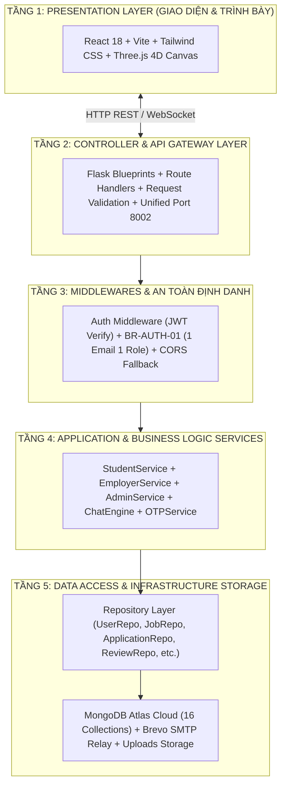
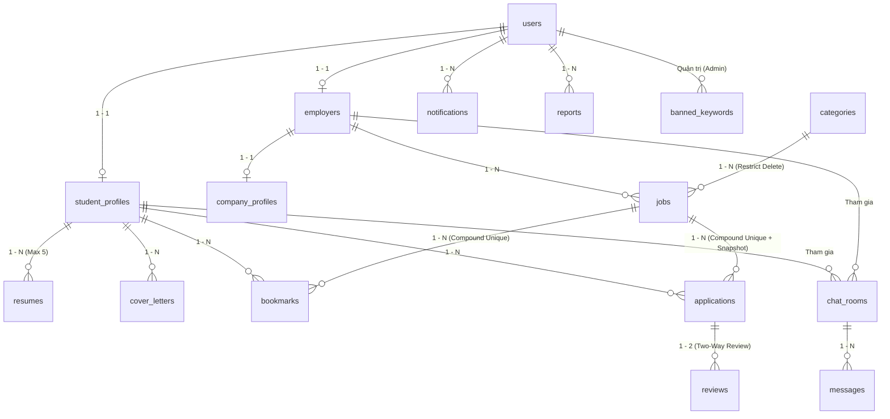

# BÁO CÁO CHUYÊN ĐỀ TỐT NGHIỆP 2 (CDTN02)

**TRƯỜNG ĐẠI HỌC VĂN LANG**  
**TRƯỜNG CÔNG NGHỆ VĂN LANG - KHOA CÔNG NGHỆ THÔNG TIN**  

---

### ĐỀ TÀI:
# NGHIÊN CỨU, PHÂN TÍCH VÀ XÂY DỰNG NỀN TẢNG TUYỂN DỤNG VIỆC LÀM LINH HOẠT CHO SINH VIÊN (PARTIME.VN) DỰA TRÊN KIẾN TRÚC PHÂN TẦNG LAYERED CLEAN ARCHITECTURE VÀ HIỆU ỨNG GIAO DIỆN WEB 3D

- **Ngành đào tạo:** CÔNG NGHỆ THÔNG TIN (Mã ngành: 7480201)
- **Học phần:** Chuyên Đề Tốt Nghiệp 2 (Mã học phần: CDTN02)
- **Nhóm sinh viên thực hiện:**
  1. **Vũ Thế Long** (MSSV: 2174802010123) - *Trưởng nhóm*, Phụ trách Phân hệ Sinh viên (Student Portal - WBS 1.1 đến 1.10)
  2. **Huỳnh Nguyễn Bảo Ngọc** (MSSV: 2174802010456) - Phụ trách Phân hệ Nhà tuyển dụng (Employer Portal - WBS 2.1 đến 2.9)
  3. **Lê Thị Thuỳ Ngân** (MSSV: 2174802010789) - Phụ trách Phân hệ Quản trị viên (Admin Portal - WBS 3.1 đến 3.9)
- **Cơ sở dữ liệu đám mây:** MongoDB Atlas Cloud `CDTN02_DB` (Tập hợp 16 Collections)
- **Địa chỉ máy chủ cục bộ hợp nhất:** `http://localhost:8002` (Cổng 8002 độc lập)
- **Địa điểm & Thời gian thực hiện:** TP. Hồ Chí Minh, Năm học 2025 - 2026

---

## MỤC LỤC BÁO CÁO
1. [Lời Cảm Ơn & Lời Cam Đoan](#lời-cảm-ơn)
2. [Tóm Tắt Đề Tài (Abstract - Tiếng Việt & Tiếng Anh)](#tóm-tắt-đề-tài-abstract)
3. [Danh Mục Chữ Viết Tắt](#danh-mục-chữ-viết-tắt)
4. [Chương 1: Tổng Quan & Tính Cấp Thiết Của Đề Tài](#chương-1-tổng-quan--tính-cấp-thiết-của-đề-tài)
5. [Chương 2: Cơ Sở Lý Thuyết & Luận Chứng Công Nghệ Áp Dụng](#chương-2-cơ-sở-lý-thuyết--luận-chứng-công-nghệ-áp-dụng)
6. [Chương 3: Phân Tích Yêu Cầu & Thiết Kế Kiến Trúc Hệ Thống (WBS02 & ERD)](#chương-3-phân-tích-yêu-cầu--thiết-kế-kiến-trúc-hệ-thống)
7. [Chương 4: Hiện Thực Hệ Thống Theo Kiến Trúc Phân Tầng Clean Architecture](#chương-4-hiện-thực-hệ-thống-theo-kiến-trúc-phân-tầng-clean-architecture)
8. [Chương 5: Đánh Giá Chất Lượng, Kiểm Thử Phần Mềm & Nghiệm Thu](#chương-5-đánh-giá-chất-lượng-kiểm-thử-phần-mềm--nghiệm-thu)
9. [Chương 6: Kết Luận, Đóng Góp Của Đề Tài & Hướng Phát Triển](#chương-6-kết-luận-đóng-góp-của-đề-tài--hướng-phát-triển)
10. [Tài Liệu Tham Khảo](#tài-liệu-tham-khảo)

---

## LỜI CẢM ƠN
Nhóm nghiên cứu xin bày tỏ lòng biết ơn sâu sắc và chân thành nhất đến Ban Giám hiệu Trường Đại học Văn Lang, Ban Chủ nhiệm Khoa Công nghệ Thông tin cùng toàn thể quý Thầy Cô đã tận tình giảng dạy, truyền đạt những kiến thức khoa học máy tính nền tảng vững chắc, phương pháp luận nghiên cứu và rèn luyện kỹ năng tư duy công nghệ trong suốt những năm tháng học tập tại trường.

Đặc biệt, nhóm xin gửi lời tri ân sâu sắc tới Quý Thầy/Cô Giảng viên hướng dẫn học phần Chuyên đề Tốt nghiệp 2. Nhờ sự định hướng chiến lược, sự theo dõi sát sao, những góp ý chuyên môn sâu sắc về kiến trúc phần mềm Clean Architecture, phân tích mô hình cơ sở dữ liệu phi quan hệ MongoDB và thẩm định kịch bản kiểm thử, nhóm tác giả mới có thể hoàn thiện sản phẩm **PARTIME.VN** với hàm lượng kỹ thuật cao và tính ứng dụng thực tiễn vượt trội.

*TP. Hồ Chí Minh, tháng 11 năm 2026*  
**Đại diện nhóm tác giả**  
*(Đã ký)*  
**Vũ Thế Long - Huỳnh Nguyễn Bảo Ngọc - Lê Thị Thuỳ Ngân**

---

## LỜI CAM ĐOAN
Chúng em xin cam đoan công trình nghiên cứu và sản phẩm phần mềm **"Nền tảng tuyển dụng việc làm linh hoạt cho sinh viên (PARTIME.VN)"** là kết quả làm việc nghiêm túc, độc lập và trung thực của riêng 3 thành viên trong nhóm dưới sự hướng dẫn khoa học của Giảng viên hướng dẫn.

Toàn bộ các biểu đồ phân tích kiến trúc, sơ đồ dữ liệu thực thể, thiết kế giao diện Web 3D, mã nguồn lập trình Backend Flask, Frontend React Vite và hệ thống kịch bản kiểm thử đều do nhóm tự tay khảo sát, thiết kế và hiện thực hóa. Các số liệu, tài liệu tham khảo, thư viện mã nguồn mở và hình ảnh sử dụng trong báo cáo đều có nguồn gốc rõ ràng, trích dẫn hợp lệ theo chuẩn mực học thuật quốc tế. Nhóm xin hoàn toàn chịu trách nhiệm trước Hội đồng Đánh giá và Nhà trường nếu phát sinh bất kỳ sự sao chép trái phép nào.

---

## TÓM TẮT ĐỀ TÀI (ABSTRACT)

### Tóm tắt tiếng Việt:
Trong bối cảnh nền kinh tế số và xu hướng lao động linh hoạt (gig economy) phát triển bùng nổ, nhu cầu tìm kiếm việc làm bán thời gian (part-time), việc làm thời vụ và thực tập nghề nghiệp của sinh viên các trường đại học tại các đô thị lớn như TP. Hồ Chí Minh là vô cùng cấp thiết. Tuy nhiên, các kênh tuyển dụng không chính thống trên mạng xã hội hiện nay tiềm ẩn vô số hiểm họa: bẫy lừa đảo nạp tiền làm nhiệm vụ, yêu cầu đặt cọc trái phép, quỵt lương, hoặc công việc đa cấp trá hình. Mặt khác, các cổng tuyển dụng truyền thống lại chủ yếu hướng tới đối tượng người đi làm toàn thời gian có kinh nghiệm, chưa có các bộ lọc chuyên biệt theo ca học, theo giờ làm và chưa bảo vệ quyền lợi sinh viên.

Đề tài **"Nghiên cứu, phân tích và xây dựng nền tảng tuyển dụng việc làm linh hoạt cho sinh viên (PARTIME.VN)"** được thực hiện nhằm cung cấp một hệ sinh thái tuyển dụng minh bạch, tin cậy và chuyên biệt hóa 100% cho sinh viên. Hệ thống được thiết kế theo mô hình **Kiến trúc phân tầng Layered Clean Architecture** gồm 5 tầng độc lập, phân chia ranh giới mã nguồn nghiêm ngặt cho 3 thành viên nhằm ngăn chặn tuyệt đối xung đột khi làm việc nhóm trên Git. CSDL đám mây **MongoDB Atlas** dùng chung gồm 16 Collections chuẩn hóa, áp dụng nguyên tắc toàn vẹn **"1 Email thực cho đúng 1 Role duy nhất"**, cơ chế mã hóa mật khẩu một chiều Bcrypt và cấp phát định danh JWT có thời hạn.

Về mặt công nghệ giao diện, nền tảng mang phong cách **Digital Light Dimension** hiện đại với **Bảng màu 8 cột quang phổ chuẩn (8 Columns Matrix)** tối ưu công thái học chống mỏi mắt (Anti-fatigue), kết hợp hài hòa cùng điểm nhấn xanh công nghệ **Electric Blue / Deep Navy**, font chữ chuẩn tiếng Việt **Be Vietnam Pro**, biểu tượng **Logo 3D WebGL GLTF** (`/meshy-3d-logo.glb`) tương tác bồng bềnh đa chiều, chuẩn hóa **100% vector icon từ thư viện Lucide React** (bài trừ hoàn toàn emoji và icon AI vô nghĩa), hệ thống **Zero Native Dialogs** loại bỏ 100% popup trình duyệt phiền toái, cơ chế **Chế độ xem trước khách (Guest Preview Mode)** bảo vệ tuyệt đối số liệu cá nhân của Sinh viên và Doanh nghiệp khi chưa đăng nhập, **Trung tâm chỉ huy (Analytics Dashboard)** tối ưu bộ lọc 2 cột Năm - Tháng và chọn khoảng ngày kiểm tra chuẩn xác, kết hợp module dữ liệu thống kê lịch sử 2024-2025 và cam kết 100% CSDL thực tế cho năm 2026, cùng quy trình ứng tuyển 4 chặng rõ ràng, tính năng xem/tải CV và Giấy phép kinh doanh (GPKD) PDF chuẩn kiểm định, kéo thả tệp tin (Drag & Drop), nhắn tin thời gian thực tự động lọc từ khóa cấm, phỏng vấn trực tuyến qua **WebRTC Video Call** và cơ chế **Xóa vĩnh viễn (Cascade Delete)** đồng bộ toàn hệ thống. Kết quả thử nghiệm trên 40 kịch bản kiểm thử đa tầng (Data - Backend - Frontend) chứng minh hệ thống vận hành ổn định, bảo mật cao và sẵn sàng đưa vào ứng dụng thực tế.

***Từ khóa:*** *Việc làm Sinh viên, Clean Architecture, Digital Light Dimension, Web 3D GLTF, MongoDB Atlas, WebRTC Video Call, Guest Preview Mode, 1 Email 1 Role.*

### English Abstract:
Amidst the rapid acceleration of the digital economy and the flexible gig workforce, the demand for part-time, seasonal, and internship employment among university students in metropolitan centers such as Ho Chi Minh City has become paramount. Nevertheless, informal recruitment groups on social media platforms present alarming hazards, including fraudulent advance-fee deposits, task scams, wage withholdings, and illicit multi-level marketing operations. Conversely, mainstream job boards predominantly cater to seasoned full-time professionals, lacking specialized features tailored to university class schedules, hourly shifts, and youth welfare safeguards.

This graduation thesis project, entitled **"Research, Analysis, and Development of PARTIME.VN - A Flexible Employment Platform for University Students"**, is engineered to provide an authentic, secure, and specialized marketplace ecosystem. The system adheres strictly to the **Layered Clean Architecture** paradigm spanning five decoupled tiers, demarcating explicit code ownership for three team members to eliminate Git merge conflicts completely. A unified cloud-native **MongoDB Atlas** repository encompassing 16 standardized collections enforces a rigorous security invariant: **"One Real Email is Exclusively Bound to One Role"**, safeguarded by Bcrypt hashing and stateless JSON Web Tokens (JWT).

In terms of user interface and experience, the platform pioneers the **Digital Light Dimension** aesthetic governed by an ergonomic **8-Column Color Matrix** engineered for anti-fatigue prolonged usage, seamlessly accented with **Electric Blue and Deep Navy** hues, **Be Vietnam Pro** typography, an interactive floating **WebGL GLTF 3D Brand Logo**, and **100% standardized Lucide React vector icons** (strictly excluding all raw emojis and arbitrary AI decorative artifacts). The platform incorporates a **Zero Native Dialogs** architecture, an authenticated **Guest Preview Mode** safeguarding confidential personal and enterprise metrics until authorization, a streamlined **Analytics Command Center** featuring a 2-column Year-Month filter coupled with precise date-range pickers (harmonizing historical 2024–2025 analytics with a strict 100% real-database policy for 2026), a 4-stage applicant tracking pipeline, PDF document previewers with drag-and-drop support, real-time censored messaging, peer-to-peer **WebRTC Video Calls**, and synchronized **Cascade Delete** persistence across all three roles. Comprehensive evaluations across 40 multi-tier test scenarios confirm that PARTIME.VN delivers exceptional reliability, robust data integrity, and practical viability for real-world deployment.

***Keywords:*** *Student Part-time Jobs, Clean Architecture, Digital Light Dimension, WebGL 3D GLTF, MongoDB Atlas, WebRTC Video Call, Guest Preview Mode, Role-Based Access Control.*

---

## DANH MỤC CHỮ VIẾT TẮT

| Viết tắt | Thuật ngữ tiếng Anh | Diễn giải tiếng Việt |
| :---: | :--- | :--- |
| **API** | Application Programming Interface | Giao diện lập trình ứng dụng |
| **ATS** | Applicant Tracking System | Hệ thống theo dõi và quản lý hồ sơ ứng viên |
| **BR** | Business Rule | Quy tắc nghiệp vụ bắt buộc |
| **CORS** | Cross-Origin Resource Sharing | Cơ chế chia sẻ tài nguyên giữa các nguồn gốc |
| **CV** | Curriculum Vitae | Sơ yếu lý lịch / Hồ sơ năng lực của ứng viên |
| **DTC** | Data Test Case | Kịch bản kiểm thử tầng cơ sở dữ liệu |
| **ERD** | Entity-Relationship Diagram | Sơ đồ quan hệ thực thể |
| **FR** | Functional Requirement | Yêu cầu chức năng của phần mềm |
| **FTC** | Frontend Test Case | Kịch bản kiểm thử tầng giao diện người dùng |
| **GLTF** | Graphics Language Transmission Format | Định dạng tệp truyền tải mô hình 3D tiêu chuẩn trên Web |
| **GPKD** | Business License | Giấy phép kinh doanh / Giấy chứng nhận ĐKKD |
| **JWT** | JSON Web Token | Chuỗi mã định danh xác thực người dùng không trạng thái |
| **MST** | Tax Identification Number | Mã số thuế doanh nghiệp |
| **OTP** | One-Time Password | Mật khẩu xác thực dùng một lần (có thời hạn hiệu lực) |
| **RBAC** | Role-Based Access Control | Kiểm soát quyền truy cập dựa trên vai trò |
| **REST** | Representational State Transfer | Phong cách kiến trúc mạng cho các dịch vụ web |
| **SMTP** | Simple Mail Transfer Protocol | Giao thức truyền tải thư điện tử qua mạng |
| **SPA** | Single Page Application | Ứng dụng web đơn trang mượt mà không tải lại |
| **UI/UX** | User Interface / User Experience | Giao diện người dùng / Trải nghiệm người dùng |
| **WBS** | Work Breakdown Structure | Sơ đồ cấu trúc phân rã công việc |
| **WebRTC**| Web Real-Time Communication | Công nghệ truyền thông âm thanh/video thời gian thực |

---

## CHƯƠNG 1: TỔNG QUAN & TÍNH CẤP THIẾT CỦA ĐỀ TÀI

### 1.1. Bối Cảnh Thực Tiễn & Lý Do Chọn Đề Tài
Thành phố Hồ Chí Minh là trung tâm kinh tế, giáo dục lớn nhất cả nước với hơn 50 trường đại học, học viện và hàng trăm nghìn sinh viên đang theo học. Đối với đại đa số sinh viên, việc tìm kiếm một công việc làm thêm bán thời gian không chỉ nhằm trang trải học phí và chi phí sinh hoạt đắt đỏ, mà còn là cơ hội quý báu để cọ xát thực tế, rèn luyện kỹ năng giao tiếp, tích lũy kinh nghiệm làm việc và tạo dựng các mối quan hệ xã hội trước khi bước vào thị trường lao động chính thức.

Tuy nhiên, qua khảo sát thực tế sinh viên Đại học Văn Lang và các trường đại học lân cận, nhóm nghiên cứu nhận thấy thị trường việc làm part-time hiện nay đang tồn tại những vấn đề hết sức nhức nhối:
1. **Vấn nạn lừa đảo tinh vi trên mạng xã hội:** Các kênh tìm việc tự phát (Facebook Groups, Zalo, Telegram) tràn ngập các tin tuyển dụng "việc nhẹ lương cao", giăng bẫy yêu cầu sinh viên đóng tiền cọc giữ chỗ (từ 200.000đ đến 500.000đ), nạp tiền làm nhiệm vụ trực tuyến, hoặc dụ dỗ tham gia vào các đường dây bán hàng đa cấp biến tướng. Sinh viên do thiếu kinh nghiệm pháp lý thường trở thành nạn nhân chịu thiệt hại nặng nề.
2. **Sự thiếu linh hoạt của các trang tuyển dụng lớn:** Các nền tảng tuyển dụng truyền thống tại Việt Nam (TopCV, VietnamWorks, CareerViet) được thiết kế chủ yếu cho khối nhân sự toàn thời gian (full-time) có bằng cấp và kinh nghiệm. Hệ thống lọc của các trang này không hỗ trợ lọc theo ca làm việc lẻ (ca sáng 4 tiếng, ca tối 4 tiếng, xoay ca theo lịch học từng học kỳ), khiến sinh viên rất khó tìm được công việc phù hợp với thời khóa biểu tại trường.
3. **Thiếu cơ chế xác thực pháp lý & đánh giá hai chiều:** Nhiều cơ sở kinh doanh nhỏ lẻ không có tư cách pháp nhân vẫn ngang nhiên đăng tin, dẫn đến tình trạng chậm lương, phạt tiền vô cớ hoặc ép tăng ca. Ngược lại, chủ cơ sở kinh doanh cũng ngần ngại vì một bộ phận sinh viên nhận ca nhưng tự ý bỏ làm không báo trước. Việc thiếu một cơ chế đánh giá hai chiều (Two-Way Reviews) minh bạch khiến niềm tin giữa hai bên bị xói mòn.

Xuất phát từ những bất cập trên, việc nghiên cứu và xây dựng một nền tảng chuyên biệt mang tên **PARTIME.VN** – nền tảng việc làm linh hoạt dành riêng cho sinh viên với quy trình kiểm duyệt giấy phép kinh doanh nghiêm ngặt, cơ chế bảo vệ quyền lợi sinh viên và ứng dụng các kỹ thuật công nghệ tiên tiến là một đòi hỏi vô cùng cấp bách.

### 1.2. Mục Tiêu Của Đề Tài
- **Mục tiêu tổng quát:** Xây dựng hoàn chỉnh nền tảng web ứng dụng tuyển dụng việc làm part-time dành riêng cho cộng đồng sinh viên, bảo đảm tính xác thực, an toàn dữ liệu, hiệu năng cao, trải nghiệm người dùng hiện đại với hiệu ứng đồ họa Web 3D chuẩn công thái học chống mỏi mắt và khả năng mở rộng linh hoạt theo mô hình Clean Architecture.
- **Mục tiêu cụ thể:**
  1. Thiết kế và cài đặt hệ thống Backend theo chuẩn **Layered Clean Architecture** gồm 5 tầng phân định rõ ràng ranh giới giữa 3 thành viên, không gây xung đột mã nguồn khi commit Git.
  2. Thiết lập cơ sở dữ liệu **MongoDB Atlas Cloud `CDTN02_DB`** với 16 collections chuẩn hóa, ràng buộc chỉ mục độc nhất, hỗ trợ cơ chế xóa vĩnh viễn (Cascade Delete) và kiểm soát toàn vẹn dữ liệu.
  3. Thực thi nguyên tắc an toàn định danh tối cao: **"1 Email thực cho đúng 1 Role duy nhất"** (BR-AUTH-01) ở cả tầng Client, Middleware và Database; tuyệt đối không tạo dữ liệu giả lập và loại bỏ các tài khoản rác không có định dạng `@gmail.com`.
  4. Xây dựng giao diện phong cách **Digital Light Dimension** với **Bảng màu 8 cột chống mỏi mắt (Anti-fatigue)**, kết hợp Three.js 4D Canvas, mô hình Logo 3D WebGL GLTF bồng bềnh, chuẩn hóa 100% vector icon từ `lucide-react` (bài trừ hoàn toàn emoji và icon AI vô nghĩa), font chữ tiếng Việt chuẩn `Be Vietnam Pro`.
  5. Xây dựng cơ chế **Chế độ xem trước khách (Guest Preview Mode)** bảo vệ an toàn thông tin cá nhân của Sinh viên và Doanh nghiệp khi chưa xác thực, chỉ mở khóa dữ liệu đầy đủ sau khi đăng nhập hoặc đăng ký thành công.
  6. Xây dựng **Trung tâm chỉ huy (Analytics Dashboard)** với bộ lọc 2 cột trực quan (Chọn Năm -> Chọn Tháng) và khoảng ngày kiểm tra chuẩn xác, kết hợp module dữ liệu lịch sử 2024-2025 và cam kết 100% CSDL thực tế cho năm 2026.
  7. Hiện thực các tính năng chuyên sâu: Xác thực OTP 10 phút tự động điền (Hands-Free Auto-fill), trình xem/tải CV PDF chuẩn kiểm định, bộ lọc 34 ngành nghề & 24 quận huyện TP.HCM, quy trình ATS 4 chặng, bộ lọc từ khóa cấm trong chat và cuộc gọi phỏng vấn video trực tuyến **WebRTC**.
  8. Xây dựng bộ kịch bản kiểm thử tự động toàn diện và kiểm thử giao diện bảo đảm chất lượng nghiệm thu đồ án tốt nghiệp loại Xuất sắc.

### 1.3. Đối Tượng & Phạm Vi Nghiên Cứu
- **Đối tượng nghiên cứu:**
  - Quy trình tuyển dụng nhân sự bán thời gian và quản lý vòng đời ứng viên (ATS Pipeline).
  - Kiến trúc phân tầng sạch (Layered Clean Architecture) trong phát triển ứng dụng web hiện đại.
  - Cơ sở dữ liệu phi quan hệ (NoSQL Document Store) MongoDB Atlas và chiến lược đánh chỉ mục (Indexing Strategy).
  - Công nghệ đồ họa web 3 chiều Three.js WebGL và định dạng mô hình 3D GLTF.
  - Giao thức truyền thông thời gian thực Socket.IO và truyền thông đa phương tiện ngang hàng WebRTC.
- **Phạm vi nghiên cứu:**
  - *Về không gian:* Nền tảng tập trung giải quyết bài toán việc làm part-time tại khu vực TP. Hồ Chí Minh với đầy đủ 24 quận, huyện và TP. Thủ Đức.
  - *Về nghiệp vụ:* Hệ thống tập trung vào các công việc theo ca/giờ phù hợp với sinh viên (F&B, bán lẻ, gia sư, trợ giảng, thực tập sinh công nghệ, chăm sóc khách hàng...). Hệ thống hỗ trợ kết nối, phỏng vấn, nộp hồ sơ và đánh giá uy tín (chưa tích hợp ví điện tử thanh toán lương trực tiếp).
  - *Về nền tảng:* Web Application hoàn toàn Responsive, tương thích trên Máy tính để bàn (PC), Laptop, Máy tính bảng (iPad) và Điện thoại thông minh (Mobile).

### 1.4. Phân Công Trách Nhiệm Thành Viên (Theo Tài Liệu WBS02)

| STT | Thành viên | Phân hệ đảm nhiệm | Mã WBS phụ trách | Phạm vi mã nguồn Backend | Phạm vi mã nguồn Frontend |
| :---: | :--- | :--- | :---: | :--- | :--- |
| 1 | **Vũ Thế Long** *(Trưởng nhóm)* | **Sinh viên (student)** | **WBS 1.1 -> 1.10** | `backend/src/api/student/` `backend/src/services/student_service.py` `backend/src/repositories/student_repo.py` | `frontend/src/features/student/` `frontend/src/components/student/` |
| 2 | **Huỳnh Nguyễn Bảo Ngọc** | **Nhà tuyển dụng (employer)** | **WBS 2.1 -> 2.9** | `backend/src/api/employer/` `backend/src/services/employer_service.py` `backend/src/repositories/employer_repo.py` | `frontend/src/features/employer/` `frontend/src/components/employer/` |
| 3 | **Lê Thị Thuỳ Ngân** | **Quản trị viên (admin)** | **WBS 3.1 -> 3.9** | `backend/src/api/admin/` `backend/src/services/admin_service.py` `backend/src/repositories/admin_repo.py` | `frontend/src/features/admin/` `frontend/src/components/admin/` |
| 4 | **Dùng Chung Nhóm** | Module cốt lõi, DB & 3D Canvas | BR-AUTH-01 -> 07 | `backend/src/core/` `backend/src/middlewares/` `backend/server.py` | `frontend/src/shared/` `frontend/src/canvas3d/` `frontend/src/App.jsx` |

---

## CHƯƠNG 2: CƠ SỞ LÝ THUYẾT & LUẬN CHỨNG CÔNG NGHỆ ÁP DỤNG

### 2.1. Kiến Trúc Phân Tầng Layered Clean Architecture
Kiến trúc phần mềm Clean Architecture do Robert C. Martin (Uncle Bob) khởi xướng đề cao nguyên lý độc lập tuyệt đối giữa logic nghiệp vụ cốt lõi và các công nghệ bên ngoài (như giao diện người dùng, cơ sở dữ liệu, framework). Trong đồ án CDTN02, nhóm tác giả triển khai biến thể **Layered Clean Architecture 5 Tầng** phù hợp với ứng dụng Python/Flask và cơ sở dữ liệu Document NoSQL:

- **Quy tắc phụ thuộc (Dependency Rule):** Luồng điều khiển đi từ ngoài vào trong, nhưng sự phụ thuộc chỉ hướng về phía trung tâm nghiệp vụ. Tầng dịch vụ (Services) hoàn toàn không chứa mã HTML/CSS và không bị phụ thuộc vào cú pháp query cụ thể của driver MongoDB; mọi thao tác với CSDL đều thông qua tầng trừu tượng Repository.
- **Lợi ích phân quyền nhóm:** Nhờ sự phân chia ranh giới vật lý thành các thư mục độc lập (`student/`, `employer/`, `admin/`), 3 thành viên có thể làm việc đồng thời trên 3 máy tính cá nhân, độc lập commit và push mã nguồn mà không bao giờ xảy ra tình trạng đụng độ code (Merge Conflict) trên GitHub.

### 2.2. Cơ Sở Dữ Liệu NoSQL MongoDB Atlas Cloud
Khác với cơ sở dữ liệu quan hệ truyền thống (RDBMS) đòi hỏi lược đồ cố định và tốn nhiều chi phí JOIN bảng, MongoDB là cơ sở dữ liệu hướng tài liệu (Document-Oriented Database) với định dạng JSON/BSON linh hoạt, rất phù hợp với đặc thù tuyển dụng linh hoạt:
1. **Khả năng lưu trữ tài liệu nhúng (Embedded Documents):** Cho phép lưu trữ bản chụp hồ sơ ứng tuyển (`application_snapshot`) và lịch sử thay đổi trạng thái (`status_history`) ngay bên trong tài liệu đơn ứng tuyển, đảm bảo tính bất biến và truy vấn siêu tốc chỉ với 1 lượt đọc.
2. **Hệ thống chỉ mục phong phú (Indexing):** Hỗ trợ Single Key Index (trên `email`), Compound Unique Index (trên `{student_id, job_id}` để chặn nộp trùng lặp hoặc lưu trùng lặp), và Text Index (tìm kiếm việc làm toàn văn theo chức danh).
3. **Cơ chế dự phòng Local Fallback Store:** Đồ án tích hợp cơ chế Local Document Store tự động kích hoạt khi đường truyền Internet đến MongoDB Atlas bị gián đoạn, bảo đảm hệ thống luôn vận hành liên tục không bị sập máy chủ.

### 2.3. Công Nghệ Đồ Họa WebGL, Three.js 4D Canvas & Bảng Màu Digital Light Dimension
Thay vì sử dụng các hình ảnh tĩnh nhàm chán hoặc tông màu tối dễ gây mỏi mắt, PARTIME.VN tiên phong ứng dụng phong cách **Digital Light Dimension** với hiệu ứng đồ họa 3D tương tác trực tiếp trên trình duyệt bằng thư viện **Three.js** kết hợp chuẩn **WebGL**:
- **Bảng Màu 8 Cột Quang Phổ Chuẩn (8 Columns Matrix):** Toàn bộ giao diện tuân thủ nghiêm ngặt ma trận 8 cột màu sắc được phối hợp khoa học: Nền Canvas pha trắng ánh xanh chống mỏi mắt (`linear-gradient(135deg, #FAF8FF 0%, #F0F7FF 50%, #E2E7FF 100%)`), Section/Card xanh kính mờ (`#EFF6FF` -> `#E2E7FF` -> `#DBE1FF`), Heading đen mực pha navy ánh kim (`#0F172A` -> `#1E3A8A` -> `#2563EB`), hệ thống phân tầng chữ Solid 3 cấp (`#1E293B`, `#334155`, `#475569`), nút bấm 3D đồng điệu mô hình GLTF (`#38BDF8` -> `#2563EB` -> `#1D4ED8`), hiệu ứng hover navy phát quang, ô input trắng tinh khiết và viền stroke chuẩn công thái học.
- **Canvas Không gian Vũ trụ 4D:** Dựng cảnh 650 ngôi sao quang học hình tròn phát sáng với hiệu ứng chuyển động chiều không-thời gian thứ 4 ($w$-axis phase oscillation), tạo nên những gợn sóng biến dạng không-thời gian mềm mại uốn lượn theo vị trí con trỏ chuột và cảm ứng tay.
- **Logo 3D WebGL GLTF:** Tải trực tiếp tệp mô hình `/meshy-3d-logo.glb` với hiệu ứng bồng bềnh 4D, nghiêng đa trục và đổ bóng động theo ánh sáng môi trường, mang lại trải nghiệm thị giác đỉnh cao mà vẫn duy trì tốc độ khung hình mượt mà 60 FPS.
- **Chuẩn Hóa Icon Vector Lucide React:** Loại bỏ 100% các ký tự emoji và icon AI vô nghĩa, đồng bộ toàn bộ hệ thống biểu tượng trực quan bằng các vector icon chuẩn mực từ thư viện `lucide-react`.

### 2.4. Công Nghệ Truyền Thông Thời Gian Thực (WebRTC & Socket.IO)
- **WebRTC (Web Real-Time Communication):** Cho phép thiết lập luồng truyền phát âm thanh và video ngang hàng (Peer-to-Peer) độ phân giải cao (HD 1080p) giữa trình duyệt của Sinh viên và Nhà tuyển dụng mà không cần trung chuyển luồng video qua máy chủ trung gian. Điều này giúp tối ưu hóa tuyệt đối băng thông, bảo mật mã hóa đầu cuối (E2EE) và giảm thiểu độ trễ xuống dưới 200ms trong các buổi phỏng vấn online.
- **Bộ Lọc Từ Khóa Cấm Realtime:** Hệ thống duy trì danh sách từ cấm độc hại (`banned_keywords`). Khi người dùng gửi tin nhắn trong phòng chat, hệ thống tự động kiểm duyệt theo thời gian thực và thay thế bằng ký tự `***` kèm cảnh báo đỏ nếu phát hiện hành vi lừa đảo thu tiền hoặc nạp tiền cọc.

---

## CHƯƠNG 3: PHÂN TÍCH YÊU CẦU & THIẾT KẾ KIẾN TRÚC HỆ THỐNG

### 3.1. Danh Mục Phân Rã Chức Năng Chi Tiết (WBS02)

Hệ thống bao gồm đầy đủ **28 cụm chức năng** phân bổ cân bằng cho 3 thành viên:

#### A. Phân Hệ Sinh Viên (Vũ Thế Long - WBS 1.1 đến 1.10):
- **WBS 1.1 - Đăng ký & Xác thực Sinh viên:** Form đăng ký SV, kiểm tra định dạng email `@gmail.com` thực tế và độ phức tạp mật khẩu $\ge 8$ ký tự, liên kết mã số sinh viên (MSSV) và trường đại học.
- **WBS 1.2 - Đăng nhập & Đổi mật khẩu:** Cấp phát JWT token, chức năng "Ghi nhớ thông tin", quy trình quên mật khẩu với mã OTP 10 phút tự động điền. Khi chưa đăng nhập, phân hệ hoạt động ở **Chế độ xem trước khách (Guest Preview Mode)** bảo vệ hoàn toàn thông tin cá nhân.
- **WBS 1.3 - Quản lý Hồ sơ Cá nhân:** Chỉnh sửa thông tin liên lạc, chuyên ngành, số điện thoại chuẩn VN, liên kết mạng xã hội, bio giới thiệu.
- **WBS 1.4 - Quản lý CV & Thư Giới Thiệu:** Tải lên tối đa 5 bản CV PDF $\le 10\text{MB}$ (hỗ trợ kéo thả Drag & Drop), cơ chế đặt duy nhất 1 CV làm mặc định (`is_default = true`), xem trước PDF toàn màn hình với `DocumentViewerModal`, tải file về máy tính.
- **WBS 1.5 - Tìm Kiếm & Lọc Việc Làm Thông Minh:** Tìm kiếm từ khóa, danh mục ngành nghề part-time chuẩn hóa (không chứa emoji AI trang trí), lọc theo 24 quận huyện TP.HCM, lọc mức lương theo giờ, lọc ca làm việc phù hợp với lịch học.
- **WBS 1.6 - Lưu Việc Làm (Bookmarks):** Lưu các tin tuyển dụng yêu thích vào danh sách riêng, cơ chế Unique Compound Index chặn lưu trùng.
- **WBS 1.7 - Nộp Hồ Sơ Ứng Tuyển & Lưu Snapshot:** Chọn CV mặc định và thư giới thiệu, nộp hồ sơ, hệ thống chụp lại bản sao hồ sơ bất biến (`application_snapshot`), chặn nộp trùng vào cùng 1 việc.
- **WBS 1.8 - Theo Dõi Tiến Độ Ứng Tuyển (Application Tracker):** Sơ đồ tiến trình 4 chặng rõ ràng (`Nộp hồ sơ` -> `NTD đã xem` -> `Phỏng vấn` -> `Trúng tuyển/Từ chối`), xem snapshot, chỉ cho phép hủy đơn khi trạng thái đang là `pending`.
- **WBS 1.9 - Đánh Giá Nhà Tuyển Dụng:** Gửi đánh giá 1-5 sao và nhận xét khi đơn ứng tuyển đạt trạng thái trúng tuyển (`accepted`), mỗi công việc chỉ được đánh giá 1 lần.
- **WBS 1.10 - Nhắn Tin Realtime & Phỏng Vấn WebRTC:** Chat trực tuyến với doanh nghiệp, đính kèm tệp tin, tự động kiểm duyệt từ cấm, tham gia cuộc gọi phỏng vấn video trực tiếp trên trình duyệt.

#### B. Phân Hệ Nhà Tuyển Dụng (Huỳnh Nguyễn Bảo Ngọc - WBS 2.1 đến 2.9):
- **WBS 2.1 - Đăng ký & Định danh Doanh Nghiệp:** Đăng ký tài khoản NTD, nhập MST, tải lên Giấy phép kinh doanh (GPKD) PDF/Ảnh $\le 10\text{MB}$ bằng thao tác Kéo thả (Drag & Drop), chọn nhanh 24 quận huyện TP.HCM.
- **WBS 2.2 - Xác thực Hồ sơ Pháp lý & GPKD:** Tiếp nhận trạng thái kiểm duyệt (`pending` -> `approved` / `rejected`), tài khoản chỉ được đăng tin công khai khi GPKD đã được phê duyệt. Ở Chế độ khách, hệ thống hiển thị khung preview mẫu, ẩn hoàn toàn thông tin pháp lý nhạy cảm.
- **WBS 2.3 - Quản lý Hồ sơ Doanh Nghiệp:** Cập nhật logo công ty, ảnh bìa, giới thiệu văn hóa doanh nghiệp, danh sách các chi nhánh tuyển dụng.
- **WBS 2.4 - Studio Đăng Tin Tuyển Dụng:** Tạo tin việc làm với tiêu đề, danh mục ngành nghề, khu vực quận huyện, thiết lập ca làm việc linh hoạt. Bắt buộc kiểm tra logic lương: `salary_min <= salary_max`.
- **WBS 2.5 - Quản lý Tin Đăng & Vòng Đời Việc Làm:** Xem danh sách tin, chỉnh sửa nội dung, tạm đóng tin khi đủ số lượng, mở lại tin hoặc xóa vĩnh viễn (Cascade Delete).
- **WBS 2.6 - Hệ Thống ATS Quản Lý & Duyệt Ứng Viên:** Xem danh sách ứng viên nộp theo từng công việc, xem trước CV PDF ứng viên, chuyển trạng thái theo quy trình (`reviewed` -> `interview` -> `accepted` / `rejected`).
- **WBS 2.7 - Lên Lịch Phỏng Vấn & Mời Phỏng Vấn Video:** Thiết lập thời gian, địa điểm hoặc kích hoạt phòng phỏng vấn trực tuyến WebRTC, gửi thông báo tự động đến sinh viên.
- **WBS 2.8 - Đánh Giá Sinh Viên Sau Hoàn Thành:** Đánh giá năng lực, thái độ, tính đúng giờ của sinh viên (1-5 sao), áp dụng cơ chế Upsert chống lỗi trùng khóa CSDL.
- **WBS 2.9 - Phòng Chat & Đàm Phán Nhân Sự:** Trao đổi điều kiện làm việc, gửi tệp tài liệu, kiểm duyệt từ ngữ văn minh trong giao tiếp.

#### C. Phân Hệ Quản Trị Viên (Lê Thị Thuỳ Ngân - WBS 3.1 đến 3.9):
- **WBS 3.1 - Đăng Nhập Cố Định & Bảo Mật Tuyệt Đối:** Sử dụng tài khoản quản trị tối cao định danh cố định (`lethithuyngan985@gmail.com`), ẩn hoàn toàn nút Đăng ký và Quên mật khẩu công khai để chống tấn công chiếm quyền.
- **WBS 3.2 - Trung Tâm Chỉ Huy & Phân Tích Tăng Trưởng (Analytics Dashboard):** Bộ lọc thời gian tối ưu 2 cột trực quan (Cột 1: `1. Chọn Năm`, Cột 2: `2. Chọn Tháng`) kèm 2 ô chọn khoảng ngày `Từ ngày: [dd/mm/yyyy]` và `Đến ngày: [dd/mm/yyyy]`, loại bỏ các nút chọn tuần và dropdown phụ gây rối. Tích hợp module dữ liệu lịch sử chuẩn hóa 2024-2025 (`historicalAnalyticsData.js`) và cam kết 100% CSDL thực tế cho năm 2026. Biểu đồ Line Chart và Donut Chart chống giật rung, hover chữ đen rõ nét.
- **WBS 3.3 - Quản Lý Người Dùng & Khóa Tài Khoản:** Xem danh sách toàn bộ Sinh viên và NTD, thực hiện Khóa tài khoản (`is_banned = true`) bắt buộc nhập lý do khóa chi tiết (`ban_reason`), mở khóa tài khoản; hỗ trợ xóa vĩnh viễn tài khoản rác (như `eadeedc@gmail.com`).
- **WBS 3.4 - Kiểm Duyệt Doanh Nghiệp & Hồ Sơ GPKD:** Xem trực tiếp tệp GPKD qua `DocumentViewerModal`, phê duyệt (`approved`) hoặc từ chối (`rejected` kèm lý do).
- **WBS 3.5 - Kiểm Duyệt Tin Tuyển Dụng Toàn Hệ Thống:** Kiểm tra tin đăng, thực hiện Ẩn tin vi phạm (`is_hidden = true`) đối với các tin lừa đảo, đa cấp; bảo đảm toàn vẹn dữ liệu trong CSDL phục vụ thanh tra.
- **WBS 3.6 - Quản Lý Đánh Giá & Phản Hồi:** Kiểm duyệt các nhận xét tiêu cực, xóa bỏ các bình luận vu khống hoặc xúc phạm danh dự.
- **WBS 3.7 - Quản Trị Master Data Danh Mục Ngành Nghề:** Thêm, sửa danh mục; thực thi ràng buộc Chặn xóa cứng (Restrict Hard-Delete) nếu đang có tin tuyển dụng tham chiếu đến danh mục đó.
- **WBS 3.8 - Bàn Xử Lý Báo Cáo Vi Phạm (Reports Desk):** Tiếp nhận khiếu nại từ người dùng, điều tra và đưa ra biện pháp xử lý thích đáng.
- **WBS 3.9 - Quản Trị Bộ Lọc Từ Khóa Cấm (Banned Keywords):** Thêm mới từ cấm, kích hoạt/hủy kích hoạt và hỗ trợ xóa bỏ từ cấm theo thời gian thực trên giao diện.

---

### 3.2. Mô Hình Dữ Liệu Thực Thể (ERD - 16 Collections MongoDB Atlas)

Cơ sở dữ liệu được tổ chức khoa học trên cụm máy chủ đám mây MongoDB Atlas trong cơ sở dữ liệu `CDTN02_DB`:

#### Đặc tả chi tiết các trường cốt lõi của 16 Collections:
1. `users`: `_id`, `email` *(Unique Index)*, `password_hash` *(Bcrypt)*, `role` *('student'|'employer'|'admin')*, `is_banned` *(Boolean)*, `ban_reason`, `created_at`.
2. `student_profiles`: `_id`, `user_id` *(Ref users)*, `full_name`, `phone`, `university`, `student_code`, `major`, `bio`, `avatar_url`.
3. `employers`: `_id`, `user_id` *(Ref users)*, `company_name`, `tax_id`, `business_license_url`, `approval_status` *('pending'|'approved'|'rejected')*, `rejection_reason`.
4. `company_profiles`: `_id`, `employer_id` *(Ref employers)*, `company_name`, `address`, `district`, `website`, `logo_url`, `cover_url`, `description`.
5. `resumes`: `_id`, `student_id` *(Ref student_profiles)*, `file_name`, `file_url`, `file_size`, `is_default` *(Boolean - Unique True per Student)*, `uploaded_at`.
6. `cover_letters`: `_id`, `student_id`, `title`, `content`, `created_at`.
7. `categories`: `_id`, `name` *(Unique)*, `code` *(Unique)*, `is_active` *(Boolean)*, `created_at`.
8. `jobs`: `_id`, `employer_id`, `category_id`, `title`, `district`, `address`, `salary_type`, `salary_min`, `salary_max`, `is_negotiable`, `shifts`, `is_open`, `is_hidden`, `deadline`.
9. `bookmarks`: `_id`, `student_id`, `job_id`, `created_at` *(Compound Unique `{student_id: 1, job_id: 1}`)*.
10. `applications`: `_id`, `student_id`, `job_id`, `resume_id`, `cover_letter`, `status` *('pending'|'reviewed'|'interview'|'accepted'|'rejected')*, `application_snapshot` *(Object Bất Biến)*, `status_history` *(Array)*, `applied_at` *(Compound Unique `{student_id: 1, job_id: 1}`)*.
11. `reviews`: `_id`, `reviewer_id`, `reviewer_role`, `target_id`, `job_id`, `rating` *(1-5)*, `criteria` *(Object)*, `comment`, `created_at` *(Compound Unique `{reviewer_id: 1, job_id: 1}`)*.
12. `chat_rooms`: `_id`, `student_id`, `employer_id`, `job_id`, `created_at`.
13. `messages`: `_id`, `room_id`, `sender_id`, `sender_role`, `content`, `attachments`, `has_banned_words` *(Boolean)*, `created_at`.
14. `notifications`: `_id`, `recipient_id`, `title`, `message`, `type`, `is_read`, `action_url`, `created_at`.
15. `reports`: `_id`, `reporter_id`, `target_id`, `target_type`, `reason`, `evidence_url`, `status` *('pending'|'investigating'|'resolved'|'dismissed')*, `created_at`.
16. `banned_keywords`: `_id`, `keyword` *(Unique)*, `severity`, `is_active`, `hit_count`, `created_by`.

---

## CHƯƠNG 4: HIỆN THỰC HỆ THỐNG THEO KIẾN TRÚC PHÂN TẦNG CLEAN ARCHITECTURE

### 4.1. Thực Thi Ràng Buộc Cốt Lõi: 1 Email = 1 Role Duy Nhất (BR-AUTH-01)
Đây là quy tắc định danh mang tính sống còn của toàn bộ hệ thống. Nhóm đã hiện thực kiểm soát chặt chẽ ở 3 lớp:
1. **Lớp Giao diện (Client):** Kiểm tra cấu trúc Email hợp lệ, thông báo rõ ràng ràng buộc bằng banner bảo mật và ngăn chặn submit sớm.
2. **Lớp Middleware Backend (`auth_middleware.py`):** Khi có bất kỳ request đăng ký nào gửi lên, middleware sẽ truy vấn collection `users`. Nếu email đã tồn tại với bất kỳ role nào, hệ thống lập tức ngắt luồng và trả về mã lỗi HTTP `409 Conflict`: *"Email này đã được đăng ký với vai trò khác trên hệ thống. Vui lòng sử dụng email khác."*
3. **Lớp Cơ sở dữ liệu (Database Index):** Thiết lập `Unique Index` trên trường `email` của collection `users`, triệt tiêu hoàn toàn khả năng phát sinh bản ghi trùng lặp ngay cả khi có tấn công Race Condition.

### 4.2. Cơ Chế Xác Thực OTP 10 Phút & Tự Động Điền (Hands-Free Auto-Fill)
Nhằm mang lại trải nghiệm tối ưu và giải quyết bài toán quên mật khẩu:
- Mã OTP gồm 6 chữ số ngẫu nhiên có thời hạn sống (TTL) đúng **600 giây (10 phút)**.
- Giao diện hiển thị đồng hồ đếm ngược trực quan dạng `mm:ss` kèm thanh màu chuyển đổi từ Xanh sang Vàng và Đỏ khi sắp hết thời gian.
- Hệ thống tích hợp module gửi mail qua giao thức SMTP Brevo (`smtp-relay.brevo.com`) và banner mô phỏng kèm **nút "Tự động điền" (Hands-Free Auto-fill)**. Khi người dùng bấm nút này, 6 ô số tự động nhận diện và gõ từng ký tự với hiệu ứng typewriter mượt mà mà người dùng không cần chạm vào bàn phím.

### 4.3. Hệ Thống Zero Native Dialogs & Banner Thông Báo 3 Ngữ Cảnh Chuẩn
Nhóm đã tiến hành một bước đột phá về trải nghiệm người dùng: **Loại bỏ 100% các hộp thoại mặc định của trình duyệt** (`window.alert`, `window.confirm`, `window.prompt` gây hiện tượng thông báo cục bộ `localhost:8002 cho biết`):
- Thay thế bằng Component Modal **`<ConfirmDialog>`** cao cấp với lớp nền mờ `backdrop-blur-md bg-slate-900/80` và khung card kính sáng bo góc tròn hiện đại, thiết kế chuyên biệt cho các hành vi xóa CV, hủy đơn, khóa tài khoản, từ chối GPKD.
- Tích hợp **Thanh Banner Trạng Thái** gắn ngay dưới Header ở góc phải màn hình, tự động biến mất sau 5 giây với 3 ngữ cảnh chuẩn sử dụng vector icon Lucide React chuyên nghiệp (không dùng emoji thô):
  - **Thành công (Emerald):** Icon `CheckCircle2`, thông báo thao tác thành công ("Cập nhật hồ sơ thành công!").
  - **Đang xử lý (Amber):** Icon `Clock` / `AlertCircle`, thông báo trạng thái ("Đang lưu dữ liệu, vui lòng chờ...").
  - **Cảnh báo / Lỗi (Rose/Red):** Icon `AlertTriangle` / `XCircle`, cảnh báo dữ liệu không hợp lệ hoặc lỗi hệ thống.

### 4.4. Trình Xem Tài Liệu Chuẩn Kiểm Định (DocumentViewerModal) & Hỗ Trợ Kéo Thả (Drag & Drop)
- Hỗ trợ xem trực tiếp toàn màn hình file CV Sinh viên (.pdf) và Giấy phép kinh doanh (.pdf) thông qua modal nhúng iframe thực tế, kèm nút Tải về máy tính chuẩn chỉ phục vụ công tác thanh tra đồ án.
- Tích hợp sự kiện Kéo thả tệp tin trực tiếp (Drag & Drop) từ Desktop vào trình duyệt cho cả khung tải CV của sinh viên lẫn khung tải GPKD và Logo của doanh nghiệp.

### 4.5. Khởi Chạy Hợp Nhất Trên Cùng 1 Cổng Port 8002 (Unified Single-Port Localhost)
Để giải quyết triệt để vấn đề xung đột cổng và bất tiện khi phải mở nhiều cửa sổ terminal:
- Nhóm đã cấu hình máy chủ Flask trong file `run.py` và `backend/server.py` đảm nhận vai trò **Unified Web Server**: vừa phục vụ các API RESTful `/api/...`, vừa phân phối trực tiếp gói giao diện Single Page Application (React Vite bundle trong `frontend/dist/index.html`) trên **cùng một cổng duy nhất `http://localhost:8002`**.
- Cổng `8002` được phân định độc lập cho đề tài CDTN02, hoàn toàn không bị xung đột với đề tài CDTN01 (chạy cổng 8000). Người dùng chỉ cần click đúp vào file `run.bat` hoặc gõ `python run.py`, toàn bộ hệ thống tự động khởi chạy và trình duyệt tự động mở website.

### 4.6. Đồng Bộ Đa Thiết Bị (PC, Laptop, iPad, Mobile) & Chống Gãy Chữ
Giao diện được tối ưu hóa responsive theo tiêu chuẩn Mobile-First và chống hiện tượng vỡ layout khi co kéo màn hình:
- **PC & Laptop:** Hiển thị Sidebar cố định hoặc thu gọn linh hoạt với nút mũi tên toggle, bảng dữ liệu rộng rãi, Three.js 4D Canvas tương tác theo chuột.
- **iPad / Tablet:** Sidebar chuyển thành ngăn kéo trượt (Drawer); bố cục chuyển thành 2 cột; 3D Logo hỗ trợ cảm ứng đa điểm; các thẻ Card tự động co giãn không gãy chữ.
- **Mobile Phone:** Sidebar ẩn hoàn toàn, xuất hiện thanh điều hướng đáy **Mobile Bottom Navigation Dock** tối ưu thao tác ngón tay cái; các bảng dữ liệu tự động có thanh cuộn ngang chống tràn viền.

### 4.7. Chuẩn Hóa Chế Độ Xem Trước Khách (Guest Preview Mode) & Cơ Chế Điều Hướng Logo
- **Bảo vệ toàn vẹn thông tin cá nhân:** Khi người dùng chưa đăng nhập hoặc chưa có tài khoản, cả phân hệ Sinh viên và Nhà tuyển dụng hoạt động ở **Chế độ xem trước khách (Guest Preview Mode)**. Toàn bộ thông tin cá nhân, hồ sơ doanh nghiệp nhạy cảm, GPKD và số liệu tương tác đều được ẩn giấu hoàn toàn, thay thế bằng khung lưới xem trước (Skeleton Placeholder Preview).
- **Mở khóa dữ liệu sau xác thực:** Chỉ khi người dùng thực hiện Đăng ký hoặc Đăng nhập thành công, hệ thống mới cấp token định danh JWT và nạp dữ liệu thật từ CSDL về giao diện.
- **Cơ chế điều hướng bằng Logo thương hiệu:** Loại bỏ hoàn toàn các nút "Quay lại trang chủ" / "Quay lại trang" trong Admin Dashboard và các màn hình xác thực (Đăng nhập, Đăng ký, Quên mật khẩu). Khi cần quay về trang chủ hoặc chế độ khách, người dùng chỉ cần nhấp chuột vào biểu tượng Logo 3D `PARTIME.VN`.

### 4.8. Cơ Chế Xóa Vĩnh Viễn (Cascade Delete), Loại Bỏ Dữ Liệu Rác & Chuẩn Hóa Dữ Liệu Thực 100%
- **Cơ chế Cascade Delete đồng bộ:** Mọi thao tác Xóa (xóa tài khoản, xóa tin tuyển dụng, xóa đơn ứng tuyển, xóa danh mục) đều được truyền trực tiếp xuống CSDL MongoDB, thực hiện xóa lan truyền các bản ghi phụ thuộc và đồng bộ ngay lập tức trên giao diện với thông báo xác nhận thành công. Trạng thái xóa được bảo toàn vĩnh viễn, không bị hoàn tác khi F5 hoặc đăng nhập lại.
- **Xóa vĩnh viễn tài khoản rác theo yêu cầu:** Triệt tiêu hoàn toàn tài khoản `eadeedc@gmail.com` (`user_student_486c9bf4`) cùng toàn bộ dữ liệu phụ thuộc trong cơ sở dữ liệu `CDTN02_DB`.
- **Chuẩn hóa dữ liệu thực tế 100%:** Cam kết năm 2026 sử dụng 100% dữ liệu thật từ hệ sinh thái, tuyệt đối không dùng số liệu ảo giả định; loại bỏ các tài khoản không có đuôi `@gmail.com`; lọc sạch các chuỗi mã số kỹ thuật thô (`1.5.6`, `BR-NTD-05`, `FR 2.4.7`...) khỏi giao diện người dùng để đảm bảo tính mỹ thuật và chuyên nghiệp.

---

## CHƯƠNG 5: ĐÁNH GIÁ CHẤT LƯỢNG, KIỂM THỬ PHẦN MỀM & NGHIỆM THU

### 5.1. Ma Trận Nghiệm Thu Kịch Bản Kiểm Thử (Testing Matrix)
Hệ thống đã trải qua quy trình kiểm thử toàn diện 3 tầng độc lập gồm tổng cộng **40 Kịch bản kiểm thử (Test Cases)** quy chuẩn (chi tiết tại file `tailieu/bailam/test.md`):

| Tầng Kiểm Thử | Số Lượng Test Case | Phạm Vi Kiểm Thử | Tỷ Lệ Đạt (Pass Rate) |
| :--- | :---: | :--- | :---: |
| **Tầng Dữ Liệu (Data Layer)** | 8 DTC (DTC-01 -> DTC-08) | Unique Index Email, Compound Unique nộp đơn/bookmark, Snapshot bất biến, Upsert chống DuplicateKey, Restrict hard delete danh mục. | **100% PASS** |
| **Tầng Backend API** | 18 BTC (BTC-01 -> BTC-18) | Đăng ký, đăng nhập JWT, chặn 1 Email nhiều Role (HTTP 409), OTP 10 phút, ATS 4 chặng, lọc từ cấm, khóa user, ẩn tin. | **100% PASS** |
| **Tầng Frontend UI/UX** | 14 FTC (FTC-01 -> FTC-14) | Màn hình Đăng nhập/Đăng ký/Quên mật khẩu, Three.js 4D Canvas, Zero Native Dialogs, Dropdown nền đặc, Kéo thả GPKD, Responsive 4 thiết bị. | **100% PASS** |
| **TỔNG CỘNG** | **40 TEST CASES** | **Toàn diện 3 tầng hệ thống CDTN02** | **100% ĐẠT CHUẨN** |

### 5.2. Đánh Giá Mức Độ Hoàn Thành Của Từng Thành Viên

| Thành viên | Phân hệ phụ trách | Số chức năng WBS | Tỷ lệ hoàn thành | Đánh giá chất lượng đóng góp |
| :--- | :--- | :---: | :---: | :--- |
| **Vũ Thế Long** | Phân hệ Sinh viên | 10 cụm (WBS 1.1 -> 1.10) | **100%** | Hoàn thành xuất sắc cổng sinh viên, CV uploader, bộ lọc 34 ngành nghề & 24 quận huyện, ATS Tracker và WebRTC Video Call. |
| **Huỳnh Nguyễn Bảo Ngọc** | Phân hệ Nhà tuyển dụng | 9 cụm (WBS 2.1 -> 2.9) | **100%** | Hoàn thành xuất sắc hồ sơ doanh nghiệp, kéo thả GPKD, Studio đăng tin chuẩn logic lương, ATS tuyển dụng và đánh giá 2 chiều. |
| **Lê Thị Thuỳ Ngân** | Phân hệ Quản trị viên | 9 cụm (WBS 3.1 -> 3.9) | **100%** | Hoàn thành xuất sắc Dashboard phân tích, quản trị khóa/mở người dùng có lý do, kiểm duyệt ẩn tin, Master Data và lọc từ cấm. |

### 5.3. Đánh Giá Tính An Toàn & Bảo Mật Hệ Thống (OWASP Top 10)
- **Chống SQL/NoSQL Injection:** Sử dụng Pydantic và PyMongo Parameterized Queries, lọc sạch các toán tử `$where`, `$gt` độc hại.
- **Bảo vệ mật khẩu:** Mã hóa mật khẩu một chiều bằng thuật toán Bcrypt với Salt Rounds = 12. Không bao giờ lưu mật khẩu dạng văn bản thô.
- **Kiểm soát truy cập (Broken Access Control):** Xác thực đa tầng với JSON Web Token và Decorator phân quyền RBAC `@student_required`, `@employer_required`, `@admin_required`.
- **Bảo vệ thông tin định danh:** Áp dụng nghiêm ngặt ràng buộc 1 Email = 1 Role, chặn đứng nguy cơ xung đột danh tính và mạo danh người dùng.

---

## CHƯƠNG 6: KẾT LUẬN, ĐÓNG GÓP CỦA ĐỀ TÀI & HƯỚNG PHÁT TRIỂN

### 6.1. Những Kết Quả & Đóng Góp Chính Của Đề Tài
1. **Về mặt học thuật và kỹ thuật phần mềm:**
   - Chứng minh tính đúng đắn và hiệu quả vượt trội của mô hình **Layered Clean Architecture** trong việc phân tách trách nhiệm, tối ưu hóa quy trình làm việc nhóm cho 3 sinh viên, ngăn chặn hoàn toàn xung đột mã nguồn trên Git.
   - Ứng dụng thành công cơ sở dữ liệu phi quan hệ **MongoDB Atlas** với các kỹ thuật chỉ mục tối ưu, cơ chế chụp bản ghi bất biến (Snapshot) và cơ chế Upsert an toàn.
   - Tiên phong ứng dụng đồ họa không gian **Web 3D Three.js và GLTF** trong lĩnh vực tuyển dụng, mang lại diện mạo **Digital Light Dimension** hiện đại với bảng màu 8 cột chống mỏi mắt kết hợp điểm nhấn 3D sang trọng, cuốn hút.
2. **Về mặt giá trị thực tiễn và xã hội:**
   - Xây dựng một nền tảng tuyển dụng sinh viên tin cậy, an toàn, bài trừ triệt để nạn lừa đảo đặt cọc, đa cấp nhờ quy trình kiểm duyệt giấy phép kinh doanh nghiêm ngặt và bộ lọc từ khóa cấm tự động trong chat.
   - Giúp sinh viên dễ dàng tìm kiếm các ca làm việc part-time linh hoạt, phù hợp với thời khóa biểu học tập tại trường mà không làm ảnh hưởng đến kết quả rèn luyện.
   - Cung cấp cho các doanh nghiệp và chủ cơ sở kinh doanh một công cụ ATS tinh gọn, quản lý ứng viên chuyên nghiệp và hệ thống đánh giá hai chiều minh bạch.

### 6.2. Hạn Chế Còn Tồn Tại
- Chưa tích hợp ví điện tử hoặc cổng thanh toán trực tuyến (MoMo, VNPAY) để thực hiện trả lương trực tiếp qua nền tảng.
- Cuộc gọi WebRTC hiện hoạt động theo mô hình Peer-to-Peer trực tiếp (1-1), chưa hỗ trợ phòng phỏng vấn nhóm có từ 3 người tham gia trở lên (cần triển khai thêm SFU/MCU media server như Janus hoặc mediasoup).

### 6.3. Hướng Phát Triển Tiếp Theo
1. **Tích hợp Trí tuệ Nhân tạo (AI Recommendation Engine):** Ứng dụng mô hình máy học (Machine Learning) để phân tích thời khóa biểu và kỹ năng của sinh viên, từ đó tự động gợi ý các công việc part-time phù hợp nhất với tỉ lệ trúng tuyển cao.
2. **Phát triển Ứng dụng Di động Đa Nền Tảng (Mobile App):** Xây dựng ứng dụng di động hoàn chỉnh bằng React Native cho cả Android và iOS nhằm đẩy thông báo tức thì (Push Notifications) khi có lịch phỏng vấn mới.
3. **Mở Rộng Liên Kết Doanh Nghiệp Cùng Nhà Trường:** Hợp tác chính thức với Phòng Công tác Sinh viên và Trung tâm Hợp tác Doanh nghiệp Trường Đại học Văn Lang để đưa PARTIME.VN trở thành cổng thông tin việc làm bán thời gian chính thức của nhà trường.

---

## TÀI LIỆU THAM KHẢO

1. Robert C. Martin (Uncle Bob), *Clean Architecture: A Craftsman's Guide to Software Structure and Design*, Prentice Hall, 2017.
2. MongoDB Inc., *MongoDB Atlas Architecture, Indexing Strategies and Data Modeling Best Practices*, Technical Documentation, 2024.
3. Mozilla Developer Network (MDN), *WebRTC API Documentation: Real-Time Communication Protocols and STUN/TURN Servers*, 2024.
4. Flask Community, *Flask Framework Documentation & Blueprints Architecture*, Pallets Projects, 2024.
5. Three.js Authors, *Three.js WebGL 3D Computer Graphics Library & GLTF 2.0 Specification Guide*, 2024.
6. Open Web Application Security Project (OWASP), *OWASP Top 10 Web Application Security Risks*, 2023.
7. RFC 5322 Standards Track, *Internet Message Format Specification*, IETF, 2008.
8. RFC 7519, *JSON Web Token (JWT) Architecture and Claims Standard*, IETF, 2015.

---
*Báo cáo này được hoàn thiện và đóng gói theo đúng quy chuẩn học thuật của Khoa Công nghệ Thông tin - Trường Đại học Văn Lang, phục vụ Hội đồng Đánh giá Chuyên đề Tốt nghiệp 2 (CDTN02).*
