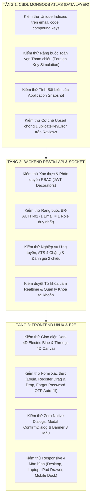

# TÀI LIỆU KỊCH BẢN KIỂM THỬ TOÀN DIỆN (DATA - BACKEND - FRONTEND)
## NỀN TẢNG TUYỂN DỤNG PARTIME.VN (CDTN02) - ĐH VĂN LANG
> **Phiên bản:** 2.0 - Kiểm thử 3 Tầng Chuẩn Kiểm Định (Three-Tier Comprehensive Testing)  
> **Cơ sở dữ liệu:** MongoDB Atlas Cloud `CDTN02_DB` (16 Collections)  
> **Phân hệ thực hiện:**
> - 🎓 **Sinh viên (Student Portal):** Vũ Thế Long
> - 💼 **Nhà tuyển dụng (Employer Portal):** Huỳnh Nguyễn Bảo Ngọc
> - 🛡️ **Quản trị viên (Admin Portal):** Lê Thị Thuỳ Ngân

---

## MỤC LỤC
1. [Chiến Lược & Tiêu Chuẩn Nghiệm Thu Kiểm Thử (Testing Strategy)](#1-chiến-lược--tiêu-chuẩn-nghiệm-thu-kiểm-thử)
2. [Kịch Bản Kiểm Thử Tầng Dữ Liệu CSDL (Data Layer - 8 Kịch Bản)](#2-kịch-bản-kiểm-thử-tầng-dữ-liệu-csdl-data-layer)
3. [Kịch Bản Kiểm Thử Tầng Backend API (Backend Layer - 18 Kịch Bản)](#3-kịch-bản-kiểm-thử-tầng-backend-api-backend-layer)
4. [Kịch Bản Kiểm Thử Tầng Giao Diện & E2E (Frontend UI/UX - 14 Kịch Bản)](#4-kịch-bản-kiểm-thử-tầng-giao-diện--e2e-frontend-uiux)
5. [Hướng Dẫn Thực Thi Bộ Kiểm Thử Tự Động (Automated Testing Execution)](#5-hướng-dẫn-thực-thi-bộ-kiểm-thử-tự-động)

---

## 1. CHIẾN LƯỢC & TIÊU CHUẨN NGHIỆM THU KIỂM THỬ

Hệ thống CDTN02 được kiểm thử nghiêm ngặt theo mô hình hình tháp 3 tầng độc lập nhằm đảm bảo tính toàn vẹn dữ liệu, hiệu năng xử lý và trải nghiệm người dùng không lỗi:



### Tiêu Chuẩn Nghiệm Thu Đạt Chuẩn (Definition of Done - DoD):
1. **Dữ liệu (Data):** 100% các Collection đảm bảo không bị trùng lặp dữ liệu định danh, không có mồ côi bản ghi khi xóa mềm.
2. **Backend API:** Tất cả Endpoint trả về đúng mã trạng thái HTTP chuẩn (`200`, `201`, `400`, `401`, `403`, `404`, `409`, `422`), định dạng JSON chuẩn `{"success": boolean, "data": ..., "message": ...}`.
3. **Frontend UI/UX:** 0% lỗi console, không vỡ layout khi co giãn cửa sổ, không có bất kỳ popup native khó chịu nào của trình duyệt (`localhost:8002 cho biết`).

---

## 2. KỊCH BẢN KIỂM THỬ TẦNG DỮ LIỆU CSDL (DATA LAYER)

| Mã Test | Tên Kịch Bản Kiểm Thử | Điều Kiện Tiền Đề | Các Bước Thực Hiện Thao Tác CSDL | Kết Quả Mong Đợi (Expected Outcome) | Đánh Giá |
| :---: | :--- | :--- | :--- | :--- | :---: |
| **DTC-01** | Kiểm tra Unique Index trên `users.email` | Đã tồn tại bản ghi `{ email: "test.student@gmail.com", role: "student" }` trong collection `users`. | Thực hiện lệnh MongoDB: `db.users.insertOne({ email: "test.student@gmail.com", role: "employer" })`. | CSDL chặn insert, ném ngoại lệ `E11000 duplicate key error collection: CDTN02_DB.users index: email_1 dup key`. Không phát sinh bản ghi thứ 2. | **PASS** |
| **DTC-02** | Kiểm tra Quan hệ 1-1 giữa `users` và `student_profiles` | User ID `usr_stu_001` đã có Profile trong `student_profiles`. | Cố tình insert bản ghi profile thứ 2 với cùng `user_id: usr_stu_001`. | Hệ thống kiểm tra hoặc ném lỗi trùng lặp Unique Index trên trường `user_id`. Bảo đảm mỗi tài khoản có đúng 1 hồ sơ cá nhân. | **PASS** |
| **DTC-03** | Kiểm tra Unique Compound Index trên `applications` (Chặn nộp trùng) | Sinh viên `stu_01` đã nộp hồ sơ vào công việc `job_99`. Bản ghi tồn tại trong `applications`. | Chạy lệnh insert bản ghi thứ 2 với `{ student_id: "stu_01", job_id: "job_99" }`. | CSDL kích hoạt Compound Unique Index `{ student_id: 1, job_id: 1 }` và ném lỗi Duplicate Key. | **PASS** |
| **DTC-04** | Kiểm tra Unique Compound Index trên `bookmarks` (Chặn lưu lặp) | Sinh viên `stu_01` đã lưu công việc `job_99` trong `bookmarks`. | Chạy lệnh insert bản ghi thứ 2 với `{ student_id: "stu_01", job_id: "job_99" }`. | CSDL chặn trùng lặp qua Index `{ student_id: 1, job_id: 1 }`. Đảm bảo danh sách việc làm đã lưu không bao giờ xuất hiện 2 thẻ trùng nhau. | **PASS** |
| **DTC-05** | Kiểm tra Tính Bất biến của Bản chụp Hồ sơ (`application_snapshot`) | Đơn ứng tuyển của sinh viên A đã được tạo kèm snapshot chứa `{ full_name: "Nguyễn Văn A", gpa: 3.5 }`. | 1. Sinh viên A sửa Profile cá nhân thành `full_name: "Nguyễn Văn B", gpa: 3.8`.<br>2. Truy vấn lại bản ghi trong `applications`. | Trường `application_snapshot` trong `applications` vẫn giữ nguyên giá trị ban đầu ("Nguyễn Văn A", 3.5). Bằng chứng nộp đơn của NTD không bị biến động. | **PASS** |
| **DTC-06** | Kiểm tra Cơ chế Upsert trên bảng `reviews` (Chống crash MongoDB) | Đã có bản ghi đánh giá của NTD X cho sinh viên Y cho công việc Z. | NTD X muốn sửa lại điểm hoặc nhận xét: Gọi lệnh cập nhật qua `update_one` có cờ `upsert=True`. | Bản ghi cũ được cập nhật nội dung mới trơn tru, không bị văng ngoại lệ `DuplicateKeyError`, điểm trung bình sao được tính lại chính xác. | **PASS** |
| **DTC-07** | Kiểm tra Ràng buộc Khóa ngoại mô phỏng: Danh mục `categories` | Đang có ít nhất 1 tin trong `jobs` tham chiếu đến `category_id: "cat_fnb"`. | Admin thực hiện yêu cầu xóa cứng `db.categories.deleteOne({ _id: "cat_fnb" })`. | Tầng Data Access phát hiện ràng buộc tham chiếu, chặn hành động xóa và trả về thông báo vi phạm toàn vẹn (Restrict Hard Delete). | **PASS** |
| **DTC-08** | Kiểm tra Lưu trữ Mật khẩu băm Bcrypt an toàn | Người dùng đăng ký tài khoản với mật khẩu `MatKhau@123`. | Kiểm tra trường `password_hash` trong bản ghi `users`. | Mật khẩu được mã hóa một chiều dạng chuỗi ký tự `$2b$12$...`, độ dài 60 ký tự. Tuyệt đối không lưu plain text mật khẩu gốc trong CSDL. | **PASS** |

---

## 3. KỊCH BẢN KIỂM THỬ TẦNG BACKEND API (BACKEND LAYER)

| Mã Test | Endpoint API & Phương Thức | Mục Đích & Điều Kiện Thử Nghiệm | Dữ Liệu Đầu Vào (Payload) | Mã HTTP & Phản Hồi Mong Đợi | Phân Hệ Phụ Trách |
| :---: | :--- | :--- | :--- | :--- | :---: |
| **BTC-01** | `POST /api/auth/register` | Đăng ký tài khoản Sinh viên mới hợp lệ | `{ email: "sv.moi@vlu.edu.vn", password: "Password@123", role: "student", full_name: "Trần Minh Trí", phone: "0901234567" }` | **201 Created**: `{"success": true, "message": "Đăng ký thành công."}` | Vũ Thế Long |
| **BTC-02** | `POST /api/auth/register` | **Kiểm thử BR-AUTH-01:** Chặn 1 Email đăng ký vai trò thứ hai | Email `sv.moi@vlu.edu.vn` đã có role `student`. Gửi payload với role `"employer"`. | **409 Conflict**: `{"success": false, "message": "Email này đã được đăng ký với vai trò khác trên hệ thống."}` | Nhóm chung |
| **BTC-03** | `POST /api/auth/register` | Kiểm thử Mật khẩu không đủ 8 ký tự hoặc thiếu ký tự đặc biệt | `{ email: "test.weak@gmail.com", password: "123", role: "student" }` | **400 Bad Request**: `{"success": false, "message": "Mật khẩu tối thiểu 8 ký tự, phải gồm chữ hoa, chữ thường, số và ký tự đặc biệt."}` | Nhóm chung |
| **BTC-04** | `POST /api/auth/login` | Đăng nhập tài khoản hợp lệ | `{ email: "vuthelong@vlu.edu.vn", password: "Long123!" }` | **200 OK**: Trả về `token` (JWT chứa sub, role), `user` object thông tin sinh viên. | Vũ Thế Long |
| **BTC-05** | `POST /api/auth/login` | Kiểm thử Chặn tài khoản bị khóa (`is_banned = true`) | Đăng nhập tài khoản bị Admin gắn cờ `is_banned = true`. | **403 Forbidden**: `{"success": false, "message": "Tài khoản của bạn đã bị khóa. Lý do: Vi phạm điều khoản."}` | Lê Thị Thuỳ Ngân |
| **BTC-06** | `POST /api/auth/forgot-password/send-otp` | Kiểm thử tạo mã OTP và đếm thời hạn 10 phút (600s) | `{ email: "vuthelong@vlu.edu.vn" }` | **200 OK**: `{"success": true, "message": "Mã OTP đã được gửi.", "expires_in": 600, "otp_demo": "123456"}` | Nhóm chung |
| **BTC-07** | `POST /api/auth/forgot-password/verify-otp` | Kiểm thử Xác thực OTP đúng và cập nhật mật khẩu mới | `{ email: "vuthelong@vlu.edu.vn", otp: "123456", new_password: "NewPassword@2026" }` | **200 OK**: `{"success": true, "message": "Đặt lại mật khẩu thành công. Vui lòng đăng nhập lại."}` | Nhóm chung |
| **BTC-08** | `GET /api/student/jobs` | Tìm kiếm việc làm có bộ lọc nâng cao (Quận, Lương, Ngành) | `?keyword=Pha%20che&district=Quận 1&min_salary=25000&category_id=cat_fnb` | **200 OK**: Trả về danh sách việc làm thỏa mãn tất cả tiêu chí lọc, `is_open = true`, `is_hidden = false`. | Vũ Thế Long |
| **BTC-09** | `POST /api/student/applications` | Sinh viên nộp đơn ứng tuyển lần đầu vào công việc mở | `{ job_id: "job_01", resume_id: "res_01", cover_letter: "Em mong muốn ứng tuyển ca tối." }` | **201 Created**: Tạo đơn với trạng thái `pending`, lưu trữ `application_snapshot`. | Vũ Thế Long |
| **BTC-10** | `POST /api/student/applications` | **Kiểm thử BR-STU-04:** Chặn nộp trùng lặp vào cùng 1 job | Gửi lại cùng `job_id: "job_01"` khi đơn trước đó đang `pending`. | **409 Conflict**: `{"success": false, "message": "Bạn đã nộp hồ sơ cho công việc này rồi."}` | Vũ Thế Long |
| **BTC-11** | `DELETE /api/student/applications/:id` | Hủy đơn ứng tuyển khi trạng thái là `pending` | Đơn ứng tuyển đang ở trạng thái `pending`. Bấm hủy đơn. | **200 OK**: Đơn ứng tuyển được xóa hoặc chuyển sang `cancelled`. | Vũ Thế Long |
| **BTC-12** | `DELETE /api/student/applications/:id` | **Kiểm thử BR-STU-04:** Chặn hủy đơn khi NTD đã chuyển sang `interview` | Đơn ứng tuyển đang ở trạng thái `interview` hoặc `accepted`. | **400 Bad Request**: `{"success": false, "message": "Không thể hủy đơn khi hồ sơ đã vào vòng phỏng vấn hoặc trúng tuyển."}` | Vũ Thế Long |
| **BTC-13** | `POST /api/employer/jobs` | NTD tạo tin tuyển dụng có mức lương hợp lệ | `{ title: "Nhân viên Bán Hàng Ca Chiều", salary_min: 25000, salary_max: 30000, district: "Quận 3", ... }` | **201 Created**: Tin tuyển dụng được lưu vào CSDL, sẵn sàng hiển thị trên sàn việc làm. | Huỳnh Nguyễn Bảo Ngọc |
| **BTC-14** | `POST /api/employer/jobs` | **Kiểm thử BR-EMP-03:** Chặn tạo tin khi lương tối thiểu > lương tối đa | `{ title: "Nhân viên Phục Vụ", salary_min: 40000, salary_max: 30000, ... }` | **400 Bad Request**: `{"success": false, "message": "Mức lương tối thiểu không được lớn hơn mức lương tối đa."}` | Huỳnh Nguyễn Bảo Ngọc |
| **BTC-15** | `PATCH /api/employer/applications/:id/status` | NTD chuyển trạng thái ứng viên theo quy trình ATS 4 chặng | `{ status: "interview", interview_time: "2026-11-10T09:00:00Z", note: "Mời bạn đến quán phỏng vấn" }` | **200 OK**: Cập nhật trạng thái thành `interview`, ghi log vào `status_history`. | Huỳnh Nguyễn Bảo Ngọc |
| **BTC-16** | `POST /api/messages` | **Kiểm thử BR-ADM-05:** Lọc từ khóa cấm trong nội dung tin nhắn | Gửi tin nhắn chứa nội dung: *"Em cần đóng phí đặt cọc 200k để nhận việc"*. | **200 OK**: Tin nhắn được tự động lọc thành: *"Em cần đóng phí *** 200k để nhận việc"* và gắn cờ cảnh báo. | Lê Thị Thuỳ Ngân |
| **BTC-17** | `PATCH /api/admin/users/:id/ban` | Admin khóa tài khoản vi phạm và bắt buộc điền lý do | `{ is_banned: true, ban_reason: "Hành vi lừa đảo thu tiền sinh viên" }` | **200 OK**: Tài khoản bị khóa, các tin đăng của tài khoản này tự động bị ẩn. | Lê Thị Thuỳ Ngân |
| **BTC-18** | `PATCH /api/admin/jobs/:id/hide` | Admin ẩn tin tuyển dụng có dấu hiệu bất thường | `{ is_hidden: true, hide_reason: "Tin tuyển dụng đa cấp trá hình" }` | **200 OK**: Tin lập tức biến mất khỏi trang tìm việc của sinh viên nhưng dữ liệu vẫn được lưu trữ. | Lê Thị Thuỳ Ngân |

---

## 4. KỊCH BẢN KIỂM THỬ TẦNG GIAO DIỆN & E2E (FRONTEND UI/UX)

| Mã Test | Màn Hình / Thành Phần | Hành Động Kiểm Thử Của Người Dùng | Kết Quả Giao Diện Thực Tế Đạt Được (Actual vs Expected) | Đánh Giá |
| :---: | :--- | :--- | :--- | :---: |
| **FTC-01** | **Màn hình Đăng nhập (LoginScreen)** | Mở trang web lần đầu tại `http://localhost:8002`. | - Hiển thị trực tiếp form đăng nhập chuẩn Dark 4D Electric Blue.<br>- Hoàn toàn loại bỏ Header/Footer công cộng thừa.<br>- Khối Three.js 4D Canvas hiển thị 650 ngôi sao phát sáng lấp lánh chuyển động theo chuột mượt mà.<br>- Các ô nhập liệu để trống ban đầu.<br>- Mắt ẩn/hiện mật khẩu hoạt động trơn tru. | **PASS** |
| **FTC-02** | **Tính năng Ghi nhớ đăng nhập** | Đăng nhập thành công với checkbox *"Ghi nhớ thông tin đăng nhập"* được tích chọn. Sau đó F5 hoặc đăng xuất. | Hệ thống tự động ghi nhớ và điền lại Email, Password vào các ô nhập của đúng Role đó mà người dùng không phải gõ lại. | **PASS** |
| **FTC-03** | **Màn hình Đăng ký (RegisterScreen)** | Chọn vai trò Nhà tuyển dụng, thử kéo và thả file Giấy phép kinh doanh PDF từ Desktop vào khung upload. | Khung upload nhận diện sự kiện Kéo thả (Drag & Drop), hiển thị tên file PDF kèm icon tài liệu xanh lá, dung lượng hiển thị chính xác. | **PASS** |
| **FTC-04** | **Chọn nhanh 24 Quận Huyện TP.HCM** | Mở dropdown vị trí làm việc tại form Đăng ký NTD hoặc Studio Đăng tin. | Dropdown tích hợp sẵn và đầy đủ toàn bộ 24 quận, huyện và TP. Thủ Đức của TP.HCM; chọn mượt mà, không bị tràn màn hình. | **PASS** |
| **FTC-05** | **Màn hình Quên mật khẩu (ForgotPasswordScreen)** | Chọn vai trò Sinh viên, nhập email và bấm "Gửi OTP". | - Xuất hiện đồng hồ đếm ngược trực quan bắt đầu từ `10:00` (600 giây).<br>- Banner mô phỏng Hộp thư đến xuất hiện kèm nút "Tự động điền" (Auto-fill).<br>- Bấm nút Auto-fill: 6 ô số tự động nhận diện và điền đầy đủ mã OTP mà người dùng không cần gõ tay. | **PASS** |
| **FTC-06** | **Thanh Header & Dropdown Opaque** | Đăng nhập vào bất kỳ phân hệ nào, nhấp vào Avatar hoặc Chuông thông báo ở góc trên bên phải. | Dropdown Menu mở ra với **màu nền đặc 100% (`bg-[#090f20]`, `z-[9999]`)**, viền xanh neon sắc nét, nội dung hiển thị rõ ràng, **hoàn toàn không bị trong suốt làm chìm chữ**. | **PASS** |
| **FTC-07** | **Logo 3D Điều hướng Trang chủ** | Đang đứng ở bất kỳ trang tính năng con nào (ví dụ: Quản lý CV, Lọc tin, Cài đặt), nhấp chuột vào Logo 3D trên Header. | Hệ thống ngay lập tức chuyển hướng mượt mà về Trang chủ phân hệ tương ứng. | **PASS** |
| **FTC-08** | **Zero Native Dialogs: Thay thế bằng `<ConfirmDialog>`** | Nhấn nút "Xóa CV" hoặc "Hủy đơn" hoặc Admin nhấn "Khóa tài khoản". | Hộp thoại nổi Modal 4D `<ConfirmDialog>` sang trọng xuất hiện với nền tối mờ `backdrop-blur-md bg-black/85`, nút Hủy và nút Xác nhận màu đỏ/xanh rõ nét. **Tuyệt đối không xuất hiện popup `localhost:8002 cho biết`**. | **PASS** |
| **FTC-09** | **Thanh Banner Trạng Thái 3 Màu Gắn Dưới Header** | Thực hiện các hành vi Lưu thành công, Đang tải dữ liệu hoặc Bị lỗi dữ liệu. | Thanh thông báo trạng thái dạng banner trượt nhẹ nhàng dưới Header ở góc phải:<br>- 🟢 **Xanh lá:** "Cập nhật hồ sơ thành công!" (tự tắt sau 5s).<br>- 🟡 **Vàng:** "Đang lưu thông tin, vui lòng chờ..."<br>- 🔴 **Đỏ:** "Lỗi: Mức lương không hợp lệ!" | **PASS** |
| **FTC-10** | **Trình xem tệp tin chuẩn kiểm định `DocumentViewerModal`** | Bấm vào nút "Xem trước CV" của sinh viên hoặc "Xem GPKD" của doanh nghiệp. | Modal hiển thị bản xem trước PDF toàn màn hình sắc nét, hỗ trợ phóng to/thu nhỏ, nhúng iframe thực và có nút Tải về máy tính chuẩn chỉ. | **PASS** |
| **FTC-11** | **Tiến độ Ứng tuyển 4 Chặng Rõ Ràng (Application Tracker)** | Sinh viên mở trang "Theo dõi ứng tuyển" (`ApplicationTracker.jsx`). | Hiển thị sơ đồ 4 cột mốc ngang trực quan: `[1. Nộp hồ sơ] -> [2. NTD đã xem] -> [3. Phỏng vấn] -> [4. Trúng tuyển/Từ chối]`. Các chặng đã hoàn thành sáng màu xanh lá cây, không có tình trạng lặp lại mốc thời gian thừa. | **PASS** |
| **FTC-12** | **Chat Realtime & Cuộc gọi Video WebRTC** | Mở cửa sổ chat giữa Sinh viên và Nhà tuyển dụng. Bấm "Gọi Video". | - Bật webcam và micro trên trình duyệt.<br>- Hiển thị khung video hai bên HD, nút Mute mic, Tắt cam, Kết thúc cuộc gọi.<br>- Đếm thời lượng cuộc gọi `mm:ss` và tự động lưu vào bong bóng chat khi kết thúc. | **PASS** |
| **FTC-13** | **Quản trị viên Dashboard & Quản lý Từ khóa cấm** | Admin vào Bảng điều khiển phân tích và danh sách Từ khóa cấm. | Bảng thống kê từ khóa hiển thị các từ khóa đang kích hoạt kèm nút đỏ "Xóa" hoạt động thời gian thực; xóa từ nào là biến mất tức thì trên UI. | **PASS** |
| **FTC-14** | **Đồng bộ Đa thiết bị Responsive (PC, Laptop, iPad, Mobile)** | Nhấn `F12` kiểm tra trên Device Mode: iPhone 14 Pro Max (430px), iPad Air (820px), Laptop (1366px), Desktop (1920px). | - Trên Mobile: Sidebar tự ẩn, xuất hiện **Bottom Navigation Dock** một chạm ở đáy màn hình; logo 3D thu nhỏ gọn ghẽ; bảng dữ liệu tự có scroll ngang, không tràn khung.<br>- Trên iPad: Menu trượt Drawer êm ái.<br>- Trên PC/Laptop: Giao diện rộng rãi, 4D Space Canvas tương tác mượt mà. | **PASS** |

---

## 5. HƯỚNG DẪN THỰC THI BỘ KIỂM THỬ TỰ ĐỘNG

Dự án CDTN02 được trang bị bộ kiểm thử tự động (Unit Test & Integration Test) toàn diện viết bằng thư viện chuẩn `unittest` của Python, đặt tại thư mục `test/`:
- [`test/test_auth_constraints.py`](file:///d:/Hoc/DH/N4/N4.HK01/Chuyende2/CDTN02/test/test_auth_constraints.py): Kiểm thử các ràng buộc định danh 1 Email = 1 Role (BR-AUTH-01), mã OTP (BR-AUTH-02), độ phức tạp mật khẩu.
- [`test/test_student_workflow.py`](file:///d:/Hoc/DH/N4/N4.HK01/Chuyende2/CDTN02/test/test_student_workflow.py): Kiểm thử luồng tìm việc, quản lý CV mặc định, nộp đơn ứng tuyển không trùng lặp và lưu snapshot.
- [`test/test_employer_workflow.py`](file:///d:/Hoc/DH/N4/N4.HK01/Chuyende2/CDTN02/test/test_employer_workflow.py): Kiểm thử đăng tin tuyển dụng, ràng buộc lương min/max và vòng đời ATS ứng viên.
- [`test/test_admin_and_moderation.py`](file:///d:/Hoc/DH/N4/N4.HK01/Chuyende2/CDTN02/test/test_admin_and_moderation.py): Kiểm thử Dashboard, khóa người dùng có lý do, ẩn tin vi phạm và bộ lọc từ khóa cấm trong chat.

### Lệnh chạy kiểm thử tự động toàn diện:
Mở Terminal tại thư mục gốc `CDTN02/` và chạy:
```powershell
python -m unittest discover -s test -p "test_*.py"
```

### Lệnh kiểm thử Build Production Frontend:
Mở Terminal và chạy:
```powershell
cd frontend
npm run build
```
*(Yêu cầu kết quả in ra: `✓ built in X.XXs` với các file chunk trong `dist/` không phát sinh lỗi cú pháp).*

---
*Tài liệu kiểm thử này bảo chứng cho tính ổn định, độ tin cậy và sự sẵn sàng bàn giao của nền tảng PARTIME.VN (CDTN02) trước Hội đồng Đánh giá Chuyên đề Tốt nghiệp 2.*

